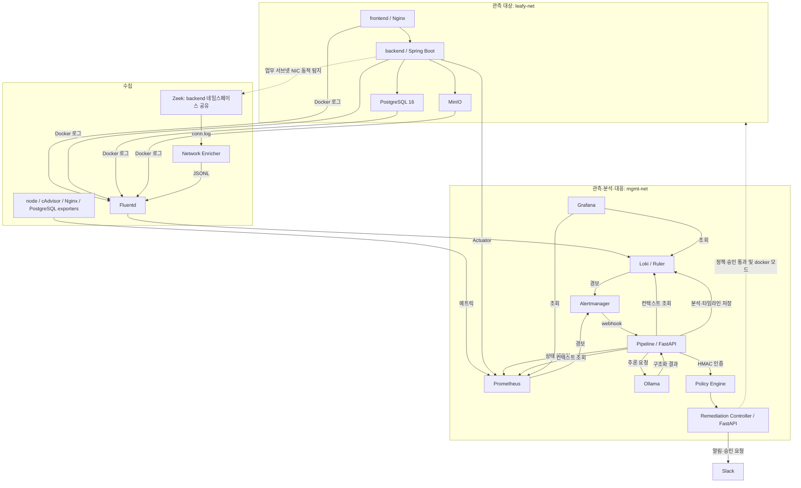
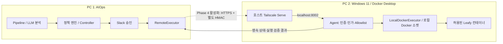

# Leafy AIOps

## 프로젝트 소개

Leafy AIOps는 건국대학교 컴퓨터공학과 졸업 프로젝트로, 웹 애플리케이션의 장애와 보안 이상을 관측하고 로컬 LLM으로 원인을 분석하는 시스템입니다. 운영자가 경보를 받은 뒤 로그·메트릭·네트워크 정보를 각각 찾아야 하는 반복 작업을 줄이기 위해, 경보 발생 시점과 대상 서비스를 기준으로 데이터를 모아 근본 원인 분석(RCA)과 권장 조치를 생성합니다.

이 저장소는 수집·탐지 설정, FastAPI 기반 분석·대응 서비스, Grafana 대시보드, 실험 도구를 포함합니다. 관측 대상인 **Leafy frontend/backend 소스는 포함하지 않으며**, Compose에서 `gicks/ai-ops-leafy-frontend`, `gicks/ai-ops-leafy-backend` 이미지를 사용합니다. 단일 PC 통합 구성과 Tailscale 기반 2대 PC 구성을 제공합니다. **Phase 3 원격 Remediation Agent의 코드 구현·모의 테스트는 완료했으며, 기본 실행 모드는 `disabled`입니다.** 실제 PC 2 배포·운영 활성화·S2 원격 조치 E2E는 Phase 4에서 검증합니다. 일부 원격 메트릭 수집도 추가 구성이 필요합니다.

## 주요 기능

- **로그 수집·정규화**: Docker fluentd 드라이버 → Fluentd → Loki. JSON/텍스트 정규화, Docker partial 로그 재조립, 서비스 라벨 부여, 큰 로그 크기 제한을 처리합니다. 원격 호스트 PostgreSQL 17 jsonlog는 Fluent Bit으로 별도 인증 포트에 전송합니다.
- **네트워크 관측**: Zeek가 backend 네트워크 네임스페이스에서 연결을 관측하고 Python Enricher가 서비스 식별 정보를 붙인 Canonical Network Event JSONL을 생성합니다.
- **메트릭·규칙 기반 탐지**: 통합 구성에서 Prometheus와 node-exporter·cAdvisor·nginx-exporter·postgres-exporter를 사용합니다. Prometheus 규칙 6개와 Loki 규칙 11개(보안 9개·네트워크 2개)가 선언되어 있습니다. 규칙 선언과 실제 발화 여부는 구분해야 합니다.
- **LLM 원인 분석**: Pipeline이 경보 전후 5분의 메트릭·앱 로그·네트워크 컨텍스트를 수집하고 Ollama에 전달합니다. 원인, 조치 유형·대상, 위협 심각도(`threat_level`), 근거, 신뢰도를 구조화합니다. 조치 위험도(`action_risk`)는 LLM 출력이 아닌 정책 엔진이 결정합니다.
- **정책 판단·인증된 승인**: [정책 파일](aiops/policy/remediation_policy.yml)이 실행 조건을 정합니다. RESTART·PAUSE·ISOLATE는 승인 필수이며, 로컬 THROTTLE의 자동 실행 후보는 신뢰도 0.8 이상·위협 medium/high 조건을 요구합니다. 원격 모드는 THROTTLE도 수동 승인으로 전환합니다. Pipeline 요청은 HMAC, Slack 콜백은 Slack 서명으로 검증합니다.
- **원격 실행·검증·복구**: PC 1 RemoteExecutor → Tailscale/HTTPS → PC 2 Agent 경로를 제공합니다. Agent는 별도 HMAC·Allowlist·컨테이너 ID/이미지/라벨을 검증하고, 조치 전 증거와 멱등성 상태를 영속 저장합니다. 실행 후 Docker 상태를 확인하며, 원격 결과를 확인할 수 없으면 `UNKNOWN`으로 기록합니다.
- **시각화·실험**: Grafana에서 메트릭·로그·분석 이력을 조회하고, `scenarios/`와 `aiops/eval/`에서 장애·보안 시나리오 및 LLM 평가 도구를 제공합니다.

## 시스템 아키텍처

다음은 **단일 PC 통합 구성**의 흐름입니다. 화살표는 구현된 연결 관계이며 현재 실행 상태를 뜻하지 않습니다.



`leafy-net`은 `10.210.0.0/24`이며 frontend IP는 `10.210.0.10`입니다. backend와 일부 수집기는 관리 네트워크에도 연결됩니다. Zeek는 `network_mode: service:backend`로 backend 네임스페이스를 공유하며 업무 서브넷의 route와 `ifindex`를 주기적으로 검사합니다. NIC가 사라지면 관측 인터페이스 표시를 비우고, 재연결되면 해당 NIC로 캡처를 다시 시작합니다. backend 네임스페이스 자체가 교체되는 경우에는 observer 재생성이 필요할 수 있습니다.

**원격 구성**에서는 Leafy 앱·호스트 PostgreSQL 17·Zeek/Enricher·Fluent Bit이 PC 2에 있고, PC 1에는 수집·저장·분석·대응 서비스 8개가 있습니다. Docker 로그와 네트워크 이벤트는 Tailscale의 24224/TCP, PostgreSQL 로그는 공유 키 인증을 사용하는 24225/TCP로 PC 1 Fluentd에 전달합니다. Pipeline의 `TARGET_SERVICE_MAP`으로 원격 대상을 식별합니다. Phase 3 Agent는 PC 2에 추가 배포할 별도 서비스이며 기존 수집 구성만 실행해도 활성화되지는 않습니다.



LLM·정책·Slack 승인은 PC 1에 유지합니다. Agent는 정책 판단을 다시 하지 않지만 독립적인 실행 권한 검증을 수행합니다. Docker Engine TCP API와 Tailscale Funnel은 사용하지 않습니다. 원격 경로는 구현되어 있으나 실제 운영 활성화는 Phase 4 범위입니다.

상세 자료: [현재 아키텍처와 기존 도면](docs/architecture/README.md), [원격 수집 배포](docs/remote/REMOTE_DEPLOYMENT.md), [Phase 3 Agent 구현·배포·인계](docs/remote/PHASE3_REMOTE_AGENT.md), [Phase 3 검증 기록](docs/remote/PHASE3_VERIFICATION.md), [네트워크 이벤트 스키마](docs/network-observability/NETWORK_EVENT_SCHEMA.md).

## 기술 스택

| 영역 | 코드·설정에서 확인한 기술 |
|---|---|
| 분석·대응 API | Python 3.11 컨테이너, FastAPI, Uvicorn, Pydantic 2, HTTPX |
| 대응 정책·상태 | PyYAML 정책, Controller JSON 상태 저장소, Agent SQLite, Docker SDK, HMAC-SHA256 |
| 네트워크 Enricher | Python 3.12 컨테이너, Docker SDK 7.1.0, PyYAML 6.0.2 |
| LLM | Ollama, Compose 모델 `llama3.2:3b` |
| 로그 | Fluentd 1.16, Ruby 필터, fluent-plugin-grafana-loki 1.3.0, fluent-plugin-concat 2.6.2, Loki, 원격 Fluent Bit |
| 메트릭·알림·시각화 | Prometheus, Alertmanager, Grafana, node-exporter, cAdvisor, Nginx/PostgreSQL exporters, Slack webhook |
| 네트워크·배포 | Zeek, Docker Compose v2, 원격 Tailscale, 선택적 NVIDIA GPU 오버레이 |
| 관측 대상 | 외부 Leafy Nginx/Spring Boot 이미지, PostgreSQL 16(통합) / 호스트 17(원격), MinIO |

현재 추적 파일에는 루트 `package.json`, 공통 Python 의존성 파일, GitHub Actions 워크플로가 없습니다. Python 의존성은 서비스별 `requirements.txt`, 실행 진입점은 각 `Dockerfile`에 있습니다. 다수 인프라 이미지는 `latest`를 사용합니다.

## 디렉터리 구조

```text
.
├── aiops/
│   ├── pipeline/          # 경보 수신, 컨텍스트 수집·상관, 프롬프트, 스키마·테스트
│   ├── remediation/       # 정책·Controller, agent/, 로컬·원격 executor/, 인증·복구·테스트
│   ├── policy/            # 조치 정책과 네트워크 통신 Allowlist
│   ├── network-observer/  # Zeek 설정, 연결 이벤트 정규화·서비스 식별
│   └── eval/              # LLM 평가 케이스·실행기·기록
├── leafy/
│   ├── fluentd/           # 이미지, 수집 라우팅, Ruby 필터·테스트
│   └── db/                # 통합 PostgreSQL 초기화 SQL
├── monitoring/            # Prometheus, Loki, Alertmanager, Grafana provisioning
├── deploy/                # PC 2 수집·Agent 배포 예시, PC 1 원격 override·연결 확인 도구
├── testing/               # Docker·외부 IO 차단 테스트 실행기, Zeek supervisor 모의 검사
├── scenarios/             # 장애·보안 재현, TUI, 배치·평가 도구와 기록
└── docs/                  # 아키텍처, 원격 배포, 네트워크 PoC, 설계·검증 이력
```

루트에는 `.env.example`, 통합 구성 `docker-compose.yml`, 원격 구성 `docker-compose.aiops.yml`, GPU 오버레이 `docker-compose.gpu.yml`이 있습니다. `docs/verification/current_info_files/`는 구현 전 설계 기준선도 포함하므로 기능 구현 여부는 현재 소스와 함께 확인해야 합니다.

## 설치 및 실행 방법

### 준비 및 환경 변수

Docker와 Compose v2를 준비합니다. Windows에서는 Linux 컨테이너를 실행할 수 있는 Docker Desktop 환경을 사용합니다. Python 서비스만 로컬 실행하려면 Python과 가상환경이 필요합니다. 아래 셸 예시는 **저장소 루트에서 PowerShell 기준**입니다.

```powershell
git clone https://github.com/KU-GraduationProject/graduation-project.git
cd graduation-project
Copy-Item .env.example .env  # 최초 설정 때만 실행
```

`.env`의 빈 값을 채우고 커밋하지 않습니다. 기존 `.env`가 있으면 복사로 덮어쓰지 말고 필요한 항목을 추가합니다.

| 변수 | 용도 및 적용 구성 |
|---|---|
| `JWT_SECRET_KEY_DEV` | 통합 필수. backend dev 인증용 Base64 인코딩 256bit 이상 키 |
| `STORAGE_ACCESS_KEY`, `STORAGE_SECRET_KEY` | 통합 필수. backend/MinIO 공통 자격 증명, secret 8자 이상 |
| `DB_PASSWORD` | 통합 DB·backend·exporter 공통 비밀번호 |
| `FRONTEND_TAG`, `BACKEND_TAG`, `LEAFY_BIND_IP` | 통합 이미지 태그(기본 `latest`), frontend 바인딩 IP(기본 `127.0.0.1`) |
| `GRAFANA_PASSWORD`, `SLACK_WEBHOOK_URL` | Grafana 관리자 비밀번호(기본 `admin`), 선택적 Slack 알림 |
| `REMEDIATION_API_KEY` | Pipeline → Controller `/action` 및 `/remote/reconcile` HMAC 공유키. 양쪽에 같은 값 설정. 없으면 Pipeline 전달 생략·Controller 인증 거부 |
| `SLACK_SIGNING_SECRET` | Slack `/slack/action` 요청 검증용. webhook URL과 별개이며 없으면 승인·복구 콜백 거부 |
| `REMEDIATION_MODE` | `disabled`(기본), `docker`(PC 1 로컬 실행), `remote`(PC 2 Agent). 통합 Compose는 `.env` 값을 읽으며 원격 기본 Compose는 disabled 고정 |
| `PLANT_ID_API_KEY`, `OPENAI_API_KEY`, `NONGSARO_API_KEY`, `AIR_PURIFIY_KEY`, `OPEN_WEATHER_API_KEY` | 외부 Leafy 앱 API 설정. AIOps RCA는 Ollama 사용 |
| `AIOPS_TAILSCALE_IP`, `FLUENTD_PG_SHARED_KEY` | 원격 필수. 수집기 바인딩 IP와 대상 PC Fluent Bit의 공유 키 |
| `GRAFANA_BIND_IP` | 원격 Grafana 바인딩 IP(기본 `127.0.0.1`) |

원격 Agent 설정은 [Phase 3 배포 문서](docs/remote/PHASE3_REMOTE_AGENT.md)를 따릅니다. PC 1의 `REMEDIATION_AGENT_URL`·`AGENT_CONTROLLER_ID`, 양쪽의 **별도** `AGENT_HMAC_KEY_FILE`(또는 `AGENT_HMAC_KEY`), PC 2의 `AGENT_ALLOWLIST_PATH`·`AGENT_STATE_PATH`·`AGENT_MODE`를 사용합니다. Agent 키를 Pipeline 키나 Slack secret과 공유하지 않습니다. 실제 키와 대상 ID가 들어간 allowlist는 커밋하지 않습니다.

Pipeline의 `LLM_MODEL`, `LLM_TIMEOUT`, `PROMETHEUS_URL`, `LOKI_URL`, `OLLAMA_URL`, `REMEDIATION_URL`은 Compose의 `environment`에 직접 지정되어 있습니다. `.env`에 같은 이름만 추가해도 덮어써지지 않습니다. 변경하려면 Compose 환경 설정이나 오버레이를 수정합니다. 로컬 Python에서는 프로세스 환경 변수로 지정합니다. `config.py`의 모델 기본값은 `llama3.1:8b`이므로 아래에서는 Compose와 같은 모델을 명시합니다.

### Docker: 단일 PC 통합 구성

먼저 정적으로 설정을 검사합니다. `config --quiet`는 비밀값을 출력하지 않습니다.

```powershell
docker compose -f docker-compose.yml config --quiet
docker compose -f docker-compose.yml up -d --build fluentd
docker compose -f docker-compose.yml up -d --build frontend backend db minio node-exporter cadvisor nginx-exporter postgres-exporter prometheus alertmanager loki grafana ollama pipeline network-observer-zeek network-observer-enricher
docker exec ollama ollama pull llama3.2:3b
docker compose -f docker-compose.yml ps
```

로그 드라이버가 연결할 Fluentd를 먼저 시작합니다. 위 목록은 **Remediation을 새로 기동하지 않는 관측·분석 구성**이며, 이미 실행 중인 Remediation을 중지하지는 않습니다. Pipeline은 대응 서비스가 없으면 전달 실패를 기록할 수 있습니다. 판단·승인 기록까지 확인하려면 아래 서비스를 별도로 기동합니다. 통합 구성 기본값은 `disabled`이며 `.env`나 셸에 `REMEDIATION_MODE=docker/remote`가 이미 설정되어 있다면 그 값이 적용되므로 먼저 확인합니다. disabled에서도 Slack 설정이 있으면 알림·승인 요청은 발송될 수 있습니다.

```powershell
docker compose -f docker-compose.yml up -d --build remediation
```

GPU 사용 시 위 명령의 `-f docker-compose.yml` 대신 `-f docker-compose.yml -f docker-compose.gpu.yml`을 사용합니다. 이 오버레이는 Ollama에 NVIDIA GPU를 요청하며 드라이버와 Docker GPU 지원이 필요합니다.

통합 구성은 Fluentd 컨테이너에 PostgreSQL 공유 키 변수를 전달하지 않으며 24225도 publish하지 않습니다. 호스트 PostgreSQL 로그 수신은 아래 원격 구성을 기준으로 설정합니다.

<!-- TODO: 최신 Fluentd 설정의 통합 구성 기동(24225 shared_key 미전달 포함)을 Docker 엔진이 있는 환경에서 검증한다. -->

### Docker: 2대 PC 원격 수집 구성

두 구성은 `container_name`이 겹치므로 같은 PC에서 동시에 실행하지 않습니다. 전환이 필요하면 사용 중인 구성의 `down`으로 컨테이너를 정리하고 볼륨은 보존합니다(`-v` 제외). Tailscale 연결·공유·ACL을 먼저 설정하고 `.env`의 원격 필수값을 채웁니다.

```powershell
docker compose -f docker-compose.aiops.yml config --quiet
docker compose -f docker-compose.aiops.yml up -d --build
docker exec ollama ollama pull llama3.2:3b
docker compose -f docker-compose.aiops.yml ps
```

GPU 실행은 `docker compose -f docker-compose.aiops.yml -f docker-compose.gpu.yml up -d --build`입니다. Leafy 앱·DB·exporter·Zeek는 AIOps PC에 실행하지 않습니다. 대상 PC는 [배포 안내](deploy/leafy-pc/README.md)에 따라 Docker 로그, PostgreSQL Fluent Bit, [Network Observer](deploy/leafy-pc/network-observer/docker-compose.yml)를 설정합니다.

Prometheus 원격 대상은 [targets 안내](monitoring/prometheus/targets/README.md)에 따라 `.yml.example`을 복사하고 실제 주소로 변경합니다. 대상 PC의 메트릭 포트와 exporter가 준비되기 전에는 해당 지표를 수집할 수 없습니다. 원격 구성에는 cAdvisor/node-exporter도 없어 CPU·메모리·재시작 탐지를 통합 구성과 동일하게 사용할 수 없습니다. 세부 상태는 [원격 배포 문서](docs/remote/REMOTE_DEPLOYMENT.md)에 있습니다.

원격 조치의 PC 2 기본 설정은 [Agent Compose](deploy/leafy-pc/remediation-agent/compose.yml)이며 **disabled·Docker 소켓 미마운트·127.0.0.1:8002 게시·빈 Allowlist 예시**로 시작합니다. [live override](deploy/leafy-pc/remediation-agent/compose.live.yml)와 [PC 1 remote override](deploy/aiops-pc/remediation-remote.example.yml)는 Phase 4에서 명시적으로 적용합니다. 키 배포, Tailscale Serve/ACL, Windows 방화벽·LAN 노출 검사, Disabled → Live, 긴급 중단은 [Phase 3 절차](docs/remote/PHASE3_REMOTE_AGENT.md)를 따릅니다. Agent 상태 볼륨은 멱등성·복구 근거이므로 삭제하지 않습니다.

<!-- TODO: 원격 메트릭 포트·exporter 배치 합의 및 CPU·메모리·재시작 탐지 경로 검증을 완료한다. -->

### Python 의존성 설치 및 로컬 실행

Pipeline과 Remediation은 각각 자신의 디렉터리를 기준으로 import합니다. 개발용 공통 가상환경 설치 예시입니다.

```powershell
python -m venv .venv
.\.venv\Scripts\python.exe -m pip install -r aiops/pipeline/requirements.txt -r aiops/remediation/requirements.txt
# Network Observer 및 시나리오 회귀 테스트도 실행할 때
.\.venv\Scripts\python.exe -m pip install -r aiops/network-observer/requirements.txt rich
```

Docker로 Prometheus·Loki·Ollama를 준비하고 모델을 내려받은 뒤, Pipeline을 별도 터미널에서 실행합니다. Python 코드는 `.env`를 자동으로 읽지 않습니다.

```powershell
$env:PROMETHEUS_URL = 'http://127.0.0.1:9090'
$env:LOKI_URL = 'http://127.0.0.1:3100'
$env:OLLAMA_URL = 'http://127.0.0.1:11434'
$env:REMEDIATION_URL = 'http://127.0.0.1:8001'
$env:REMEDIATION_API_KEY = '<Controller와 동일한 공유키로 교체>'
$env:LLM_MODEL = 'llama3.2:3b'
Set-Location aiops/pipeline
..\..\.venv\Scripts\python.exe -m uvicorn main:app --host 127.0.0.1 --port 8000
```

Remediation은 다른 터미널에서 저장소 루트부터 실행합니다. 이 예시는 조치를 비활성화합니다.

```powershell
$env:REMEDIATION_MODE = 'disabled'
$env:REMEDIATION_API_KEY = '<Pipeline과 동일한 공유키로 교체>'
# Slack 상호작용을 연결하는 경우 실제 Signing Secret을 설정합니다.
# $env:SLACK_SIGNING_SECRET = '<Slack app Signing Secret>'
$env:REMEDIATION_STATE_DIR = Join-Path $env:LOCALAPPDATA 'LeafyAIOps/remediation-state'
$env:LOKI_URL = 'http://127.0.0.1:3100'
Set-Location aiops/remediation
..\..\.venv\Scripts\python.exe -m uvicorn main:app --host 127.0.0.1 --port 8001
```

Compose의 Pipeline/Remediation을 실행 중이면 해당 서비스를 중지하거나 로컬 포트를 변경해야 합니다. 호스트 서비스는 Compose 내부의 `pipeline`/`remediation` DNS 경로를 자동으로 대체하지 않습니다. Windows 직접 Python 실행에서는 코드가 사용하는 Unix Docker 소켓(`/var/run/docker.sock`)으로 메타데이터를 읽을 수 없어, 컨테이너 메트릭·서비스 자동 식별 검증에는 Docker 구성을 사용합니다. 원격 대상에는 `TARGET_SERVICE_MAP`을 지정할 수 있습니다([correlation.py](aiops/pipeline/correlation.py)).

### 테스트 및 검증 범위

저장소 루트에서 **격리 실행기**로 실행합니다. 일반 `unittest discover`를 직접 사용하지 않습니다. 이 실행기는 테스트 수집 전에 Docker 클라이언트 생성, 외부 소켓·DNS, subprocess, Docker socket/pipe 접근을 차단하고 실제 Slack/Agent 설정을 제거합니다. Docker는 FakeDocker/Mock, Agent HTTP는 메모리 transport로 검증합니다. 네트워크 회귀 테스트는 자신이 만든 임시 루프백 서버에만 접속합니다.

```powershell
.\.venv\Scripts\python.exe testing/run_isolated.py remediation
.\.venv\Scripts\python.exe testing/run_isolated.py pipeline
.\.venv\Scripts\python.exe testing/run_isolated.py network
.\.venv\Scripts\python.exe testing/run_isolated.py observer
# Git for Windows 기본 설치 경로. 실제 Zeek 대신 임시 fixture를 사용합니다.
& 'C:/Program Files/Git/bin/bash.exe' testing/test_zeek_supervisor.sh
```

Fluentd Ruby 필터 테스트는 [원격 문서의 테스트 절차](docs/remote/REMOTE_DEPLOYMENT.md#5-테스트)를 참고합니다. 시나리오 도구는 컨테이너 상태를 변경하며 일부는 현재 없는 결과 조회 API를 전제로 합니다. 단위 테스트와 시나리오 전체 성공은 구분합니다.

최신 구현 검증 기록(2026-10-29, Phase 3): Windows / Python 3.13.5 환경에서 **Remediation 270개·Pipeline 98개·Network 100개·Observer 12개, 총 480개 테스트가 통과**했습니다. Zeek NIC 재탐지 fixture, 배포 YAML 파싱·안전 기본값, Python AST와 diff 검사도 통과했습니다. 자세한 근거는 [Phase 3 검증 기록](docs/remote/PHASE3_VERIFICATION.md)에 있습니다. 이는 이전 구현 작업의 결과이며 이번 README 수정에서 테스트를 다시 실행했다는 뜻은 아닙니다. Phase 3 검증에서는 Docker 이미지 빌드·실제 컨테이너 조치·PC 2 배포·실제 Slack 발송을 수행하지 않았습니다.

<!-- TODO: Docker 이미지 빌드·컨테이너 기동·실제 LLM 분석·Slack 왕복·원격 PC 수집을 실행 환경에서 검증한다. -->

## 사용 예시 및 API 개요

### 접속 및 데이터 확인

| 서비스 | 기본 로컬 주소 | 확인 내용 |
|---|---|---|
| Leafy | `http://127.0.0.1:80` | 통합 앱 화면 (`LEAFY_BIND_IP`에 따라 변경) |
| Grafana | `http://127.0.0.1:3000` | 대시보드와 Explore, 초기 사용자 `admin` |
| Prometheus | `http://127.0.0.1:9090/targets` | 실제 scrape 상태 |
| Alertmanager | `http://127.0.0.1:9093` | 경보 수신·라우팅 |
| Loki | `http://127.0.0.1:3100/ready` | 저장소 준비 상태 |
| Pipeline | `http://127.0.0.1:8000/docs` | FastAPI 대화형 API 문서 |
| Remediation | `http://127.0.0.1:8001/docs` | 기동한 경우 대응 API 문서 |

통합 구성의 frontend는 기본 `127.0.0.1`, Remediation `8001`은 `127.0.0.1`에 바인딩됩니다. Pipeline `8000`과 여러 인프라 포트는 호스트 IP 제한 없이 게시되므로 사용 중인 Compose의 `ports`를 확인합니다. 원격 구성은 Fluentd를 Tailscale IP에, 내부 API를 `127.0.0.1`에 바인딩하며 Grafana는 선택적으로 공개합니다. PC 2 Agent 예시는 `127.0.0.1:8002`만 게시하고 호스트 Tailscale Serve를 통해 전달합니다. Grafana 공유 시 `GRAFANA_PASSWORD`를 설정합니다.

Grafana Explore에서 Loki 데이터 소스를 선택해 조회합니다. 호스트 DB 선택자는 원격 구성에 해당하며, 실제 데이터 발생 시간으로 조회 범위를 맞춥니다.

```logql
{service="backend"}
{service="db", runtime="host"}
{log_type="network"}
{job="aiops-llm"}
{job="aiops-timeline"}
```

### 구현된 API

| 서비스 | 메서드·경로 | 동작 |
|---|---|---|
| Pipeline | `GET /health` | 프로세스 상태 응답 |
| Pipeline | `GET /metrics` | Prometheus 형식의 컨테이너 식별·Docker 상태 메트릭 |
| Pipeline | `POST /webhook/alert` | Alertmanager payload에서 firing 경보를 백그라운드 분석에 등록 |
| Remediation | `GET /health` | 프로세스 상태 응답 |
| Controller | `POST /action` | Pipeline HMAC 필수. `alert`, `analysis`로 정책 판단·알림·조치 처리 |
| Controller | `POST /slack/action` | Slack 서명 필수. 조치 승인·거부 및 복구 승인 처리 |
| Controller | `POST /remote/reconcile` | Pipeline→Controller HMAC 필수. 기존 원격 레코드 상태 동기화·승인된 불확실 요청의 동일 ID 재시도 |
| PC 2 Agent | `GET /healthz` | 인증 없는 liveness·모드·키 설정 유무. Docker 실행 준비 완료를 보장하지 않음 |
| PC 2 Agent | `POST /v1/executions` | Agent 전용 HMAC 필수. 승인 정보·Allowlist 검증 후 실행·검증 |
| PC 2 Agent | `GET /v1/executions/{rid}/{target}` | Agent 전용 HMAC 필수. 영속 실행·복구 상태 조회 |
| PC 2 Agent | `POST /v1/recoveries` | Agent 전용 HMAC 필수. 원 레코드의 증거로 복구·검증 |

Agent 요청에는 `remediation_id`, `action_type`, `target`, 승인 참조(`authorization`), `expires_at`과 복구 정책이 포함됩니다. nonce·timestamp·method·path·raw body를 결합해 인증하며 키가 없으면 거부합니다. Agent는 대화형 `/docs`와 OpenAPI 엔드포인트를 공개하지 않습니다. 구체적인 요청·응답은 [Agent API 계약](docs/remote/PHASE3_REMOTE_AGENT.md#3-api-계약)을 참고합니다.

```powershell
Invoke-RestMethod http://127.0.0.1:8000/health
Invoke-RestMethod http://127.0.0.1:8001/health
```

분석은 Alertmanager → `POST /webhook/alert`로 시작합니다. Payload에는 `version`, `groupKey`, `status`, `alerts`가, 각 경보에는 `status`, `labels.alertname`, `startsAt`이 필요합니다. 대상은 `annotations.container` 또는 `labels.container`로 전달합니다. `queued for analysis` 응답은 등록을 뜻하며 추론·알림·조치 완료를 보장하지 않습니다.

[분석 결과 스키마](aiops/pipeline/schemas/llm_output.py) 예시이며 실제 측정 결과는 아닙니다.

```json
{
  "root_cause": "수집된 근거에 대한 원인 추정",
  "action_type": "NOTIFY",
  "action_targets": ["leafy-backend"],
  "action_description": "운영자 확인 요청",
  "threat_level": "medium",
  "evidence": ["수집된 로그 또는 메트릭 근거"],
  "confidence": 0.8
}
```

### 조치·복구 정책과 상태 기록

| 조치 | 실행 조건 | 복구 |
|---|---|---|
| RESTART | 정책 허용 + 수동 승인 | 비가역. 재시작 후 running·기동 시각 검증 |
| PAUSE | 정책 허용 + 수동 승인 | UNPAUSE. TTL 만료만으로 자동 해제하지 않고 복구 승인 요구 |
| ISOLATE | 정책 허용 + 수동 승인, 업무·관리 네트워크 식별 | RECONNECT. 관리 경로를 보존하고 원 network ID·IP·alias로 복구. 자동 재연결 금지 |
| THROTTLE | 로컬: 정책 조건 충족 시 자동 후보. 원격: 수동 승인 필수 | UNTHROTTLE. 원래 CPU quota/period로 TTL 복구. Agent의 기존 NanoCPUs 모드는 차단 |
| NONE / NOTIFY | 조치 없음 / 알림 | 복구 대상 아님 |
| SCALE 및 미지원 조치 | 정책에서 차단 | 실행하지 않음 |

`disabled`에서는 승인되어도 Docker 조치를 실행하지 않습니다. Controller는 JSON 상태 파일, Agent는 SQLite에 실행 선점·증거·복구 상태를 보존합니다. 같은 `remediation_id`/대상의 요청이 재전송되어도 중복 실행하지 않으며, 프로세스 중단으로 결과가 불확실하면 자동 재실행하지 않습니다. 원격 타임아웃은 성공이나 실패로 단정하지 않고 `UNKNOWN`/`RECOVERY_UNKNOWN`으로 기록한 뒤 상태를 조회합니다.

수동 승인된 원격 THROTTLE의 TTL은 PC 1과 독립적으로 Agent가 처리하지만, **Agent 또는 PC 2가 중단되면 복구가 지연됩니다.** 원격 자동 THROTTLE 실행은 차단되어 있습니다. 실행·복구 검증이 실패하거나 중단된 작업은 사람이 증거를 확인해야 합니다. MTTR은 원 경보 발생부터 **검증된 복구 시각**까지, containment 시간은 조치 검증 시각까지로 구분합니다. RECONNECT 성공은 Docker 연결 복원을 뜻하며 실제 Zeek 패킷 관측까지 보장하지 않습니다.

### 현재 구현 범위와 제한

- Pipeline에는 `/results`, `/results/latest`, `/debug/*`가 없습니다. 일부 실험 도구의 호출은 동작하지 않습니다. 분석 결과는 Loki에서 조회하며 메모리에는 최근 20건을 보관합니다. `results/` 마운트가 있어도 현재 경보 처리 경로는 JSONL을 자동 갱신하지 않습니다.
- 주기적 로그 스캔·LLM 상태 검사 함수는 있으나 시작 태스크가 주석 처리되어 있습니다. 현재 분석 시작점은 webhook입니다.
- `SCALE`은 LLM 출력 스키마에서 허용하지만 정책이 미지원 조치로 차단합니다. ISOLATE의 실제 업무·보존 네트워크 이름은 Docker inspect와 설정으로 확인합니다.
- 원격 조치가 비활성화되어도 판단·알림·승인 기록은 남길 수 있습니다. Slack 서명 검증과 리플레이 차단은 구현되어 있으며, 실제 상호작용 URL 배포·권한·왕복 확인은 운영 환경에서 별도로 수행해야 합니다.
- PC 2 Agent는 등록된 backend/frontend/minio의 고정 ID·이미지·라벨과 조치 권한을 검증합니다. 관리용 컨테이너, 미등록 대상, Windows PostgreSQL을 포함한 호스트 서비스는 조작하지 않습니다. Docker 소켓은 강한 권한이므로 Agent의 네트워크 노출·키·Allowlist를 함께 제한합니다.
- 실제 PC 2 배포, Windows 방화벽·Tailscale ACL/HTTPS·컨테이너 내부 DNS 검증, 실제 IP·alias 복원과 Zeek 관측, S2 승인→원격 격리→복구 E2E는 Phase 4 인계 사항입니다. [배포·긴급 중단·복구 한계](docs/remote/PHASE3_REMOTE_AGENT.md)를 확인합니다.
- 루트 `api-docs.json`은 HTML 내용으로 현재 API 명세가 아닙니다. 서비스 코드와 `/docs`, `/openapi.json`을 기준으로 확인합니다.

<!-- TODO: 결과 조회 API와 실험 도구를 일치시키고, Phase 4에서 Slack 콜백 배포 및 원격 Agent 운영 E2E를 검증한다. -->

## 팀원 및 역할

레포지토리 [원격 배포 문서](docs/remote/REMOTE_DEPLOYMENT.md)에 기재된 식별자와 배포 담당 범위입니다. 전체 개발 기여 분담을 뜻하지 않습니다.

| 문서 내 식별자 | 확인 가능한 담당 범위 |
|---|---|
| GC | PC 2: frontend/backend/MinIO, 호스트 PostgreSQL 17, Zeek/Enricher, Fluent Bit. Remediation Agent는 Phase 4 배포 예정 |
| JH | PC 1: `docker-compose.aiops.yml` 기반 관측·분석 스택과 Remediation Controller·정책·Slack 승인 |

<!-- TODO: 전체 팀원의 실명·GitHub 계정과 개발 역할은 팀 확인 후 기재한다. GC/JH와 커밋 작성자의 대응 관계는 추정하지 않는다. -->
