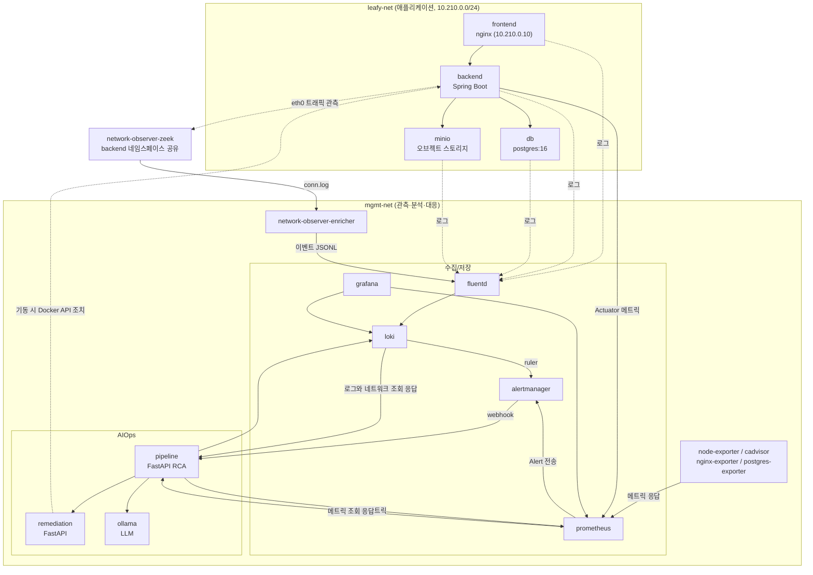
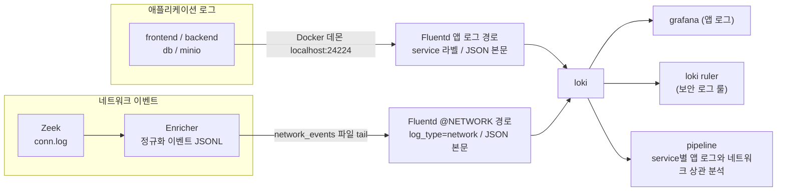
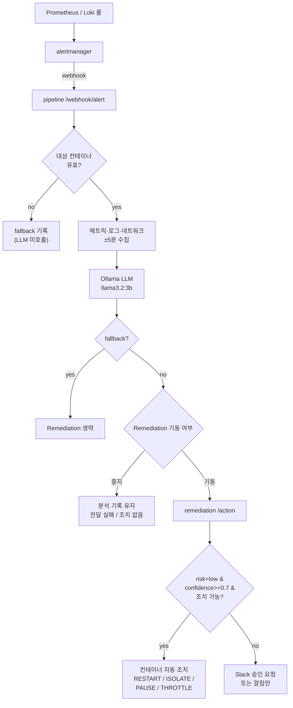

# Leafy AIOps

**LLM 기반 AIOps 보안 관측·분석·대응 플랫폼**
건국대학교 컴퓨터공학과 졸업 프로젝트 (2026)

---

## 1. 프로젝트 소개

Leafy AIOps는 데모용 웹 애플리케이션(**Leafy**)에서 발생하는 로그·메트릭·네트워크 이벤트를 수집하고, Alert를 기준으로 **로컬 LLM의 근본 원인 분석(RCA)**과 **대응(Remediation)**을 연결하는 Docker Compose 기반 졸업 프로젝트이다. 이 문서는 현재 저장소의 코드와 설정을 기준으로 설명한다.

해결하려는 문제는 다음과 같다. 전통적인 모니터링은 임계값 기반 Alert를 사람에게 전달하는 데서 멈춘다. 운영자는 Alert가 울린 뒤 메트릭·로그·네트워크를 직접 상관 분석(correlation)해 원인을 찾아야 하며, 이 과정이 느리고 반복적이다. 본 프로젝트는 Alert 발생 시점을 기준으로 **메트릭·로그·네트워크 컨텍스트를 자동으로 수집·상관**하고, 이를 LLM 프롬프트로 구성해 **원인 추정과 권장 조치를 구조화된 JSON으로 산출**하며, 위험도가 낮고 신뢰도가 높은 경우에 한해 **컨테이너 조치를 자동 실행**하는 파이프라인을 검증한다.

> Leafy 애플리케이션(frontend/backend) 자체의 소스 코드는 이 저장소에 포함되지 않으며, 외부에 빌드된 컨테이너 이미지(`gicks/ai-ops-leafy-*`)로 실행된다. 이 저장소는 **관측·분석·대응(AIOps) 레이어와 그 운영 환경**을 담는다.

> 현재 작업 환경에서는 Remediation을 중지 상태로 유지한다. 아래 다이어그램은 구현된 연결 관계이며 실행 상태를 나타내지 않는다. Remediation이 중지되어 있으면 자동 조치와 해당 서비스를 통한 Slack 알림은 수행되지 않는다.

---

## 2. 핵심 기능

- **애플리케이션 로그 수집**: Leafy 컨테이너들의 로그를 Docker fluentd 드라이버로 Fluentd에 보내고, 라벨을 붙여 Loki에 적재한다.
- **네트워크 관측(Network Observability)**: Zeek가 backend의 네트워크 네임스페이스에 붙어 트래픽을 캡처하고, Enricher가 이를 정규화된 네트워크 이벤트(Canonical Network Event)로 변환해 Loki로 보낸다.
- **메트릭 수집**: Prometheus가 node/cadvisor/nginx/postgres exporter와 AIOps 파이프라인의 컨테이너 상태 메트릭을 수집한다.
- **이상 탐지(Alert)**: Prometheus 룰과 Loki 룰러가 임계값/로그 패턴 기반으로 Alert를 발생시키고 Alertmanager로 보낸다.
- **LLM 기반 RCA**: AIOps Pipeline이 Alert를 수신해 전후 ±5분의 메트릭·로그·네트워크를 수집·상관하고, 로컬 Ollama LLM으로 근본 원인과 권장 조치를 분석한다.
- **대응(Remediation)**: 서비스가 기동된 경우 분석 결과의 위험도·신뢰도·대상에 따라 컨테이너 조치(RESTART/ISOLATE/PAUSE/THROTTLE)를 실행하거나 Slack 승인 요청을 보낸다.
- **시각화**: Grafana 대시보드로 메트릭·로그·LLM 분석 타임라인을 조회한다.
- **공격/장애 시나리오**: `scenarios/`에 CPU/메모리 부하와 보안 공격 재현 도구가 있다. 일부 결과 조회 기능은 미구현 API에 의존하므로 실행과 분석 결과 확인을 구분한다.

---

## 3. 전체 시스템 아키텍처

스택은 크게 세 계층으로 나뉜다. **Leafy 애플리케이션 계층**(leafy-net), **관측·분석·대응 계층**(mgmt-net), 그리고 두 계층을 잇는 **데이터 수집 경로**이다. Docker 네트워크는 `leafy-net`(bridge, 10.210.0.0/24)과 `mgmt-net`(bridge) 두 개이다.



> `network-observer-zeek`는 자체 네트워크를 갖지 않고 `network_mode: "service:backend"`로 backend의 네임스페이스를 공유한다. 다이어그램의 "eth0 트래픽 관측" 화살표는 이 인터페이스에서 캡처하는 관계를 뜻한다.

Remediation의 점선은 backend를 대상으로 하는 조치의 예시이다. 실제 조치 대상은 LLM 응답의 `action_targets`로 결정된다. nginx/postgres exporter는 두 네트워크에 연결되며, 위 다이어그램에서는 수집기 노드 하나로 묶어 표시한다. 상세 정의는 [docker-compose.yml](docker-compose.yml)과 [Prometheus 설정](monitoring/prometheus/prometheus.yml)에 있다.

---

## 4. Docker Compose 서비스 및 네트워크 구조

스택은 `docker-compose.yml` 하나로 정의되며, `docker-compose.gpu.yml`은 Windows(RTX) 환경에서 `ollama`에 GPU를 할당하는 오버라이드이다. Compose 프로젝트 이름은 `graduation-project`로 고정되는데, 이는 Remediation이 `graduation-project_leafy-net`이라는 네트워크 이름에 의존하기 때문이다.

### 네트워크

| 네트워크 | 종류 | 용도 |
|---|---|---|
| `leafy-net` | bridge (10.210.0.0/24) | Leafy 애플리케이션 계층. frontend는 고정 IP 10.210.0.10 |
| `mgmt-net` | bridge | 관측·분석·대응 계층 |

### 명명 볼륨

| 볼륨 | 데이터와 연결 |
|---|---|
| `postgres_data` | DB 데이터 → db의 `/var/lib/postgresql/data` |
| `minio_data` | 업로드·오브젝트 데이터 → minio의 `/data` |
| `prometheus_data`, `loki_data`, `grafana_data` | 메트릭·로그·대시보드 상태 → 각 저장소 |
| `ollama_data` | 내려받은 모델 → ollama의 `/root/.ollama` |
| `zeek_logs` | Zeek 쓰기 → Enricher 읽기 전용 |
| `network_events` | Enricher 쓰기 → Fluentd 읽기 전용 |

설정 파일은 저장소에서 bind mount한다. Pipeline의 `results` 디렉터리도 bind mount하지만 현재 Alert 분석 경로에는 JSONL 파일 저장 코드가 없으며, 결과는 Loki에 기록한다.

### 서비스

포트는 `호스트:컨테이너` 형식이며, 별도 표기가 없으면 TCP이다. `없음`은 호스트 publish가 없다는 뜻이다.

| 서비스 | 이미지 / 빌드 | 공개 포트 | 네트워크 | 역할 |
|---|---|---|---|---|
| `frontend` | `gicks/ai-ops-leafy-frontend:${FRONTEND_TAG:-latest}` | `${LEAFY_BIND_IP:-127.0.0.1}:80:80` | leafy-net | Leafy 웹 프런트(nginx) |
| `backend` | `gicks/ai-ops-leafy-backend:${BACKEND_TAG:-latest}` | 없음 | leafy-net, mgmt-net | Leafy API(Spring Boot, `dev` 프로필) |
| `db` | `postgres:16` | 없음 | leafy-net | 애플리케이션 DB. 접속·슬로우쿼리 로깅 활성화 |
| `minio` | `gicks/minio:RELEASE.2025-09-07T16-13-09Z` | 없음 | leafy-net | 오브젝트 스토리지 |
| `fluentd` | `./leafy/fluentd` 빌드 | `24224:24224` TCP/UDP | leafy-net, mgmt-net | 로그 수집 → Loki 전송 |
| `loki` | `grafana/loki` | `3100:3100` | mgmt-net | 로그 저장소 + 룰러 |
| `prometheus` | `prom/prometheus` | `9090:9090` | mgmt-net | 메트릭 수집(5s), 30일 보존 |
| `alertmanager` | `prom/alertmanager` | `9093:9093` | mgmt-net | Alert 라우팅 → pipeline webhook |
| `grafana` | `grafana/grafana` | `3000:3000` | mgmt-net | 대시보드 |
| `node-exporter` | `prom/node-exporter` | 없음 | mgmt-net | 호스트 메트릭 |
| `cadvisor` | `gcr.io/cadvisor/cadvisor` | 없음 | mgmt-net | 컨테이너 메트릭 |
| `nginx-exporter` | `nginx/nginx-prometheus-exporter` | 없음 | leafy-net, mgmt-net | nginx 메트릭 |
| `postgres-exporter` | `prometheuscommunity/postgres-exporter` | 없음 | leafy-net, mgmt-net | postgres 메트릭 |
| `ollama` | `ollama/ollama` | `11434:11434` | mgmt-net | 로컬 LLM 추론 |
| `pipeline` | `./aiops/pipeline` 빌드 | `8000:8000` | mgmt-net | Alert 수신·상관·LLM RCA |
| `remediation` | `./aiops/remediation` 빌드 | `8001:8001` | mgmt-net | 기동 시 컨테이너 대응, 현재 환경에서는 중지 유지 |
| `network-observer-zeek` | `zeek/zeek` | 없음 | backend 네임스페이스 공유 | 트래픽 캡처(conn.log) |
| `network-observer-enricher` | `./aiops/network-observer` 빌드 | 없음 | mgmt-net | conn.log → 정규화 이벤트 |

`backend`의 `container_name`은 `leafy-backend`이며 frontend/db/minio도 `leafy-*` 이름을 쓴다. Pipeline과 Remediation의 이름은 각각 `aiops-pipeline`, `aiops-remediation`이며 나머지는 서비스 이름과 같다.

backend는 DB와 MinIO의 healthcheck 통과를 기다리고, db는 Fluentd에 의존한다. Pipeline은 Prometheus·Loki·Ollama에, Remediation은 Pipeline에 의존한다. Enricher는 Zeek에, Zeek는 backend에 의존한다. `depends_on`만으로 모든 서비스의 준비 상태가 보장되지는 않으며 Ollama 모델도 별도로 준비한다.

> `pipeline`은 Docker 메타데이터 조회를 위해, `remediation`은 실제 조치를 위해 Docker 소켓(`/var/run/docker.sock`)을 마운트한다. Enricher도 메타데이터 조회용 소켓을 `:ro`로 마운트한다. `frontend`를 제외한 공개 포트는 호스트 IP 제한이 없다.

---

## 5. Leafy Application Logging 흐름

`frontend`, `backend`, `db`, `minio` 네 컨테이너는 Docker **fluentd 로깅 드라이버**를 사용한다. 전송 주소는 Docker 데몬 기준 `localhost:24224`이며, 호스트의 공개 포트를 통해 Fluentd의 forward 입력에 연결된다.

[fluent.conf](leafy/fluentd/fluent.conf)는 Docker가 16KB 단위로 나눈 긴 로그(partial)를 다시 이어 붙인 뒤, Compose 라벨의 `com.docker.compose.service`에서 논리 서비스 이름인 `service`를 얻는다. `container_name`·`runtime`·`source`, 기존 tag 기반 `container`, 형식 구분 `log_format`(json/text/json_invalid)을 Loki 라벨로 보존한다. 본문은 JSON이다. JSON 로그는 앱 필드를 그대로, 그 외는 원문을 `message`에 담는다 (변환: [filter_leafy_docker_log.rb](leafy/fluentd/plugins/filter_leafy_docker_log.rb)). Pipeline은 Docker 메타데이터로 `leafy-backend`를 `backend`로 해석한 뒤 `{service="backend"}`로 조회한다. 기존 `container` 값은 tag에 따라 `backend`와 `leafy-db`처럼 달라지므로 신규 상관 분석의 기준으로 사용하지 않는다.

---

## 6. Zeek 기반 Network Observability 흐름

Zeek는 backend의 네트워크 네임스페이스를 공유하며 `zeek -C -i eth0`로 캡처한다. frontend→backend와 backend→db 등 해당 인터페이스를 지나는 연결이 관측 대상이며, 전체 스택의 모든 트래픽을 수집하는 구조는 아니다. `-C`는 Docker 가상 NIC의 checksum offload를 고려하는 옵션이다.

[local.zeek](aiops/network-observer/zeek/local.zeek)는 로그 회전을 끄고 `Conn::LOG`만 남겨 `conn.log`를 `zeek_logs` 볼륨에 JSON으로 기록한다. **Enricher**는 파일을 tail하면서 Docker 네트워크 IP와 Compose 라벨로 출발·도착 서비스 identity를 해석한다. 결과는 **Canonical Network Event v1.0** JSONL이며 `network_events` 볼륨의 `network-events.jsonl`과 stdout으로 출력된다. identity를 찾지 못하면 이벤트를 버리지 않고 `unknown`으로 표시한다.

Fluentd는 JSONL을 별도 `@NETWORK` 경로로 수집하므로 애플리케이션 로그 변환 필터를 거치지 않는다. 본문은 원본 이벤트 JSON이며 Loki 라벨은 `log_type`, `event_type`, `src_service`, `dst_service`, `protocol`, `network`이다. 이벤트 시각은 연결 시작 시각이다. Pipeline은 `service`에 대응하는 출발·도착 셀렉터 두 개로 조회한 뒤 중복을 제거한다.

> 현재 네트워크 이벤트는 **LLM 프롬프트의 NETWORK CONTEXT로만 활용**된다. 네트워크 이벤트 전용 Grafana 패널이나 전용 Alert 룰은 아직 없다. Enricher 설정의 `host_endpoints`는 비어 있어, 호스트 상의 DB를 대상으로 하는 구성은 활성화되어 있지 않다.



---

## 7. Metrics, Logs, Alerts 수집 및 처리 흐름

- **Metrics**: Prometheus가 5초 주기로 node-exporter(`9100`), cadvisor(`8080`), nginx-exporter(`9113`), postgres-exporter(`9187`), 자신, `pipeline:8000/metrics`, `backend:9090/actuator/prometheus`를 수집한다. Pipeline은 Docker 소켓에서 이름 매핑과 감시 대상 서비스의 재시작/기동 시각/OOM 상태를 읽어 `container_name_info`, `aiops_docker_*` 메트릭을 노출한다. Prometheus 보존 기간은 Compose에서 30일로 설정된다.
- **Logs**: 위 5·6절 경로로 Loki에 적재된다.
- **Alerts**:
  - Prometheus 룰 6종: `HighCpuUsage`, `HighMemoryUsage`, `ContainerRestarted`(leafy-backend 한정), `HighNetworkReceive`, `HighNginxRequestRate`, `HighPostgresConnections`.
  - Loki 룰러 룰 9종(보안 로그 패턴): `UnauthorizedDBAccess`, `SecretDumpAttempt`, `SQLInjectionAttempt`, `HighNginxErrorRate`, `SuspiciousProcessExecution` 등.
  - Prometheus와 Loki 룰러가 각각 Alertmanager로 Alert를 보내고, Alertmanager는 **모든 Alert를 단일 webhook `http://pipeline:8000/webhook/alert`로 라우팅**한다(group_wait/interval 10s, repeat 240s).

규칙은 [Prometheus rules](monitoring/prometheus/rules/alert.rules.yml)와 [Loki security rules](monitoring/loki/rules/fake/security-rules.yml)에 정의된다. Alertmanager는 resolved 알림도 전송하지만 Pipeline이 이를 건너뛴다. 설정된 scrape target이나 규칙의 존재가 실제 수집 성공을 보장하지는 않는다.

---

## 8. AIOps Pipeline → LLM RCA → Remediation 구조

Alert가 Pipeline의 `/webhook/alert`로 들어오면 다음 순서로 처리된다.

1. **필터·중복 제거**: resolved 상태 Alert는 건너뛰고, `alertname:container` 키로 300초 윈도 내 중복을 제거한다. 컨테이너가 없거나 `unknown`이면 `alertname`만 키로 사용한다.
2. **대상 컨테이너 결정**: annotation/label에서 컨테이너를 얻고, `HighCpuUsage`에 컨테이너가 없으면 CPU topk 질의로 보완한다. 대상이 없거나 `unknown`이면 LLM 호출 없이 fallback 결과만 Loki에 기록한다.
3. **컨텍스트 수집(±5분)**: `startsAt` 전후 5분을 조회 범위로 메트릭(cAdvisor/호스트), 로그(`{service="..."}`, 최대 200건), 네트워크(출발/도착 각각 최대 500건)를 수집·상관한다. 미래 구간이 끝날 때까지 기다리지 않으므로 실행 시점에 존재하는 데이터만 얻는다. 서비스 해석 실패 시 앱 로그·네트워크 조회를 생략하며, 네트워크 조회 실패는 보조 컨텍스트 오류로 남겨 RCA를 계속한다.
4. **프롬프트 구성**: JSON 스키마와 few-shot 예시를 system 프롬프트로 사용한다. ALERT/METRICS/LOGS는 6000자에서 자르고 절단 표시를 붙이며, 이후 최대 1200자의 NETWORK CONTEXT를 삽입한다. 로그는 에러·경고 우선으로 최대 50줄을 선택한다.
5. **LLM 호출**: 로컬 Ollama(`POST {OLLAMA_URL}/api/chat`, `format: json`, 모델 `llama3.2:3b`, 요청별 타임아웃 180s)를 세마포어(동시 1)로 호출한다. 타임아웃·HTTP 오류 응답·JSON/스키마 오류는 최대 2회 시도 후 fallback을 반환한다. 그 밖의 예외는 상위 분석 오류 처리로 넘어갈 수 있다.
6. **결과 적재**: 분석 결과를 `job="aiops-llm"`(라벨 `target_container`/`alert`/`threat_level`/`action_risk`)과 `job="aiops-timeline"`으로 Loki에 기록한다.
7. **Remediation 연계**: fallback이 아니면 `{alert, analysis}`를 `REMEDIATION_URL/action`으로 POST한다. 현재처럼 Remediation이 중지되어 있으면 앞 단계의 Loki 분석 기록은 남지만 전달·조치는 완료되지 않는다.

Remediation은 위험도(`action_risk`)·신뢰도(`confidence`)·조치 유형에 따라 분기한다.



**조치 동작**(`actions/container.py`): RESTART는 `container.restart()`, ISOLATE는 `leafy-net`에서 분리, PAUSE는 `container.pause()`, THROTTLE는 `cpu_quota=50000` 적용이다. Slack 승인 콜백(`/slack/action`)은 **RESTART와 ISOLATE만 실제 실행**하며, PAUSE/THROTTLE는 로그만 남기고 SCALE에는 핸들러가 없다.

LLM 출력 스키마(`schemas/llm_output.py`)의 `action_type`은 `RESTART / ISOLATE / SCALE / PAUSE / THROTTLE / NOTIFY / NONE` 중 하나이다.

자동 조치는 대상 목록이 있어야 수행된다. 저위험·저신뢰 분석이나 중·고위험 조치는 승인 요청으로 분기하며, 중위험이면서 위협 수준이 낮으면 알림만 전송한다. Slack 전송에는 `SLACK_WEBHOOK_URL`이 필요하고 버튼 승인은 별도의 interactivity 연결이 필요하다. 위 다이어그램의 기동 여부 분기는 운영 상태를 설명하며 코드에 기동 상태 확인 분기가 구현되어 있다는 뜻은 아니다.

모델 `llama3.2:3b`는 Compose가 지정하는 값이다. [config.py](aiops/pipeline/config.py)의 단독 실행 기본값은 `llama3.1:8b`이므로 Compose 밖에서 Pipeline을 실행한다면 `LLM_MODEL`과 실제 준비한 모델을 일치시킨다.

---

## 9. 실행 방법 및 검증 방법

### 사전 요구와 환경 변수

Docker와 Docker Compose가 필요하다. GPU 오버라이드는 GPU를 사용할 수 있는 Windows/RTX 환경에서 Ollama에 `gpus: all`을 추가하는 설정이다. Mac 구성은 오버라이드 없이 사용하며, 네트워크 관측 등 환경별 제약은 [PoC 문서](docs/network-observability/poc/WINDOWS_TRAFFIC_CAPTURE_POC.md)와 함께 확인한다.

명령은 `docker-compose.yml`이 있는 저장소 루트에서 실행하는 사용 예시이다. 이 문서 정리 작업에서는 실행하지 않는다. 새 환경에서는 `.env.example`을 `.env`로 복사하고 값을 채운다. 기존 환경에서는 `.env`를 덮어쓰거나 Secret을 교체하지 않는다.

| 변수 | 역할 |
|---|---|
| `JWT_SECRET_KEY_DEV` | backend의 dev 인증 설정이다. Compose 주석과 예제는 Base64로 인코딩한 256bit 이상 키를 요구한다. 검증 구현은 외부 backend 이미지에 있다. |
| `STORAGE_ACCESS_KEY`, `STORAGE_SECRET_KEY` | backend와 MinIO가 공유하는 자격 증명이다. Secret은 8자 이상을 사용하도록 예제에 안내되어 있다. |
| `DB_PASSWORD` | DB·backend·postgres-exporter에 공통으로 전달되는 비밀번호이다. |
| `FRONTEND_TAG`, `BACKEND_TAG`, `LEAFY_BIND_IP` | 이미지 태그와 웹 바인딩 주소를 선택한다. 미설정 시 Compose 기본값이 적용된다. |
| `GRAFANA_PASSWORD`, `SLACK_WEBHOOK_URL` | Grafana 관리자 비밀번호와 선택적인 Slack 전송 설정이다. |
| `PLANT_ID_API_KEY`, `OPENAI_API_KEY`, `NONGSARO_API_KEY`, `AIR_PURIFIY_KEY`, `OPEN_WEATHER_API_KEY` | Leafy 앱의 외부 API 설정이다. AIOps RCA는 `OPENAI_API_KEY` 대신 로컬 Ollama를 사용한다. |

`LLM_MODEL`, `LLM_TIMEOUT`, `PROMETHEUS_URL`, `LOKI_URL`, `OLLAMA_URL`, `REMEDIATION_URL`은 현재 Compose의 Pipeline `environment`에 직접 지정된다. `.env`에 같은 이름을 추가하는 것만으로 이 값들이 바뀌지는 않는다.

### Remediation을 제외한 기동 예시

현재 Remediation 중지 상태를 유지하기 위해 서비스 이름을 명시한다. 전체 서비스에 대한 `docker compose up -d`는 Remediation도 기동하므로 이 구성에서는 사용하지 않는다. 다음 명령은 이미 실행 중인 Remediation을 중지하는 명령은 아니다.

```bash
# 로그 수신기를 먼저 준비한다.
docker compose up -d fluentd

# remediation을 제외한 서비스만 지정한다.
docker compose up -d frontend backend db minio node-exporter cadvisor nginx-exporter postgres-exporter prometheus alertmanager loki grafana ollama pipeline network-observer-zeek network-observer-enricher

# Compose는 모델을 자동으로 내려받지 않는다.
docker exec ollama ollama pull llama3.2:3b
```

GPU 구성을 사용하는 경우에는 위 두 `docker compose` 명령의 `up` 앞에 `-f docker-compose.yml -f docker-compose.gpu.yml`을 추가한다. 명시한 서비스 목록은 그대로 유지한다.

### 실행 중인 환경의 읽기 전용 검증

아래 항목은 서비스가 이미 기동된 환경에서 확인하는 절차이다. `/health`는 프로세스 응답 확인이며 전체 수집·분석 경로의 정상 동작을 증명하지 않는다.

| 확인 대상 | 경로와 확인 내용 |
|---|---|
| Pipeline | `http://127.0.0.1:8000/health`, `/metrics`에서 응답과 메트릭을 확인한다. |
| Prometheus | `http://127.0.0.1:9090/targets`에서 exporter·backend·Pipeline의 수집 상태를 확인한다. |
| Alertmanager | `http://127.0.0.1:9093`에서 수신 Alert를 확인한다. |
| Grafana | `http://127.0.0.1:3000`에서 provision된 대시보드와 데이터 소스를 확인한다. 관리자 비밀번호는 `GRAFANA_PASSWORD` 설정을 따른다. |
| Loki 데이터 | Grafana Explore에서 `{service="backend"}`, `{log_type="network"}`, `{job="aiops-llm"}`, `{job="aiops-timeline"}`을 조회한다. 데이터가 발생한 시간 범위를 선택한다. |
| Leafy | 기본 주소 `http://127.0.0.1:80` 또는 `LEAFY_BIND_IP`의 웹 포트로 접근한다. |
| Remediation | 현재 중지 유지 대상이므로 `:8001/health` 성공을 검증 조건으로 삼지 않는다. |

### 오프라인 단위 테스트와 시나리오 도구

Python 환경에 [Pipeline 의존성](aiops/pipeline/requirements.txt)을 준비한 뒤 다음 테스트를 실행한다. 기존 52개 테스트는 `httpx.MockTransport` 등을 사용해 identity·시간 구간·네트워크 조회·프롬프트 조립을 검증하며 실제 Docker나 LLM을 호출하지 않는다.

```bash
cd aiops/pipeline
python -B -m unittest discover -s tests -v
```

`python scenarios/run.py`는 `rich`와 Docker SDK를 사용하는 시나리오 TUI이다. CPU/메모리 부하·공격 재현은 실행 상태를 바꾸고 `scenarios/logs/`에 기록하므로 읽기 전용 검증 절차와 분리한다. TUI의 결과 개수 확인·LLM 대기는 미구현 `/results` API에 의존하며, 일부 다른 도구는 `/results/latest`와 `/debug/*`도 호출한다. 현재 코드 기준으로 이 도구들의 전체 성공 판정을 보장할 수 없으며, 분석 결과는 Loki/Grafana에서 확인한다.

### Token 스크립트 검토 결과

두 파일은 통합하지 않고 그대로 유지한다. 둘 다 CLI 인자 처리와 환경변수 읽기가 없으며 `jwt.encode`로 HS256을 사용한다. 공통 payload는 `sub`, `role`, 현재 시각 `iat`, 24시간 뒤 `exp`이며 issuer/audience는 지정하지 않는다.

| 파일 | 키 처리와 출력 계약 |
|---|---|
| [gen_token.py](gen_token.py) | 하드코딩된 키 문자열 하나를 그대로 사용하고 토큰 한 개를 stdout에 출력한다. |
| [gen_token2.py](gen_token2.py) | 원문 문자열·Base64 디코딩 문자열·hex 문자열·hex bytes의 네 후보를 시도하고 번호가 붙은 결과 또는 오류를 출력한다. 첫 후보는 `gen_token.py`의 키와 같다. |

검색 시점의 저장소에서는 두 파일의 호출 참조가 발견되지 않았다. 그러나 외부 호출과 stdout 의존성은 확인할 수 없으며, backend JWT 검증 구현도 외부 이미지에 있어 키 해석·인증 호환성을 입증할 수 없다. Mock으로 호출 인자와 출력 계약을 비교해도 실제 backend의 수락 여부까지 검증하지는 못한다. 따라서 단순 중복으로 간주해 통합하지 않는다. 서비스별 requirements에는 이 스크립트의 JWT 의존성도 선언되어 있지 않다. 이번 정리에서는 Token 스크립트 실행·실제 토큰 발급·Secret 출력·인증 설정 변경을 하지 않는다.

---

## 10. 알려진 제약사항 및 주의사항

- **Leafy 앱 소스 비포함**: frontend/backend는 외부 이미지로 실행된다. nginx `stub_status`(8081), backend Actuator(9090) 등은 이미지 내부 구성에 의존하며 이 저장소에서 검증되지 않는다.
- **Remediation 선언과 실행 상태 구분**: Compose에는 일반 서비스로 선언되며 별도의 dry-run/비활성 플래그는 없다. 기동하면 조건에 따라 실제 조치를 수행한다. 현재 환경의 중지 상태를 유지하며, 이 문서의 다이어그램을 현재 가동 상태로 해석하지 않는다.
- **조치의 한계**: ISOLATE는 `leafy-net`만 분리하므로 backend의 `mgmt-net` 연결까지 끊는 완전 격리는 아니다. 대상 네트워크가 없으면 경고 후 반환해 상위 계층이 성공으로 기록할 수 있다. SCALE은 실행 핸들러가 없으며 Slack 승인 경로에서는 PAUSE/THROTTLE도 실행하지 않는다.
- **Slack 콜백 검증 부재**: Slack 서명 검증·리플레이 방지가 없으며, 공개 interactivity URL 설정도 포함되어 있지 않다.
- **주기적 LLM 스캔 비활성**: `periodic_log_check`, `periodic_llm_health` 함수는 존재하지만 lifespan의 태스크 시작 코드가 주석 처리되어 비활성 상태이다. 이를 켜는 환경 변수는 없다.
- **통계·ML 이상탐지 모듈 없음**: 여기서의 "이상 탐지"는 Prometheus/Loki의 임계값·패턴 룰과 LLM 분석을 의미하며, 별도의 통계/ML 기반 모델은 구현되어 있지 않다.
- **네트워크 관측의 한계**: 이벤트는 LLM 보조 컨텍스트이며 전용 패널/Alert 룰은 없다. `host_endpoints`는 비어 있고 DB는 현재 `postgres:16` 컨테이너이다. 장기 연결은 종료 시 기록될 수 있으므로 빈 조회 결과가 무트래픽·정상을 뜻하지 않는다. backend 재생성 시 observer가 이전 네임스페이스에 남는 문제가 생길 수 있으며 캡처 인터페이스 배치도 환경에서 확인해야 한다.
- **수집 이력과 저장 공간**: Enricher는 최초 파일 열기에서 기존 `conn.log` 내용을 건너뛴다. Zeek 로그 회전은 비활성이고 `network_events` JSONL의 보존 정책도 별도로 구현되어 있지 않다. Fluentd의 tail 위치 파일은 명명 볼륨이 아니므로 재생성 시 재수집 여부에 주의한다.
- **결과 API·파일 저장 제한**: Pipeline의 현재 API는 `/health`, `/metrics`, `/webhook/alert`이다. `/results`, `/results/latest`, `/debug/*`와 JSONL 결과 파일 자동 갱신은 구현되어 있지 않다. 메모리 이력은 최근 20건이며 지속적인 결과 조회는 Loki를 기준으로 한다.
- **포트 노출**: frontend를 제외한 공개 포트는 모든 인터페이스에 바인딩된다. 외부 네트워크에 노출된 호스트에서는 방화벽·바인딩 주소를 조정한다.

---

## 문서

- `docs/verification/current_info_files/` — 설계 기준선(ARCHITECTURE/DESIGN/TASKS). 구현 전 베이스라인 문서로, 실제 구현과 차이가 있을 수 있다.
- `docs/verification/legacy_info_files/` — 과거 개발 문서 보관.
- `docs/network-observability/` — 네트워크 이벤트 스키마 및 PoC 문서.
- `docs/remote/` — Leafy(팀원 PC)와 AIOps(`docker-compose.aiops.yml`)를 다른 PC에서 실행하는 원격 수집 구성, JSON 전환에 따른 탐지 규칙 검토. 팀원 PC 작업은 `deploy/leafy-pc/`.

**학교** 건국대학교 컴퓨터공학과 · **주제** LLM 기반 AIOps 보안 플랫폼 · **연도** 2026
