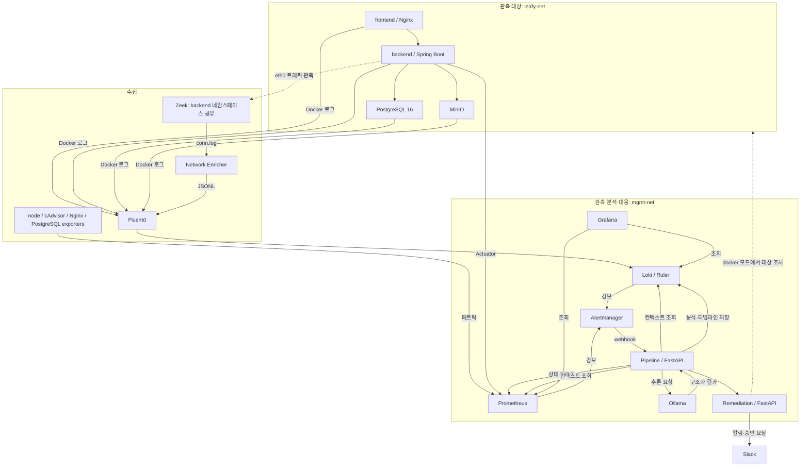

# Leafy AIOps

## 프로젝트 소개

Leafy AIOps는 건국대학교 컴퓨터공학과 졸업 프로젝트로, 웹 애플리케이션의 장애와 보안 이상을 관측하고 로컬 LLM으로 원인을 분석하는 시스템입니다. 운영자가 경보를 받은 뒤 로그·메트릭·네트워크 정보를 각각 찾아야 하는 반복 작업을 줄이기 위해, 경보 발생 시점과 대상 서비스를 기준으로 데이터를 모아 근본 원인 분석(RCA)과 권장 조치를 생성합니다.

이 저장소는 수집·탐지 설정, FastAPI 기반 분석·대응 서비스, Grafana 대시보드, 실험 도구를 포함합니다. 관측 대상인 **Leafy frontend/backend 소스는 포함하지 않으며**, Compose에서 `gicks/ai-ops-leafy-frontend`, `gicks/ai-ops-leafy-backend` 이미지를 사용합니다. 단일 PC 통합 구성과 Tailscale 기반 2대 PC 원격 수집 구성을 제공합니다. 원격 구성은 Docker 조치를 비활성화하며 일부 메트릭 수집은 추가 구성이 필요합니다.

## 주요 기능

- **로그 수집·정규화**: Docker fluentd 드라이버 → Fluentd → Loki. JSON/텍스트 정규화, Docker partial 로그 재조립, 서비스 라벨 부여, 큰 로그 크기 제한을 처리합니다. 원격 호스트 PostgreSQL 17 jsonlog는 Fluent Bit으로 별도 인증 포트에 전송합니다.
- **네트워크 관측**: Zeek가 backend 네트워크 네임스페이스에서 연결을 관측하고 Python Enricher가 서비스 식별 정보를 붙인 Canonical Network Event JSONL을 생성합니다.
- **메트릭·규칙 기반 탐지**: 통합 구성에서 Prometheus와 node-exporter·cAdvisor·nginx-exporter·postgres-exporter를 사용합니다. Prometheus 규칙 6개와 Loki 보안 규칙 9개를 Alertmanager에 연결합니다. 규칙 선언과 실제 발화 여부는 구분해야 합니다.
- **LLM 원인 분석**: Pipeline이 경보 전후 5분의 메트릭·앱 로그·네트워크 컨텍스트를 수집하고 Ollama에 전달합니다. 원인, 조치 유형·대상, 위험도, 근거, 신뢰도를 구조화합니다.
- **대응 판단·Slack 알림**: 저위험(`action_risk=low`)·신뢰도 0.7 이상이면 지원하는 Docker 조치를 실행하며, 다른 조건에서는 알림이나 승인 요청으로 분기합니다. 원격 구성의 `REMEDIATION_MODE=disabled`에서는 조치 실행을 건너뜁니다.
- **시각화·실험**: Grafana에서 메트릭·로그·분석 이력을 조회하고, `scenarios/`와 `aiops/eval/`에서 장애·보안 시나리오 및 LLM 평가 도구를 제공합니다.

## 시스템 아키텍처

다음은 **단일 PC 통합 구성**의 흐름입니다. 화살표는 구현된 연결 관계이며 현재 실행 상태를 뜻하지 않습니다.



`leafy-net`은 `10.210.0.0/24`이며 frontend IP는 `10.210.0.10`입니다. backend와 일부 수집기는 관리 네트워크에도 연결됩니다. Zeek는 `network_mode: service:backend`로 backend 네임스페이스를 공유합니다. 인터페이스 배치가 달라지면 캡처 설정을 확인해야 합니다.

**원격 구성**에서는 Leafy 앱·호스트 PostgreSQL 17·Zeek/Enricher·Fluent Bit이 대상 PC에 있고, AIOps PC에는 수집·저장·분석 서비스 8개가 있습니다. Docker 로그와 네트워크 이벤트는 Tailscale의 24224/TCP, PostgreSQL 로그는 공유 키 인증을 사용하는 24225/TCP로 Fluentd에 전달합니다. Pipeline의 `TARGET_SERVICE_MAP`으로 원격 대상을 식별하며, 원격 조치 경로는 구현되어 있지 않습니다.

상세 자료: [아키텍처 파일](docs/architecture/README.md), [원격 배포](docs/remote/REMOTE_DEPLOYMENT.md), [네트워크 이벤트 스키마](docs/network-observability/NETWORK_EVENT_SCHEMA.md).

## 기술 스택

| 영역 | 코드·설정에서 확인한 기술 |
|---|---|
| 분석·대응 API | Python 3.11 컨테이너, FastAPI, Uvicorn, Pydantic 2, HTTPX |
| 네트워크 Enricher | Python 3.12 컨테이너, Docker SDK 7.1.0, PyYAML 6.0.2 |
| LLM | Ollama, Compose 모델 `llama3.2:3b` |
| 로그 | Fluentd 1.16, Ruby 필터, fluent-plugin-grafana-loki 1.3.0, fluent-plugin-concat 2.6.2, Loki, 원격 Fluent Bit |
| 메트릭·알림·시각화 | Prometheus, Alertmanager, Grafana, node-exporter, cAdvisor, Nginx/PostgreSQL exporters, Slack webhook |
| 네트워크·배포 | Zeek, Docker Compose v2, 원격 Tailscale, 선택적 NVIDIA GPU 오버레이 |
| 관측 대상 | 외부 Leafy Nginx/Spring Boot 이미지, PostgreSQL 16(통합) / 호스트 17(원격), MinIO |

현재 추적 파일에는 루트 `package.json`, 공통 Python 의존성 파일, GitHub Actions 워크플로가 없습니다. Python 의존성은 서비스별 `requirements.txt`, 실행 진입점은 각 `Dockerfile`에 있습니다. 다수 인프라 이미지는 `latest`를 사용합니다.

## 디렉터리 구조

```text
.
├── aiops/
│   ├── pipeline/          # 경보 수신, 컨텍스트 수집·상관, 프롬프트, 스키마·테스트
│   ├── remediation/       # 조치 판단, Docker 조작, Slack 알림·승인·테스트
│   ├── network-observer/  # Zeek 설정, 연결 이벤트 정규화·서비스 식별
│   └── eval/              # LLM 평가 케이스·실행기·기록
├── leafy/
│   ├── fluentd/           # 이미지, 수집 라우팅, Ruby 필터·테스트
│   └── db/                # 통합 PostgreSQL 초기화 SQL
├── monitoring/            # Prometheus, Loki, Alertmanager, Grafana provisioning
├── deploy/                # 대상 PC 수집 설정, AIOps PC 연결 확인 도구
├── scenarios/             # 장애·보안 재현, TUI, 배치·평가 도구와 기록
└── docs/                  # 아키텍처, 원격 배포, 네트워크 PoC, 설계·검증 이력
```

루트에는 `.env.example`, 통합 구성 `docker-compose.yml`, 원격 구성 `docker-compose.aiops.yml`, GPU 오버레이 `docker-compose.gpu.yml`이 있습니다. `docs/verification/current_info_files/`는 구현 전 설계 기준선도 포함하므로 기능 구현 여부는 현재 소스와 함께 확인해야 합니다.

## 설치 및 실행 방법

### 준비 및 환경 변수

Docker와 Compose v2를 준비합니다. Windows에서는 Linux 컨테이너를 실행할 수 있는 Docker Desktop 환경을 사용합니다. Python 서비스만 로컬 실행하려면 Python과 가상환경이 필요합니다. 아래 셸 예시는 **저장소 루트에서 PowerShell 기준**입니다.

```powershell
git clone https://github.com/KU-GraduationProject/graduation-project.git
cd graduation-project
Copy-Item .env.example .env  # 최초 설정 때만 실행
```

`.env`의 빈 값을 채우고 커밋하지 않습니다. 기존 `.env`가 있으면 복사로 덮어쓰지 말고 필요한 항목을 추가합니다.

| 변수 | 용도 및 적용 구성 |
|---|---|
| `JWT_SECRET_KEY_DEV` | 통합 필수. backend dev 인증용 Base64 인코딩 256bit 이상 키 |
| `STORAGE_ACCESS_KEY`, `STORAGE_SECRET_KEY` | 통합 필수. backend/MinIO 공통 자격 증명, secret 8자 이상 |
| `DB_PASSWORD` | 통합 DB·backend·exporter 공통 비밀번호 |
| `FRONTEND_TAG`, `BACKEND_TAG`, `LEAFY_BIND_IP` | 통합 이미지 태그(기본 `latest`), frontend 바인딩 IP(기본 `127.0.0.1`) |
| `GRAFANA_PASSWORD`, `SLACK_WEBHOOK_URL` | Grafana 관리자 비밀번호(기본 `admin`), 선택적 Slack 알림 |
| `PLANT_ID_API_KEY`, `OPENAI_API_KEY`, `NONGSARO_API_KEY`, `AIR_PURIFIY_KEY`, `OPEN_WEATHER_API_KEY` | 외부 Leafy 앱 API 설정. AIOps RCA는 Ollama 사용 |
| `AIOPS_TAILSCALE_IP`, `FLUENTD_PG_SHARED_KEY` | 원격 필수. 수집기 바인딩 IP와 대상 PC Fluent Bit의 공유 키 |
| `GRAFANA_BIND_IP` | 원격 Grafana 바인딩 IP(기본 `127.0.0.1`) |

Pipeline의 `LLM_MODEL`, `LLM_TIMEOUT`, `PROMETHEUS_URL`, `LOKI_URL`, `OLLAMA_URL`, `REMEDIATION_URL`은 Compose의 `environment`에 직접 지정되어 있습니다. `.env`에 같은 이름만 추가해도 덮어써지지 않습니다. 변경하려면 Compose 환경 설정이나 오버레이를 수정합니다. 로컬 Python에서는 프로세스 환경 변수로 지정합니다. `config.py`의 모델 기본값은 `llama3.1:8b`이므로 아래에서는 Compose와 같은 모델을 명시합니다.

### Docker: 단일 PC 통합 구성

먼저 정적으로 설정을 검사합니다. `config --quiet`는 비밀값을 출력하지 않습니다.

```powershell
docker compose -f docker-compose.yml config --quiet
docker compose -f docker-compose.yml up -d --build fluentd
docker compose -f docker-compose.yml up -d --build frontend backend db minio node-exporter cadvisor nginx-exporter postgres-exporter prometheus alertmanager loki grafana ollama pipeline network-observer-zeek network-observer-enricher
docker exec ollama ollama pull llama3.2:3b
docker compose -f docker-compose.yml ps
```

로그 드라이버가 연결할 Fluentd를 먼저 시작합니다. 위 목록은 **Remediation을 새로 기동하지 않는 관측·분석 구성**이며, 이미 실행 중인 Remediation을 중지하지는 않습니다. Pipeline은 대응 서비스가 없으면 전달 실패를 기록할 수 있습니다. 대응까지 실험하려는 경우에만 다음을 별도로 실행합니다. 통합 구성의 기본 모드는 `docker`이므로 조건에 따라 실제 컨테이너 조치를 수행합니다.

```powershell
docker compose -f docker-compose.yml up -d --build remediation
```

GPU 사용 시 위 명령의 `-f docker-compose.yml` 대신 `-f docker-compose.yml -f docker-compose.gpu.yml`을 사용합니다. 이 오버레이는 Ollama에 NVIDIA GPU를 요청하며 드라이버와 Docker GPU 지원이 필요합니다.

통합 구성은 Fluentd 컨테이너에 PostgreSQL 공유 키 변수를 전달하지 않으며 24225도 publish하지 않습니다. 호스트 PostgreSQL 로그 수신은 아래 원격 구성을 기준으로 설정합니다.

<!-- TODO: 최신 Fluentd 설정의 통합 구성 기동(24225 shared_key 미전달 포함)을 Docker 엔진이 있는 환경에서 검증한다. -->

### Docker: 2대 PC 원격 수집 구성

두 구성은 `container_name`이 겹치므로 같은 PC에서 동시에 실행하지 않습니다. 전환이 필요하면 사용 중인 구성의 `down`으로 컨테이너를 정리하고 볼륨은 보존합니다(`-v` 제외). Tailscale 연결·공유·ACL을 먼저 설정하고 `.env`의 원격 필수값을 채웁니다.

```powershell
docker compose -f docker-compose.aiops.yml config --quiet
docker compose -f docker-compose.aiops.yml up -d --build
docker exec ollama ollama pull llama3.2:3b
docker compose -f docker-compose.aiops.yml ps
```

GPU 실행은 `docker compose -f docker-compose.aiops.yml -f docker-compose.gpu.yml up -d --build`입니다. Leafy 앱·DB·exporter·Zeek는 AIOps PC에 실행하지 않습니다. 대상 PC는 [배포 안내](deploy/leafy-pc/README.md)에 따라 Docker 로그, PostgreSQL Fluent Bit, [Network Observer](deploy/leafy-pc/network-observer/docker-compose.yml)를 설정합니다.

Prometheus 원격 대상은 [targets 안내](monitoring/prometheus/targets/README.md)에 따라 `.yml.example`을 복사하고 실제 주소로 변경합니다. 대상 PC의 메트릭 포트와 exporter가 준비되기 전에는 해당 지표를 수집할 수 없습니다. 원격 구성에는 cAdvisor/node-exporter도 없어 CPU·메모리·재시작 탐지를 통합 구성과 동일하게 사용할 수 없습니다. 세부 상태는 [원격 배포 문서](docs/remote/REMOTE_DEPLOYMENT.md)에 있습니다.

<!-- TODO: 원격 메트릭 포트·exporter 배치 합의 및 CPU·메모리·재시작 탐지 경로 검증을 완료한다. -->

### Python 의존성 설치 및 로컬 실행

Pipeline과 Remediation은 각각 자신의 디렉터리를 기준으로 import합니다. 개발용 공통 가상환경 설치 예시입니다.

```powershell
python -m venv .venv
.\.venv\Scripts\python.exe -m pip install -r aiops/pipeline/requirements.txt -r aiops/remediation/requirements.txt
```

Docker로 Prometheus·Loki·Ollama를 준비하고 모델을 내려받은 뒤, Pipeline을 별도 터미널에서 실행합니다. Python 코드는 `.env`를 자동으로 읽지 않습니다.

```powershell
$env:PROMETHEUS_URL = 'http://127.0.0.1:9090'
$env:LOKI_URL = 'http://127.0.0.1:3100'
$env:OLLAMA_URL = 'http://127.0.0.1:11434'
$env:REMEDIATION_URL = 'http://127.0.0.1:8001'
$env:LLM_MODEL = 'llama3.2:3b'
Set-Location aiops/pipeline
..\..\.venv\Scripts\python.exe -m uvicorn main:app --host 127.0.0.1 --port 8000
```

Remediation은 다른 터미널에서 저장소 루트부터 실행합니다. 이 예시는 조치를 비활성화합니다.

```powershell
$env:REMEDIATION_MODE = 'disabled'
$env:LOKI_URL = 'http://127.0.0.1:3100'
Set-Location aiops/remediation
..\..\.venv\Scripts\python.exe -m uvicorn main:app --host 127.0.0.1 --port 8001
```

Compose의 Pipeline/Remediation을 실행 중이면 해당 서비스를 중지하거나 로컬 포트를 변경해야 합니다. 호스트 서비스는 Compose 내부의 `pipeline`/`remediation` DNS 경로를 자동으로 대체하지 않습니다. Windows 직접 Python 실행에서는 코드가 사용하는 Unix Docker 소켓(`/var/run/docker.sock`)으로 메타데이터를 읽을 수 없어, 컨테이너 메트릭·서비스 자동 식별 검증에는 Docker 구성을 사용합니다. 원격 대상에는 `TARGET_SERVICE_MAP`을 지정할 수 있습니다([correlation.py](aiops/pipeline/correlation.py)).

### 테스트 및 검증 범위

저장소 루트에서 실행합니다.

```powershell
Push-Location aiops/pipeline
..\..\.venv\Scripts\python.exe -B -m unittest discover -s tests -v
Pop-Location

Push-Location aiops/remediation
..\..\.venv\Scripts\python.exe -B -m unittest discover -s tests -v
Pop-Location
```

Fluentd Ruby 필터 테스트는 [원격 문서의 테스트 절차](docs/remote/REMOTE_DEPLOYMENT.md#5-테스트)를 참고합니다. 시나리오 도구는 컨테이너 상태를 변경하며 일부는 현재 없는 결과 조회 API를 전제로 합니다. 단위 테스트와 시나리오 전체 성공은 구분합니다.

README 갱신 시 확인한 범위(2026-10-24): Windows / Python 3.13.5 가상환경에서 위 두 서비스의 의존성을 설치하고 Pipeline 70개·Remediation 6개 테스트가 통과했습니다. Uvicorn으로 두 API를 임시 포트에 기동해 `/health`, `/docs`, OpenAPI 경로를 확인했고, Pipeline의 resolved webhook 건너뛰기 응답을 확인했습니다. 통합·원격 Compose와 각각의 GPU 조합은 `config --quiet`가 통과했습니다. Docker 엔진에 연결할 수 없어 이미지 빌드·컨테이너 기동과 실제 외부 서비스 연동은 이번 검증에 포함되지 않았습니다.

<!-- TODO: Docker 이미지 빌드·컨테이너 기동·실제 LLM 분석·Slack 왕복·원격 PC 수집을 실행 환경에서 검증한다. -->

## 사용 예시 및 API 개요

### 접속 및 데이터 확인

| 서비스 | 기본 로컬 주소 | 확인 내용 |
|---|---|---|
| Leafy | `http://127.0.0.1:80` | 통합 앱 화면 (`LEAFY_BIND_IP`에 따라 변경) |
| Grafana | `http://127.0.0.1:3000` | 대시보드와 Explore, 초기 사용자 `admin` |
| Prometheus | `http://127.0.0.1:9090/targets` | 실제 scrape 상태 |
| Alertmanager | `http://127.0.0.1:9093` | 경보 수신·라우팅 |
| Loki | `http://127.0.0.1:3100/ready` | 저장소 준비 상태 |
| Pipeline | `http://127.0.0.1:8000/docs` | FastAPI 대화형 API 문서 |
| Remediation | `http://127.0.0.1:8001/docs` | 기동한 경우 대응 API 문서 |

통합 구성은 frontend 외 공개 포트가 호스트 IP로 제한되지 않습니다. 원격 구성은 Fluentd를 Tailscale IP에, 내부 API를 `127.0.0.1`에 바인딩하며 Grafana는 선택적으로 공개합니다. Grafana 공유 시 `GRAFANA_PASSWORD`를 설정합니다.

Grafana Explore에서 Loki 데이터 소스를 선택해 조회합니다. 호스트 DB 선택자는 원격 구성에 해당하며, 실제 데이터 발생 시간으로 조회 범위를 맞춥니다.

```logql
{service="backend"}
{service="db", runtime="host"}
{log_type="network"}
{job="aiops-llm"}
{job="aiops-timeline"}
```

### 구현된 API

| 서비스 | 메서드·경로 | 동작 |
|---|---|---|
| Pipeline | `GET /health` | 프로세스 상태 응답 |
| Pipeline | `GET /metrics` | Prometheus 형식의 컨테이너 식별·Docker 상태 메트릭 |
| Pipeline | `POST /webhook/alert` | Alertmanager payload에서 firing 경보를 백그라운드 분석에 등록 |
| Remediation | `GET /health` | 프로세스 상태 응답 |
| Remediation | `POST /action` | `alert`, `analysis` 객체로 판단·알림·조치 처리 |
| Remediation | `POST /slack/action` | Slack 상호작용 payload로 승인·거부 처리 |

```powershell
Invoke-RestMethod http://127.0.0.1:8000/health
Invoke-RestMethod http://127.0.0.1:8001/health
```

분석은 Alertmanager → `POST /webhook/alert`로 시작합니다. Payload에는 `version`, `groupKey`, `status`, `alerts`가, 각 경보에는 `status`, `labels.alertname`, `startsAt`이 필요합니다. 대상은 `annotations.container` 또는 `labels.container`로 전달합니다. `queued for analysis` 응답은 등록을 뜻하며 추론·알림·조치 완료를 보장하지 않습니다.

[분석 결과 스키마](aiops/pipeline/schemas/llm_output.py) 예시이며 실제 측정 결과는 아닙니다.

```json
{
  "root_cause": "수집된 근거에 대한 원인 추정",
  "action_type": "NOTIFY",
  "action_targets": ["leafy-backend"],
  "action_description": "운영자 확인 요청",
  "threat_level": "medium",
  "action_risk": "low",
  "evidence": ["수집된 로그 또는 메트릭 근거"],
  "confidence": 0.8
}
```

현재 구현 범위와 제한:

- Pipeline에는 `/results`, `/results/latest`, `/debug/*`가 없습니다. 일부 실험 도구의 호출은 동작하지 않습니다. 분석 결과는 Loki에서 조회하며 메모리에는 최근 20건을 보관합니다. `results/` 마운트가 있어도 현재 경보 처리 경로는 JSONL을 자동 갱신하지 않습니다.
- 주기적 로그 스캔·LLM 상태 검사 함수는 있으나 시작 태스크가 주석 처리되어 있습니다. 현재 분석 시작점은 webhook입니다.
- `RESTART`, `ISOLATE`, `PAUSE`, `THROTTLE` 실행 코드가 있습니다. `SCALE`은 스키마에서 허용하지만 실행 핸들러는 없습니다. `ISOLATE`는 `leafy-net`만 분리합니다.
- 원격 조치가 비활성화되어도 판단·알림·승인 기록은 남길 수 있습니다. Slack webhook은 선택 설정이며 상호작용 URL 배포와 서명 검증은 별도 보완이 필요합니다.
- 루트 `api-docs.json`은 HTML 내용으로 현재 API 명세가 아닙니다. 서비스 코드와 `/docs`, `/openapi.json`을 기준으로 확인합니다.

<!-- TODO: 결과 조회 API와 실험 도구를 일치시키고, Slack 콜백 서명 검증 및 배포 설정을 보완한다. -->

## 팀원 및 역할

레포지토리 [원격 배포 문서](docs/remote/REMOTE_DEPLOYMENT.md)에 기재된 식별자와 배포 담당 범위입니다. 전체 개발 기여 분담을 뜻하지 않습니다.

| 문서 내 식별자 | 확인 가능한 담당 범위 |
|---|---|
| GC | Leafy 대상 PC: frontend/backend/MinIO, 호스트 PostgreSQL 17, Zeek/Enricher, Fluent Bit |
| JH | AIOps PC: `docker-compose.aiops.yml` 기반 독립 관측·분석 스택 |

<!-- TODO: 전체 팀원의 실명·GitHub 계정과 개발 역할은 팀 확인 후 기재한다. GC/JH와 커밋 작성자의 대응 관계는 추정하지 않는다. -->
