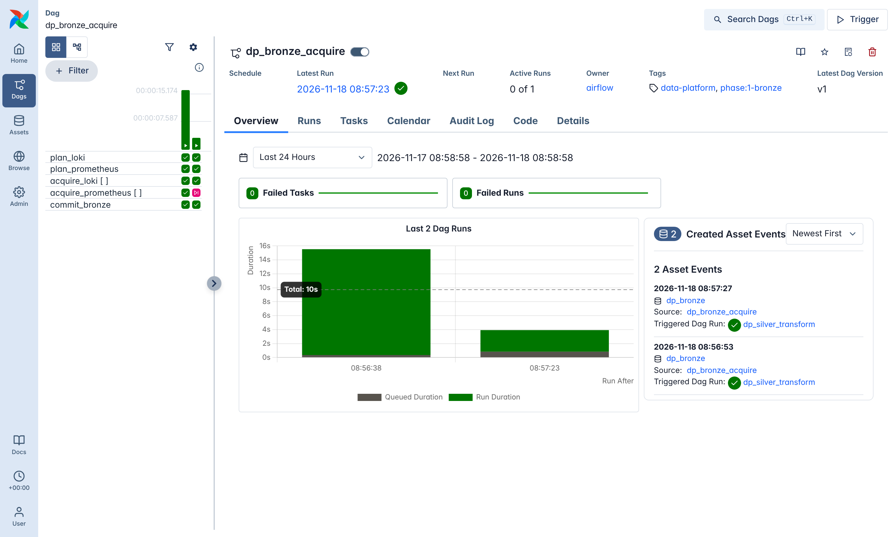
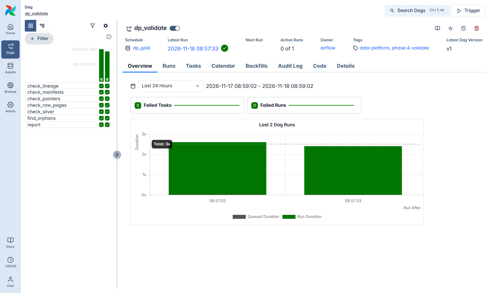

# aiops/dataplatform

데이터 티어링(Bronze/Silver/Gold) 배치 플랫폼. 계약은 [docs/data-platform](../../docs/data-platform/README.md)이다.

```text
dp_incident_discover ─(trigger)─▶ dp_bronze_acquire ─▶ (dp_bronze) ─▶ dp_silver_transform ─▶ (dp_silver) ─▶ dp_gold_build ─▶ (dp_gold) ─▶ dp_validate
```

## 현재 상태

| Phase | 구현 | 계약 |
|---|---|---|
| STEP 0.5 계약 코드 | `contracts/` (canonical JSON·해시·ID 식·어휘·스키마), `storage/` (LocalFsStore·manifest commit·current 포인터·lineage writer) | 01 §1, 02 §3·§4, 03 §2·§3 |
| Track A Bronze | `bronze/plan.py` (`plan_incident`), `bronze/acquire.py` (`acquire`: series·lookback preflight, Loki 페이지네이션, 반환 label·본문 검증, 부분 실패 보존, 금지 스트림 차단) | 01 §2, 02 §5~§7, 04 §1 |
| Track B Silver | `silver/normalize.py` (데이터셋 7종 + quarantine), `silver/build.py` (coverage, dedup, edge) | 01 §3, DQ-S01~S06 |
| Track C Gold·Lineage | `gold/build.py` (사건 창·scope 매칭·채널 상태·evidence·rca_link), `gold/render.py` (Pipeline 렌더 포팅), `gold/checks.py` (DQ-G), `lineage/trace.py` (`trace`, DQ-L01) | 01 §4, 03, 04 §4·§5 |
| Track D Airflow | DAG 4개가 `orchestration/phases.py`의 실제 진입점을 호출(#38의 `fixture_stubs` 대체), `dp_validate` 검사 5종 | 05 §5 Track D |
| 배치화 (#68) | `orchestration/discover.py` + `dp_incident_discover`: 10분마다 Loki `{job="aiops-llm"}` envelope에서 IncidentRequest를 만들고, 획득 창 종료 + 10분 뒤 `dp_bronze_acquire`를 run id `discover__{incident_id}`로 1회 trigger(`lake-meta/discover/`에 cursor·pending·triggered 기록, plan이 이미 있으면 건너뜀). `dp_validate`는 `dp_gold` 갱신 또는 매일 19:00 UTC | 05 §5·§6 |
| E2E용 원천 | `mock_sources/` — fixture Bronze 행으로 답하는 mock Loki/Prometheus (Compose `dp-mock-sources`, 테스트의 `httpx.MockTransport`) | 07 |

**fixture 파리티:** Bronze 10건, Silver 8 build(대체된 1차 db_log 포함), Gold 2 build(대체된 1차 포함)를 fixture의
요청·binding·실행 시각으로 다시 만들면 행·edge·manifest(bytes·sha256 포함)가 `docs/data-platform/examples`와
**바이트 단위로 같다**(`tests/test_bronze.py`, `test_silver.py`, `test_gold.py`). 대체된 두 build는 fixture에 행이 없어
manifest의 `inputs`·`quality`·출력 행 수만 비교한다.

## 결정 기록 (DEC)

| ID | 결정 |
|---|---|
| DEC-01 | 코드 위치 `aiops/dataplatform/`. Pipeline 모듈(`identity`, `correlation`, `prompt.log_line`, `schemas.llm_output`, `collector.metrics`, `policy.allowlist`)은 `contracts/pipeline_compat.py`가 `sys.path`로 **읽기만** 한다(바이트코드 미생성). 사설 함수(`network_section._aggregate/_flow_line`, `log_line._summarize` 등)는 `gold/render.py`로 포팅하고 파리티 테스트로 고정한다 |
| DEC-02 | 핵심 로직은 순수 Python dict. 데이터 파일은 fixture 규약 바이트(canonical JSON 줄, `*.parquet` key → 로컬 `*.jsonl`)로 쓴다. **Parquet codec은 아직 없다**: pyarrow가 설치돼 있지 않고 새 패키지 설치는 승인 대상이라 후속으로 남긴다. DuckDB 조회도 같은 이유로 미구현 |
| DEC-03 | 저장소는 로컬 `LocalFsStore`(02 §3 key 레이아웃 그대로, 기본 `./.lake`, `DP_LAKE_ROOT`)부터. #38의 `orchestration/lake.py`를 `storage/store.py`로 옮겨 확장했다(덮어쓰기 거부, raw gzip mtime=0, manifest·포인터·run·plan). MinIO 어댑터는 후속 |
| DEC-18 | Delta가 아니라 **자체 manifest**를 유지한다. 계약·fixture·검증이 manifest 기준이다 |

구현 중 정한 세부 사항:

- **plan 기록** `lake-meta/plans/{incident_id}.json`: Bronze phase가 이번 실행의 plan id·binding 집합·획득 창을 남기고, Silver/Gold는 이것으로 같은 `coverage_id`를 계산한다. binding 집합은 **필터 전 전체 plan** 기준이다(`stream_classes`로 db_log만 재획득해도 coverage가 바뀌지 않음, 02 §7).
- **재빌드 조건**: coverage의 입력 manifest 집합이 현재 build와 같으면 Silver/Gold를 다시 만들지 않는다(03 §4 "같은 내용이면 no-op"). 사건 모드는 같은 `acquisition_key`의 닫힌 창 `ok` 획득을 재사용하고, `force_reacquire`면 새로 받는다(02 §5).
- **IncidentRequest 확장 키**(선택): `stream_classes`(재획득 대상 제한), `page_limit`, `max_pages`, `metric_queries`. 없으면 collector와 같은 전체 쿼리를 계획한다(related backend는 gc-telemetry 쿼리 6개).
- **사건 창 필터의 시각**: 로그는 실시간 collector처럼 Loki entry 시각, Network은 이벤트 `timestamp`, 메트릭은 sample 시각.
- **lineage.run**: task 시도마다 `lake-meta/lineage/v1/run/…`에 기록. `DP_GIT_SHA`(40 hex)가 없으면 실행을 거부하고, `DP_ENV=production`에서 `DP_GIT_DIRTY=true`면 거부한다(03 §2). unmapped task의 `map_index=-1`은 null로 저장한다.
- **평균값**: `math.fsum`을 쓴다. Python 3.12+의 `sum()`은 보정 합산이라 3.11과 결과가 1ulp 다를 수 있다(Airflow 이미지는 3.11).

## 실행

```sh
cd aiops/dataplatform && python -m unittest discover -s tests -v       # httpx·pydantic·PyYAML 필요 (Pipeline과 같은 의존성)

# 저장소 루트에서. git sha를 넘기지 않으면 task가 실행을 거부한다.
DP_GIT_SHA=$(git rev-parse HEAD) DP_GIT_DIRTY=$(test -z "$(git status --porcelain)" && echo false || echo true) \
  docker compose -f docker-compose.dataplatform.yml up -d                # UI http://127.0.0.1:18080
docker exec dp-airflow airflow dags trigger dp_bronze_acquire             # 하위 Phase는 Asset으로 연쇄 실행
# db_log만 강제 재획득(fixture 03:40 reprocess와 같은 조건)
docker exec dp-airflow airflow dags trigger dp_bronze_acquire --conf '{…요청…, "force_reacquire": true, "page_limit": 3, "stream_classes": ["db_log"]}'
```

사건 자동 발견: `dp_incident_discover`가 10분마다 돈다. 과거 범위를 다시 스캔하려면(cursor는 그대로)
`docker exec dp-airflow airflow dags trigger dp_incident_discover --conf '{"scan_start": "2026-11-10T02:45:00Z", "scan_end": "2026-11-10T03:30:00Z"}'`.
설정은 `DP_DISCOVER_START`(첫 cursor), `DP_DISCOVER_LOOKBACK_S`, `DP_DISCOVER_RELATED`(related scope 규칙 JSON) 등이다(`orchestration/discover.py`).

`DP_LOKI_URL`/`DP_PROMETHEUS_URL`을 주지 않으면 `dp-mock-sources`(fixture)를 읽는다. 실제 Loki/Prometheus 연결은
OI-09 binding 인수 이후 사용자 승인 단계다(05 §7).

### E2E 화면 (2026-11-18, Airflow 3.3.2, mock 원천)

| 화면 | |
|---|---|
| Bronze — 1회차 전체 획득(15건) 후 2회차 db_log만 재획득. Prometheus 레인은 plan이 비어 skipped(분홍)이고 `commit_bronze`는 실행돼 `dp_bronze`를 낸다 |  |
| Validate — 두 실행 모두 검사 5종 PASS |  |
| (#38 stub 시점) Phase별 Graph | [asset](docs/0_asset_chain.jpg) · [bronze](docs/1_bronze_graph.jpg) · [silver](docs/2_silver_graph.jpg) · [gold](docs/3_gold_graph.jpg) · [validate](docs/4_validate_graph.jpg) |

## 테스트 구성

| 파일 | 내용 |
|---|---|
| `tests/test_contracts.py` | S-01~S-06 재검증: 스키마 ↔ 문서 표 ↔ fixture, 어휘, ID·해시 재계산, manifest bytes/sha256, fixture lake에 DQ 적용, Pipeline 파리티 |
| `tests/test_bronze.py` | Track A ①~⑧ + 실패·불일치·재사용·열린 창 |
| `tests/test_silver.py` | Track B ①~⑥ + value_revised |
| `tests/test_gold.py` | Track C ①~⑥ + 채널 규칙 1~8, DQ-G05, lineage 무결성 |
| `tests/test_orchestration.py` | Track D ①~⑤: E2E(MockTransport·loopback HTTP 서버), 재실행 보존, 실패 시 manifest 없음, git_dirty 거부, 필터 재처리, 검증기 오류 탐지, DAG 구조(Airflow 있을 때) |

테스트 디렉터리를 `tests/<track>/` 패키지로 나누지 않은 이유: `discover -s tests`에서 `tests/contracts`가 실제
`contracts` 패키지를 가린다. fixture 로더는 `tests/fixture_data.py`이며 `docs/data-platform/examples`를 제자리에서 읽는다.
