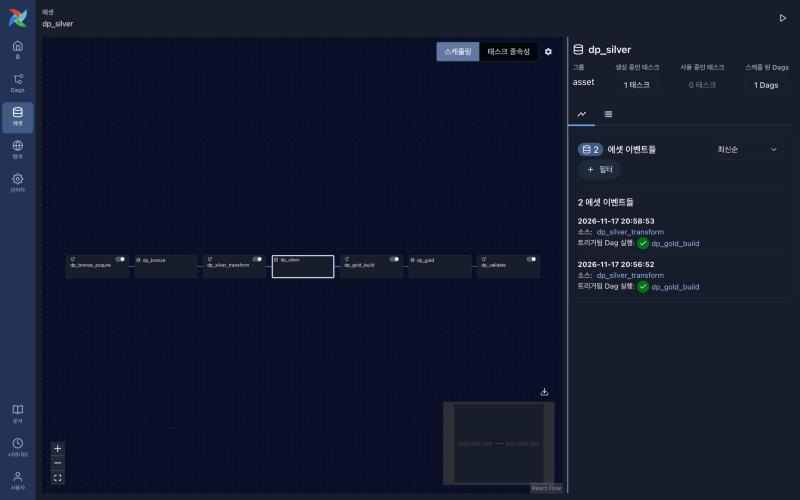
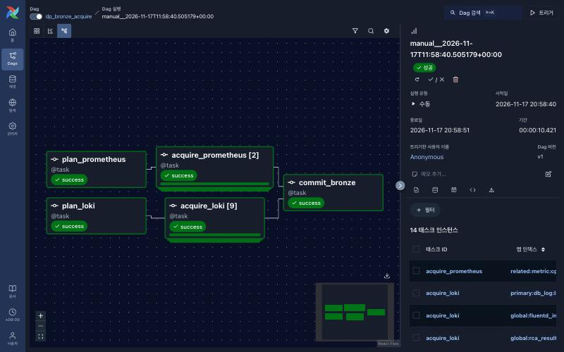
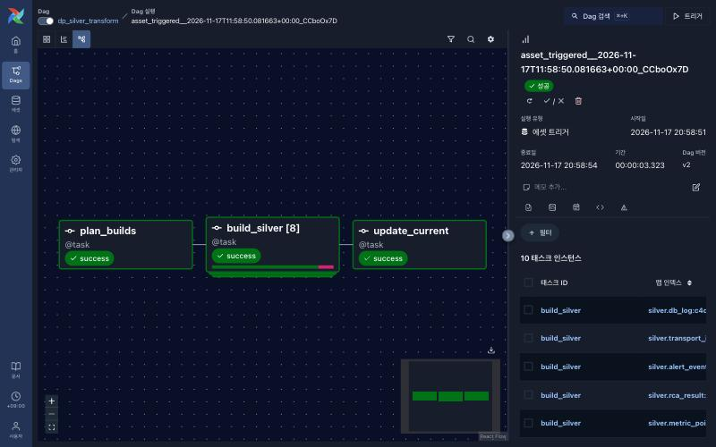
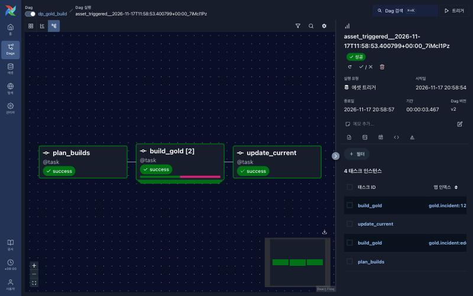
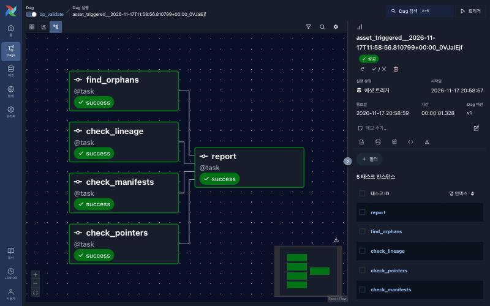

# aiops/dataplatform

데이터 티어링(Bronze/Silver/Gold) 배치 플랫폼. 계약은 [docs/data-platform](../../docs/data-platform/README.md)이다.

## 현재 상태 (#38)

Airflow 오케스트레이션만 구현되어 있다. 각 Phase의 변환은 **stub**으로, STEP 0 Mock fixture
(`docs/data-platform/examples/db-connection-limit`)의 committed build를 그대로 다시 쓴다.
`dp_validate`의 검사는 실제로 동작한다.

```text
dp_bronze_acquire ─▶ (dp_bronze) ─▶ dp_silver_transform ─▶ (dp_silver) ─▶ dp_gold_build ─▶ (dp_gold) ─▶ dp_validate
```

### Phase별 DAG 화면 (2026-11-17 로컬 실행, Airflow 3.3.2)

| Phase | Graph |
|---|---|
| 전체 Asset 체인 |  |
| 1 Bronze — 원천별 레인, pool로 직렬화. 매핑 task는 `scope:stream:query:획득ID`로 표시 |  |
| 2 Silver — build 8개 중 1개는 fixture에 행이 없는 대체 build라 `skipped`(분홍) |  |
| 3 Gold — build 2개 중 대체 build 1개 `skipped` |  |
| 4 Validate — 검사 3개 + orphan 보고를 병렬 실행 후 `report` |  |

| 경로 | 내용 |
|---|---|
| `airflow/dags/` | Phase별 DAG 4개와 Asset 정의(`dp_assets.py`) |
| `orchestration/fixture_stubs.py` | Phase 진입점 stub (`plan_incident`, `acquire`, `build_silver`, `build_gold`, `update_pointers`) |
| `orchestration/validate.py` | `dp_validate` 검사 |
| `orchestration/lake.py` | stub용 로컬 저장소. STEP 0.5 `storage/`로 교체 예정. 파일은 Parquet가 아니라 fixture 규약 바이트(canonical JSON 줄) |

## Phase 구현을 넣는 방법

1. 자기 Phase의 진입점을 같은 시그니처로 구현한다(05 §4).
2. 해당 DAG 파일의 `from orchestration import fixture_stubs as phase`를 새 모듈로 바꾼다. 다른 Phase DAG는 건드리지 않는다.
3. `dp_validate`가 통과하는지 확인한다.

## 실행

```sh
cd aiops/dataplatform && python -m unittest discover -s tests -v      # Airflow 불필요
docker compose -f docker-compose.dataplatform.yml up -d                  # 저장소 루트에서, UI http://127.0.0.1:18080
docker exec dp-airflow airflow dags trigger dp_bronze_acquire            # 하위 Phase는 Asset으로 연쇄 실행
```
