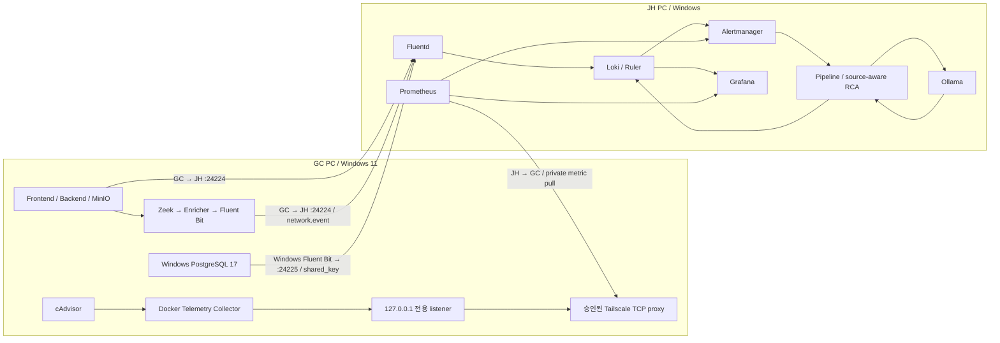

# Leafy AIOps — Windows 2PC Tailscale E2E 실행 Runbook

문서 기준: 2026-11-11 / KU-GraduationProject/graduation-project
대상: GC(PC2, Windows 11 관측 대상) + JH(PC1, Windows AIOps 관리)

**현재 판정: 문서와 오프라인 통합 코드는 준비됨. 실제 Windows 2PC E2E와 본 촬영 승인은 BLOCKED.**

이 문서 작성 중 Windows PC 연결·서비스 기동·DB 변경·시나리오·Slack 송신은 실행하지 않았다. 이전 통합 검증 588 PASS / FAIL 0 / SKIP 0은 오프라인 결과다. 재부팅 후 현재 상태, 5초 수집, 실제 경보·Ollama 추론·Loki 저장을 보장하지 않는다. 모든 출력 예시는 예상 출력 예시이며 관측 기록이 아니다.

## 먼저 읽기: 오늘 할 수 있는 것과 중단 조건

- STEP 0~7의 기존 시스템 읽기 전용 점검은 운영 변경 없이 진행한다. 로컬 비공개 증거 파일은 새 디렉터리에 만든다.
- 설정·기동·로그 driver 변경·transport 생성·테스트 요청은 해당 단계의 선행 조건과 사람의 승인이 필요하다. 문서 전체를 한 번에 실행하지 않는다.
- 미확정 주소·실제 앱 Compose 경로·컨테이너 이름·PG 서비스명은 입력/조회로 확인한다. 문서의 관리 API 포트는 저장소 기본 구성값이며 실행 중 publish 출력과 같을 때만 사용한다.
- source 미확인 또는 데이터 부재는 PASS가 아니다. UNKNOWN / EMPTY / 0 / API 오류를 구분한다.
- M4는 NORMAL_UNCONFIRMED를 유지한다. 짧은 정상 대조 요청은 M4 정상 Baseline 인수가 아니다.
- M6 동결·M7 Heldout 평가는 별도다. S2 V2는 코드가 Heldout 최종 평가로 분류하므로 데모에서 제외한다. 비공개 transfer specification, variants, fixtures, 정답 및 결과는 열람하지 않았다.
- F2-c는 Docker DB 전용이며 GC Windows PostgreSQL 17에 사용할 수 없다. 레거시 고부하 SQLi 실행기도 기본 데모에서 제외한다.
- Remediation/Slack은 source-aware 소비자 계약 미완성으로 보류 상태를 유지한다. 성공 장면에 포함하지 않는다.

당일 간단한 순서는 E2E_EXECUTION_CHECKLIST.md, 촬영 장면은 E2E_DEMO_RECORDING_SCRIPT.md를 사용한다. 이 세 파일은 노션에 각각 첨부할 수 있다. 저장소 상대 링크가 노션에서 자동 연결되지 않으면 파일명과 STEP 번호로 찾는다.

## 아키텍처와 담당

| 구간 | GC PC | JH PC | 통신 방향·판정 |
|---|---|---|---|
| 앱 | Frontend/Nginx, Backend, MinIO | Grafana 확인 | 실제 앱 Compose는 별도 저장소일 수 있음 |
| DB | Windows PostgreSQL 17 + Windows Fluent Bit | Fluentd → Loki | GC → JH 24225/TCP, shared_key |
| 앱 로그 | Docker fluentd driver | Fluentd → Loki | GC → JH 24224/TCP |
| Network | Zeek → Enricher → JSONL → Fluent Bit shipper | Fluentd @NETWORK → Loki | GC → JH 24224/TCP, tag network.event |
| 자원·재시작 | cAdvisor + GC Telemetry Collector | Prometheus | JH → GC 승인 private transport. 로그 포트 재사용 아님 |
| 탐지·RCA | 승인된 공개 요청만 생산 | Loki Ruler/Prometheus → AM → Pipeline → Ollama → Loki | 다섯 identity와 사건 시각을 끝까지 대조 |
| 조치 | 실행 안 함 | Policy/Remediation disabled, Slack 보류 | LLM 제안은 실행 승인이 아님 |




Mermaid가 코드로 표시되면 내용은 그대로 보존한다. 연결 방향과 포트 표를 함께 읽으면 된다.

**네 단계는 서로 다르다:** Tailscale ping 성공 → TCP 연결 성공 → API 응답 성공 → 같은 사건 데이터 저장/분석 성공. 앞 단계 성공으로 뒤 단계를 PASS 처리하지 않는다.

## 확인한 저장소 상태와 현재 버전

로컬 통합 Worktree는 m5-integration-release, detached HEAD 92e70dbf8b9af14b9376df3fde3a7fb4db7e3e50이다. A/B/C 브랜치도 같은 HEAD에 미커밋 구현이 있었다. main 50, A 12, B 23, C 54건을 보존해 84개 고유 경로를 통합했다. 따라서 SHA만 같아도 코드가 같다는 뜻이 아니다.

main의 후속 .gitignore/claude.md/AGENTS.md/agent-context 변경은 이 통합에 넣지 않았다. 당일 양 PC는 Git 상태 + 통합 코드/번들 해시 + 실제 이미지 ID를 비교해야 한다. 무조건 pull/reset/clean/checkout 하지 않는다.

| 구현 자료 | 확인 결과 | 실환경 상태 |
|---|---|---|
| OI-09 identity.py / collector / main.py | source별 해석, exact scope, UNKNOWN 차단, RCA v2 | 배포·bindings 미검증 |
| OI-02/03/04 exporter.py / verify.py | Docker 고정 GET, CPU/working set/RX/restart/started, 상태 지표 | Desktop/cgroup/transport 미검증 |
| M5-B acceptance_m5b.py | --plan, --bundle, endpoint 옵션, --at, --expected-model, --output 확인 | 실제 평가·발화·E2E 미인수 |
| M5-A | 원본 후보 21개 정의, Loki 12 / Prometheus 9, 이름 18종 | 운영 정의 17개와 구별 |
| prepare_release.py | source 보존·GC 프로파일 생성 | 부분 후보. frontend/backend/minio+PG 합성 예는 17개 정의 |
| 공개 S1-a | GET 생성, count/background 인자, source-level 검토 | 실제 GC API의 읽기 전용 동작 확인 필요 |
| S2/C-a / F2-c | V2 Heldout, hardcoded topology·Docker DB 전제 확인 | 데모 경로 BLOCKED |

근거 파일: docs/rulepack/M5_INTEGRATION_RELEASE_READINESS.md, OI_09_SOURCE_IDENTITY.md, OI_02_03_04_TELEMETRY.md, M5_B_RUNTIME_ACCEPTANCE.md, m5b/PHASE_B_REVALIDATION.md 및 integration/verification.json.
과거 문서의 “GC→JH 전달 확인”은 그 관측 시점의 기록이며 오늘의 성공 판정이 아니다.

## STEP 0 — 준비와 버전 확인

STEP 0은 양 PC에서 병렬로 수행한다. 아래 함수는 같은 PowerShell 창에서 이후 STEP이 사용한다. 새 창을 열면 이 STEP과 해당 PC 변수 설정을 다시 한다.


### STEP 0.1 — 실제 경로·도구·시각과 세션 준비 [PARALLEL]

| 항목 | 설명 |
|---|---|
| 담당 PC | GC + JH |
| 운영체제 | Windows |
| 실행 터미널 | PowerShell 5.1 이상 |
| 실행 권한 | 일반 사용자 |
| 실행 위치 | $Repo (STEP 0.1에서 입력한 실제 경로) |
| 실행 구분 | 읽기 전용 조회 + 로컬 비공개 기록 디렉터리 생성 |
| 실행 방식 | [PARALLEL] |
| 선행 조건 | 각 PC에서 일반 PowerShell 창을 열고 실제 저장소 경로를 알고 있음 |
| 성공 조건 | 도구/저장소 확인, 고유 증거 폴더 생성, UTC/KST 기록 |
| 실패 시 조치 | 경로·도구 누락 시 중단. Python Store 별칭 또는 Docker Desktop 미기동은 운영자가 확인 |

**① 실행 명령어**

```powershell
$ErrorActionPreference = 'Stop'
$env:PYTHONUTF8 = '1'
$Pc = (Read-Host '이 PC 담당: GC 또는 JH').Trim().ToUpperInvariant()
if ($Pc -notin @('GC','JH')) { throw 'GC 또는 JH만 입력' }
$Repo = (Read-Host '통합 코드가 있는 실제 저장소 절대 경로').Trim()
if (-not (Test-Path -LiteralPath (Join-Path $Repo '.git'))) { throw 'Git 저장소 경로 재확인' }
Set-Location -LiteralPath $Repo
function Assert-Native { if ($LASTEXITCODE -ne 0) { throw "native command exit=$LASTEXITCODE; 다음 단계 중단" } }
function Save-PrivateJson($Value, [string]$Name) {
    $p = Join-Path $Evidence $Name
    if (Test-Path -LiteralPath $p) { throw "증거 덮어쓰기 거부: $Name" }
    $Value | ConvertTo-Json -Depth 60 | Set-Content -LiteralPath $p -Encoding UTF8
}
function Get-ApiJson([string]$Uri, [hashtable]$Query = @{}) {
    if ($Query.Count -gt 0) {
        $pairs = foreach ($k in $Query.Keys) {
            [Uri]::EscapeDataString([string]$k) + '=' + [Uri]::EscapeDataString([string]$Query[$k])
        }
        $Uri += '?' + ($pairs -join '&')
    }
    $r = Invoke-RestMethod -Method Get -Uri $Uri -TimeoutSec 15
    if ($r.PSObject.Properties['warnings'] -and @($r.warnings).Count -gt 0) { throw 'API warnings: PARTIAL, private 증거로 조사' }
    if ($r.PSObject.Properties['infos'] -and @($r.infos).Count -gt 0) { throw 'API infos: PARTIAL, private 증거로 조사' }
    if ($r.PSObject.Properties['status'] -and $r.status -notin @('success','ok')) { throw 'API non-success' }
    return $r
}
function New-Selector([hashtable]$Labels) {
    $items = foreach ($k in ($Labels.Keys | Sort-Object)) {
        if ($k -notmatch '^[a-zA-Z_][a-zA-Z0-9_]*$') { throw 'invalid label key' }
        $k + '=' + (ConvertTo-Json -InputObject ([string]$Labels[$k]) -Compress)
    }
    return '{' + ($items -join ',') + '}'
}
Get-Command git,docker,python,tailscale,curl.exe -ErrorAction Stop | Select-Object Name,Source
python --version
Assert-Native
git rev-parse --show-toplevel
Assert-Native
git rev-parse HEAD
Assert-Native
git status --short --untracked-files=all
Assert-Native
git worktree list
Assert-Native
docker version --format '{{.Client.Version}} / {{.Server.Version}}'
Assert-Native
docker compose version
Assert-Native
tailscale version
Assert-Native
$EvidenceRoot = (Read-Host '저장소 밖의 비공개 증거 상위 폴더 절대 경로').Trim()
$RunId = [DateTimeOffset]::UtcNow.ToString('yyyyMMddTHHmmssZ') + '-' + $Pc + '-' + ([Guid]::NewGuid().ToString('N').Substring(0,8))
$Evidence = Join-Path $EvidenceRoot $RunId
New-Item -ItemType Directory -Path $Evidence | Out-Null
$RunStartUtc = [DateTimeOffset]::UtcNow
$Clock = [pscustomobject]@{pc=$Pc; run_id=$RunId; utc=$RunStartUtc.ToString('o'); kst=[TimeZoneInfo]::ConvertTimeBySystemTimeZoneId($RunStartUtc,'Korea Standard Time').ToString('o')}
$Clock
Save-PrivateJson $Clock 'start-clock.json'
w32tm /query /status
Assert-Native
```

**② 명령어 설명**

한 블록은 한 번 복사 가능하다. PYTHONUTF8=1은 현재 Python 프로세스의 텍스트 파일 인코딩을 UTF-8로 고정하며 Windows 시스템 locale은 바꾸지 않는다. Assert-Native는 PowerShell 5.1에서 native 명령 실패도 중단한다. Get-ApiJson은 GET만 사용하고 warning/infos를 PARTIAL로 중단한다. Save-PrivateJson은 새 파일만 만든다. 시계 오차는 양 PC UTC를 비교한다.

**③ 예상 출력 예시 — 실제 관측값 아님**

```text
HEAD: <실제 SHA>
Client / Server: <실제 Docker 버전>
utc: <실제 UTC>
kst: <같은 순간 +09:00>
Git 변경 목록은 비어 있지 않을 수 있음
```

**④ 결과의 의미**

도구와 세션 준비만 확인했다. Git 변경을 지우거나 Windows 시각을 자동 수정하지 않았다. w32tm의 동기화 원본과 양 PC 차이를 기록하고, 관측 시간 비교를 해칠 오차가 있으면 테스트 전에 운영자가 해결한다.

**⑤ 실패 시 확인 사항**

권한 때문에 w32tm 조회가 거부되면 그 항목은 UNVERIFIED다. 관리자 조회가 필요하면 별도 창에서 조회만 수행한다. 저장소 밖 폴더를 고르며 공개 공유/Notion 업로드 폴더는 사용하지 않는다.

- [ ] 실행자 / 실제 UTC·KST 시각 / 결과 / 증거 파일을 기록했다.


### STEP 0.2-JH — 실제 배포 프로파일과 관리 API 변수 [SEQUENTIAL]

| 항목 | 설명 |
|---|---|
| 담당 PC | JH |
| 운영체제 | Windows |
| 실행 터미널 | PowerShell 5.1 이상 |
| 실행 권한 | 일반 사용자 |
| 실행 위치 | $Repo (STEP 0.1에서 입력한 실제 경로) |
| 실행 구분 | 읽기 전용 + 현재 세션 변수 설정 |
| 실행 방식 | [SEQUENTIAL] |
| 선행 조건 | STEP 0.1 완료. 실제 private env와 검토된 profile/bundle 위치 확인 |
| 성공 조건 | 현재 Compose 인자, 실제 GC identity, 관리 포트가 구분됨 |
| 실패 시 조치 | profile/bundle이 없으면 health 진단만 가능. identity·메트릭·주입 단계 BLOCKED |

**① 실행 명령어**

```powershell
$JhPeer = (Read-Host 'JH의 실측 Tailscale IPv4 또는 이름').Trim()
$GcPeer = (Read-Host 'GC의 실측 Tailscale IPv4 또는 이름').Trim()
$JhPrivateEnv = (Read-Host 'JH 실제 비공개 Compose env 파일 절대 경로').Trim()
if (-not (Test-Path -LiteralPath $JhPrivateEnv -PathType Leaf)) { throw '실제 env 파일 필요' }
$JhArgs = @('--project-directory',$Repo,'--env-file',$JhPrivateEnv,'-f',(Join-Path $Repo 'docker-compose.aiops.yml'))
$Bundle = (Read-Host '검토한 실제 JH 번들 절대 경로; 없으면 Enter').Trim()
if ($Bundle) {
    if (-not (Test-Path -LiteralPath (Join-Path $Bundle 'manifest.json'))) { throw 'bundle 없음' }
    $env:RELEASE_BUNDLE = $Bundle
    $JhArgs += @('-f',(Join-Path $Bundle 'jh.compose.override.yml'))
}
docker compose @JhArgs config --services
Assert-Native
docker compose @JhArgs port prometheus 9090
Assert-Native
docker compose @JhArgs port loki 3100
Assert-Native
docker compose @JhArgs port alertmanager 9093
Assert-Native
docker compose @JhArgs port pipeline 8000
Assert-Native
# 위 실제 publish 출력이 아래 저장소 기본값과 다르면 여기서 중단하고 실측 origin으로 바꾼다.
$Prom = 'http://127.0.0.1:9090'
$Loki = 'http://127.0.0.1:3100'
$Am = 'http://127.0.0.1:9093'
$Pipe = 'http://127.0.0.1:8000'
$Ollama = 'http://127.0.0.1:11434'
$Grafana = 'http://127.0.0.1:3000'
$PrivateProfile = (Read-Host '실측 GC release profile JSON 절대 경로; 없으면 Enter').Trim()
if ($PrivateProfile) {
    $Profile = Get-Content -LiteralPath $PrivateProfile -Raw | ConvertFrom-Json
    if ($Profile.inventory_verified -ne $true) { throw '실측 inventory 미인수' }
    $GcSite = [string]$Profile.gc.site
    $GcSource = [string]$Profile.gc.source
    $BackendName = [string]$Profile.gc.targets.backend.name
    $FrontendName = [string]$Profile.gc.targets.frontend.name
    $TeleJob = [string]$Profile.telemetry.job
    $TeleInstance = [string]$Profile.telemetry.instance
    $BackendScope = @{site=$GcSite; source=$GcSource; service='backend'; runtime='container'; target=$BackendName}
    $FrontendScope = @{site=$GcSite; source=$GcSource; service='frontend'; runtime='container'; target=$FrontendName}
    $SourceScope = @{site=$GcSite; source=$GcSource}
}
```

**② 명령어 설명**

모든 -f는 명시된 파일만 사용한다. --env-file 값은 출력하지 않는다. port는 기동 명령이 아니다. 부분 번들로 전체 운영을 교체하지 않는다. profile의 true 플래그만으로 사실 검증이 끝나는 것은 아니며 GC 실측값을 대조해야 한다.

**③ 예상 출력 예시 — 실제 관측값 아님**

```text
서비스 이름: fluentd loki prometheus alertmanager pipeline ollama grafana remediation
publish: 127.0.0.1:<실제 포트>
profile 없음: 후속 source 검증 BLOCKED
```

**④ 결과의 의미**

JH loopback API를 GC에서 localhost로 호출하지 않는다. GC의 localhost는 GC 자신이다. SHA와 profile 값만으로 현재 실행 이미지가 일치한다고 판정하지 않는다.

**⑤ 실패 시 확인 사항**

기동 전 port 조회가 실패하면 STEP 2.2 승인 절차를 검토하고 다시 실행한다. 실제 approved override가 별도 이름이면 그 실제 파일을 사용하고 명령 배열을 기록한다. 부분 후보는 전체 M5 교체 불가다.

- [ ] 실행자 / 실제 UTC·KST 시각 / 결과 / 증거 파일을 기록했다.


### STEP 0.2-GC — 실제 앱·Observer·Telemetry 경로 [SEQUENTIAL]

| 항목 | 설명 |
|---|---|
| 담당 PC | GC |
| 운영체제 | Windows |
| 실행 터미널 | PowerShell 5.1 이상 |
| 실행 권한 | 일반 사용자 |
| 실행 위치 | $Repo (STEP 0.1에서 입력한 실제 경로) |
| 실행 구분 | 읽기 전용 + 현재 세션 변수 설정 |
| 실행 방식 | [SEQUENTIAL] |
| 선행 조건 | STEP 0.1 완료. GC 실제 앱 저장소의 Compose 경로를 운영자에게 확인 |
| 성공 조건 | 존재하는 파일의 service 목록/현재 프로젝트만 확인 |
| 실패 시 조치 | 외부 back/deploy 경로가 미확정이면 추측하지 말고 해당 기동 단계 중단 |

**① 실행 명령어**

```powershell
$GcPeer = (Read-Host 'GC의 실측 Tailscale IPv4 또는 이름').Trim()
$JhPeer = (Read-Host 'JH의 실측 Tailscale IPv4 또는 이름').Trim()
docker compose ls --format json
Assert-Native
$AppCompose = (Read-Host 'GC 실제 Leafy 앱 Compose 파일 절대 경로').Trim()
$AppEnv = (Read-Host 'GC 앱 비공개 env 파일 절대 경로').Trim()
if (-not (Test-Path -LiteralPath $AppCompose -PathType Leaf)) { throw '앱 Compose 없음' }
if (-not (Test-Path -LiteralPath $AppEnv -PathType Leaf)) { throw '앱 env 없음' }
$GcAppArgs = @('--project-directory',(Split-Path -Parent $AppCompose),'--env-file',$AppEnv,'-f',$AppCompose)
docker compose @GcAppArgs config --services
Assert-Native
$FrontendOrigin = (Read-Host '실측 GC Frontend origin; scheme://host:port').TrimEnd('/')
$SqliPath = (Read-Host 'GC 앱 담당자가 읽기 전용임을 검토한 실제 공개 경로').Trim()
$SqliParam = (Read-Host '해당 경로의 실제 검색/조회 parameter 이름').Trim()
$BackendName = (Read-Host '실측 Backend 컨테이너 이름').Trim()
$FrontendName = (Read-Host '실측 Frontend 컨테이너 이름').Trim()
Get-Service '*postgres*' | Select-Object Name,Status
$PgService = (Read-Host '위 Get-Service에서 확인한 실제 PG17 Windows 서비스명').Trim()
$ObserverDir = Join-Path $Repo 'deploy\leafy-pc\network-observer'
$ObserverEnv = (Read-Host '이미 인수된 GC Observer private env 파일 절대 경로; 없으면 Enter').Trim()
if ($ObserverEnv) {
    $ObserverArgs = @('--project-directory',$ObserverDir,'--env-file',$ObserverEnv,'-f',(Join-Path $ObserverDir 'docker-compose.yml'))
}
$TeleDir = Join-Path $Repo 'deploy\leafy-pc\telemetry'
$TeleEnv = (Read-Host '이미 인수된 GC Telemetry private env 파일 절대 경로; 없으면 Enter').Trim()
if ($TeleEnv) {
    $TeleArgs = @('--project-directory',$TeleDir,'--env-file',$TeleEnv,'-f',(Join-Path $TeleDir 'compose.candidate.yml'),'-f',(Join-Path $TeleDir 'compose.transport.candidate.yml'))
}
```

**② 명령어 설명**

config --services는 비밀 환경변수 전체를 출력하지 않고 서비스 이름만 확인한다. 앱 Compose가 여러 -f를 쓰는 실제 구성이면 승인된 순서대로 GcAppArgs에 모두 추가한다. 저장소의 all-in-one Compose로 GC 외부 앱을 대신 기동하지 않는다.

**③ 예상 출력 예시 — 실제 관측값 아님**

```text
프로젝트 목록과 실제 ConfigFiles
앱 service 역할 frontend/backend/minio 확인 또는 이름 차이 기록
PG 서비스명 및 공개 API path는 실제 값
```

**④ 결과의 의미**

이 저장소의 S1-a 기본 경로는 /api/v1/auth/check-login-id, parameter는 login_id다. 실제 GC 앱에 존재하고 GET의 동작이 읽기 전용임을 별도 앱 담당자가 확인해야 한다. 존재하지 않으면 이 값으로 밀어붙이지 않는다.

**⑤ 실패 시 확인 사항**

Observer config에는 instance:null, network placeholder, 과거 host endpoint 예가 있으므로 그대로 실측값으로 간주하지 않는다. Telemetry env/transport가 없으면 BLOCKED로 표시한다.

- [ ] 실행자 / 실제 UTC·KST 시각 / 결과 / 증거 파일을 기록했다.


### STEP 0.3 — 코드·이미지와 안전 상태 대조 [PARALLEL]

| 항목 | 설명 |
|---|---|
| 담당 PC | GC + JH |
| 운영체제 | Windows |
| 실행 터미널 | PowerShell 5.1 이상 |
| 실행 권한 | 일반 사용자 |
| 실행 위치 | $Repo (STEP 0.1에서 입력한 실제 경로) |
| 실행 구분 | 읽기 전용 |
| 실행 방식 | [PARALLEL] |
| 선행 조건 | 각 PC Compose 인자 준비. 각 코드 주석의 PC에서만 실행 |
| 성공 조건 | 코드/번들 해시와 실제 이미지 ID를 기록. name-only 자동 조치가 활성화되지 않음 |
| 실패 시 조치 | 동일 SHA지만 해시/이미지가 다르면 재배포 여부를 운영자가 결정. 자동 build하지 않음 |

**① 실행 명령어**

```powershell
# 양 PC
$Critical = @('aiops\pipeline\identity.py','aiops\pipeline\main.py','aiops\pipeline\collector\metrics.py','deploy\leafy-pc\telemetry\exporter.py','tools\rulepack\acceptance_m5b.py','tools\rulepack\prepare_release.py','scenarios\v2\s1a_input_attack.py','scenarios\v2\supervisor.py')
$Hashes = foreach ($f in $Critical) { Get-FileHash -LiteralPath (Join-Path $Repo $f) -Algorithm SHA256 | Select-Object Path,Hash }
Save-PrivateJson @($Hashes) 'source-hashes.json'
docker ps -a --no-trunc --format '{{.ID}} {{.Names}} {{.Image}} {{.Status}}'
Assert-Native
# JH 전용: image ID는 실제 실행 파일이 갱신됐다는 별도 증거와 함께 기록
if ($Pc -eq 'JH') {
    foreach ($s in @('pipeline','fluentd','prometheus','loki','alertmanager','ollama')) {
        $cid = docker compose @JhArgs ps -q $s
        Assert-Native
        if (-not $cid) { Write-Warning "$s 미실행"; continue }
        docker inspect $cid --format '{{.Name}} {{.Image}} {{.Config.Image}}'
        Assert-Native
    }
    docker compose @JhArgs exec -T remediation python -c "import os; print('REMEDIATION_MODE='+os.getenv('REMEDIATION_MODE','disabled'))"
    Assert-Native
    docker compose @JhArgs exec -T pipeline python -c "import os; print('SLACK_CONFIGURED='+str(bool(os.getenv('SLACK_WEBHOOK_URL'))))"
    Assert-Native
}
```

**② 명령어 설명**

로컬 file hash와 실제 컨테이너 image ID를 별도로 수집한다. exec는 조회용 Python만 실행한다. built image에 RepoDigest가 없으면 image ID와 배포 provenance를 기록하며 digest가 있다고 꾸미지 않는다.

**③ 예상 출력 예시 — 실제 관측값 아님**

```text
REMEDIATION_MODE=disabled
SLACK_CONFIGURED=False
<실제 image ID / 코드 SHA256>
```

**④ 결과의 의미**

기존 source-aware handoff는 중단된 상태다. 모드 설정만으로 모든 외부 자동화가 격리됐다고 보지는 않는다. 운영자는 legacy periodic task와 외부 consumer가 따로 실행되지 않는지도 확인한다.

**⑤ 실패 시 확인 사항**

컨테이너 미실행은 그 항목 BLOCKED이며 설치/기동 PASS가 아니다. Slack_CONFIGURED=True면 키를 출력하지 않고 담당자가 이유를 검토한다. 현재 데모에는 전달을 포함하지 않는다.

- [ ] 실행자 / 실제 UTC·KST 시각 / 결과 / 증거 파일을 기록했다.


### STEP 0.4 — 필요한 경우에만 별도 Python 문서 도구 환경 준비 [PARALLEL]

| 항목 | 설명 |
|---|---|
| 담당 PC | GC + JH |
| 운영체제 | Windows |
| 실행 터미널 | PowerShell 5.1 이상 |
| 실행 권한 | 일반 사용자 |
| 실행 위치 | $Repo (STEP 0.1에서 입력한 실제 경로) |
| 실행 구분 | 로컬 개발환경 생성/의존성 설치; 운영 서비스 변경 없음 |
| 실행 방식 | [PARALLEL] |
| 선행 조건 | Python 3.11 이상 설치, 패키지 설치 승인. 이미 검증된 환경이면 import 확인만 수행 |
| 성공 조건 | PyYAML import와 acceptance CLI가 현재 통합 코드를 읽음 |
| 실패 시 조치 | 설치 실패는 환경 BLOCKED. 실행 정책을 무조건 완화하지 않음 |

**① 실행 명령어**

```powershell
# 이미 준비된 환경이면 아래 한 줄만 조회하고 STEP 0.2로 진행
python -B -c "import sys,yaml; print(sys.version.split()[0],yaml.__version__)"
Assert-Native

# 위 import가 실패한 경우에만, 별도 승인된 새 폴더에서 개별 실행
# $VenvDir = (Read-Host '저장소 밖의 새 전용 venv 절대 경로').Trim()
# if (Test-Path -LiteralPath $VenvDir) { throw '기존 환경 덮어쓰기 금지' }
# python -m venv $VenvDir
# Assert-Native
# $env:PATH = (Join-Path $VenvDir 'Scripts') + ';' + $env:PATH
# python -m pip install -r (Join-Path $Repo 'deploy\leafy-pc\telemetry\requirements-test.txt')
# Assert-Native
```

**② 명령어 설명**

새 venv를 선택하면 현재 세션 PATH만 조정하므로 PowerShell script 실행 정책을 바꾸지 않아도 된다. acceptance/prepare 도구의 host 의존성은 PyYAML이며 공개 S1-a 제한 경로는 표준 라이브러리를 사용한다.

**③ 예상 출력 예시 — 실제 관측값 아님**

```text
Python 실제 버전 / PyYAML 실제 버전
또는 ModuleNotFoundError → 환경 BLOCKED
```

**④ 결과의 의미**

라이브 서비스 이미지의 requirements와 host 도구 환경은 다르다. Docker Desktop 서비스를 이 설치로 변경하지 않는다.

**⑤ 실패 시 확인 사항**

네트워크/설치 권한이 없으면 운영자가 승인된 wheel/offline 환경을 제공한다. 기존 venv를 덮어쓰지 않는다.

- [ ] 실행자 / 실제 UTC·KST 시각 / 결과 / 증거 파일을 기록했다.


## STEP 1 — Tailscale 통신

순서: STEP 1.1 ping → JH STEP 2와 GC STEP 3 병렬 준비 → STEP 1.2 TCP → STEP 4.
Tailscale 공유 방향은 오늘 다시 확인한다. 서로 다른 tailnet이면 GC→JH 로그와 JH→GC metric pull이 각각 가능한 공유·ACL/grants가 필요하다. shared device quarantine을 “양방향 자동 허용”으로 해석하지 않는다.


### STEP 1.1 — 양 PC peer·route 확인 [PARALLEL]

| 항목 | 설명 |
|---|---|
| 담당 PC | GC + JH |
| 운영체제 | Windows |
| 실행 터미널 | PowerShell 5.1 이상 |
| 실행 권한 | 일반 사용자 |
| 실행 위치 | $Repo (STEP 0.1에서 입력한 실제 경로) |
| 실행 구분 | 읽기 전용 |
| 실행 방식 | [PARALLEL] |
| 선행 조건 | STEP 0 변수 설정. Tailscale 설치·운영자 로그인 완료 |
| 성공 조건 | 의도한 peer가 online이고 daemon 간 ping 응답 |
| 실패 시 조치 | 로그인/공유/ACL 담당자에게 전달. tailnet 재설정이나 방화벽 해제 금지 |

**① 실행 명령어**

```powershell
tailscale status
Assert-Native
tailscale ip -4
Assert-Native
$Peer = if ($Pc -eq 'GC') { $JhPeer } else { $GcPeer }
tailscale ping $Peer
Assert-Native
tailscale netcheck
Assert-Native
```

**② 명령어 설명**

ping은 실제 peer 값을 쓴다. netcheck는 연결 경로 진단이며 정책을 변경하지 않는다. 직접 경로와 DERP relay는 구분해서 기록하되 relay라는 이유만으로 실패로 판정하지 않는다.

**③ 예상 출력 예시 — 실제 관측값 아님**

```text
pong from <peer> via <직접 경로 또는 relay>
Tailscale local IPv4: <실측값>
```

**④ 결과의 의미**

Tailscale daemon 도달성만 확인했다. 24224/24225나 metric listener의 TCP 수신, 로그 저장, RCA는 아직 확인하지 않았다.

**⑤ 실패 시 확인 사항**

peer 미표시/로그아웃이면 각 tailnet 관리자와 공유 방향을 확인한다. 공유 받은 장치가 임의 outbound를 시작할 수 있다고 가정하지 않는다. 문서 끝 공식 자료 참조.

- [ ] 실행자 / 실제 UTC·KST 시각 / 결과 / 증거 파일을 기록했다.


### STEP 1.2 — 방향별 TCP와 Windows 방화벽 조회 [SEQUENTIAL]

| 항목 | 설명 |
|---|---|
| 담당 PC | GC + JH |
| 운영체제 | Windows |
| 실행 터미널 | PowerShell 5.1 이상 |
| 실행 권한 | 일반 사용자 |
| 실행 위치 | $Repo (STEP 0.1에서 입력한 실제 경로) |
| 실행 구분 | 읽기 전용 |
| 실행 방식 | [SEQUENTIAL] |
| 선행 조건 | STEP 2 서버 준비 및 STEP 3 승인된 collector/transport 준비 완료 |
| 성공 조건 | GC→JH 로그 포트, 필요한 경우 JH→GC private metric 포트 연결 |
| 실패 시 조치 | False면 T02로 진단. 새 포트 개방·전체 방화벽 해제하지 않음 |

**① 실행 명령어**

```powershell
# GC에서 JH로: 로그 두 포트를 각각 판정
if ($Pc -eq 'GC') {
    Test-NetConnection -ComputerName $JhPeer -Port 24224 -InformationLevel Detailed
    Test-NetConnection -ComputerName $JhPeer -Port 24225 -InformationLevel Detailed
}
# JH에서 GC로: 실제 승인된 transport host/port를 입력
if ($Pc -eq 'JH') {
    $MetricTransportHost = (Read-Host '승인된 GC metric transport host').Trim()
    $MetricTransportPort = [int](Read-Host '승인된 GC metric transport port')
    Test-NetConnection -ComputerName $MetricTransportHost -Port $MetricTransportPort -InformationLevel Detailed
}
Get-NetFirewallProfile | Select-Object Name,Enabled,DefaultInboundAction,DefaultOutboundAction
```

**② 명령어 설명**

Test-NetConnection의 TcpTestSucceeded를 포트별로 확인한다. ICMP PingSucceeded와 혼동하지 않는다. 방화벽 명령은 조회만 한다. 접근이 거부되면 관리자 조회 결과를 별도로 받는다.

**③ 예상 출력 예시 — 실제 관측값 아님**

```text
TcpTestSucceeded : True
포트별 True/False를 따로 기록
```

**④ 결과의 의미**

TCP 연결 가능만 뜻한다. forward shared_key 인증과 Loki 저장 또는 Prometheus scrape 성공은 별도다. metric transport 미구축이면 그 행은 BLOCKED다.

**⑤ 실패 시 확인 사항**

JH는 listener/Compose publish를 STEP 2.1에서 확인하고, GC는 STEP 3.3에서 loopback→Serve 경로를 확인한다. 실제 포트 정책을 관리자와 검토한 뒤 TCP 검사를 반복한다.

- [ ] 실행자 / 실제 UTC·KST 시각 / 결과 / 증거 파일을 기록했다.


## STEP 2 — JH AIOps 준비


### STEP 2.1 — 서버 readiness·수신 포트·모델·receiver [BATCH]

| 항목 | 설명 |
|---|---|
| 담당 PC | JH |
| 운영체제 | Windows |
| 실행 터미널 | PowerShell 5.1 이상 |
| 실행 권한 | 일반 사용자 |
| 실행 위치 | $Repo (STEP 0.1에서 입력한 실제 경로) |
| 실행 구분 | 읽기 전용 |
| 실행 방식 | [BATCH] |
| 선행 조건 | STEP 0.2-JH의 실제 API origin과 Compose 선택 완료 |
| 성공 조건 | 각 필수 서비스 실행, API 종류·receiver·모델 목록 확인 |
| 실패 시 조치 | 첫 실패에서 중단. 해당 서비스만 T03/T09/T11 진단 후 재개 |

**① 실행 명령어**

```powershell
docker compose @JhArgs config --quiet
Assert-Native
docker compose @JhArgs ps --all
Assert-Native
Get-NetTCPConnection -State Listen | Where-Object { $_.LocalPort -in @(24224,24225,9090,3100,9093,8000,11434,3000) } | Select-Object LocalAddress,LocalPort,OwningProcess
curl.exe --fail --silent --show-error --max-time 15 "$Prom/-/ready"
Assert-Native
curl.exe --fail --silent --show-error --max-time 15 "$Loki/ready"
Assert-Native
curl.exe --fail --silent --show-error --max-time 15 "$Am/-/ready"
Assert-Native
$PipeHealth = Get-ApiJson "$Pipe/health"
$PipeHealth
$GrafHealth = Get-ApiJson "$Grafana/api/health"
$GrafHealth | Select-Object database,version
$Tags = Get-ApiJson "$Ollama/api/tags"
$Tags.models | Select-Object name
$Model = docker compose @JhArgs exec -T pipeline python -c "from config import settings; print(settings.llm_model)"
Assert-Native
$Model = ($Model | Select-Object -Last 1).Trim()
if ($Model -notin @($Tags.models.name)) { throw 'Pipeline 설정 모델이 tags에 없음: BLOCKED' }
$AmStatus = Get-ApiJson "$Am/api/v2/status"
[pscustomobject]@{PipelineWebhookTextPresent=([string]$AmStatus.config.original).Contains('http://pipeline:8000/webhook/alert')}
```

**② 명령어 설명**

config --quiet는 구성 문법만 검사한다. curl.exe는 PowerShell curl 별칭을 피하고 --fail로 HTTP 오류를 구분한다. /health가 다른 앱일 수 있으므로 STEP 6 OpenAPI 확인도 필수다. AM config는 변수에서 receiver 문자열 유무만 확인하고 전체 비공개 설정을 출력하지 않는다.

**③ 예상 출력 예시 — 실제 관측값 아님**

```text
Loki: ready
Prometheus / Alertmanager: ready 응답
Pipeline: status=ok
Grafana: database=ok
실제 설정 모델과 tags 이름 일치
PipelineWebhookTextPresent=True
```

**④ 결과의 의미**

실제 추론은 아직 요청하지 않았다. tags 모델 존재는 실제 /api/chat 완료 증거가 아니다. receiver 문자열 존재도 실제 라우팅/송신 성공을 보장하지 않는다. Docker Desktop publish의 Windows listener 표시가 없으면 docker compose port와 API 결과도 함께 검토한다.

**⑤ 실패 시 확인 사항**

기존 404 응답 서버를 Pipeline으로 간주하지 않는다. 누락된 서비스는 승인된 STEP 2.2만 사용한다. 24224는 Docker log driver와 network.event, 24225는 host PG shared_key 수신이다.

- [ ] 실행자 / 실제 UTC·KST 시각 / 결과 / 증거 파일을 기록했다.


### STEP 2.2 — 필요한 서비스만 승인 후 기동 [SEQUENTIAL]

| 항목 | 설명 |
|---|---|
| 담당 PC | JH |
| 운영체제 | Windows |
| 실행 터미널 | PowerShell 5.1 이상 |
| 실행 권한 | 일반 사용자 |
| 실행 위치 | $Repo (STEP 0.1에서 입력한 실제 경로) |
| 실행 구분 | 서비스 기동 / 이미지 build 가능 |
| 실행 방식 | [SEQUENTIAL] |
| 선행 조건 | 변경 전 image/config/state 원복본, 명확한 기동 승인, complete 후보 여부 검토. 이미 정상 실행 중이면 건너뜀 |
| 성공 조건 | STEP 2.1을 다시 수행하여 readiness 통과 |
| 실패 시 조치 | 기동 실패 시 반복 재시작하지 말고 이전 이미지/config로 원복 담당자 호출 |

**① 실행 명령어**

```powershell
# 이 블록은 읽기 전용 점검이 아니다. 승인 후 사람이 개별 실행한다.
docker compose @JhArgs up -d --build loki ollama prometheus alertmanager fluentd pipeline grafana remediation
Assert-Native
docker compose @JhArgs ps --all
Assert-Native
```

**② 명령어 설명**

-d는 백그라운드 기동, --build는 소스 이미지 재생성이다. depends_on 서비스도 영향을 받을 수 있다. 현재 부분 GC 번들을 운영 전체에 적용하면 누락 룰과 scrape coverage가 생기므로 그 상태에서는 실행하지 않는다.

**③ 예상 출력 예시 — 실제 관측값 아님**

```text
필수 서비스 Up / 실행 상태
실제 readiness는 STEP 2.1 재확인
```

**④ 결과의 의미**

서비스 준비일 뿐 데이터 수집·경보 E2E 성공이 아니다. 원래 all-in-one과 aiops 스택은 동일 이름을 공유하므로 동시에 기동하지 않는다.

**⑤ 실패 시 확인 사항**

Remediation disabled, Slack 보류, 기존 volume 보존을 확인한다. 모델 pull·운영 룰 교체·정책 수정은 이 블록에 포함하지 않는다.

- [ ] 실행자 / 실제 UTC·KST 시각 / 결과 / 증거 파일을 기록했다.


## STEP 3 — GC 앱·Host DB·Observer 준비


### STEP 3.1 — 컨테이너 ID·service·limit·namespace 확인 [BATCH]

| 항목 | 설명 |
|---|---|
| 담당 PC | GC |
| 운영체제 | Windows |
| 실행 터미널 | PowerShell 5.1 이상 |
| 실행 권한 | 일반 사용자 |
| 실행 위치 | $Repo (STEP 0.1에서 입력한 실제 경로) |
| 실행 구분 | 읽기 전용 |
| 실행 방식 | [BATCH] |
| 선행 조건 | 실제 앱 Compose와 컨테이너 이름을 STEP 0.2에서 확인 |
| 성공 조건 | 앱 역할·project/service·64자리 ID와 host DB 분리가 확인됨 |
| 실패 시 조치 | 이름만 보고 대상 추정 금지. 다른 프로젝트/PC 데이터면 중단 |

**① 실행 명령어**

```powershell
docker compose @GcAppArgs ps --all
Assert-Native
docker ps -a --no-trunc --format '{{.ID}} {{.Names}} {{.Label "com.docker.compose.project"}} {{.Label "com.docker.compose.service"}} {{.State}}'
Assert-Native
docker info --format '{{.OSType}} {{.CgroupVersion}} {{.Driver}}'
Assert-Native
foreach ($name in @($BackendName,$FrontendName)) {
    docker inspect $name --format '{{.Id}} {{.Name}} {{index .Config.Labels "com.docker.compose.project"}} {{index .Config.Labels "com.docker.compose.service"}} {{.State.Running}} {{.HostConfig.Memory}} {{.HostConfig.NanoCpus}} {{.RestartCount}} {{.State.StartedAt}}'
    Assert-Native
}
docker inspect $BackendName --format '{{json .NetworkSettings.Networks}}'
Assert-Native
docker inspect $BackendName --format '{{json .HostConfig.LogConfig}}'
Assert-Native
docker exec $BackendName cat /proc/1/cgroup
Assert-Native
docker exec $BackendName cat /proc/net/dev
Assert-Native
```

**② 명령어 설명**

전체 inspect나 .env를 출력하지 않고 필요한 필드만 조회한다. Memory는 bytes이며 0은 Docker 설정 limit 없음이다. /proc 조회는 컨테이너 내부 Linux 파일의 읽기 전용 docker exec다. Windows 경로 명령과 혼합하지 않는다.

**③ 예상 출력 예시 — 실제 관측값 아님**

```text
실제 project/service/name + 64자리 full ID
Running=True
Memory=<bytes 또는 0>
실제 network/interface 및 cgroup path
```

**④ 결과의 의미**

cAdvisor의 id가 /docker/<같은 full ID>인지 별도 검증해야 한다. backend 네트워크 재생성 후 Zeek가 옛 namespace에 남을 수 있다. 0 limit을 메모리 사용량 0 또는 건강으로 해석하지 않는다.

**⑤ 실패 시 확인 사항**

cat/getent가 없는 이미지라면 도구 부재로 기록하고 진단용 컨테이너를 자동 실행하지 않는다. OOM/중지/이름 차이를 앱 운영자와 해결하고 프로파일 ID를 갱신한다.

- [ ] 실행자 / 실제 UTC·KST 시각 / 결과 / 증거 파일을 기록했다.


### STEP 3.2 — Windows PG17·Fluent Bit·Observer 설정 확인 [INDEPENDENT]

| 항목 | 설명 |
|---|---|
| 담당 PC | GC |
| 운영체제 | Windows |
| 실행 터미널 | PowerShell 5.1 이상 |
| 실행 권한 | 일반 사용자 |
| 실행 위치 | $Repo (STEP 0.1에서 입력한 실제 경로) |
| 실행 구분 | 읽기 전용 |
| 실행 방식 | [INDEPENDENT] |
| 선행 조건 | 실제 PG 서비스명, 실제 jsonlog 폴더, Observer config와 env 확인 |
| 성공 조건 | PG17 Running, 실제 jsonlog와 Fluent Bit 계정 접근, observer instance·network·interface 명시 |
| 실패 시 조치 | PG 설정 변경/재시작 없이 누락 항목 BLOCKED 기록 |

**① 실행 명령어**

```powershell
Get-Service -Name $PgService | Select-Object Name,Status
Get-Service '*fluent*' -ErrorAction SilentlyContinue | Select-Object Name,Status
$PgLogDir = (Read-Host 'PG17 실제 jsonlog 디렉터리 절대 경로').Trim()
$LatestPg = Get-ChildItem -LiteralPath $PgLogDir -Filter '*.json' -File | Sort-Object LastWriteTime -Descending | Select-Object -First 1
if (-not $LatestPg) { throw 'PG jsonlog 없음' }
$LatestPg | Select-Object Name,Length,LastWriteTimeUtc
Get-Content -LiteralPath $LatestPg.FullName -Tail 1 | ConvertFrom-Json | Select-Object timestamp,error_severity,state_code
if ($ObserverEnv) {
    docker compose @ObserverArgs config --quiet
    Assert-Native
    docker compose @ObserverArgs ps --all
    Assert-Native
    Get-Content -LiteralPath (Join-Path $ObserverDir 'config\observer.yml') | Select-String -Pattern 'name:|instance:|interface:|REPLACE_'
}
```

**② 명령어 설명**

Get-Service는 Windows PG17과 Fluent Bit 서비스를 조회한다. raw SQL·사용자/IP·message는 공개 출력에서 제외한다. 파일 경로와 계정 권한은 GC 운영자가 비공개로 확인한다. Observer instance:null이나 REPLACE가 남으면 source 인수 실패다.

**③ 예상 출력 예시 — 실제 관측값 아님**

```text
PG17: Running
jsonlog: 최근 실제 시각, bytes>0
observer.instance: 실제 고유 값
REPLACE 항목 없음
```

**④ 결과의 의미**

PG17이 Docker 목록에 없는 것은 정상이다. instance가 비어도 network 이벤트가 생성될 수 있지만 OI-09 source-safe 소비는 미인수다. 과거 host.docker.internal IP 예시는 오늘의 주소가 아니다.

**⑤ 실패 시 확인 사항**

Fluent Bit Path/DB/storage와 PG data_directory는 실제 파일 기준으로 확인한다. DB_PORT 5432를 JH에 공개하지 않는다. PostgreSQL 로깅 SQL·인증 실패 주입·Restart-Service를 이 점검에서 실행하지 않는다.

- [ ] 실행자 / 실제 UTC·KST 시각 / 결과 / 증거 파일을 기록했다.


### STEP 3.3 — Telemetry/Observer 준비와 승인된 private transport [SEQUENTIAL]

| 항목 | 설명 |
|---|---|
| 담당 PC | GC |
| 운영체제 | Windows |
| 실행 터미널 | PowerShell 5.1 이상 |
| 실행 권한 | 일반 사용자 |
| 실행 위치 | $Repo (STEP 0.1에서 입력한 실제 경로) |
| 실행 구분 | 설정 문법 조회; 아래 구분된 기동은 별도 승인 |
| 실행 방식 | [SEQUENTIAL] |
| 선행 조건 | 실측 config, 검토 이미지 digest, 실제 env, loopback 미사용 포트와 private proxy 승인. 미확정이면 BLOCKED |
| 성공 조건 | collector 원시 지표 조회 가능. 실제 scrape 인수는 STEP 5 |
| 실패 시 조치 | cgroup/id/cpu=total 미지원 또는 transport 부재는 중단 |

**① 실행 명령어**

```powershell
if (-not $TeleEnv) { throw 'Telemetry env/transport 미확정: BLOCKED' }
docker compose @TeleArgs config --quiet
Assert-Native
docker compose @TeleArgs ps --all
Assert-Native
$LocalCollectorPort = [int](Read-Host '실제 GC loopback collector publish port')
$ApprovedTailnetPort = [int](Read-Host '별도 승인된 Tailscale TCP proxy port')
tailscale serve status --json
Assert-Native
# 아래 세 명령은 기존 서비스가 없는 경우에만, 변경 승인 후 개별 실행
# docker compose @TeleArgs up -d --build
# tailscale serve --bg --tcp=$ApprovedTailnetPort "tcp://127.0.0.1:$LocalCollectorPort"
# docker compose @ObserverArgs up -d --build
```

**② 명령어 설명**

base Compose만으로는 JH가 collector에 접근할 listener가 없다. transport override는 127.0.0.1만 publish한다. 주석 처리한 기동 예를 자동 실행하지 않는다. GC 앱 logging 재생성은 별도 앱 승인이고, 재생성 후 full ID를 다시 받아 bindings를 갱신한다.

**③ 예상 출력 예시 — 실제 관측값 아님**

```text
config: exit 0
실제 ps 상태
Serve 기존 설정과 충돌 없음
미설정: BLOCKED
```

**④ 결과의 의미**

cAdvisor는 Docker Desktop Linux VM 컨텍스트다. Windows PG CPU로 대신 쓰지 않는다. Collector socket :ro는 Docker API 권한 경계가 아니며 privileged cAdvisor/host mounts 위험을 별도로 검토한다.

**⑤ 실패 시 확인 사항**

실제 승인 전 이미지는 build/pull하지 않는다. 새 public NIC listener나 Funnel을 만들지 않는다. Observer interface 변경/namespace 재연결도 이 문서가 자동 수행하지 않는다.

- [ ] 실행자 / 실제 UTC·KST 시각 / 결과 / 증거 파일을 기록했다.


## STEP 4 — GC → JH 로그 검증


### STEP 4.1 — 정상 GET 하나로 신선한 앱 로그 생산 [SEQUENTIAL]

| 항목 | 설명 |
|---|---|
| 담당 PC | GC |
| 운영체제 | Windows |
| 실행 터미널 | PowerShell 5.1 이상 |
| 실행 권한 | 일반 사용자 |
| 실행 위치 | $Repo (STEP 0.1에서 입력한 실제 경로) |
| 실행 구분 | 승인된 정상 HTTP GET 요청; 로컬 증거 기록 |
| 실행 방식 | [SEQUENTIAL] |
| 선행 조건 | STEP 1.2·2·3 통과. 앱 담당자가 실제 path/parameter의 읽기 전용 동작을 확인 |
| 성공 조건 | HTTP 결과와 실제 시작/종료 UTC·KST 기록 |
| 실패 시 조치 | 비정상 상태이면 주입으로 진행하지 않고 앱 경로/서비스 진단 |

**① 실행 명령어**

```powershell
$RequestStart = [DateTimeOffset]::UtcNow
$RequestStart.ToString('o')
curl.exe --fail --silent --show-error --max-time 10 --get --data-urlencode "$SqliParam=leafy" -o (Join-Path $Evidence 'normal-response.private.txt') -w 'HTTP=%{http_code}\n' "$FrontendOrigin$SqliPath"
Assert-Native
$RequestEnd = [DateTimeOffset]::UtcNow
Save-PrivateJson ([pscustomobject]@{case='normal-http-path-check'; start_utc=$RequestStart.ToString('o'); end_utc=$RequestEnd.ToString('o'); kst=[TimeZoneInfo]::ConvertTimeBySystemTimeZoneId($RequestStart,'Korea Standard Time').ToString('o')}) 'normal-request-window.json'
docker logs $FrontendName --since ($RequestStart.ToString('o')) --tail 20
Assert-Native
```

**② 명령어 설명**

--get와 --data-urlencode로 하나의 일반 조회값을 인코딩한다. -o 응답은 비공개 폴더에 저장한다. stdout 로컬 로그에 request_uri/status/request_id가 있는지 확인하고 원문을 Notion에 붙이지 않는다.

**③ 예상 출력 예시 — 실제 관측값 아님**

```text
HTTP=200 또는 해당 공개 경로에서 앱 담당자가 확인한 정상 2xx
UTC 시작/종료와 실제 Nginx JSON 로그
```

**④ 결과의 의미**

HTTP 성공과 GC 로컬 로그 생산까지만 확인했다. GC→JH 전달과 Loki 저장은 아직 별도다. 3xx/4xx/5xx/timeout이면 성공으로 표현하지 않는다.

**⑤ 실패 시 확인 사항**

응답이 2xx여도 다른 앱의 fallback 페이지일 수 있다. 실제 path와 응답 스키마를 앱 담당자가 대조한다. JH에게 시각·대상 identity만 전달하고 응답/인증 정보를 공개하지 않는다.

- [ ] 실행자 / 실제 UTC·KST 시각 / 결과 / 증거 파일을 기록했다.


### STEP 4.2 — 다섯 identity로 Loki read-back [SEQUENTIAL]

| 항목 | 설명 |
|---|---|
| 담당 PC | JH |
| 운영체제 | Windows |
| 실행 터미널 | PowerShell 5.1 이상 |
| 실행 권한 | 일반 사용자 |
| 실행 위치 | $Repo (STEP 0.1에서 입력한 실제 경로) |
| 실행 구분 | 읽기 전용 GET |
| 실행 방식 | [SEQUENTIAL] |
| 선행 조건 | STEP 4.1 생산 시각 전달, GC 실측 profile과 site/source/name 일치 |
| 성공 조건 | 새 로그가 정확한 stream·시각·본문 타입으로 반환됨 |
| 실패 시 조치 | empty면 T03 진단. service-only 또는 다른 PC fallback 금지 |

**① 실행 명령어**

```powershell
if (-not $PrivateProfile) { throw '실제 profile 없음: BLOCKED' }
$WindowStart = [DateTimeOffset]::Parse((Read-Host 'GC에서 전달한 실제 요청 시작 UTC ISO 시각'))
$StartNs = ([long]$WindowStart.AddSeconds(-5).ToUnixTimeMilliseconds()) * 1000000L
$EndNs = ([long][DateTimeOffset]::UtcNow.ToUnixTimeMilliseconds()) * 1000000L
$FrontLogQ = New-Selector $FrontendScope
$AppLogs = Get-ApiJson "$Loki/loki/api/v1/query_range" @{query=$FrontLogQ; start=[string]$StartNs; end=[string]$EndNs; direction='forward'; limit='50'}
if ($AppLogs.data.resultType -ne 'streams') { throw 'Loki schema mismatch' }
if (@($AppLogs.data.result).Count -eq 0) { throw 'EMPTY: source scope/시각/전송 진단 필요' }
Save-PrivateJson $AppLogs 'loki-app-readback.private.json'
foreach ($s in $AppLogs.data.result) {
    $s.stream | Select-Object site,source,service,runtime,target,log_stream,log_format
    foreach ($v in $s.values) {
        $body = $v[1] | ConvertFrom-Json
        [pscustomobject]@{entry_ns=$v[0]; request_id=$body.request_id; status=$body.status; uri_is_string=($body.request_uri -is [string])}
    }
}
```

**② 명령어 설명**

profile의 실측 frontend identity를 selector로 만든다. API parameter는 URL 인코딩하며 query string을 수동 이어 붙이지 않는다. 원본 URI와 로그는 private evidence로만 보존한다.

**③ 예상 출력 예시 — 실제 관측값 아님**

```text
resultType=streams
site/source/service/runtime/target가 모두 실측 기대값
request_uri type=string, 실제 status/request_id, GC 요청 시간과 대응
```

**④ 결과의 의미**

Loki가 실제 데이터를 반환하므로 GC 로컬 로그 조회보다 강한 저장 증거다. 그래도 경보·RCA 성공은 아니다. source=stdout/stderr만 있으면 observation source 인수 실패다.

**⑤ 실패 시 확인 사항**

기존 로그 label은 자동 backfill되지 않는다. 새 driver labels/site/target가 필요하면 승인된 logging 변경과 컨테이너 재생성 후 ID를 재인수한다. host PG와 container DB를 같은 selector로 조회하지 않는다.

- [ ] 실행자 / 실제 UTC·KST 시각 / 결과 / 증거 파일을 기록했다.


### STEP 4.3 — Host PG와 Network provenance 분리 [INDEPENDENT]

| 항목 | 설명 |
|---|---|
| 담당 PC | JH |
| 운영체제 | Windows |
| 실행 터미널 | PowerShell 5.1 이상 |
| 실행 권한 | 일반 사용자 |
| 실행 위치 | $Repo (STEP 0.1에서 입력한 실제 경로) |
| 실행 구분 | 읽기 전용 GET |
| 실행 방식 | [INDEPENDENT] |
| 선행 조건 | 실측 host PG identity 또는 observer/instance를 GC가 제공. STEP 4.2의 실제 시간창 존재 |
| 성공 조건 | host runtime/target 및 observer_instance가 유일하게 GC에 대응 |
| 실패 시 조치 | host profile 없음/observer instance null이면 해당 경로 BLOCKED |

**① 실행 명령어**

```powershell
if ($Profile.host_postgres) {
    $PgScope = @{site=[string]$Profile.host_postgres.site; source=[string]$Profile.host_postgres.source; target=[string]$Profile.host_postgres.target; service='db'; runtime='host'}
    $PgLogs = Get-ApiJson "$Loki/loki/api/v1/query_range" @{query=(New-Selector $PgScope); start=[string]$StartNs; end=[string]$EndNs; limit='20'}
    Save-PrivateJson $PgLogs 'loki-host-pg.private.json'
    $PgLogs.data.result | ForEach-Object { $_.stream | Select-Object site,source,service,runtime,target,log_format }
} else { Write-Warning 'host PG profile 미인수: BLOCKED' }
$ObserverName = (Read-Host '실측 GC observer.name').Trim()
$ObserverInstance = (Read-Host '실측 GC observer.instance; null 금지').Trim()
if (-not $ObserverInstance -or $ObserverInstance -eq 'null') { throw 'observer instance 미인수' }
$NetQ = '{log_type="network",src_service="backend"} | json | observer=' + (ConvertTo-Json -InputObject $ObserverName -Compress) + ' and observer_instance=' + (ConvertTo-Json -InputObject $ObserverInstance -Compress)
$NetLogs = Get-ApiJson "$Loki/loki/api/v1/query_range" @{query=$NetQ; start=[string]$StartNs; end=[string]$EndNs; limit='20'}
Save-PrivateJson $NetLogs 'loki-network.private.json'
foreach ($s in $NetLogs.data.result) {
    foreach ($v in $s.values) {
        ($v[1] | ConvertFrom-Json) | Select-Object timestamp,observer,observer_instance,src_service,src_runtime,src_container,src_target,dst_service,dst_runtime,dst_container,dst_target
    }
}
```

**② 명령어 설명**

Network stream은 기존 6개 label 계약이며 site/source를 임의 추가했다고 가정하지 않는다. body의 observer/instance와 endpoint identity를 검증해 실제 GC source에 연결한다. host endpoint에 container 이름을 만들어 넣지 않는다.

**③ 예상 출력 예시 — 실제 관측값 아님**

```text
PG: service=db / runtime=host / 별도 실제 source,target
Network body: observer/instance 실측 일치; src/dst runtime/container/target 구분
실제 event가 없으면 EMPTY/UNVERIFIED
```

**④ 결과의 의미**

network 로그 존재만으로 host target 바인딩 또는 unauthorized transfer 탐지를 인수할 수 없다. 같은 observer 이름이어도 instance가 없으면 OI-09 안전 소비는 미완료다.

**⑤ 실패 시 확인 사항**

새 PG 로그가 없으면 임의 로그인 실패/DB 주입으로 채우지 않는다. PG log 시각·Fluent Bit tail/state·수신 shared_key·Fluentd source labels를 운영자가 점검한다.

- [ ] 실행자 / 실제 UTC·KST 시각 / 결과 / 증거 파일을 기록했다.


## STEP 5 — GC → JH 메트릭 검증


### STEP 5.1 — 실제 collector snapshot·연속성 확인 [SEQUENTIAL]

| 항목 | 설명 |
|---|---|
| 담당 PC | GC |
| 운영체제 | Windows |
| 실행 터미널 | PowerShell 5.1 이상 |
| 실행 권한 | 일반 사용자 |
| 실행 위치 | $Repo (STEP 0.1에서 입력한 실제 경로) |
| 실행 구분 | 읽기 전용 GET + 로컬 비공개 기록 |
| 실행 방식 | [SEQUENTIAL] |
| 선행 조건 | 승인된 collector가 기존에 실행 중. 실측 collector.json과 실제 endpoint 존재 |
| 성공 조건 | producer 상태·정확한 identity·표본 연속성 검증. runtime_accepted=false 유지 |
| 실패 시 조치 | HTTP/검증 실패 시 중단. 실패를 값 0으로 채우지 않음 |

**① 실행 명령어**

```powershell
$CollectorConfig = (Read-Host '실측 GC collector.json 절대 경로').Trim()
$CollectorOrigin = (Read-Host 'GC에서 접근 가능한 승인된 collector origin').TrimEnd('/')
$CaptureRows = @()
for ($i = 1; $i -le 13; $i++) {
    $watch = [Diagnostics.Stopwatch]::StartNew()
    $at = [DateTimeOffset]::UtcNow.ToUnixTimeMilliseconds() / 1000.0
    $name = 'scrape-{0:D2}.prom' -f $i
    $path = Join-Path $Evidence $name
    if (Test-Path -LiteralPath $path) { throw 'capture 덮어쓰기 거부' }
    curl.exe --fail --silent --show-error --max-time 4 "$CollectorOrigin/metrics" -o $path
    Assert-Native
    $CaptureRows += [pscustomobject]@{timestamp=$at; path=$name}
    if ($i -lt 13) { Start-Sleep -Milliseconds ([int][Math]::Max(0,5000-$watch.ElapsedMilliseconds)) }
}
Save-PrivateJson @($CaptureRows) 'captures.json'
python -B (Join-Path $Repo 'deploy\leafy-pc\telemetry\verify.py') --config $CollectorConfig --captures (Join-Path $Evidence 'captures.json')
Assert-Native
```

**② 명령어 설명**

13개 snapshot을 목표 시작 간격 5초로 수집하지만 실제 timestamp와 gap을 검증한다. --config/--captures는 실제 argparse에 존재한다. Windows UTF-8 BOM JSON은 verifier가 지원한다.

**③ 예상 출력 예시 — 실제 관측값 아님**

```text
status=PASS, errors=[]
runtime_accepted=false
또는 status=FAIL과 구체적인 errors
```

**④ 결과의 의미**

이 PASS는 저장한 collector snapshot 품질이다. JH Prometheus가 해당 endpoint를 scrape했다거나 실제 restart를 탐지했다는 뜻이 아니다. root fallback은 Docker VM이고 host PG가 아니다.

**⑤ 실패 시 확인 사항**

producer collection_success, target_present, target_scrape_success, full id, cpu=total, memory 쌍, freshness를 확인한다. cgroup path를 조용히 /docker/로 바꾸거나 raw cAdvisor를 중복 scrape하지 않는다.

- [ ] 실행자 / 실제 UTC·KST 시각 / 결과 / 증거 파일을 기록했다.


### STEP 5.2 — JH target·원시 표본·restart·metadata 대조 [SEQUENTIAL]

| 항목 | 설명 |
|---|---|
| 담당 PC | JH |
| 운영체제 | Windows |
| 실행 터미널 | PowerShell 5.1 이상 |
| 실행 권한 | 일반 사용자 |
| 실행 위치 | $Repo (STEP 0.1에서 입력한 실제 경로) |
| 실행 구분 | 읽기 전용 GET |
| 실행 방식 | [SEQUENTIAL] |
| 선행 조건 | 실측 profile/endpoint와 STEP 5.1 결과 존재. 한 daemon 한 scrape 경로 |
| 성공 조건 | active target 하나, up=1, component/target 성공, fresh 실제 raw 표본과 유일 metadata |
| 실패 시 조치 | 경고/empty/중복/단위 불일치는 PARTIAL 또는 FAIL. 조건 충족 전 주입 중단 |

**① 실행 명령어**

```powershell
$Targets = Get-ApiJson "$Prom/api/v1/targets"
$TargetRows = @($Targets.data.activeTargets | Where-Object { $_.labels.job -eq $TeleJob -and $_.labels.instance -eq $TeleInstance })
$TargetRows | Select-Object health,scrapeInterval,scrapeTimeout,lastScrape,lastError
if ($TargetRows.Count -ne 1) { throw '등록 target 개수 불일치' }
$TransportSel = New-Selector @{job=$TeleJob; instance=$TeleInstance}
$MetricScope = @{site=$GcSite; source=$GcSource; job=$TeleJob; instance=$TeleInstance}
$MetricSel = New-Selector $MetricScope
$Checks = @(
    ('up' + $TransportSel),
    ('leafy_telemetry_collection_success' + $MetricSel),
    ('leafy_telemetry_target_present' + $MetricSel),
    ('leafy_telemetry_target_scrape_success' + $MetricSel),
    ('container_name_info' + $MetricSel),
    ('aiops_docker_container_restarts_total' + $MetricSel),
    ('aiops_docker_container_started_at_seconds' + $MetricSel),
    ('time() - leafy_telemetry_last_success_timestamp_seconds' + $MetricSel),
    ('count by(site,id,cpu) (container_cpu_usage_seconds_total' + (New-Selector @{site=$GcSite; cpu='total'}) + ') > 1')
)
foreach ($q in $Checks) {
    $r = Get-ApiJson "$Prom/api/v1/query" @{query=$q}
    [pscustomobject]@{query=$q; series=@($r.data.result).Count}
    $r.data.result | Select-Object metric,value
}
$CpuScope = @{site=$GcSite; source=$GcSource; job=$TeleJob; instance=$TeleInstance; cpu='total'}
$RawCpu = Get-ApiJson "$Prom/api/v1/query" @{query=('container_cpu_usage_seconds_total' + (New-Selector $CpuScope) + '[1m]')}
if ($RawCpu.data.resultType -ne 'matrix') { throw 'raw range vector 필요' }
Save-PrivateJson $RawCpu 'prometheus-raw-cpu.private.json'
foreach ($s in $RawCpu.data.result) {
    $times = @($s.values | ForEach-Object { [double]$_[0] })
    $gaps = for ($i=1; $i -lt $times.Count; $i++) { $times[$i] - $times[$i-1] }
    [pscustomobject]@{samples=$times.Count; min_gap_s=($gaps | Measure-Object -Minimum).Minimum; max_gap_s=($gaps | Measure-Object -Maximum).Maximum}
}
```

**② 명령어 설명**

up는 job/instance만으로 조회한다. exporter의 site/source가 up에 자동 붙는다고 가정하지 않는다. 원시 range vector의 sample timestamp 차이를 보며 query_range step=5s로 재샘플링한 결과를 원시 cadence 증거로 사용하지 않는다.

**③ 예상 출력 예시 — 실제 관측값 아님**

```text
target: health=up, scrapeInterval=5s, scrapeTimeout=4s
up value=1, component docker/resources 및 예상 target 상태=1
metadata: id당 하나/값 1
raw gap: 실제 약 5s, 큰 공백 없음
중복 검사: 빈 결과일 때만 중복 조건 미관측
```

**④ 결과의 의미**

각 family가 존재하고 값도 정상이어야 한다. “중복 조건 결과 empty”와 “입력 자체 없음”은 구별한다. CPU는 seconds counter, working set/limit는 bytes, RX는 bytes counter, restart는 RestartCount, started는 epoch seconds다.

**⑤ 실패 시 확인 사항**

Memory/Network의 실제 사용량·limit 의미와 ID/name을 GC inspect/snapshot과 대조한다. TX 및 memory_usage는 GC producer 미지원이며 0으로 주장하지 않는다. 최근 restart가 없으면 실제 변화 탐지는 UNVERIFIED다. Collector가 모든 daemon 컨테이너를 취급하는 범위도 확인한다.

- [ ] 실행자 / 실제 UTC·KST 시각 / 결과 / 증거 파일을 기록했다.


## STEP 6 — OI-09 Identity 인수


### STEP 6.1 — 배포된 모델 스키마·bindings·canonical hash [SEQUENTIAL]

| 항목 | 설명 |
|---|---|
| 담당 PC | JH |
| 운영체제 | Windows |
| 실행 터미널 | PowerShell 5.1 이상 |
| 실행 권한 | 일반 사용자 |
| 실행 위치 | $Repo (STEP 0.1에서 입력한 실제 경로) |
| 실행 구분 | 읽기 전용 |
| 실행 방식 | [SEQUENTIAL] |
| 선행 조건 | 실측 bundle/bindings 존재, GC 현재 full ID 재확인, source-aware 코드 이미지 provenance 확보 |
| 성공 조건 | 다섯 label 스키마와 nonempty 유효 binding, 로컬/배포 canonical JSON hash 일치 |
| 실패 시 조치 | count=0, parse 오류, 구버전 스키마 또는 불일치면 BLOCKED |

**① 실행 명령어**

```powershell
$Schema = Get-ApiJson "$Pipe/openapi.json"
$Schema.info | Select-Object title,version
$LabelSchema = $Schema.components.schemas.AlertLabel
$LabelSchema.properties.PSObject.Properties.Name | Sort-Object
[pscustomobject]@{extra_labels=$LabelSchema.additionalProperties}
if (-not $Bundle) { throw '검토한 실제 bundle 없음' }
$BindingFile = Join-Path $Bundle 'bindings.json'
python -B -c "import sys,json,hashlib; x=json.load(open(sys.argv[1],encoding='utf-8-sig')); print('local_count='+str(len(x))); print('canonical_sha256='+hashlib.sha256(json.dumps(x,sort_keys=True,separators=(',',':')).encode()).hexdigest())" $BindingFile
Assert-Native
docker compose @JhArgs exec -T pipeline python -c "import os,json,hashlib; from identity import parse_bindings; raw=os.getenv('OBSERVATION_BINDINGS','[]'); rows=parse_bindings(raw); x=json.loads(raw); print('deployed_count='+str(len(rows))); print('canonical_sha256='+hashlib.sha256(json.dumps(x,sort_keys=True,separators=(',',':')).encode()).hexdigest()); assert rows, 'empty bindings'"
Assert-Native
```

**② 명령어 설명**

canonical JSON으로 공백·줄바꿈 차이를 제거해 hash를 비교한다. 실제 endpoint·키·bindings 본문을 출력하지 않는다. hash 일치는 내용 전달 확인이지 내용의 사실성 증명이 아니므로 ID/site/source와 실제 쿼리 결과를 STEP 3~5에서 별도로 대조한다.

**③ 예상 출력 예시 — 실제 관측값 아님**

```text
AlertLabel properties에 site/source/service/runtime/target
extra_labels=True
local_count와 deployed_count>0, canonical_sha256 일치
```

**④ 결과의 의미**

이름 alias만으로 site/runtime을 확정하지 않는다. host PG binding은 runtime=host/별도 target/source다. root Docker VM은 PG가 아니고, 검증되지 않은 source는 UNKNOWN/LLM 미호출이 정상 안전 동작이다.

**⑤ 실패 시 확인 사항**

M5 집계에서 source가 없어진 경보를 Pipeline이 복원했다고 가정하지 않는다. candidate labels/집계와 AM 개별 labels까지 확인한다. ID가 바뀌었으면 재생성 후 binding을 재인수하고 자동 local Docker fallback을 쓰지 않는다.

- [ ] 실행자 / 실제 UTC·KST 시각 / 결과 / 증거 파일을 기록했다.


## STEP 7 — M5-B 후보와 정확한 로드 확인

SQLInjection의 for=0m은 pending 없이 firing이 될 수 있으므로 pending 장면을 만들려고 룰을 수정하지 않는다.

원본 운영 정의는 17개(Loki 11 / Prometheus 6), M5-A 후보는 21개(Loki 12 / Prometheus 9), alert 이름은 18종이다. source-aware GC 부분 번들은 별도 산출물이며 21개 전체 인수로 바꾸어 세지 않는다.

| # | 엔진 | M5-A 후보 정의 | 당일 입력/selector/query/load/firing/AM/Pipeline/RCA |
|---|---|---|---|
| 1 | Loki | SecretDumpAttempt / backend | 모두 UNVERIFIED에서 시작 |
| 2 | Loki | SuspiciousProcessExecution / backend | UNVERIFIED |
| 3 | Loki | SuspiciousProcessExec / backend | UNVERIFIED |
| 4 | Loki | PathTraversalAttempt / frontend | UNVERIFIED |
| 5 | Loki | ContainerEscapeAttempt / backend | UNVERIFIED |
| 6 | Loki | UnauthorizedDataTransfer / backend | Network 계약·source 후보 미완료 |
| 7 | Loki | UnauthorizedTransferEarly / backend | Network 계약·source 후보 미완료 |
| 8 | Loki | HighNginxErrorRate / frontend | UNVERIFIED |
| 9 | Loki | VulnerabilityScanningDetected / frontend | UNVERIFIED |
| 10 | Loki | UnauthorizedDBAccess / DB | host/container 구분 필요 |
| 11 | Loki | SQLInjection / frontend | 조건부 공개 GET 데모 대상 |
| 12 | Loki | DBConnectionLimit / host DB | GC PG17 profile 필요 |
| 13 | Prometheus | HighPostgresConnections / DB | 실제 host exporter 계약 필요 |
| 14 | Prometheus | HighNginxRequestRate / frontend | 실제 nginx exporter 계약 필요 |
| 15 | Prometheus | HighCpuUsage / frontend | UNVERIFIED |
| 16 | Prometheus | HighCpuUsage / backend | UNVERIFIED |
| 17 | Prometheus | ContainerRestarted / backend | 실제 변화 사건 미관측이면 UNVERIFIED |
| 18 | Prometheus | HighCpuUsage / container DB | GC PG17 host CPU로 전용 불가 |
| 19 | Prometheus | HighCpuUsage / minio | UNVERIFIED |
| 20 | Prometheus | HighMemoryUsage / dynamic name | for=5m 인수 별도 |
| 21 | Prometheus | HighNetworkReceive / container 또는 VM | root host 오귀속 금지 |

SQLInjectionAttempt는 reference이며 SQLInjection과 중복 로드하지 않는다. source-safe 전체 후보가 완성되기 전 운영 rule replacement/reload는 수행하지 않는다.


### STEP 7.1 — CLI와 21개 원본 plan·loaded inventory [SEQUENTIAL]

| 항목 | 설명 |
|---|---|
| 담당 PC | JH |
| 운영체제 | Windows |
| 실행 터미널 | PowerShell 5.1 이상 |
| 실행 권한 | 일반 사용자 |
| 실행 위치 | $Repo (STEP 0.1에서 입력한 실제 경로) |
| 실행 구분 | 읽기 전용 + 로컬 plan 파일 생성 |
| 실행 방식 | [SEQUENTIAL] |
| 선행 조건 | STEP 0의 통합 코드 확인, Python 의존성 준비. output은 새 private 파일 |
| 성공 조건 | --help 실제 옵션과 원본 plan 21개 정의, loaded inventory를 별도로 기록 |
| 실패 시 조치 | 구버전 CLI 또는 candidate drift는 중단. 같은 alert 이름만으로 loaded PASS 금지 |

**① 실행 명령어**

```powershell
python -B tools\rulepack\acceptance_m5b.py --help
Assert-Native
$M5PlanPath = Join-Path $Evidence 'm5a-plan.private.json'
if (Test-Path -LiteralPath $M5PlanPath) { throw '기존 plan 덮어쓰기 거부' }
python -B tools\rulepack\acceptance_m5b.py --plan --output $M5PlanPath
Assert-Native
$M5Plan = Get-Content -LiteralPath $M5PlanPath -Raw | ConvertFrom-Json
[pscustomobject]@{definitions=@($M5Plan.rules).Count}
$M5Plan.rules | Select-Object id,engine,alert,duration,keep_firing_for,configured_interval
$PromRules = Get-ApiJson "$Prom/api/v1/rules" @{type='alert'}
$LokiRules = Get-ApiJson "$Loki/prometheus/api/v1/rules" @{type='alert'}
Save-PrivateJson $PromRules 'loaded-prometheus.private.json'
Save-PrivateJson $LokiRules 'loaded-loki.private.json'
foreach ($g in @($PromRules.data.groups) + @($LokiRules.data.groups)) {
    foreach ($r in $g.rules) { [pscustomobject]@{group=$g.name; interval=$g.interval; alert=$r.name; state=$r.state; health=$r.health; lastError=$r.lastError} }
}
```

**② 명령어 설명**

--plan은 네트워크 접근이 없다. loaded inventory는 별도 GET이다. 정확한 식·group·labels·annotations·for·keep_firing_for·명시 interval을 비교한다. 5초 group과 중복 없는 정의를 인수한다.

**③ 예상 출력 예시 — 실제 관측값 아님**

```text
plan definitions=21 / actual_alert_e2e_verified=false
loaded: 실제 수·group·interval·health·lastError
불일치: UNVERIFIED 또는 FAIL, 운영 교체 아님
```

**④ 결과의 의미**

원본 후보가 실제 GC source 프로파일과 맞지 않을 수 있다. loaded 17개라는 이유로 원본 후보 21개가 로드됐다고 하지 않는다. 임의로 기존 룰을 덮어쓰지 않는다.

**⑤ 실패 시 확인 사항**

query normalisation 때문에 hash가 다를 수 있지만 자동 PASS 하지 않는다. backup/reference 폴더를 rule mount에 넣지 않는다. health가 bad/lastError가 있으면 식/API/입력 문제를 먼저 해결한다.

- [ ] 실행자 / 실제 UTC·KST 시각 / 결과 / 증거 파일을 기록했다.


### STEP 7.2 — 실제 endpoint에서 read-only 인수 probe [SEQUENTIAL]

| 항목 | 설명 |
|---|---|
| 담당 PC | JH |
| 운영체제 | Windows |
| 실행 터미널 | PowerShell 5.1 이상 |
| 실행 권한 | 일반 사용자 |
| 실행 위치 | $Repo (STEP 0.1에서 입력한 실제 경로) |
| 실행 구분 | 읽기 전용 GET + private 요약 파일 생성 |
| 실행 방식 | [SEQUENTIAL] |
| 선행 조건 | 실제 endpoint/model 확인. 어떤 candidate를 probe하는지 선택·기록 |
| 성공 조건 | 후보별 단계 상태를 증거대로 기록; probe는 전체 E2E를 자동 인수하지 않음 |
| 실패 시 조치 | API 실패·warning·empty·identity 미입증은 UNVERIFIED/BLOCKED 유지 |

**① 실행 명령어**

```powershell
# A: 원본 M5-A 21개를 조회한다. 실제 source와 안 맞으면 미인수로 남는다.
$M5RuntimePath = Join-Path $Evidence 'm5a-runtime.private.json'
if (Test-Path -LiteralPath $M5RuntimePath) { throw '증거 덮어쓰기 거부' }
python -B tools\rulepack\acceptance_m5b.py --prometheus $Prom --loki $Loki --alertmanager $Am --pipeline $Pipe --ollama $Ollama --expected-model $Model --output $M5RuntimePath
Assert-Native

# B: 검토한 번들의 정확한 정의를 조회할 때만 별도 결과로 실행한다.
# 부분 번들 결과를 21개 전체 결과로 합치지 않는다.
if ($Bundle) {
    $BundleRuntimePath = Join-Path $Evidence 'bundle-runtime.private.json'
    if (Test-Path -LiteralPath $BundleRuntimePath) { throw '증거 덮어쓰기 거부' }
    python -B tools\rulepack\acceptance_m5b.py --bundle $Bundle --prometheus $Prom --loki $Loki --alertmanager $Am --pipeline $Pipe --ollama $Ollama --expected-model $Model --output $BundleRuntimePath
    Assert-Native
}
```

**② 명령어 설명**

출력은 원문 로그/주소 대신 제한된 metadata다. --bundle은 rule hash drift를 검사하고 실제 번들의 식을 쓴다. --at은 명시 timezone이 있는 query instant를 지정할 때만 사용하며, 로그 sampling과 firing/RCA 시간을 같은 사건으로 확인해야 한다.

**③ 예상 출력 예시 — 실제 관측값 아님**

```text
actual_alert_e2e_verified=false
deployment_performed=false
후보별 INPUT/SELECTOR/QUERY/LOADED 등 실제 증거 상태
```

**④ 결과의 의미**

CLI exit 0은 수집기가 요약 파일을 만들었다는 뜻이다. INPUT/FIRING/DELIVERED/RECEIVED/RCA는 별도 사건 증거가 없으면 자동 PASS 하지 않는다. deployment_allowed=false는 승인 대상 후보라는 뜻이다.

**⑤ 실패 시 확인 사항**

BLOCKED endpoint가 있으면 해당 경로만 진단하고 전체 PASS 금지. query true라도 for/keep-firing 전체 시간창은 따로 관찰한다. Alertmanager는 /api/v2/alerts에서 active/suppressed 등을 표시하며 Ruler의 firing 상태와 구분한다.

- [ ] 실행자 / 실제 UTC·KST 시각 / 결과 / 증거 파일을 기록했다.


## STEP 8 — 실제 E2E 시나리오

### 시나리오 선정과 실행 금지 경로

| 후보 | 코드에서 확인한 전제·부작용 | 오늘의 선택 |
|---|---|---|
| C-a 네트워크 정상 대조군 | DB 합성 데이터 조회, sender image build·sidecar 생성, Sink stats 초기화, 고정 backend/DB/sink topology. GC host PG/JH 원격 API adapter 미완성 | BLOCKED. 짧은 일반 HTTP 대조를 C-a 실행이라고 부르지 않음 |
| S2 V2 | code가 Heldout 최종 평가로 명시. frozen snapshot·비공개 전송 specification 연계 | 실행·파라미터 열람·freeze 하지 않음. M7과 분리 |
| 공개 S1-a의 제한된 SQL 패턴 GET | 기존 v2/s1a_input_attack.py의 build_request_urls와 inject(count,background) 사용. 앞 두 GET만 선택. 실제 앱의 읽기 전용 의미는 GC 확인 필요 | 조건부 권장. 아래 2 GET 경로 |
| legacy category2_security/sql_injection.py | 동시 고부하·다수 요청, TLS 검증 우회, simulator 직접 Loki push, 구 룰 기준 결과 검증 포함 | 데모 기본 경로에서 제외 |
| F2-c | Docker DB 내부 psql·보유 세션·pg_terminate_backend·sh watchdog 전제. Windows Host PG17 아님 | BLOCKED. env의 컨테이너 이름을 host IP로 바꿔 해결되지 않음 |

공개 SQL 패턴 요청은 “SQL 실행/침해 성공”을 증명하지 않는다. M3 SQLInjection은 request_uri 패턴 탐지다. path/parameter·대상 소스·동작·원복 책임자가 확인된 경우에만 제한된 요청을 실행한다. 전체 v2 registry/--list/--variant/--seed/--dry-run은 정답/변형 정보를 출력할 수 있어 이 문서에서 호출하지 않는다.

**합류 게이트:** 양 PC STEP 0~7의 데모 필수 경로 통과 → 이전 동일 alert 해소 및 2분 룰 윈도/300초 Pipeline dedup 영향 확인 → 정상 대조 → 제한된 GET → firing/AM/실제 LLM/Loki read-back → 복구. 상관없는 사건·동시 테스트는 중단한다. 전체 21개 M5-B가 미인수면 “선택한 SQLInjection 경로의 부분 데모”만 별도 승인할 수 있다.


### STEP 8.1 — 정상 대조와 사건 시간창 확정 [SEQUENTIAL]

| 항목 | 설명 |
|---|---|
| 담당 PC | GC + JH |
| 운영체제 | Windows |
| 실행 터미널 | PowerShell 5.1 이상 |
| 실행 권한 | 일반 사용자 |
| 실행 위치 | $Repo (STEP 0.1에서 입력한 실제 경로) |
| 실행 구분 | 승인된 정상 GET + 읽기 전용 경보 관찰 |
| 실행 방식 | [SEQUENTIAL] |
| 선행 조건 | 모든 선택 데모 게이트 통과. 동일 target의 과거 경보/300초 dedup 격리. 관찰창을 실제 loaded rule 기준으로 사전 합의 |
| 성공 조건 | 정상 요청의 저장 증거와 해당 원인 경보 미발생 관찰. 다른 사건은 분리 |
| 실패 시 조치 | 동일 경보가 이미 active거나 입력 부재이면 대조 PASS 금지 |

**① 실행 명령어**

```powershell
# JH 먼저: 실제 현재 firing/AM 상태 확인
if ($Pc -eq 'JH') {
    (Get-ApiJson "$Loki/prometheus/api/v1/rules" @{type='alert'}).data.groups | ForEach-Object { $_.rules | Select-Object name,state,health }
    (Get-ApiJson "$Am/api/v2/alerts") | Select-Object fingerprint,startsAt,endsAt,labels,status
}
# JH가 clear를 확인한 뒤 GC: STEP 4.1의 정상 GET 블록을 새 RunId/증거 디렉터리에서 1회 수행
# 양 PC: 관찰 시작/종료를 실제 UTC와 KST로 기록한다.
[pscustomobject]@{utc=[DateTimeOffset]::UtcNow.ToString('o'); kst=[TimeZoneInfo]::ConvertTimeBySystemTimeZoneId([DateTimeOffset]::UtcNow,'Korea Standard Time').ToString('o')}
```

**② 명령어 설명**

기존 active 경보가 있으면 시험을 겹치지 않는다. 정상 HTTP GET의 실제 코드는 STEP 4.1이다. 새 증거 디렉터리는 STEP 0.1로 생성하고, 후속 창은 역할 변수를 다시 준비한다.

**③ 예상 출력 예시 — 실제 관측값 아님**

```text
정상 HTTP 2xx + 정확한 Loki stream/본문
사전 합의 관찰창 동안 해당 요청에 기인한 SQLInjection 없음
실제 UTC/KST 기록
```

**④ 결과의 의미**

데이터가 안 들어와 무경보인 상태는 정상 대조가 아니다. 이 짧은 경로 검사는 네트워크 C-a·M4 Baseline·Heldout 통계 평가가 아니다.

**⑤ 실패 시 확인 사항**

이전 SQLInjection이 2분 윈도에 남아 있거나 Pipeline dedup가 남으면 실제 해소·경과를 관찰해 기다린다. cache 삭제나 Pipeline 재시작으로 조건을 우회하지 않는다.

- [ ] 실행자 / 실제 UTC·KST 시각 / 결과 / 증거 파일을 기록했다.


### STEP 8.2 — 공개 S1-a에서 제한된 2 GET 실행 [SEQUENTIAL]

| 항목 | 설명 |
|---|---|
| 담당 PC | GC |
| 운영체제 | Windows |
| 실행 터미널 | PowerShell 5.1 이상 |
| 실행 권한 | 일반 사용자 |
| 실행 위치 | $Repo (STEP 0.1에서 입력한 실제 경로) |
| 실행 구분 | 보안 탐지용 GET 요청: 별도 승인 필수 |
| 실행 방식 | [SEQUENTIAL] |
| 선행 조건 | 정상 대조 완료. GC 앱 코드 담당자가 실제 GET의 비파괴 동작 확인. JH source-safe SQLInjection 룰·bindings·모델 준비. 전용 테스트 대상 |
| 성공 조건 | 기존 함수가 2 GET만 수행하고 상태·시각을 기록. E2E는 STEP 8.3에서 별도 판정 |
| 실패 시 조치 | 2xx 통과 0건/다른 target/예상치 못한 변경이면 즉시 중단 |

**① 실행 명령어**

```powershell
$OldPythonPath = $env:PYTHONPATH
$OldBase = $env:S1A_BASE_URL
$OldPath = $env:S1A_PATH
$OldParam = $env:S1A_PARAM
$env:PYTHONPATH = Join-Path $Repo 'scenarios'
$env:S1A_BASE_URL = $FrontendOrigin
$env:S1A_PATH = $SqliPath
$env:S1A_PARAM = $SqliParam
$InjectStart = [DateTimeOffset]::UtcNow
$InjectStart.ToString('o')
try {
    python -B -c "from v2.s1a_input_attack import inject; inject(count=2, background=False)"
    Assert-Native
} finally {
    if ($null -eq $OldPythonPath) { Remove-Item Env:PYTHONPATH -ErrorAction SilentlyContinue } else { $env:PYTHONPATH=$OldPythonPath }
    if ($null -eq $OldBase) { Remove-Item Env:S1A_BASE_URL -ErrorAction SilentlyContinue } else { $env:S1A_BASE_URL=$OldBase }
    if ($null -eq $OldPath) { Remove-Item Env:S1A_PATH -ErrorAction SilentlyContinue } else { $env:S1A_PATH=$OldPath }
    if ($null -eq $OldParam) { Remove-Item Env:S1A_PARAM -ErrorAction SilentlyContinue } else { $env:S1A_PARAM=$OldParam }
}
$InjectEnd = [DateTimeOffset]::UtcNow
Save-PrivateJson ([pscustomobject]@{case='public-s1a-two-get'; start_utc=$InjectStart.ToString('o'); end_utc=$InjectEnd.ToString('o'); kst=[TimeZoneInfo]::ConvertTimeBySystemTimeZoneId($InjectStart,'Korea Standard Time').ToString('o')}) 'public-s1a-window.json'
```

**② 명령어 설명**

직접 공개 모듈만 import하고 registry/variant/fixture를 호출하지 않는다. count=2는 검토한 공개 payload 순서의 앞 두 GET이며 DDL payload를 선택하지 않는다. background=False로 watchdog/배경 트래픽을 띄우지 않는다. path/base/parameter는 import 전에 env로 설정하고 종료 시 원래 세션 값으로 복원한다.

**③ 예상 출력 예시 — 실제 관측값 아님**

```text
[S1-a] sent=2 passed_to_app(2xx)=2 statuses=[200, 200]
정상 상태코드는 실제 앱 계약에 따름. 코드 0/4xx/5xx이면 그대로 기록
```

**④ 결과의 의미**

프로세스 exit 0만으로 통과가 아니다. 함수는 실패 status도 수집하고 종료할 수 있으므로 sent/status/실제 로그를 대조한다. SQLInjection 이름의 실제 탐지·AM·Ollama·Loki까지 연결되기 전 전체 E2E PASS 금지.

**⑤ 실패 시 확인 사항**

임의로 count를 올리거나 다른 고부하 스크립트로 대체하지 않는다. API가 실제로 값을 실행/변경할 가능성이 있으면 이 단계 자체 BLOCKED다. 실행 실패 후 같은 요청을 연속 반복하면 dedup와 룰 윈도가 섞이므로 새 시험 승인·시간 격리가 필요하다.

- [ ] 실행자 / 실제 UTC·KST 시각 / 결과 / 증거 파일을 기록했다.


### STEP 8.3 — firing → AM → Pipeline/Ollama → Loki 사건 연결 [SEQUENTIAL]

| 항목 | 설명 |
|---|---|
| 담당 PC | JH |
| 운영체제 | Windows |
| 실행 터미널 | PowerShell 5.1 이상 |
| 실행 권한 | 일반 사용자 |
| 실행 위치 | $Repo (STEP 0.1에서 입력한 실제 경로) |
| 실행 구분 | 읽기 전용 GET·컨테이너 로그 조회 |
| 실행 방식 | [SEQUENTIAL] |
| 선행 조건 | 실제 GC 주입 시각과 frontend 다섯 identity 확보. 선택 경로 실제 source-safe 룰 로드 |
| 성공 조건 | 같은 alertname/identity/startsAt·fingerprint, 실제 LLM 완료 및 Loki read-back |
| 실패 시 조치 | 어느 단계든 없으면 해당 단계 UNVERIFIED/PARTIAL. 과거 RCA로 대체하지 않음 |

**① 실행 명령어**

```powershell
$WindowStart = [DateTimeOffset]::Parse((Read-Host '이번 2 GET의 실제 GC 시작 UTC ISO 시각'))
$RuleNow = Get-ApiJson "$Loki/prometheus/api/v1/rules" @{type='alert'}
$RuleNow.data.groups | ForEach-Object { $_.rules | Where-Object { $_.name -eq 'SQLInjection' } | Select-Object name,state,health,lastEvaluation,lastError }
$Alerts = @(Get-ApiJson "$Am/api/v2/alerts")
$Chosen = @($Alerts | Where-Object { $_.labels.alertname -eq 'SQLInjection' -and $_.labels.site -eq $GcSite -and $_.labels.source -eq $GcSource -and $_.labels.service -eq 'frontend' -and $_.labels.runtime -eq 'container' -and $_.labels.target -eq $FrontendName })
if ($Chosen.Count -ne 1) { throw 'AM 사건 유일성 미확인: 여러 건/없음' }
$Chosen[0] | Select-Object fingerprint,startsAt,endsAt,labels,status
Save-PrivateJson $Chosen[0] 'selected-am-event.private.json'
docker compose @JhArgs logs --since ($WindowStart.ToString('o')) --timestamps --tail 200 pipeline ollama alertmanager
Assert-Native
$RcaScope = @{job='aiops-llm'; alert='SQLInjection'; site=$GcSite; source=$GcSource; service='frontend'; runtime='container'; target=$FrontendName}
$RcaQ = New-Selector $RcaScope
$RcaStart = ([long]$WindowStart.ToUnixTimeMilliseconds()) * 1000000L
$RcaEnd = ([long][DateTimeOffset]::UtcNow.ToUnixTimeMilliseconds()) * 1000000L
$Rcas = Get-ApiJson "$Loki/loki/api/v1/query_range" @{query=$RcaQ; start=[string]$RcaStart; end=[string]$RcaEnd; limit='50'; direction='forward'}
Save-PrivateJson $Rcas 'rca-readback.private.json'
foreach ($s in $Rcas.data.result) {
    foreach ($v in $s.values) {
        $r = $v[1] | ConvertFrom-Json
        [pscustomobject]@{entry_ns=$v[0]; schema=$r.schema_version; alert=$r.alert_name; startsAt=$r.alert_starts_at; fingerprint=$r.alert_fingerprint; identity=$r.identity; identity_status=$r.identity_status; confidence=$r.result.confidence; root_cause=$r.result.root_cause; handoff=$r.handoff_status; remediation_dispatched=$r.remediation_dispatched; notification_dispatched=$r.notification_dispatched}
    }
}
```

**② 명령어 설명**

루프마다 실제 시각을 기록하며 필요할 때 개별 재조회한다. 비동기 RCA가 끝나기 전에 읽으면 empty일 수 있다. AM startsAt과 RCA alert_starts_at은 ISO 표기 정밀도가 다를 수 있어 UTC 순간으로 비교한다. fingerprint도 대조하고 모호하면 인수하지 않는다.

**③ 예상 출력 예시 — 실제 관측값 아님**

```text
Ruler: firing / health=ok / lastError 없음
AM: 정확한 다섯 identity, active 상태(억제 여부 구분)
Pipeline log: [LLM] model=<실제 모델> eval_count/소요 시간
Loki RCA: schema=2.0, identity_status=resolved, 같은 사건, 실제 evidence
handoff deferred / 두 dispatched=false
```

**④ 결과의 의미**

queued 응답·tags 목록·confidence 양수만으로 실제 Ollama 완료를 증명하지 않는다. Pipeline [LLM] 완료 로그·모델·시간과 저장된 근거/결과를 함께 연결한다. confidence=0/NONE이면 안전한 UNKNOWN 결과일 수 있어 성공 추론 장면으로 쓰지 않는다.

**⑤ 실패 시 확인 사항**

과거 사례는 날짜 표시된 과거 자료로만 쓴다. 각 evidence_sources의 selector·query_status·반환 labels를 비공개 원문에서 검토한다. Loki POST ACK나 메모리 history만으로 저장 PASS 금지. 같은 alert가 여러 건이면 사건을 구분한 뒤 새 증거 파일명으로 재조회한다.

- [ ] 실행자 / 실제 UTC·KST 시각 / 결과 / 증거 파일을 기록했다.


## STEP 9 — 촬영

촬영 대본은 E2E_DEMO_RECORDING_SCRIPT.md를 따른다. “전체 시스템 인수”와 “선택 SQLInjection 경로 부분 데모”를 구분한다.
실제 테스트가 성공한 사건만 화면에 연결한다. 결과가 지연되거나 실패하면 오류와 BLOCKED를 그대로 보여 주고 성공 자막을 넣지 않는다.

## STEP 10 — 기록·정리·복구

아래 기록은 실제 관측 뒤 작성한다. 미수행 테스트는 status=BLOCKED 또는 UNVERIFIED로 둔다.


### STEP 10.1 — 당일 결과와 원복 전후 기록 [PARALLEL]

| 항목 | 설명 |
|---|---|
| 담당 PC | GC + JH |
| 운영체제 | Windows |
| 실행 터미널 | PowerShell 5.1 이상 |
| 실행 권한 | 일반 사용자 |
| 실행 위치 | $Repo (STEP 0.1에서 입력한 실제 경로) |
| 실행 구분 | 로컬 기록 + 읽기 전용 상태 조회 |
| 실행 방식 | [PARALLEL] |
| 선행 조건 | 테스트 종료 또는 중단. 각 PC의 변경 목록·담당자 확인 |
| 성공 조건 | 증거·시각·SHA·image·source·판정 및 실제 원복 결과가 남음 |
| 실패 시 조치 | 예상과 다른 영향이 있으면 새 주입을 중단하고 운영자에게 인계 |

**① 실행 명령어**

```powershell
$TestId = (Read-Host '실제 테스트 ID').Trim()
$Status = (Read-Host 'PASS / PARTIAL / FAIL / BLOCKED / UNVERIFIED').Trim().ToUpperInvariant()
if ($Status -notin @('PASS','PARTIAL','FAIL','BLOCKED','UNVERIFIED')) { throw '상태 재입력' }
$GitSha = git rev-parse HEAD
Assert-Native
$Record = [ordered]@{
    test_id=$TestId; pc=$Pc; utc=[DateTimeOffset]::UtcNow.ToString('o')
    kst=[TimeZoneInfo]::ConvertTimeBySystemTimeZoneId([DateTimeOffset]::UtcNow,'Korea Standard Time').ToString('o')
    git_sha=$GitSha; status=$Status; source=(Read-Host '확인된 observation source 또는 UNKNOWN')
    scenario=(Read-Host '실제로 수행한 case 이름'); actual_alert=(Read-Host '실제 alert 이름; 없으면 NONE/UNVERIFIED 구별')
    image_record='source-hashes 및 실제 image ID 증거 참조'
    evidence_files=(Read-Host '실제 증거 파일명 목록'); rca=(Read-Host '실제 RCA 결과/미확인 사유')
    failure_reason=(Read-Host '실패/차단 원인'); action=(Read-Host '수행한 조치 또는 NONE')
    rollback=(Read-Host '원복 실행 여부와 확인 증거; 없으면 NOT_CHANGED')
}
Save-PrivateJson $Record 'final-result.private.json'
docker ps -a --format '{{.Names}} {{.Status}}'
Assert-Native
git status --short --untracked-files=all
Assert-Native
```

**② 명령어 설명**

모든 시각은 실제 값을 사용한다. source/API URL·원문 로그·token·cookie·계정·실제 IP를 공개 Notion에 올리지 않는다. 공유본은 별도 수동 비식별화하고 원본 해시·비공개 보관 위치만 연결한다.

**③ 예상 출력 예시 — 실제 관측값 아님**

```text
실제 final-result.private.json 생성
각 서비스 원복 전후 상태와 실제 변경 목록
미변경이면 NOT_CHANGED
```

**④ 결과의 의미**

증거 보존과 운영 복구는 별개다. 기록 파일 생성이 복구 성공을 뜻하지 않는다. 실패/차단을 성공으로 바꾸지 않는다.

**⑤ 실패 시 확인 사항**

새 시험을 시작할 때는 새 RunId/증거 폴더를 만든다. 기존 로그·state·buffer·volume·remediation ledger·Worktree를 지우지 않는다.

- [ ] 실행자 / 실제 UTC·KST 시각 / 결과 / 증거 파일을 기록했다.


### 변경 유형별 원복 순서 — 적용한 항목만, 담당자 승인 후

| 변경 | 복구·재검증 | 금지/주의 |
|---|---|---|
| 공개 S1-a 2 GET | 프로세스 종료와 session env 원복을 확인. 앱·PG 상태, 새 예외, 실제 alert 해소 확인 | 로그·RCA 삭제로 흔적 정리하지 않음 |
| JH profile/rule/scrape | 보존한 이전 config/image/bindings를 함께 복구. 기존 광역 룰에 GC scrape만 남지 않게 rule+scrape 원복 | 후보와 구 룰 동시 로드 금지 |
| GC Tailscale listener | 아래 승인 명령으로 이번 listener만 제거하고 기존 Serve 설정 대조 | serve reset/Funnel 사용 금지 |
| GC collector | 이번 telemetry 프로젝트의 승인된 stop만 수행. 앱/DB 영향 없음 확인 | down -v/prune 금지 |
| GC logging 재생성 | 실제 앱 Compose 사전본으로 서비스별 재생성 승인. 새 ID에 대응하는 binding 재인수 | 앱 전체 무조건 재시작 금지 |
| Fluentd/Fluent Bit | 이전 config/image만 복구하고 로그가 실제 저장되는지 확인 | buffer/tail DB/storage 유지 |
| host PG | 본 문서는 DB 설정·서비스·세션을 변경하지 않음. 예외 변경이 있었다면 별도 DB 원복계획 실행 | Docker DB 복구 명령을 host PG에 전용 금지 |

정확한 이전 image/config 경로는 각 PC STEP 0에서 기록한 사전본을 사용한다. 모르는 값을 새로 만들어 원복하지 않는다.


### STEP 10.2 — 이번에 추가한 private listener/collector만 정지 [SEQUENTIAL]

| 항목 | 설명 |
|---|---|
| 담당 PC | GC |
| 운영체제 | Windows |
| 실행 터미널 | PowerShell 5.1 이상 |
| 실행 권한 | 일반 사용자 |
| 실행 위치 | $Repo (STEP 0.1에서 입력한 실제 경로) |
| 실행 구분 | 설정 변경 / 서비스 정지: 원복 승인 후 개별 실행 |
| 실행 방식 | [SEQUENTIAL] |
| 선행 조건 | 이번 시험이 해당 listener/telemetry 프로젝트를 추가했다는 기록. 기존 Serve 백업 존재 |
| 성공 조건 | 이번 listener만 사라지고 이전 연결·앱/PG 상태 유지 |
| 실패 시 조치 | 기존 listener와 구별되지 않으면 명령 실행하지 않고 담당자에게 인계 |

**① 실행 명령어**

```powershell
# 실제로 이번 시험에서 추가한 경우에만 수행한다.
tailscale serve --bg --tcp=$ApprovedTailnetPort off
Assert-Native
docker compose @TeleArgs stop collector cadvisor
Assert-Native
tailscale serve status --json
Assert-Native
docker compose @GcAppArgs ps --all
Assert-Native
Get-Service -Name $PgService | Select-Object Name,Status
```

**② 명령어 설명**

전체 Tailscale 설정을 초기화하지 않고 실제 승인 포트의 listener만 해제한다. stop은 이번 telemetry 서비스만 중지하며 volume을 삭제하지 않는다.

**③ 예상 출력 예시 — 실제 관측값 아님**

```text
추가 listener만 제거
앱·Windows PG17 상태가 사전 관측과 일치
```

**④ 결과의 의미**

이 블록은 원복 변경이다. 기존에 이미 운영 중이던 collector라면 임의 중지하지 않는다.

**⑤ 실패 시 확인 사항**

JH에서 기존 readiness/rule/target/log inventory를 사전본과 대조한다. 복구 후 신규 잘못된 경보가 없고 자동 조치가 0인지 확인한다.

- [ ] 실행자 / 실제 UTC·KST 시각 / 결과 / 증거 파일을 기록했다.


## 두 사람 작업 분담과 합류

| 구간 | GC 담당 | JH 담당 | 병렬 가능 여부 | 합류/중단 조건 |
|---|---|---|---|---|
| 준비 | STEP 0 실제 앱/PG/도구 인벤토리 | STEP 0 통합 코드·이미지·관리 API | 가능 | 양측 시각·버전·해시 기록 |
| 연결 1 | Tailscale identity/peer | Tailscale identity/peer | 가능 | STEP 1.1 양방향 도달 |
| 준비 2 | STEP 3 앱·Observer·collector | STEP 2 수신기·Loki·모델·Pipeline | 가능. 기동 의존성은 각 PC 내부 순서 준수 | 서버·producer가 준비된 뒤 TCP |
| 전송 | STEP 1.2, 정상 요청·snapshot 생산 | STEP 4 read-back, STEP 5 target/표본 확인 | 생산→소비 순서 필수 | identity·시각·저장 연결 |
| 소비 계약 | 현재 ID/name과 host PG/observer 정보 전달 | STEP 6 binding/schema, STEP 7 loaded/probe | 일부 조회 병렬 가능 | mismatch가 있으면 주입 금지 |
| 정상 대조 | 한 번의 일반 요청 | 로그·경보 관찰창 기록 | 요청 이후 관찰 동시 가능 | 데이터 없는 무경보는 PASS 아님 |
| 실제 데모 | 승인된 STEP 8.2 2 GET | STEP 8.3 경보·LLM·저장 추적 | GC 시작 합의 후 JH 관찰 | 같은 사건 연결 안 되면 중단 |
| 정리 | session env·앱/PG 확인, 적용한 변경만 복구 | 결과 보존·기존 inventory/readiness 확인 | 가능 | 양 PC 원복/미변경 증거 |

[BATCH]는 블록 단위 복사 가능하지만 Assert-Native/HTTP 예외에서 멈춘다. [SEQUENTIAL]은 앞 단계 성공 확인 후 진행한다. [INDEPENDENT]는 해당 진단만 수행 가능하다. [PARALLEL]은 서비스 의존성이 없는 양 PC 조회만 의미한다.

## Troubleshooting — 상태 변경 없이 원인 분리

각 진단은 STEP 0.1 함수와 해당 PC 변수를 준비한 같은 PowerShell에서 실행한다. 원문 로그/주소/설정은 private evidence에만 둔다. 아래 모든 예시는 예상 출력 예시다.


### T01 — Tailscale ping 실패 [INDEPENDENT]

| 항목 | 설명 |
|---|---|
| 담당 PC | GC + JH |
| 운영체제 | Windows |
| 실행 터미널 | PowerShell 5.1 이상 |
| 실행 권한 | 일반 사용자 |
| 실행 위치 | $Repo (STEP 0.1에서 입력한 실제 경로) |
| 실행 구분 | 읽기 전용 진단 |
| 실행 방식 | [INDEPENDENT] |
| 선행 조건 | STEP 0 공통 함수/역할 변수 및 해당 경로의 앞 STEP 변수 준비. PC 주석에 해당하는 블록만 수행 |
| 성공 조건 | 증상과 원인 후보를 증거로 분리; 진단 자체를 E2E PASS로 세지 않음 |
| 실패 시 조치 | 조회 실패는 실제 오류/권한/UNVERIFIED로 기록. 무단 상태 변경 없음 |

**① 실행 명령어**

```powershell
tailscale status
Assert-Native
tailscale ip -4
Assert-Native
tailscale ping $Peer
Assert-Native
tailscale netcheck
Assert-Native
```

**② 명령어 설명**

증상 → 원인 후보 → 해당 진단 명령 → 예상 출력 → 해석 → 해결 방향 → 해당 STEP 재검증 순서다. 주소·로그는 private로 취급한다.

**③ 예상 출력 예시 — 실제 관측값 아님**

```text
peer 미표시/offline 또는 ping timeout
```

**④ 결과의 의미**

원인 후보: 로그인·장치 공유 방향·ACL/grants·네트워크 경로. ping 실패는 앱 포트 문제가 확정됐다는 뜻이 아니다.

**⑤ 실패 시 확인 사항**

해결 방향: 각 tailnet 관리자와 실제 peer/공유 방향을 확인. 로그인/정책 변경은 별도 승인. 재검증: STEP 1.1부터.

- [ ] 실행자 / 실제 UTC·KST 시각 / 결과 / 증거 파일을 기록했다.


### T02 — ping 성공, TCP 실패 [INDEPENDENT]

| 항목 | 설명 |
|---|---|
| 담당 PC | GC + JH |
| 운영체제 | Windows |
| 실행 터미널 | PowerShell 5.1 이상 |
| 실행 권한 | 일반 사용자 |
| 실행 위치 | $Repo (STEP 0.1에서 입력한 실제 경로) |
| 실행 구분 | 읽기 전용 진단 |
| 실행 방식 | [INDEPENDENT] |
| 선행 조건 | STEP 0 공통 함수/역할 변수 및 해당 경로의 앞 STEP 변수 준비. PC 주석에 해당하는 블록만 수행 |
| 성공 조건 | 증상과 원인 후보를 증거로 분리; 진단 자체를 E2E PASS로 세지 않음 |
| 실패 시 조치 | 조회 실패는 실제 오류/권한/UNVERIFIED로 기록. 무단 상태 변경 없음 |

**① 실행 명령어**

```powershell
# JH에서 listener만 조회
if ($Pc -eq 'JH') {
    docker compose @JhArgs ps --all
    Assert-Native
    Get-NetTCPConnection -State Listen | Where-Object { $_.LocalPort -in @(24224,24225) } | Select-Object LocalAddress,LocalPort
}
# GC에서 해당 로그 포트 재검사
if ($Pc -eq 'GC') { Test-NetConnection -ComputerName $JhPeer -Port 24224 -InformationLevel Detailed }
Get-NetFirewallProfile | Select-Object Name,Enabled,DefaultInboundAction
```

**② 명령어 설명**

증상 → 원인 후보 → 해당 진단 명령 → 예상 출력 → 해석 → 해결 방향 → 해당 STEP 재검증 순서다. 주소·로그는 private로 취급한다.

**③ 예상 출력 예시 — 실제 관측값 아님**

```text
TcpTestSucceeded=False, 또는 listener 없음/잘못된 bind
```

**④ 결과의 의미**

원인 후보: 서비스 미기동·loopback만 bind·잘못된 peer/port·Windows Firewall·tailnet 정책. ping은 TCP 수신을 증명하지 않는다.

**⑤ 실패 시 확인 사항**

해결 방향: publish/bind와 방향별 최소 허용 정책을 관리자가 검토. 전체 방화벽 해제 금지. 재검증: 해당 포트 TCP→API→데이터 순.

- [ ] 실행자 / 실제 UTC·KST 시각 / 결과 / 증거 파일을 기록했다.


### T03 — Fluentd 정상, Loki 미도착 [INDEPENDENT]

| 항목 | 설명 |
|---|---|
| 담당 PC | JH |
| 운영체제 | Windows |
| 실행 터미널 | PowerShell 5.1 이상 |
| 실행 권한 | 일반 사용자 |
| 실행 위치 | $Repo (STEP 0.1에서 입력한 실제 경로) |
| 실행 구분 | 읽기 전용 진단 |
| 실행 방식 | [INDEPENDENT] |
| 선행 조건 | STEP 0 공통 함수/역할 변수 및 해당 경로의 앞 STEP 변수 준비. PC 주석에 해당하는 블록만 수행 |
| 성공 조건 | 증상과 원인 후보를 증거로 분리; 진단 자체를 E2E PASS로 세지 않음 |
| 실패 시 조치 | 조회 실패는 실제 오류/권한/UNVERIFIED로 기록. 무단 상태 변경 없음 |

**① 실행 명령어**

```powershell
docker compose @JhArgs logs --since 10m --tail 80 fluentd loki
Assert-Native
$Series = Get-ApiJson "$Loki/loki/api/v1/series" @{'match[]'=(New-Selector $FrontendScope); start=[string]$StartNs; end=[string]$EndNs}
[pscustomobject]@{matching_series=@($Series.data).Count}
```

**② 명령어 설명**

증상 → 원인 후보 → 해당 진단 명령 → 예상 출력 → 해석 → 해결 방향 → 해당 STEP 재검증 순서다. 주소·로그는 private로 취급한다.

**③ 예상 출력 예시 — 실제 관측값 아님**

```text
일치 series=0, shared_key/buffer/HTTP 4xx/line size/time 오류 가능
```

**④ 결과의 의미**

원인 후보: driver/shipper 미전송, stdout/source 혼동, site/target 누락, PG shared_key, timestamp/line-size reject. Up 상태는 저장 증거가 아니다.

**⑤ 실패 시 확인 사항**

해결 방향: GC 로컬 로그→전송 포트→Fluentd 경로→Loki 거부 순으로 분리. buffer/state 삭제 금지. 재검증: STEP 4의 새 사건.

- [ ] 실행자 / 실제 UTC·KST 시각 / 결과 / 증거 파일을 기록했다.


### T04 — Loki 로그는 있으나 경보 없음 [INDEPENDENT]

| 항목 | 설명 |
|---|---|
| 담당 PC | JH |
| 운영체제 | Windows |
| 실행 터미널 | PowerShell 5.1 이상 |
| 실행 권한 | 일반 사용자 |
| 실행 위치 | $Repo (STEP 0.1에서 입력한 실제 경로) |
| 실행 구분 | 읽기 전용 진단 |
| 실행 방식 | [INDEPENDENT] |
| 선행 조건 | STEP 0 공통 함수/역할 변수 및 해당 경로의 앞 STEP 변수 준비. PC 주석에 해당하는 블록만 수행 |
| 성공 조건 | 증상과 원인 후보를 증거로 분리; 진단 자체를 E2E PASS로 세지 않음 |
| 실패 시 조치 | 조회 실패는 실제 오류/권한/UNVERIFIED로 기록. 무단 상태 변경 없음 |

**① 실행 명령어**

```powershell
$d = Get-ApiJson "$Loki/prometheus/api/v1/rules" @{type='alert'}
$d.data.groups | ForEach-Object {
    $g = $_
    $g.rules | Select-Object name,state,health,lastError,@{Name='group_interval';Expression={$g.interval}}
}
python -B tools\rulepack\acceptance_m5b.py --help
Assert-Native
```

**② 명령어 설명**

증상 → 원인 후보 → 해당 진단 명령 → 예상 출력 → 해석 → 해결 방향 → 해당 STEP 재검증 순서다. 주소·로그는 private로 취급한다.

**③ 예상 출력 예시 — 실제 관측값 아님**

```text
정확한 rule 없음 / inactive / pending / health bad / lastError
```

**④ 결과의 의미**

원인 후보: 미로딩·다른 룰·JSON 필드/타입/인코딩 불일치·window/for 미충족·source selector 불일치. 사용자 문자열만 보인다고 식이 true인 것은 아니다.

**⑤ 실패 시 확인 사항**

해결 방향: 해당 candidate의 원래 식을 private read-only query로 평가하고 loaded definition·시간창 비교. 임계값을 낮추지 않음. 재검증: STEP 7.

- [ ] 실행자 / 실제 UTC·KST 시각 / 결과 / 증거 파일을 기록했다.


### T05 — Prometheus up=0 [INDEPENDENT]

| 항목 | 설명 |
|---|---|
| 담당 PC | JH |
| 운영체제 | Windows |
| 실행 터미널 | PowerShell 5.1 이상 |
| 실행 권한 | 일반 사용자 |
| 실행 위치 | $Repo (STEP 0.1에서 입력한 실제 경로) |
| 실행 구분 | 읽기 전용 진단 |
| 실행 방식 | [INDEPENDENT] |
| 선행 조건 | STEP 0 공통 함수/역할 변수 및 해당 경로의 앞 STEP 변수 준비. PC 주석에 해당하는 블록만 수행 |
| 성공 조건 | 증상과 원인 후보를 증거로 분리; 진단 자체를 E2E PASS로 세지 않음 |
| 실패 시 조치 | 조회 실패는 실제 오류/권한/UNVERIFIED로 기록. 무단 상태 변경 없음 |

**① 실행 명령어**

```powershell
$d = Get-ApiJson "$Prom/api/v1/targets"
$d.data.activeTargets | Where-Object { $_.labels.job -eq $TeleJob } | Select-Object labels,health,lastScrape,lastError,scrapeInterval,scrapeTimeout
```

**② 명령어 설명**

증상 → 원인 후보 → 해당 진단 명령 → 예상 출력 → 해석 → 해결 방향 → 해당 STEP 재검증 순서다. 주소·로그는 private로 취급한다.

**③ 예상 출력 예시 — 실제 관측값 아님**

```text
등록 target health=down / timeout / connection refused
```

**④ 결과의 의미**

원인 후보: 승인 private transport 미구축·잘못된 endpoint·collector 미기동·timeout·ACL. target 자체 미등록이면 up=0 series도 없을 수 있다.

**⑤ 실패 시 확인 사항**

해결 방향: GC loopback GET→Tailscale proxy→JH GET→target 설정 순. 새 포트 자동 개방 금지. 재검증: STEP 1.2/5.

- [ ] 실행자 / 실제 UTC·KST 시각 / 결과 / 증거 파일을 기록했다.


### T06 — up=1인데 지표 없음 [INDEPENDENT]

| 항목 | 설명 |
|---|---|
| 담당 PC | JH |
| 운영체제 | Windows |
| 실행 터미널 | PowerShell 5.1 이상 |
| 실행 권한 | 일반 사용자 |
| 실행 위치 | $Repo (STEP 0.1에서 입력한 실제 경로) |
| 실행 구분 | 읽기 전용 진단 |
| 실행 방식 | [INDEPENDENT] |
| 선행 조건 | STEP 0 공통 함수/역할 변수 및 해당 경로의 앞 STEP 변수 준비. PC 주석에 해당하는 블록만 수행 |
| 성공 조건 | 증상과 원인 후보를 증거로 분리; 진단 자체를 E2E PASS로 세지 않음 |
| 실패 시 조치 | 조회 실패는 실제 오류/권한/UNVERIFIED로 기록. 무단 상태 변경 없음 |

**① 실행 명령어**

```powershell
$q = 'leafy_telemetry_collection_success' + (New-Selector $MetricScope)
(Get-ApiJson "$Prom/api/v1/query" @{query=$q}).data.result | Select-Object metric,value
docker compose @JhArgs logs --since 10m --tail 50 prometheus
Assert-Native
```

**② 명령어 설명**

증상 → 원인 후보 → 해당 진단 명령 → 예상 출력 → 해석 → 해결 방향 → 해당 STEP 재검증 순서다. 주소·로그는 private로 취급한다.

**③ 예상 출력 예시 — 실제 관측값 아님**

```text
component=0 또는 expected metric empty; up는 1
```

**④ 결과의 의미**

원인 후보: metric_relabel keep 오기입, producer 내부 실패, unsupported Desktop id/CPU, metadata/limit/freshness 불일치. HTTP 성공과 내부 수집 성공은 다르다.

**⑤ 실패 시 확인 사항**

해결 방향: GC snapshot verifier와 실제 site/source/regex를 대조. 결측을 0으로 채우지 않음. 재검증: STEP 5.1→5.2.

- [ ] 실행자 / 실제 UTC·KST 시각 / 결과 / 증거 파일을 기록했다.


### T07 — ID/metadata 불일치 [INDEPENDENT]

| 항목 | 설명 |
|---|---|
| 담당 PC | GC + JH |
| 운영체제 | Windows |
| 실행 터미널 | PowerShell 5.1 이상 |
| 실행 권한 | 일반 사용자 |
| 실행 위치 | $Repo (STEP 0.1에서 입력한 실제 경로) |
| 실행 구분 | 읽기 전용 진단 |
| 실행 방식 | [INDEPENDENT] |
| 선행 조건 | STEP 0 공통 함수/역할 변수 및 해당 경로의 앞 STEP 변수 준비. PC 주석에 해당하는 블록만 수행 |
| 성공 조건 | 증상과 원인 후보를 증거로 분리; 진단 자체를 E2E PASS로 세지 않음 |
| 실패 시 조치 | 조회 실패는 실제 오류/권한/UNVERIFIED로 기록. 무단 상태 변경 없음 |

**① 실행 명령어**

```powershell
if ($Pc -eq 'GC') {
    docker inspect $BackendName --format '{{.Id}} {{.Name}} {{.State.Running}}'
    Assert-Native
}
if ($Pc -eq 'JH') {
    (Get-ApiJson "$Prom/api/v1/query" @{query=('container_name_info' + (New-Selector $MetricScope))}).data.result | Select-Object metric,value
}
```

**② 명령어 설명**

증상 → 원인 후보 → 해당 진단 명령 → 예상 출력 → 해석 → 해결 방향 → 해당 STEP 재검증 순서다. 주소·로그는 private로 취급한다.

**③ 예상 출력 예시 — 실제 관측값 아님**

```text
실제 full ID와 metadata/binding ID 차이 또는 duplicate id
```

**④ 결과의 의미**

원인 후보: 앱 재생성, stale scrape, 다른 daemon/중복 endpoint, cgroup path 미지원. 짧은 ID·이름 추측 join은 불가.

**⑤ 실패 시 확인 사항**

해결 방향: 실제 새 ID 재인수 및 승인된 profile 재생성. local JH Docker id로 대체 금지. 재검증: STEP 3/5/6.

- [ ] 실행자 / 실제 UTC·KST 시각 / 결과 / 증거 파일을 기록했다.


### T08 — Windows PG 로그 누락 [INDEPENDENT]

| 항목 | 설명 |
|---|---|
| 담당 PC | GC + JH |
| 운영체제 | Windows |
| 실행 터미널 | PowerShell 5.1 이상 |
| 실행 권한 | 일반 사용자 |
| 실행 위치 | $Repo (STEP 0.1에서 입력한 실제 경로) |
| 실행 구분 | 읽기 전용 진단 |
| 실행 방식 | [INDEPENDENT] |
| 선행 조건 | STEP 0 공통 함수/역할 변수 및 해당 경로의 앞 STEP 변수 준비. PC 주석에 해당하는 블록만 수행 |
| 성공 조건 | 증상과 원인 후보를 증거로 분리; 진단 자체를 E2E PASS로 세지 않음 |
| 실패 시 조치 | 조회 실패는 실제 오류/권한/UNVERIFIED로 기록. 무단 상태 변경 없음 |

**① 실행 명령어**

```powershell
if ($Pc -eq 'GC') {
    Get-Service -Name $PgService | Select-Object Name,Status
    Get-Service '*fluent*' -ErrorAction SilentlyContinue | Select-Object Name,Status
    Get-ChildItem -LiteralPath $PgLogDir -Filter '*.json' -File | Sort-Object LastWriteTime -Descending | Select-Object -First 3 Name,Length,LastWriteTimeUtc
}
if ($Pc -eq 'JH') {
    docker compose @JhArgs logs --since 10m --tail 60 fluentd
    Assert-Native
}
```

**② 명령어 설명**

증상 → 원인 후보 → 해당 진단 명령 → 예상 출력 → 해석 → 해결 방향 → 해당 STEP 재검증 순서다. 주소·로그는 private로 취급한다.

**③ 예상 출력 예시 — 실제 관측값 아님**

```text
PG 서비스/파일 없음, tail 권한 오류 또는 shared_key mismatch
```

**④ 결과의 의미**

원인 후보: 실제 data/log 경로 불일치, Windows Fluent Bit 서비스 계정, tail DB/rotation, env 미반영, 24225 인증, host labels 없음.

**⑤ 실패 시 확인 사항**

해결 방향: 운영자가 실제 jsonlog→Fluent Bit→전용 수신기→host scope를 확인. 인증 실패를 일부러 주입하거나 PG 재시작하지 않음. 재검증: STEP 3.2/4.3.

- [ ] 실행자 / 실제 UTC·KST 시각 / 결과 / 증거 파일을 기록했다.


### T09 — Ruler firing/AM active인데 Pipeline 결과 없음 [INDEPENDENT]

| 항목 | 설명 |
|---|---|
| 담당 PC | JH |
| 운영체제 | Windows |
| 실행 터미널 | PowerShell 5.1 이상 |
| 실행 권한 | 일반 사용자 |
| 실행 위치 | $Repo (STEP 0.1에서 입력한 실제 경로) |
| 실행 구분 | 읽기 전용 진단 |
| 실행 방식 | [INDEPENDENT] |
| 선행 조건 | STEP 0 공통 함수/역할 변수 및 해당 경로의 앞 STEP 변수 준비. PC 주석에 해당하는 블록만 수행 |
| 성공 조건 | 증상과 원인 후보를 증거로 분리; 진단 자체를 E2E PASS로 세지 않음 |
| 실패 시 조치 | 조회 실패는 실제 오류/권한/UNVERIFIED로 기록. 무단 상태 변경 없음 |

**① 실행 명령어**

```powershell
(Get-ApiJson "$Am/api/v2/alerts") | Select-Object fingerprint,startsAt,labels,status
docker compose @JhArgs logs --since 10m --timestamps --tail 120 alertmanager pipeline
Assert-Native
Get-ApiJson "$Pipe/health"
```

**② 명령어 설명**

증상 → 원인 후보 → 해당 진단 명령 → 예상 출력 → 해석 → 해결 방향 → 해당 STEP 재검증 순서다. 주소·로그는 private로 취급한다.

**③ 예상 출력 예시 — 실제 관측값 아님**

```text
AM 전송 오류/억제, webhook 4xx/5xx, queued 이후 결과 없음
```

**④ 결과의 의미**

원인 후보: receiver URL/route·suppression·잘못된 서비스·schema·LLM queue·300초 dedup. AM active와 Ruler firing은 서로 다른 상태 표현이다.

**⑤ 실패 시 확인 사항**

해결 방향: 같은 labels/startsAt/fingerprint의 route→HTTP→Pipeline logs를 연결. 직접 alert POST로 우회하지 않음. 재검증: STEP 6/7/8.3.

- [ ] 실행자 / 실제 UTC·KST 시각 / 결과 / 증거 파일을 기록했다.


### T10 — Pipeline 수신했으나 RCA UNKNOWN [INDEPENDENT]

| 항목 | 설명 |
|---|---|
| 담당 PC | JH |
| 운영체제 | Windows |
| 실행 터미널 | PowerShell 5.1 이상 |
| 실행 권한 | 일반 사용자 |
| 실행 위치 | $Repo (STEP 0.1에서 입력한 실제 경로) |
| 실행 구분 | 읽기 전용 진단 |
| 실행 방식 | [INDEPENDENT] |
| 선행 조건 | STEP 0 공통 함수/역할 변수 및 해당 경로의 앞 STEP 변수 준비. PC 주석에 해당하는 블록만 수행 |
| 성공 조건 | 증상과 원인 후보를 증거로 분리; 진단 자체를 E2E PASS로 세지 않음 |
| 실패 시 조치 | 조회 실패는 실제 오류/권한/UNVERIFIED로 기록. 무단 상태 변경 없음 |

**① 실행 명령어**

```powershell
docker compose @JhArgs exec -T pipeline python -c "import os; from identity import parse_bindings; x=parse_bindings(os.getenv('OBSERVATION_BINDINGS','[]')); print('bindings_count='+str(len(x)))"
Assert-Native
docker compose @JhArgs logs --since 10m --tail 100 pipeline
Assert-Native
```

**② 명령어 설명**

증상 → 원인 후보 → 해당 진단 명령 → 예상 출력 → 해석 → 해결 방향 → 해당 STEP 재검증 순서다. 주소·로그는 private로 취급한다.

**③ 예상 출력 예시 — 실제 관측값 아님**

```text
identity source_unmapped/ambiguous/conflict 또는 scoped evidence unavailable
```

**④ 결과의 의미**

원인 후보: bindings 비어 있음, 실제 alert의 source 손실, host/container 충돌, 오래된 full ID, 로그 필수 label 누락. UNKNOWN은 안전 거부일 수 있다.

**⑤ 실패 시 확인 사항**

해결 방향: 정확한 경보 identity와 실제 producer scope를 수정 승인/인수. broad selector/local fallback/강제 LLM 금지. 재검증: STEP 4~6.

- [ ] 실행자 / 실제 UTC·KST 시각 / 결과 / 증거 파일을 기록했다.


### T11 — Ollama 호출 실패·결과 없음 [INDEPENDENT]

| 항목 | 설명 |
|---|---|
| 담당 PC | JH |
| 운영체제 | Windows |
| 실행 터미널 | PowerShell 5.1 이상 |
| 실행 권한 | 일반 사용자 |
| 실행 위치 | $Repo (STEP 0.1에서 입력한 실제 경로) |
| 실행 구분 | 읽기 전용 진단 |
| 실행 방식 | [INDEPENDENT] |
| 선행 조건 | STEP 0 공통 함수/역할 변수 및 해당 경로의 앞 STEP 변수 준비. PC 주석에 해당하는 블록만 수행 |
| 성공 조건 | 증상과 원인 후보를 증거로 분리; 진단 자체를 E2E PASS로 세지 않음 |
| 실패 시 조치 | 조회 실패는 실제 오류/권한/UNVERIFIED로 기록. 무단 상태 변경 없음 |

**① 실행 명령어**

```powershell
(Get-ApiJson "$Ollama/api/tags").models | Select-Object name
docker compose @JhArgs logs --since 10m --timestamps --tail 150 pipeline ollama
Assert-Native
```

**② 명령어 설명**

증상 → 원인 후보 → 해당 진단 명령 → 예상 출력 → 해석 → 해결 방향 → 해당 STEP 재검증 순서다. 주소·로그는 private로 취급한다.

**③ 예상 출력 예시 — 실제 관측값 아님**

```text
timeout / model missing / queue / JSON parse error / [LLM] 완료 없음
```

**④ 결과의 의미**

원인 후보: 모델 불일치, 메모리/GPU 부족, 단일 queue/timeout, schema 불일치. tags 존재가 추론 성공은 아니다.

**⑤ 실패 시 확인 사항**

해결 방향: 실제 모델·배포 자원·Pipeline 에러를 확인. 무작정 반복 요청/모델 pull/timeout 증가 금지. 재검증: 해당 사건의 실제 완료 로그와 Loki read-back.

- [ ] 실행자 / 실제 UTC·KST 시각 / 결과 / 증거 파일을 기록했다.


### T12 — RCA 완료, Loki 저장 실패 [INDEPENDENT]

| 항목 | 설명 |
|---|---|
| 담당 PC | JH |
| 운영체제 | Windows |
| 실행 터미널 | PowerShell 5.1 이상 |
| 실행 권한 | 일반 사용자 |
| 실행 위치 | $Repo (STEP 0.1에서 입력한 실제 경로) |
| 실행 구분 | 읽기 전용 진단 |
| 실행 방식 | [INDEPENDENT] |
| 선행 조건 | STEP 0 공통 함수/역할 변수 및 해당 경로의 앞 STEP 변수 준비. PC 주석에 해당하는 블록만 수행 |
| 성공 조건 | 증상과 원인 후보를 증거로 분리; 진단 자체를 E2E PASS로 세지 않음 |
| 실패 시 조치 | 조회 실패는 실제 오류/권한/UNVERIFIED로 기록. 무단 상태 변경 없음 |

**① 실행 명령어**

```powershell
curl.exe --fail --silent --show-error --max-time 10 "$Loki/ready"
Assert-Native
docker compose @JhArgs logs --since 10m --timestamps --tail 120 pipeline loki
Assert-Native
```

**② 명령어 설명**

증상 → 원인 후보 → 해당 진단 명령 → 예상 출력 → 해석 → 해결 방향 → 해당 STEP 재검증 순서다. 주소·로그는 private로 취급한다.

**③ 예상 출력 예시 — 실제 관측값 아님**

```text
storage=api_error / push 4xx·5xx / read-back empty
```

**④ 결과의 의미**

원인 후보: Loki 가용성·잘못된 route/label·시각 reject·용량·쓰기 오류. Pipeline 메모리 history는 영속 저장이 아니다.

**⑤ 실패 시 확인 사항**

해결 방향: 정확한 RCA identity와 시각으로 STEP 8.3 read-back 재검증. 재분석/중복 push는 별도 승인. 서비스 데이터·기록 삭제 금지.

- [ ] 실행자 / 실제 UTC·KST 시각 / 결과 / 증거 파일을 기록했다.


### T13 — Slack 미전송 [INDEPENDENT]

| 항목 | 설명 |
|---|---|
| 담당 PC | JH |
| 운영체제 | Windows |
| 실행 터미널 | PowerShell 5.1 이상 |
| 실행 권한 | 일반 사용자 |
| 실행 위치 | $Repo (STEP 0.1에서 입력한 실제 경로) |
| 실행 구분 | 읽기 전용 진단 |
| 실행 방식 | [INDEPENDENT] |
| 선행 조건 | STEP 0 공통 함수/역할 변수 및 해당 경로의 앞 STEP 변수 준비. PC 주석에 해당하는 블록만 수행 |
| 성공 조건 | 증상과 원인 후보를 증거로 분리; 진단 자체를 E2E PASS로 세지 않음 |
| 실패 시 조치 | 조회 실패는 실제 오류/권한/UNVERIFIED로 기록. 무단 상태 변경 없음 |

**① 실행 명령어**

```powershell
docker compose @JhArgs exec -T pipeline python -c "import os; print('SLACK_CONFIGURED='+str(bool(os.getenv('SLACK_WEBHOOK_URL'))))"
Assert-Native
```

**② 명령어 설명**

증상 → 원인 후보 → 해당 진단 명령 → 예상 출력 → 해석 → 해결 방향 → 해당 STEP 재검증 순서다. 주소·로그는 private로 취급한다.

**③ 예상 출력 예시 — 실제 관측값 아님**

```text
현재 후보: False 또는 RCA notification_dispatched=false
```

**④ 결과의 의미**

현재는 OI-09 handoff 보류가 우선 원인이다. 키가 있더라도 source-safe notification-only 소비자 계약·전송 ACK가 없어 자동 복구하지 않는다.

**⑤ 실패 시 확인 사항**

해결 방향: 알림 전용 v2 envelope/서명·멱등성·다섯 identity 표시/audit를 별도 구현·인수. /action 우회 및 key 출력 금지. 현재 데모 성공 장면에서 제외.

- [ ] 실행자 / 실제 UTC·KST 시각 / 결과 / 증거 파일을 기록했다.


### T14 — 자동 Remediation 미실행 [INDEPENDENT]

| 항목 | 설명 |
|---|---|
| 담당 PC | JH |
| 운영체제 | Windows |
| 실행 터미널 | PowerShell 5.1 이상 |
| 실행 권한 | 일반 사용자 |
| 실행 위치 | $Repo (STEP 0.1에서 입력한 실제 경로) |
| 실행 구분 | 읽기 전용 진단 |
| 실행 방식 | [INDEPENDENT] |
| 선행 조건 | STEP 0 공통 함수/역할 변수 및 해당 경로의 앞 STEP 변수 준비. PC 주석에 해당하는 블록만 수행 |
| 성공 조건 | 증상과 원인 후보를 증거로 분리; 진단 자체를 E2E PASS로 세지 않음 |
| 실패 시 조치 | 조회 실패는 실제 오류/권한/UNVERIFIED로 기록. 무단 상태 변경 없음 |

**① 실행 명령어**

```powershell
docker compose @JhArgs exec -T remediation python -c "import os; print('REMEDIATION_MODE='+os.getenv('REMEDIATION_MODE','disabled'))"
Assert-Native
```

**② 명령어 설명**

증상 → 원인 후보 → 해당 진단 명령 → 예상 출력 → 해석 → 해결 방향 → 해당 STEP 재검증 순서다. 주소·로그는 private로 취급한다.

**③ 예상 출력 예시 — 실제 관측값 아님**

```text
REMEDIATION_MODE=disabled / remediation_dispatched=false
```

**④ 결과의 의미**

현재 의도된 안전 상태다. LLM action_type이 RESTART 등이어도 실제 실행 승인이 아니다. name-only 소비자로 source를 잃는 위험이 있다.

**⑤ 실패 시 확인 사항**

해결 방향: 실행 endpoint/source→executor/runtime/id/승인/rollback 계약의 별도 검증 전 활성화하지 않음. “자동 복구 성공” 장면으로 연출 금지.

- [ ] 실행자 / 실제 UTC·KST 시각 / 결과 / 증거 파일을 기록했다.


### T15 — 특정 시나리오만 미탐지 [INDEPENDENT]

| 항목 | 설명 |
|---|---|
| 담당 PC | GC + JH |
| 운영체제 | Windows |
| 실행 터미널 | PowerShell 5.1 이상 |
| 실행 권한 | 일반 사용자 |
| 실행 위치 | $Repo (STEP 0.1에서 입력한 실제 경로) |
| 실행 구분 | 읽기 전용 진단 |
| 실행 방식 | [INDEPENDENT] |
| 선행 조건 | STEP 0 공통 함수/역할 변수 및 해당 경로의 앞 STEP 변수 준비. PC 주석에 해당하는 블록만 수행 |
| 성공 조건 | 증상과 원인 후보를 증거로 분리; 진단 자체를 E2E PASS로 세지 않음 |
| 실패 시 조치 | 조회 실패는 실제 오류/권한/UNVERIFIED로 기록. 무단 상태 변경 없음 |

**① 실행 명령어**

```powershell
if ($Pc -eq 'GC') {
    docker exec $BackendName cat /proc/net/dev
    Assert-Native
}
if ($Pc -eq 'JH') {
    $d = Get-ApiJson "$Loki/prometheus/api/v1/rules" @{type='alert'}
    $d.data.groups | ForEach-Object { $_.rules | Select-Object name,state,health,lastError }
}
```

**② 명령어 설명**

증상 → 원인 후보 → 해당 진단 명령 → 예상 출력 → 해석 → 해결 방향 → 해당 STEP 재검증 순서다. 주소·로그는 private로 취급한다.

**③ 예상 출력 예시 — 실제 관측값 아님**

```text
서비스는 준비됐지만 특정 입력/룰/캡처/대상 계약 불일치
```

**④ 결과의 의미**

원인 후보: SQL URI/필드 타입·rule 이름, Zeek stale netns/다른 interface, F2-c Docker DB 전제, S2 고정 topology, 실제 producer와 다른 target. Heldout는 진단 대상으로 열지 않는다.

**⑤ 실패 시 확인 사항**

해결 방향: 시나리오의 공개 코드 전제와 실제 scope를 대조. 임계값·주입 강도를 조정해 맞추지 않음. 미지원 시 BLOCKED로 종료하고 해당 adapter 작업을 별도로 계획.

- [ ] 실행자 / 실제 UTC·KST 시각 / 결과 / 증거 파일을 기록했다.


## 실행 전 BLOCKED 목록과 촬영 판정

- [ ] 실제 두 Windows PC 경로·image provenance·Tailscale 계정/공유 방향 확정
- [ ] GC Docker Desktop cgroup/id/cpu=total/working set·limit/interface 호환성 확인
- [ ] 승인된 metric transport/ACL·JH 실제 5초 scrape·평가·중복 0 확인
- [ ] GC 로그 site/source/target와 host PG 전용 receiver/site/target 인수
- [ ] observer.instance와 host endpoint target 계약 해결
- [ ] 실제 배포 bindings·source labels·변경 후 full ID 재인수
- [ ] 부분 후보와 전체 M5 21개 coverage/운영 교체 승인 구분
- [ ] 실제 공개 GET API의 비파괴 동작·코드 버전·개별 실행 승인
- [ ] 실제 firing→AM→Pipeline/Ollama→Loki read-back 확보
- [ ] 촬영 노출정보 제거와 실패/원복 담당자 지정

현재 문서 작성 시점에는 위 실환경 게이트를 체크하지 않았다. 전체 M5-B와 성공 E2E 본 촬영은 BLOCKED다. 문서 따라 점검하는 리허설은 가능하며 성공을 가장하지 않는다. SQL 경로만 완전히 검증되면 “선택 경로 부분 데모”로 명시해서 별도 촬영 승인할 수 있다.

## 검증 범위·근거와 실제 PC에서 더 확인할 정보

- 실제 저장소 Compose/service/기본 publish, Fluentd 포트 경로, observer config, Pipeline schema/collector/RCA/모델 호출 코드를 읽었다.
- acceptance_m5b.py --help를 오프라인 실행해 옵션을 확인했다. 공개 S1-a에서 두 GET URL만 오프라인 생성했고 DDL 요청이 선택되지 않음을 확인했다. inject/HTTP/DB/Docker는 실행하지 않았다.
- 기존 통합 588 PASS 결과를 재사용하며 이번 문서 작성을 이유로 전체 테스트를 중복 실행하지 않았다. 이전 결과는 Windows 실행 결과가 아니다.
- Windows PowerShell 실행기와 실제 PC가 이 작성 환경에 없어 명령의 현장 실행·Windows native parser 검증은 UNVERIFIED다. PowerShell 문법/인자와 실제 CLI source를 정적으로 검토했다.
- 기존 producer 테스트의 /private/tmp Unix socket fixture와 macOS native validator 경로를 Windows 명령으로 복사하지 않는다. Windows native promtool/logcli가 준비돼도 fixture 이식 전 동일 588개 재현을 약속하지 않는다.
- 실제 미확정: GC 앱 Compose/service/name/full ID·GET semantics, host PG 서비스/data/log 경로, Fluent Bit 설치/계정, observer instance/interface/host endpoint, image digest, 두 tailnet 공유/ACL, approved transport host/port, 배포 모델 및 complete rule coverage.
- 설치/이행 변경은 별도 승인 후 실측 profile을 prepare_release.py --profile <실제 JSON> --output <새 review 폴더>로 생성한다. 생성은 배포가 아니며 manifest deployment_allowed=false를 유지한다. 임계값을 바꾸지 않는다.

공식 참조(구문·의미 확인; 현장 실행 증거 아님):

- [Microsoft Test-NetConnection](https://learn.microsoft.com/en-us/powershell/module/nettcpip/test-netconnection?view=windowsserver2025-ps): TCP 도달성 조회.
- [Microsoft Invoke-RestMethod](https://learn.microsoft.com/en-us/powershell/module/microsoft.powershell.utility/invoke-restmethod?view=powershell-7.5): REST 요청·응답 처리. 본문 예제는 5.1 공통 옵션만 사용.
- [Tailscale CLI](https://tailscale.com/docs/reference/tailscale-cli): peer 상태·ping·netcheck.
- [Tailscale TCP troubleshooting](https://tailscale.com/docs/reference/troubleshooting/network-configuration/tcp-connection-two-devices): daemon ping과 TCP 구분.
- [Tailscale sharing](https://tailscale.com/docs/reference/funnel-vs-sharing): shared device quarantine과 공개 Funnel 구분.
- [Tailscale Serve](https://tailscale.com/docs/reference/tailscale-cli/serve): private TCP proxy와 off/status. 이 Windows 설치의 지원·권한은 실제 --help/운영자 확인 필요.
- [Docker Compose CLI](https://docs.docker.com/reference/cli/docker/compose/): 명시 -f/--env-file/프로젝트 선택.
- [Prometheus HTTP API](https://prometheus.io/docs/prometheus/latest/querying/api/): targets/rules/query와 vector/matrix.
