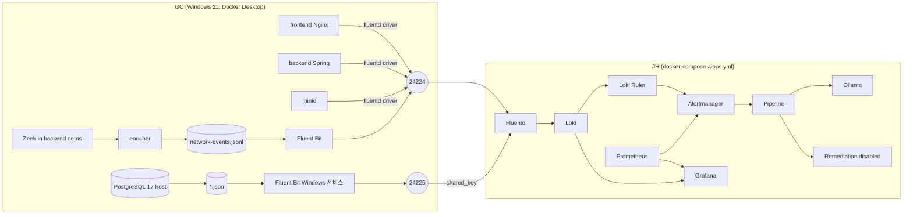

# AIOps 원격 수집 구성 (GC ↔ JH)

갱신: 2026-10-24.

| 이름 | 역할 |
|---|---|
| **GC** (Windows 11) | Leafy frontend/backend/MinIO, 호스트 PostgreSQL 17, Zeek/enricher, Fluent Bit |
| **JH** | 독립 AIOps `docker-compose.aiops.yml` |

두 PC는 Tailscale로 연결합니다. 관련 문서:
- GC 작업: [deploy/leafy-pc/README.md](../../deploy/leafy-pc/README.md)
- 탐지 규칙: [LOKI_RULES_JSON_REVIEW.md](LOKI_RULES_JSON_REVIEW.md)

## 1. AS-IS: 원격 구성에서 무효가 되는 참조와 조치

| 위치 | 기존 참조 | 원격에서의 문제 | 조치 |
|---|---|---|---|
| `prometheus.yml` | `backend:9090`, `nginx-exporter`(→`frontend:8081`), `postgres-exporter`(→`db:5432`) | 서비스 이름 해석 불가 | `prometheus.aiops.yml` + file_sd. **메트릭 포트 미합의 → 미완료** |
| `prometheus.yml` | `cadvisor`, `node-exporter` | JH 자신의 지표가 Leafy 지표로 오귀속 | JH 구성에서 제외 |
| alert 규칙 | `container_name_info{name=~"leafy-…"}`, `aiops_docker_*` | JH Docker에는 Leafy 컨테이너가 없음 → `HighCpuUsage`/`HighMemoryUsage`/`ContainerRestarted` 미발화 | 규칙 미수정. 원격 메트릭 경로가 생길 때까지 **공백** |
| Zeek | `network_mode: service:backend` | JH에는 backend 없음 | GC `deploy/leafy-pc/network-observer`로 이전 |
| Fluentd | network-events tail | 파일이 GC에 있음 | GC Fluent Bit → 24224(tag `network.event`) → 기존 `@NETWORK` |
| Pipeline | `resolve_service()` Docker inspect | `leafy-backend`가 로컬에 없어 **앱 로그 조회를 건너뜀** | `TARGET_SERVICE_MAP` 명시 매핑 우선 |
| Pipeline | `line[:200]` | PG jsonlog `message`가 200자 밖 → **RCA 입력 누락** | `prompt/log_line.py` 핵심 필드 우선 + 마스킹 |
| Remediation | 로컬 Docker SDK | 원격 대상에 닿지 않고, 같은 이름의 로컬 컨테이너를 건드릴 위험 | `REMEDIATION_MODE=disabled`, Docker socket 미마운트 |
| Fluentd | 24224 TCP/UDP를 `0.0.0.0`에 공개, `key_value`, partial 미처리 | 공개 노출, 긴 로그가 깨짐, JSON 질의 불가 | Tailscale IP 바인딩, concat, JSON 본문 |
| Loki 규칙 | `" 5xx `, `" 4xx ` 정규식 | JSON 액세스 로그 미탐 | 2개 규칙 JSON LogQL로 수정 (C 방안 1) |

## 2. TO-BE



| 포트 | 위치 | 공개 범위 | 용도 |
|---|---|---|---|
| 24224/TCP | JH Fluentd | `AIOPS_TAILSCALE_IP`만 | Docker 로그(Backend/Nginx/MinIO) + Network Event. Docker driver는 인증을 지원하지 않아 Tailscale ACL로 통제 |
| 24225/TCP | JH Fluentd | `AIOPS_TAILSCALE_IP`만 | PostgreSQL. `shared_key` 핸드셰이크 |
| 3100, 9090, 9093, 3000, 8000, 8001, 11434 | JH | `127.0.0.1` | 내부·운영자 전용 (Grafana만 `GRAFANA_BIND_IP`로 선택 공개) |
| 5432 | GC | 열지 않음 | 로그 수집에 쓰지 않음 |

### 2.1 Fluentd 라우팅 (`leafy/fluentd/fluent.conf`)

```text
24224 ─▶ @DOCKER ─┬─ tag network.event ────────────────────────────────▶ @NETWORK (기존 블록, 무변경)
                  └─ concat(use_partial_metadata) ─▶ @DOCKER_APP ─ leafy_docker_log(크기 정책) ─▶ Loki
24225 ─▶ @POSTGRES ─ leafy_postgres_log(시각 해석, 크기 정책) ─────────────▶ Loki
tail (all-in-one 전용) ─▶ @NETWORK
필터 예외 ─▶ @ERROR ─▶ Loki {log_type="fluentd_error"}
Fluentd 경고·오류(Loki 4xx 거부 포함) ─▶ @FLUENT_LOG ─▶ Loki {log_type="fluentd_internal"}
```

통합 테스트에서 세 경로가 서로 섞이지 않는 것을 확인했습니다.
- Network Event에는 앱 라벨이 없고, 앱 로그에는 Network Event가 없습니다.
- db 로그는 전부 `runtime=host`이고 Docker 메타데이터가 없습니다.

### 2.2 Loki 저장 계약

| stream | label | line(본문) | entry 시각 |
|---|---|---|---|
| 앱 로그 (24224) | `container`(LEGACY=tag), `source`, `service`, `container_name`, `runtime=container`, `log_format`=`json`\|`text`\|`json_invalid` | JSON 로그: 앱 필드를 순서 그대로 + `docker`{container_id, container_name, source, compose 라벨}. 그 외: `{"message": 원문, "docker": …}`. 깨진 JSON: `log_parse_error`. 미완성 partial: `log_partial_incomplete`. 240KB 초과: `log_truncated` | Docker driver 시각 (partial은 첫 조각) |
| 호스트 PostgreSQL (24225) | `service=db`, `runtime=host`, `log_format` | jsonlog 필드 그대로 + `pg_log_file` (+ `log_truncated`) | jsonlog `timestamp`("… KST"). 해석 불가 시 수신 시각 + `log_time_parse_error` |
| Network Event | 기존 6개 (`log_type=network` …) | canonical event 그대로 | event `timestamp` |

`request_id`, IP, `principal` 같은 고유값은 라벨로 만들지 않고 본문에만 둡니다. Loki 3.7은 자체적으로 `service_name` 라벨과 `detected_level`을 추가합니다.

### 2.3 유실 방지 정책

| 경로 | 위험 | 처리 |
|---|---|---|
| Loki `max_line_size`(256KB) 초과 | Loki 400 → out_loki가 재시도 없이 버림 (실측 유실) | Fluentd에서 240KB로 맞춥니다. 큰 필드만 머리·꼬리·`Caused by:`를 남기고 `log_truncated`를 붙입니다. Loki 설정은 바꾸지 않았습니다. 328KB 로그가 245KB로 저장됐고 RCA 필드를 보존했습니다(실측) |
| 그 밖의 Loki 4xx (7일보다 오래된 시각 등) | 조용한 유실 | `@FLUENT_LOG` → `{log_type="fluentd_internal"} \|= "failed to write post"`로 보임 (실측) |
| Docker `fluentd-async` 기동 직후 종료 | 종료 시 미전송 큐 폐기 (moby `ForceStopAsyncSend=async`) | 기동 후 0.25초 안에 종료하면 0/5, 0.5초 이후 5/5. Leafy 독립 기동을 위해 async를 유지합니다. GC `docker logs`에는 남습니다(dual logging 확인). `fluentd-request-ack`로 연결 후 at-least-once |
| JH 중단 | — | Docker 로그: GC Docker 데몬 메모리(이벤트 1,048,576개까지). Fluent Bit 경로: 디스크 버퍼(최대 1G/512M) |

## 3. JH PC 실행 절차

```powershell
# 1) .env (커밋 금지) — .env.example 의 "AIOps 단독 배포" 항목
#    AIOPS_TAILSCALE_IP=<tailscale ip -4>   FLUENTD_PG_SHARED_KEY=<openssl rand -hex 32, GC에 개별 전달>
# 2) all-in-one 스택이 남아 있으면 내린다. 볼륨 보존: -v 금지. container_name이 같아 동시 실행 불가
docker compose -f docker-compose.yml down
# 3) 기동 (Tailscale이 먼저 연결돼 있어야 Tailscale IP에 바인딩된다)
docker compose -f docker-compose.aiops.yml -f docker-compose.gpu.yml up -d --build
docker exec ollama ollama pull llama3.2:3b   # 새 프로젝트(leafy-aiops) 볼륨에는 모델이 없다
```

정상 결과 (같은 Compose 파일을 격리 이름으로 띄워 확인한 값):

| 확인 | 명령 | 정상 |
|---|---|---|
| 서비스 | `docker compose -f docker-compose.aiops.yml ps` | 8개 running. Leafy·PostgreSQL 없음. fluentd만 `100.x.y.z:24224-24225->…` |
| Fluentd | `docker logs fluentd 2>&1 \| Select-String "listening port\|worker is now running\|warn\|error"` | `listening port port=24224`, `port=24225`, `worker is now running`. warn/error 없음 |
| Loki | `curl.exe -s http://127.0.0.1:3100/ready` | `ready` (기동 직후 15초는 "Ingester not ready") |
| Loki 규칙 | `curl.exe -s http://127.0.0.1:3100/loki/api/v1/rules \| Select-String "- alert:" \| Measure-Object` | Count 9 |
| Prometheus | `curl.exe -s http://127.0.0.1:9090/api/v1/targets` | `prometheus`, `pipeline-metadata` up. leafy 대상 없음(§8 미완료) |
| Remediation | `docker logs aiops-remediation 2>&1 \| Select-String REMEDIATION_MODE`, `docker inspect aiops-remediation --format "{{len .Mounts}}"` | `REMEDIATION_MODE=disabled`, `0` |
| Grafana | 브라우저 `http://127.0.0.1:3000` | 대시보드 `aiops-main`, `leafy-aiops` |

### 3.1 Tailscale·방화벽 (2026-10-24 JH 실측)

**Tailscale 연결 방향.** GC와 JH는 서로 다른 tailnet이고, 현재는 GC 장치만 JH 계정에 공유돼 있습니다. 공유받은 장치는 먼저 연결을 시작할 수 없습니다(quarantine). 그래서 **GC → JH:24224/24225가 막혀 있습니다.**
- 실측: JH 패킷 필터가 tailnet 대역 전체를 허용하면서 GC 주소 하나만 제외합니다.
- 해결: **JH 장치를 GC 계정에 공유**하고 JH tailnet ACL로 수집 포트만 허용합니다. 절차와 ACL 예시는 [GC 문서 §2](../../deploy/leafy-pc/README.md#2-tailscale-연결-방향-gc와-jh는-서로-다른-tailnet)에 있습니다.

공유 후 JH에서 확인합니다.

```powershell
powershell -ExecutionPolicy Bypass -File deploy\aiops-pc\check-tailscale-access.ps1 -GcIp <GC_TAILSCALE_IP>
# 정상: <GC>:24224 ALLOWED, <GC>:24225 ALLOWED   (공유 전에는 BLOCKED — 실측)
```

**포트 바인딩.** 임시 리스너를 같은 주소·포트로 publish해 확인했습니다.
- Docker Desktop은 Tailscale IP에 바인딩됩니다. 리스너는 `com.docker.backend`입니다.
- `<Tailscale IP>:24224/24225`에서만 OPEN이고, `127.0.0.1`·LAN·Hamachi 주소에서는 closed입니다.

**Windows 방화벽.**
- Tailscale 어댑터는 Private 프로필입니다. Tailscale 설치 시 만들어진 `Tailscale-In` 규칙이 **로컬 주소 = 이 PC의 Tailscale IP**인 수신을 모두 허용합니다.
- 따라서 방화벽은 tailnet 피어를 막지 않고, **접근 통제는 Tailscale 공유·ACL이 맡습니다.** 별도 방화벽 규칙을 추가해도 접근을 좁힐 수 없습니다(이미 허용 규칙이 있음).
- LAN(이더넷)은 Public 프로필이고, `Docker Desktop Backend` 규칙이 Public 수신을 허용합니다. 따라서 **`0.0.0.0` publish를 쓰면 LAN에 노출됩니다.** `docker-compose.aiops.yml`은 Tailscale IP와 `127.0.0.1`에만 publish하므로 해당하지 않습니다.

**연결 확인 순서.**
1. GC 온라인 (`tailscale status`에서 GC가 offline이 아님)
2. JH 장치 공유 수락과 위 스크립트 결과 ALLOWED
3. JH AIOps 기동
4. GC에서 `Test-NetConnection <JH IP> -Port 24224/24225` → True

**재부팅 후 (미검증).** Docker Desktop이 Tailscale보다 먼저 올라오면 바인딩이 실패할 수 있습니다. `docker ps`에 fluentd가 없으면 `docker compose -f docker-compose.aiops.yml up -d fluentd`를 실행합니다.

## 4. 통합 배포 최종 체크리스트

| # | 담당 | 항목 | 확인 방법 |
|---|---|---|---|
| 1 | JH | `.env`: `AIOPS_TAILSCALE_IP`, `FLUENTD_PG_SHARED_KEY` | `docker compose -f docker-compose.aiops.yml config` 오류 없음 |
| 2 | JH | legacy 스택 내리기(`-v` 없이), AIOps 기동, 모델 pull | §3 표 |
| 3 | JH·GC | **JH 장치를 GC 계정에 공유(GC 수락)**, JH tailnet ACL로 24224/24225만 허용 | `check-tailscale-access.ps1` ALLOWED, GC `Test-NetConnection` True |
| 4 | GC | compose 서비스 이름 `frontend`/`backend`/`minio`, 이미지 digest | [GC §3](../../deploy/leafy-pc/README.md#3-leafy-compose-backdeploy-logging-설정) |
| 5 | GC | logging 블록 병합, backend `LOG_FORMAT` JSON | JH `{service="backend", log_format="json"}` |
| 6 | GC | PostgreSQL jsonlog, Fluent Bit 서비스 | JH `{service="db", runtime="host"} \|= "aiops_probe"` |
| 7 | GC | Network Observer (`observer.yml` 두 값) | JH `{log_type="network", src_service="frontend"}` |
| 8 | GC→JH | 통합 확인 4종 | [GC §7](../../deploy/leafy-pc/README.md#7-통합-확인-gc가-실행--jh가-확인) |
| 9 | 공동 | 시계 동기화 | 양쪽 `w32tm /query /status`. Loki 시각은 GC 시계, alert·Prometheus는 JH 시계 |
| 10 | 공동 | 메트릭 포트(9090/9113/9187) 합의 여부 | 미합의면 CPU·메모리·재시작 탐지 공백을 수용한다고 기록 |

## 5. 테스트

```bash
# Fluentd 플러그인 단위 테스트 (19)
docker build -t leafy-fluentd-test leafy/fluentd
docker run --rm -v "$PWD/leafy/fluentd/test:/test:ro" --entrypoint ruby leafy-fluentd-test -I/fluentd/plugins /test/test_filter_leafy_log.rb
# Pipeline (70), Remediation (6)
cd aiops/pipeline && python -m unittest discover -s tests
cd aiops/remediation && python -m unittest discover -s tests
```

통합 테스트 (2026-10-24, 운영 컨테이너·볼륨 미사용):
- JH: `docker-compose.aiops.yml`을 프로젝트 `aiopstest`와 이름 override로 실행
- GC: 팀 이미지(frontend/backend 2026-09-27 빌드), PostgreSQL jsonlog, Fluent Bit 5.1.3, Zeek/enricher

| 항목 | 결과 |
|---|---|
| Loki 규칙 9개, 수정 전 원본과 같은 데이터로 비교 (ruler → Alertmanager → Pipeline webhook) | 수정본 9/9 발화. 원본은 `HighNginxErrorRate`·`VulnerabilityScanningDetected` 미발화, 나머지 7개 동일 |
| 라우팅 비간섭 (Network / 앱 / PostgreSQL) | 통과 |
| 실제 backend 업로드 예외 34,157B (Docker 3조각) | 원문 복원, `log_partial_incomplete` 없음 |
| `request_id` 상관 | 업로드 500: Nginx 1 + Backend 2(ERROR, ACCESS). 로그인 실패: Nginx 1 + AuthService·BLOCKED·ACCESS |
| 328KB 로그 | 245,731B로 저장, level/message/request_id/exception_class 보존, 원인 사슬 보존 |
| 7일보다 오래된 PG 로그 | Loki 400 → `fluentd_internal`에 경고 기록 |
| Pipeline (Alertmanager webhook 16건) | `TARGET_SERVICE_MAP` 해석 실패 0, backend/frontend Network Event 16~20건, LLM 실패 fallback → Remediation 미실행 |
| RCA 입력 (UnauthorizedDBAccess, 실제 PG 로그 44줄) | 선별 44→6줄, `authentication failed` 포함 줄 0→6, LOGS 섹션 6,120→3,589자 |
| async 기동 직후 종료 | 0.25초 0/5, 0.5초 이후 5/5, `async=false` 5/5 |

## 6. 상관분석 (Backend 인증 로그 · Nginx · Network Event)

팀 이미지(2026-09-27 빌드) 기준입니다. 부록B(09-22 실행)에는 없던 `request_id`가 지금은 양쪽에 있습니다.
- Nginx: `leafy_json` log_format의 `request_id`. `X-Request-ID`로 backend에 전달
- Backend: `AccessLogFilter`가 MDC `request_id`에 넣고, JSON 필드로 기록

| 연결 | 기준 | 판단 |
|---|---|---|
| Nginx ↔ Backend (모든 줄) | `request_id` | **가능 (실측).** 한 요청이 Nginx 1줄과 Backend 여러 줄(AuthService, BLOCKED, ERROR, ACCESS)로 묶임 |
| Backend 인증 로그 ↔ ACCESS | `request_id` 또는 같은 `thread` | 가능 |
| 앱 로그 ↔ Network Event (Zeek L4) | 서비스 쌍 + 시간 구간(연결 [ts, ts+duration]) | request 단위 불가 (L4에는 `request_id`가 없음 — 가정하지 않음). keep-alive 연결 하나에 요청 여러 개 |
| 호스트 PG ↔ Network Event | 서비스(backend→db) + 시간 | PG `remote_host`는 Docker Desktop NAT 뒤 주소일 수 있음 (미검증) |
| 클라이언트 IP | Nginx `remote_addr`, Backend `source_ip` | **(미검증)** Docker Desktop publish 포트로 들어온 요청은 게이트웨이 주소로 찍힐 수 있음 (재현에서 그렇게 찍힘) |

Pipeline 현재 범위: `CorrelationContext(service, 시간 구간)`로 같은 구간의 앱 로그와 Network Event를 함께 조회합니다. RCA 입력에는 `request_id`·`source_ip`·`principal`이 필드로 들어갑니다(`prompt/log_line.py`).
`request_id`로 Nginx와 Backend 줄을 묶어 요약하는 것은 Pipeline 구조 변경이라 후속 작업으로 분리합니다.

## 7. 남은 문제 (미검증 · 위험)

| # | 항목 | 상태 |
|---|---|---|
| 1 | Windows Fluent Bit 5.1.3 바이너리·서비스 계정 권한 | 미검증 (Linux에서 같은 설정 검증) |
| 2 | Docker Desktop Tailscale IP 바인딩 / 재부팅 순서 | 바인딩 검증됨 (2026-10-24) / 재부팅 순서 미검증 |
| 3 | GC 실행 이미지가 확인한 digest와 같은지 | GC 확인 필요. 다르면 탐지 규칙 2개의 전제(`status` 필드)를 다시 확인 |
| 4 | Docker Desktop에서 클라이언트 실제 IP 노출 여부 | 미검증. 게이트웨이만 보이면 IP 기반 탐지·상관 약화 |
| 5 | 메트릭 포트 미합의 | CPU·메모리·재시작 탐지와 컨테이너 패널 공백 |
| 6 | 원격 Remediation 없음 | disabled 유지. `docker exec`/`psql -h leafy-db` 기반 시나리오는 JH에서 실행 불가 |
| 7 | 240KB 초과 로그는 가운데가 생략됨 | `log_truncated`로 표시. 원문 전체는 GC `docker logs`에만 남음 |
| 8 | 기동 0.5초 이내 종료 로그, non-blocking 4MB 초과, JH 장시간 중단 시 Docker 데몬 메모리 한도 | 구조적 한계. GC `docker logs`로 보완 |
| 9 | JH의 새 볼륨 (`leafy-aiops_*`) | Ollama 모델 재다운로드 필요. 기존 볼륨을 쓰려면 `-p graduation-project` |
| 10 | PG `statement` 원문 전송 | RCA 입력에서는 비밀값을 가리지만 Loki에는 원문이 저장됨 |
| 11 | Grafana 기본 비밀번호, `GRAFANA_BIND_IP` 공개 시 | 공개 전에 `GRAFANA_PASSWORD` 변경 |
| 12 | 두 PC 시계 차이 | §4 #9 |
