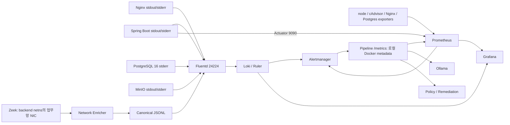
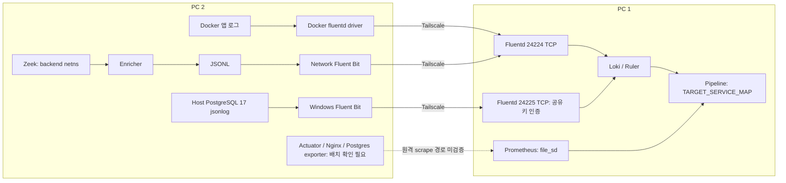

# M1 — 탐지 룰팩 개발을 위한 관측 환경 및 데이터 검증

**M1 기록 상태: 정적 감사 완료 / 런타임 검증 대기**이다. 런타임 데이터의 VERIFIED 판정과 M1 전체 데이터 확정은 대기 상태이다.

## 1. Executive Summary

### 1.1 점검 기준과 범위

점검일은 **2026-11-10(KST)**이며 기준은 `main`의 **`92e70dbf8b9af14b9376df3fde3a7fb4db7e3e50`**이다. 작업 시작 시 로컬 `main`과 `origin/main`은 같은 커밋이고 작업 트리는 깨끗한 상태이다. GitHub 연결 도구의 `compare_commits(base=92e70db…, head=main)`도 `identical`, ahead/behind `0`, 변경 파일 `0`으로 반환한 상태이다. 따라서 로컬 설정 분석의 기준이 원격 `main`과 일치함을 확인한 것이다.

이번 산출물은 이 보고서 한 파일이다. 룰·임계값·설정·`.env`·데이터베이스를 변경하지 않았으며 컨테이너 시작·재시작·재생성·삭제, Git 커밋·푸시·PR 생성은 수행하지 않은 상태이다. 시나리오 주입 코드, `scenarios/v2/`, `VARIANTS.md`, Heldout 데이터 및 과거 공격 실행 결과물은 분석 자료에서 제외한 상태이다. 기존 룰 파일의 **식과 데이터 의존성**만 분석 대상이다.

상태의 의미는 다음과 같다. `MISSING`은 아래 명시한 구성/스키마 범위에서 필요한 데이터의 수집이 빠진 사실이며, 접근하지 못한 측정 PC 전체에 데이터가 없다는 단정은 아니다.

| 확인 상태 | 판정 기준 |
|---|---|
| VERIFIED | 이번 점검에서 해당 서비스의 실제 로그 또는 메트릭 샘플을 직접 확인한 경우이다. |
| CONFIGURED | 코드·설정에 생성/전달/조회 경로가 있는 경우이다. 런타임 성공을 의미하지 않는 상태이다. |
| MISSING | 점검한 구성에서 필요한 수집 경로 또는 필드가 빠진 사실을 확인한 경우이다. |
| UNVERIFIED | 측정 PC·실행 이미지·실제 샘플에 접근하지 못하여 확인할 수 없는 경우이다. |

### 1.2 핵심 결과

**실제 탐지 입력으로 확정할 수 있는 VERIFIED 데이터는 0개이다.** 로컬 Docker에는 Leafy 프로젝트의 중지/미시작 컨테이너만 있고, 기본 Loki·Prometheus·Pipeline 포트는 연결 거부 상태이다. PC 1/PC 2에 대한 별도 실행 세션이나 접속 주소는 확보하지 못한 상태이다. 과거 문서의 실측 주장은 이번 점검의 VERIFIED 증거로 승격하지 않은 상태이다.

정적 분석으로는 Docker stdout/stderr → Fluentd → Loki, Zeek → Enricher → JSONL → Fluentd → Loki, 통합 환경의 exporter/Actuator/Pipeline → Prometheus 경로가 CONFIGURED인 상태이다. 원격 환경의 PostgreSQL 17 jsonlog → Windows Fluent Bit → 인증된 24225/TCP → Fluentd → Loki도 CONFIGURED인 상태이다. 다만 예시 파일이나 미적용 SQL은 실제 배포 증거가 아닌 상태이다.

주요 위험은 다음과 같다.

- 통합 DB는 PostgreSQL **16 + stderr 텍스트**, 원격 DB는 호스트 PostgreSQL **17 + jsonlog**인 구성이다. DB 로그의 동일한 JSON 필드 계약을 양쪽에 적용할 수 없는 구조이다.
- 원격 Prometheus에는 Leafy node-exporter/cAdvisor job이 없고, Actuator/Nginx/Postgres job은 file_sd 자리만 있는 구성이다. 로컬 `targets/*.yml` 실파일도 0개인 상태이다. 측정 PC의 실제 파일/targets는 UNVERIFIED이다.
- `ContainerRestarted`의 실제 입력은 cAdvisor 시작 시간이 아니라 **Pipeline의 로컬 Docker inspect 메트릭**이다. 원격 PC 1의 Pipeline은 PC 2 Docker를 관측하지 못하며 `TARGET_SERVICE_MAP`은 이 문제를 해결하는 메트릭 전달 기능이 아닌 구조이다.
- 문서에 기록된 Nginx JSON 형식에는 `request_length`가 없고 본문·WAF 로그 경로도 없는 상태이다. 로그인 성공/실패 이벤트의 정확한 생성 계약과 원본 IP의 신뢰성, HikariCP·DB 상한 메트릭은 이번 런타임에서 확인할 수 없는 상태이다.
- 원격 Observer 예시는 `eth0` 고정, Docker 네트워크 이름 placeholder, 환경별 host-gateway 주소를 포함하는 구성이다. 이를 실제 PC 2 값으로 확인하기 전에는 `src_service="backend"` 등의 라벨을 신뢰할 수 없는 상태이다.

### 1.3 이번 읽기 전용 런타임 점검 증거

최초 sandbox 내부 Docker/HTTP 조회는 접근 제한으로 실패한 상태이다. 동일한 **읽기 전용** 조회를 허용된 실행으로 다시 수행하여 아래 결과를 확인한 것이다. 초기 권한 오류를 서비스 장애 증거로 해석하지 않은 상태이다.

| 증거 | 실행 시각(KST / UTC) | 명령·조회 대상 | 결과 요약 | 판정 |
|---|---|---|---|---|
| R1 | 2026-11-10 13:04경 / 04:04Z | `docker context show`, `docker ps --format '{{.Names}}\t{{.Status}}\t{{.Ports}}'` | Docker context는 `desktop-linux`이며 실행 중인 컨테이너는 다른 프로젝트 소속인 상태이다. 해당 프로젝트의 메트릭/로그는 조회하지 않은 상태이다. | 로컬 Docker 조회 성공이며 Leafy 데이터 확인 증거는 아닌 결과이다. |
| R2 | 13:04:45 / 04:04:45Z | HTTP GET `http://127.0.0.1:3100/ready`, `http://127.0.0.1:9090/-/ready`, `http://127.0.0.1:8000/health` | 세 주소 모두 `Connection refused`인 상태이다. | 로컬 API 접근 불가이며 측정 PC 상태는 UNVERIFIED이다. |
| R3 | 13:05:28 / 04:05:28Z | `docker ps -a --filter label=com.docker.compose.project=<project> --format '{{.Names}}\t{{.Status}}'`; project는 `graduation-project`, `leafy-aiops`, `leafy-observer` 각각인 조회이다. | `graduation-project`에서 frontend/backend/db/Pipeline/Nginx exporter/Postgres exporter 등은 `Created`, Loki/Fluentd/Prometheus/Alertmanager/cAdvisor/node-exporter 등은 `Exited`인 상태이다. 원격용 두 project 필터는 결과 0개이다. | 로컬 통합 환경이 가동 중이 아님을 확인한 결과이다. |
| R4 | 같은 정적 점검 세션 | `monitoring/prometheus/targets`의 `*.yml` 파일명만 열거한 조회이다. | 실제 `.yml`은 0개이고 `.yml.example`만 있는 상태이다. | 이 checkout의 원격 scrape 대상은 미구체화 상태이다. |

이후 실제 job/label/metric discovery를 할 수 없었으므로 Loki 본문·Prometheus 시계열·exporter·Actuator·Zeek 샘플은 조회하지 못한 상태이다. 컨테이너나 포트를 자동으로 가동하지 않은 상태이다.

## 2. 현재 수집 아키텍처

### 2.1 통합 환경

업무망은 `leafy-net`, 대역은 `10.210.0.0/24`이고 관리망은 `mgmt-net`인 구성이다. frontend는 `10.210.0.10` 고정 IP이며 backend가 이를 신뢰 프록시로 지정한 구성이다([C01](../../docker-compose.yml), 9–19, 41–133행). 애플리케이션은 외부 Docker 이미지이므로 이 저장소만으로 이미지 내부 Nginx/Java logging 구현을 직접 증명할 수 없는 상태이다.



이는 **설정상 경로** 도식이며 가동 성공 도식이 아닌 것이다. Zeek는 `network_mode: service:backend`이며 `start-zeek.sh`가 해당 subnet의 NIC를 찾아 캡처하는 구성이다. backend의 다른 NIC나 다른 컨테이너 전체를 자동으로 감시하는 구성은 아닌 것이다.

### 2.2 원격 2대 환경

PC 1은 `docker-compose.aiops.yml`의 Fluentd/Loki/Prometheus/Alertmanager/Pipeline/Ollama/Grafana/Remediation이고, PC 2는 별도 Leafy 애플리케이션/호스트 PostgreSQL 17/Zeek/Enricher/Fluent Bit인 구성이다. PC 2 실제 애플리케이션 Compose는 이 저장소에 없는 상태이며 `leafy-compose-logging.example.yml`은 병합 예시인 것이다.



PC 1의 기본 `REMEDIATION_MODE`는 `disabled`이며 Phase 3 Agent는 별도 배포 대상이다([C02](../../docker-compose.aiops.yml), 177–199행). Agent가 실행되거나 관측 메트릭을 제공한다고 가정하지 않은 상태이다.

### 2.3 근거 파일 목록

행 번호는 위 기준 커밋 기준이다. 이후 표의 Cxx는 이 목록의 실제 파일을 가리키는 식별자이다.

| ID | 근거 파일 | 확인 내용 |
|---|---|---|
| C01 | [docker-compose.yml](../../docker-compose.yml) | 앱 로그 41–203행, exporter 209–261행, Fluentd 263–283행, 저장소 289–332행, Pipeline 371–400행, Observer 447–494행인 구성이다. |
| C02 | [docker-compose.aiops.yml](../../docker-compose.aiops.yml) | 원격 수신 34–51행, Prometheus mount 58–75행, target map 146–175행, Agent 비활성 기본값 192–193행인 구성이다. |
| C03 | [fluent.conf](../../leafy/fluentd/fluent.conf) | 24224/24225 source, Docker concat, 앱/PG/네트워크의 별도 Loki route와 오류 stream인 구성이다. |
| C04 | [Docker 로그 필터](../../leafy/fluentd/plugins/filter_leafy_docker_log.rb), [PostgreSQL 로그 필터](../../leafy/fluentd/plugins/filter_leafy_postgres_log.rb), [크기 제한](../../leafy/fluentd/plugins/leafy_log_size.rb), [Fluentd Dockerfile](../../leafy/fluentd/Dockerfile) | JSON 보존·텍스트 wrapping·identity·PG 시각 처리·240KB 상한이며 플러그인 버전 고정인 구성이다. |
| C05 | [loki-config.yml](../../monitoring/loki/loki-config.yml) | TSDB/filesystem 저장, 168h 이전 표본 거부, local Ruler와 Alertmanager 연결인 구성이다. |
| C06 | [통합 Prometheus](../../monitoring/prometheus/prometheus.yml), [원격 Prometheus](../../monitoring/prometheus/prometheus.aiops.yml) | job, 경로, 전역 scrape/evaluation 5초, 통합/원격 차이인 구성이다. |
| C07 | [targets README](../../monitoring/prometheus/targets/README.md), [Backend 예시](../../monitoring/prometheus/targets/leafy-backend.yml.example), [Nginx 예시](../../monitoring/prometheus/targets/nginx-exporter.yml.example), [Postgres 예시](../../monitoring/prometheus/targets/postgres-exporter.yml.example) | 원격 file_sd, `site: leafy-pc`, 9090/9113/9187 포트의 별도 배치 필요인 구성이다. |
| C08 | [Nginx stub_status](../../leafy/frontend/stub_status.conf), [JSON 형식 검토 문서](../remote/LOKI_RULES_JSON_REVIEW.md) 7–23행 | 전자는 현재 mount 설정이고 후자는 과거 이미지의 access log 형식을 인용한 문서이다. 현재 실행 이미지 원문은 UNVERIFIED이다. |
| C09 | [원격 Docker logging 예시](../../deploy/leafy-pc/leafy-compose-logging.example.yml), [PC 2 안내](../../deploy/leafy-pc/README.md) 94–129행 | Docker driver 직접 전달과 Backend JSON formatter 선택 예시이며 실제 병합 상태는 UNVERIFIED이다. |
| C10 | [PG Fluent Bit](../../deploy/leafy-pc/postgresql/fluent-bit.conf), [PG parser](../../deploy/leafy-pc/postgresql/parsers.conf), [PG logging SQL](../../deploy/leafy-pc/postgresql/postgresql-logging.sql) | 호스트 PG17 파일 tail, forward 인증, jsonlog 설정 제안인 것이다. SQL은 읽기만 하였으며 실행하지 않은 상태이다. |
| C11 | [통합 observer.yml](../../aiops/network-observer/config/observer.yml), [start-zeek.sh](../../aiops/network-observer/zeek/start-zeek.sh), [local.zeek](../../aiops/network-observer/zeek/local.zeek) | NIC 선택, identity map, conn/threshold JSON stream만 유지하는 구성이다. |
| C12 | [원격 Observer Compose](../../deploy/leafy-pc/network-observer/docker-compose.yml), [원격 observer.yml](../../deploy/leafy-pc/network-observer/config/observer.yml), [Network Fluent Bit](../../deploy/leafy-pc/network-observer/fluent-bit/fluent-bit.conf), [Network parser](../../deploy/leafy-pc/network-observer/fluent-bit/parsers.conf) | PC 2 netns/eth0/placeholder와 JSONL forward인 구성이다. |
| C13 | [events.py](../../aiops/network-observer/enricher/events.py), [zeek_map.py](../../aiops/network-observer/enricher/zeek_map.py), [identity.py](../../aiops/network-observer/enricher/identity.py), [capture.py](../../aiops/network-observer/enricher/capture.py), [Enricher main.py](../../aiops/network-observer/enricher/main.py) | 필드 생성·방향·unknown fallback·interface·tail 동작인 구현이다. |
| C14 | [logs collector](../../aiops/pipeline/collector/logs.py), [metrics collector](../../aiops/pipeline/collector/metrics.py), [network collector](../../aiops/pipeline/collector/network.py) | 이미 저장된 데이터의 서비스/시간창 조회인 구현이다. 수집 에이전트를 대신하는 구현은 아닌 것이다. |
| C15 | [Pipeline main.py](../../aiops/pipeline/main.py) 96–242행, [correlation.py](../../aiops/pipeline/correlation.py) 34–112행, [config.py](../../aiops/pipeline/config.py), [log_line.py](../../aiops/pipeline/prompt/log_line.py) | Docker 메트릭·identity·target map·JSON 소비 필드인 구현이다. |
| C16 | [Prometheus 룰](../../monitoring/prometheus/rules/alert.rules.yml) | 기존 6개 룰인 구성이다. |
| C17 | [Loki 보안 룰](../../monitoring/loki/rules/fake/security-rules.yml), [Loki 네트워크 룰](../../monitoring/loki/rules/fake/network-allowlist.yml) | 기존 9개+2개 룰인 구성이다. |
| C18 | [REMOTE_DEPLOYMENT.md](../remote/REMOTE_DEPLOYMENT.md) 14–27, 188–212행 | 원격 제약과 request_id/source_ip에 관한 과거 문서 증거이다. 현재 실측 증거는 아닌 것이다. |

### 2.4 수집 경로별 조사 결과

| 경로 | 수집 대상·방식·설정 | 라벨·저장 대상 | 오류 관측 방법 | 정적 결과 / 이번 런타임 |
|---|---|---|---|---|
| 1. Docker 앱 → Loki | frontend/backend/db/minio의 stdout/stderr를 Docker fluentd driver가 24224로 전달하고 C03 concat/C04 변환을 거치는 구조이다. 원격 앱은 C09 병합 예시이다. | `service`, `container_name`, `runtime`, `source`, `log_format`, LEGACY `container`; Loki JSON line인 구조이다. | `log_parse_error`, `log_partial_incomplete`, `log_truncated`, Fluentd 오류 stream과 송신측의 제한된 상태 점검 대상이다. | 통합 CONFIGURED / UNVERIFIED, 원격 예시 CONFIGURED / 적용 UNVERIFIED이다. |
| 2. Nginx access → Loki | 이미지의 stdout JSON이 1번 경로로 전달되는 구조이다. C08은 형식의 문서 근거이며 현재 repo의 mount는 stub_status만인 구성이다. | `service="frontend", log_format="json"`; error log 텍스트와 구분하는 구조이다. | JSON 파싱/필드 존재 여부와 Fluentd 유실 지표가 점검 대상이다. | 전달 CONFIGURED / access 스키마와 파싱 성공 UNVERIFIED이다. |
| 3. Spring 로그 → Loki | 통합 C01의 `LOG_FORMAT`은 주석 상태이고 원격 C09에서 formatter class를 설정하는 예시이다. | `service="backend"`; JSON이면 필드 보존, 텍스트면 `message`에 원문인 구조이다. | `log_format` 분포, JSON 주요 키, parse/partial/truncated 존재 여부가 점검 대상이다. | 전달 CONFIGURED / JSON·인증 이벤트 UNVERIFIED이다. |
| 4. PostgreSQL → Loki | 통합 PG16 stderr는 Docker 경로이며 원격 PG17은 C10의 `data\\log\\*.json` tail → 24225 → PG 필터인 구조이다. | 통합 `runtime="container"`와 `message`; 원격 `service="db", runtime="host", log_format`, 원본 jsonlog 키와 `pg_log_file`인 구조이다. | `log_time_parse_error`, `log_truncated`, Fluent Bit skip/retry/auth 오류, Fluentd 오류 stream이 점검 대상이다. | 양쪽 경로 CONFIGURED / 실제 적용·데이터 UNVERIFIED이다. |
| 5. Zeek → Loki | C11/C13의 conn/threshold → canonical JSONL → 통합 tail 또는 C12 Fluent Bit forward → C03 `@NETWORK`인 구조이다. | 아래 6개 네트워크 라벨과 canonical JSON body; Loki인 구조이다. | observer 상태·파일 크기/시각·unknown 비율·Enricher skip·Fluent Bit 전송 오류·Loki parse 오류가 점검 대상이다. | CONFIGURED / 이벤트 도착·정합성 UNVERIFIED이다. |
| 6. Exporter → Prometheus | 통합 node:9100, cAdvisor:8080, nginx:9113, postgres:9187의 `/metrics`를 C06이 scrape하는 구조이다. 원격은 C07 file_sd 일부만인 구성이다. | 기본 `job`, `instance`; 나머지는 exporter 제공값이며 원격 예시에 `site`가 추가되는 구조이다. | targets의 `health/lastError`, `up`, 발견된 exporter 내부 성공 지표와 시계열 연속성이 점검 대상이다. | 통합 job CONFIGURED / 표본 UNVERIFIED; 원격 node/cAdvisor MISSING, 나머지 실대상 UNVERIFIED이다. |
| 7. Actuator → Prometheus | 통합 `backend:9090/actuator/prometheus`, 원격 `leafy-backend*.yml`인 구성이다. Java 소스/빌드 설정은 이 repo에 없는 상태이다. | `job="leafy-backend"`, `instance`; HTTP/Hikari 라벨은 현재 실측 필요인 상태이다. | target 상태·응답 이름 discovery·빈 시계열/접근 거부가 점검 대상이다. | scrape CONFIGURED / endpoint·정확한 계측명 UNVERIFIED이다. |
| 8. Pipeline → Prometheus | 양쪽 `pipeline:8000/metrics`, job `pipeline-metadata`이며 C15에서 로컬 Docker 상태를 생성하는 구조이다. | `container_name_info{id,name,service}`, `container_service_count{service}`, `aiops_docker_*`인 구성이다. | `up{job="pipeline-metadata"}`, `aiops_docker_status_scrape_success`와 기대 대상 존재 여부가 점검 대상이다. | CONFIGURED / 실표본 UNVERIFIED; 원격 Leafy 재시작 전달 MISSING이다. |

Fluentd 앱/PG line 상한은 240KB이며 잘림을 표시하는 구현이다. 통합 Compose는 `/fluentd/log` 영속 볼륨이 없고 원격 Compose는 `fluentd_buffer`를 mount하는 차이이다. Loki는 168h보다 오래된 entry를 거부하도록 설정된 상태이다. `fluentd_internal`도 같은 Loki로 전송되므로 Loki 자체 장애 동안의 완전한 유실 감시 수단은 아닌 것이다(C03–C05).

## 3. 수집 데이터 인벤토리

아래 이름은 **생성 코드 확인**, **조회식에서 요구**, **과거 문서의 형식**을 구분한 것이다. 조회식에 이름이 존재하는 사실만으로 exporter의 실제 출력이 CONFIGURED/VERIFIED라고 판정하지 않은 상태이다.

| 데이터 소스 | 로그/메트릭 | 실제 필드/이름 | 수집 경로 | 확인 상태 | 근거 |
|---|---|---|---|---|---|
| Docker 앱 | 로그 본문·메타데이터 | JSON 객체 원문 또는 `message`; `docker`(충돌 시 `_docker`); `log_parse_error`, `log_partial_incomplete`, `log_truncated`인 생성 키이다. | driver → concat → 앱 필터 → Loki인 경로이다. | CONFIGURED, 실제 line UNVERIFIED이다. | C01, C03, C04이다. |
| Docker 앱 | Loki 라벨 | `container`=tag, `source`=stdout/stderr, `service`=Compose service(없으면 unknown), `container_name`=이름의 `/` 제거, `runtime`, `log_format`=json/text/json_invalid인 구조이다. | 앱 필터 `_lbl_*` → Loki 라벨인 경로이다. | CONFIGURED, 실제 값 UNVERIFIED이다. | C04 Docker 필터 32–58행이다. |
| Nginx | Access JSON | 문서 형식의 `time_iso8601`, `msec`, `request_id`, `remote_addr`, `realip_remote_addr`, `http_x_forwarded_for`, `request_method`, `request_uri`, `uri`, `args`, `status`, `upstream_status`, `request_time`, `upstream_response_time`, `http_user_agent`, `body_bytes_sent`이다. | stdout → Docker/Fluentd → Loki인 경로이다. | 전달 CONFIGURED, 현재 이미지 키/도착 UNVERIFIED이다. | C08 문서 12–16행이며 image-local 원문은 없는 상태이다. |
| Nginx | 요청 크기·본문·WAF | 위 형식에 `request_length`, 요청 본문, WAF 이벤트 필드가 없는 상태이다. | 별도 수집 경로가 없는 상태이다. | MISSING(문서의 형식/점검 구성 범위)이며 현재 이미지 추가 필드는 UNVERIFIED이다. | C08 및 C01/C09의 mount/driver 구성이다. |
| Spring Boot | 앱/ACCESS/인증 로그 | 소비 코드에서 `message`, `status`, `http_method`, `uri`, `request_id`, `source_ip`, `principal`, `exception_class` 등을 읽는 구조이다. `logger`는 과거 문서에 등장하는 키이다. 생성 여부를 보장하는 목록은 아닌 것이다. | stdout → Loki인 경로이다. | 전달 CONFIGURED, JSON·성공/실패·원인·사용자 식별 계약 UNVERIFIED이다. | C09, C15, C18이다. |
| PostgreSQL 16 통합 | 텍스트 로그 | 원문이 `message`에 들어가며 prefix에 시각/pid/user/db/client가 있는 구성이다. jsonlog의 top-level `error_severity`, `state_code`를 가진다고 볼 수 없는 상태이다. | stderr → Docker → Loki인 경로이다. | CONFIGURED; 통합 jsonlog MISSING; 실제 오류 UNVERIFIED이다. | C01 135–172행, C04이다. |
| PostgreSQL 17 원격 | jsonlog | 필터가 사용하는 키는 `timestamp`이며 나머지 원본 키와 `pg_log_file`을 보존하는 구조이다. 소비 코드는 `message`, `error_severity`, `state_code`, `remote_host`, `user`, `dbname` 등을 지원하는 구조이다. | Windows 파일 → Fluent Bit → 24225 → Loki인 경로이다. | CONFIGURED, 원본 필드 실재/로그 적용 UNVERIFIED이다. | C10, C04 PG 필터, C15이다. |
| PostgreSQL 원격 | 라벨·시각 오류 | `service="db"`, `runtime="host"`, `log_format`; 해석 불가 시 `log_time_parse_error`이며 container 계열 라벨은 없는 구조이다. | `@POSTGRES` → Loki인 경로이다. | CONFIGURED, 실제 샘플 UNVERIFIED이다. | C03 127–150행, C04이다. |
| Zeek | 원본 L4 conn/threshold | `ts`, `uid`, `id.orig_h`, `id.orig_p`, `id.resp_h`, `id.resp_p`, `proto`, `conn_state`, `duration`, `orig_bytes`, `resp_bytes`와 threshold stream의 `threshold`, `event_kind`인 입력이다. 일부 값은 nullable인 구조이다. | conn.log/conn_threshold.log → Enricher인 경로이다. | CONFIGURED, 원본 파일/이벤트 UNVERIFIED이다. | C11, C13이다. |
| Network Enricher | Canonical JSON body | `schema_version`, `timestamp`, `event_type`, `observer`, `src_service/src_container/src_runtime/src_ip/src_port`, `dst_service/dst_container/dst_runtime/dst_ip/dst_port`, `protocol`, `network`, `interface`, `app_protocol`, `connection_state`, `duration_ms`, `bytes_sent`, `bytes_received`, `connection_id`, `observer_instance`, `observer_meta`인 생성 키이다. `request_id`, `direction`은 현재 null인 필드이다. | JSONL → 통합 tail/원격 Fluent Bit → Loki인 경로이다. | CONFIGURED, identity·byte 표본 UNVERIFIED이다. | C13 events.py 46–128행이다. |
| Network Enricher | Loki 라벨 | **`log_type`, `event_type`, `src_service`, `dst_service`, `protocol`, `network` 6개**이다. IP/port/container/connection_id/interface는 body 필드인 구조이다. | `@NETWORK` → Loki인 경로이다. | CONFIGURED, 실제 라벨 UNVERIFIED이다. | C03 159–190행이다. |
| Zeek | DNS·payload·process | conn/threshold 외 stream을 비활성화하며 DNS 로그·패킷 payload 저장·프로세스 실행 telemetry 경로가 없는 상태이다. | 현재 수집 경로가 없는 상태이다. | MISSING이다. | C11 local.zeek 79–97행, C01/C12이다. |
| node-exporter | 호스트 자원 | collector가 `node_cpu_seconds_total{mode}`, `node_memory_MemAvailable_bytes`, `node_memory_MemTotal_bytes`를 요구하는 구조이다. | 통합 `/metrics` → Prometheus인 경로이다. | job CONFIGURED, 출력 UNVERIFIED; 원격 job MISSING이다. | C01, C06, C14 metrics.py 67–81행이다. |
| cAdvisor | 컨테이너 자원 | 룰/collector가 `container_cpu_usage_seconds_total`, `container_memory_working_set_bytes`, `container_memory_usage_bytes`, `container_spec_memory_limit_bytes`, `container_network_receive_bytes_total`, `container_network_transmit_bytes_total`를 요구하는 구조이다. | 통합 `/metrics` → Prometheus인 경로이다. | job CONFIGURED, 이름/`id,cpu,name,interface` 실제 라벨 UNVERIFIED; 원격 job MISSING이다. | C06, C14, C16이다. |
| cAdvisor | 시작 시각 | `container_start_time_seconds`는 확인 대상으로만 남긴 이름이며 현재 룰의 입력이나 repo의 생성 구현으로 확인된 이름이 아닌 것이다. | 제공 여부 discovery 필요인 상태이다. | UNVERIFIED이다. | C16은 이 지표를 사용하지 않는 구성이다. |
| Nginx exporter | 요청 수 | 기존 룰이 요구하는 `nginx_http_requests_total`이다. HTTP 상태코드별 access 지표라고 볼 수 없는 상태이다. | stub_status → exporter → Prometheus인 경로이다. | 통합 job CONFIGURED, 출력 UNVERIFIED; 원격 실배치 UNVERIFIED이다. | C08, C06, C16 147–155행이다. |
| Postgres exporter | 세션 수 | 기존 룰이 요구하는 `pg_stat_activity_count`이며 대시보드는 `datname`을 참조하는 구성이다. `state` 등 실제 차원은 UNVERIFIED이다. | DB → exporter → Prometheus인 경로이다. | 통합 job CONFIGURED, 출력/권한 UNVERIFIED; 원격 실배치 UNVERIFIED이다. | C01 251–261행, C06, C16 161–169행이다. |
| Postgres exporter | 상한·수집 성공 | `max_connections` 설정 메트릭 및 DB 수집 성공/오류 메트릭의 정확한 이름·라벨은 repo에 고정되어 있지 않은 상태이다. custom queries/명시 collector flags도 없는 구성이다. | `/metrics`와 이름 discovery가 필요한 경로이다. | UNVERIFIED이다. | C01 exporter는 latest 이미지+DSN만인 구성이다. |
| Spring Actuator | HTTP/Micrometer | 과거 문서가 `http_server_requests_seconds_count{method,status,outcome,uri}`, `logback_events_total{level}`, `spring_security_authorizations_seconds_count{error}`를 언급한 상태이다. | `/actuator/prometheus` → Prometheus인 경로이다. | scrape CONFIGURED, 현재 이름·라벨·노출 UNVERIFIED이다. | C06, C08 문서 197행이다. |
| HikariCP | 풀 상태·획득 timeout | 과거 문서는 `hikaricp_connections_*` 계열만 언급한 상태이다. active/idle/pending/max/timeout/acquire의 **정확한 노출 이름과 pool 라벨은 미확정**이다. | Actuator → Prometheus로 전달 가능한 설정상 경로이다. | UNVERIFIED이다. | C06, C08 문서 197행이며 Java 생성 설정은 repo에 없는 상태이다. |
| Pipeline | Docker metadata | `container_name_info{id,name,service}`, `container_service_count{service}`인 생성 메트릭이다. service는 이름 prefix/접미사 가공값인 구조이다. | 로컬 Docker socket → `/metrics` → Prometheus인 경로이다. | CONFIGURED, 실제 출력 UNVERIFIED이다. | C15 main.py 96–104, 205–242행이다. |
| Pipeline | Docker 재시작 상태 | `aiops_docker_container_restarts_total{name,service}`, `aiops_docker_container_started_at_seconds{name,service}`, `aiops_docker_container_oom_killed{name,service}`, 무라벨 `aiops_docker_status_scrape_success`인 생성 메트릭이다. | 로컬 Docker inspect → `/metrics`인 경로이다. | 로컬 생성 CONFIGURED, 출력 UNVERIFIED; PC 2 전달 MISSING이다. | C15 main.py 107–196행이다. |
| Pipeline | 분석 자체의 상태 | `/health`는 고정 status와 현재 시각이며 `/metrics`는 위 Docker metadata이다. 분석 latency/오류율/queue/LLM 성공률의 전용 메트릭은 이 endpoint에 없는 상태이다. | 해당 시계열 수집 경로가 없는 상태이다. | MISSING(위 전용 상태 메트릭), HTTP endpoint 도달 UNVERIFIED이다. | C15 main.py 201–242행이다. |
| Prometheus | scrape 상태 | `up{job,instance}`는 실제 target을 발견한 뒤 확인할 대상이다. scrape 성공과 애플리케이션 HTTP 성공을 구분해야 하는 데이터이다. | 각 scrape target → Prometheus인 경로이다. | scrape 설정 CONFIGURED, 실제 targets/`up` UNVERIFIED이다. | C06, R2이다. |
| Availability | MinIO·Blackbox | MinIO 전용 job, blackbox exporter 서비스/job, `probe_success` 생성 경로가 없는 상태이다. | 현재 구성에 없는 경로이다. | MISSING이다. | C01/C02/C06의 서비스와 job 목록이다. |
| Fluentd | 오류·거부 관측 | `log_type="fluentd_internal"`, `log_type="fluentd_error"`인 stream이며 앱/PG 오류 marker와 구분하는 구조이다. | Fluentd → 같은 Loki인 경로이다. | CONFIGURED, 실제 오류/정상 여부 UNVERIFIED이다. | C03 194–229행이다. |

## 4. 위협별 관측 가능성

탐지 가능 수준은 실데이터 기준이다. 아래 여섯 위협의 현재 판정은 모두 **미검증**이며, 괄호의 설명은 런타임 선행 조건을 충족한 뒤 가능한 정적 범위이다. 정적 경로가 있다는 이유로 현재 탐지가 가능하다고 완료 판정하지 않은 것이다.

| 위협 | 필요한 데이터 | 현재 수집 여부 | 탐지 가능 수준 | 관측 공백 |
|---|---|---|---|---|
| B-1 SQL Injection | 경로/query/method/status/client IP/요청 크기/응답 bytes/처리 시간/upstream 시간인 데이터이다. | Nginx JSON 전달 CONFIGURED, 형식은 과거 문서 근거이며 실데이터 UNVERIFIED이다. | 미검증(경로·query의 패턴과 HTTP 영향은 정적으로 부분 가능인 구조)이다. | `request_length`·본문·WAF 경로 누락, 원본 IP·URL 표현·현재 이미지 스키마 미검증이다. |
| B-2 Login Brute Force | 성공/실패/원인/출발지/사용자 식별/status/시각인 데이터이다. | backend/Nginx 전달 CONFIGURED, 이벤트 계약 UNVERIFIED이다. | 미검증(인증 결과 계약과 IP가 검증되면 부분 가능인 구조)이다. | 성공과 실패의 동일 출발지 연계 미검증, NAT와 principal 누락 가능성, 단순 401≠로그인 실패인 제약이다. |
| B-3 DB 연결 한도 고갈 | DB 세션 수·상한·상태별 수·거부 오류·exporter 성공, Hikari active/idle/pending/max/timeout인 데이터이다. | DB 로그와 통합 exporter/Actuator job CONFIGURED, 정확한 출력 UNVERIFIED이다. | 미검증(DB와 pool 고갈을 나누어 검증해야 하는 상태)이다. | 원격 exporter 실배치, 전체 DB 상한/세션 집계, Hikari 정확한 시계열과 라벨 미확정이다. |
| B-4 CPU 자원 고갈 | 컨테이너/호스트 CPU counter와 identity·시간 연속성인 데이터이다. | 통합 node/cAdvisor job CONFIGURED, 원격 양쪽 job MISSING이다. | 미검증(통합 경로는 부분 가능, 원격 현재 설정만으로 Leafy CPU 판정 불가능인 구조)이다. | `/docker/` id 형식·`cpu="total"`·join 적합성·PC 2 호스트 범위·표본 연속성 미검증이다. |
| B-5 Restart / Availability | restart count/StartedAt/수집 성공, target up와 서비스 HTTP probe인 데이터이다. | 통합 Docker 상태 코드 CONFIGURED, 원격 Leafy 상태 전달/MinIO job/Blackbox MISSING이다. | 미검증(통합 재시작은 부분 가능, 실제 HTTP 가용성 상시 관측은 불충분인 구조)이다. | 원격 상태 경로, 시작 시각 샘플링 손실, scrape와 서비스 가용성 구분, probe 부재인 상태이다. |
| B-6 Network Data Exfiltration | endpoint/서비스/전송 bytes/연결 상태/시각/observer 범위인 데이터이다. | conn/threshold와 canonical 수집 CONFIGURED, 실이벤트 UNVERIFIED이다. | 미검증(backend 업무망의 L4 전송은 부분 가능인 구조)이다. | 원격 NIC/identity placeholder, stale netns, 장시간 연결의 기록 시점, payload/DNS/process 부재인 상태이다. |

### 4.1 B-1: Nginx 필드별 판정

C08 문서 12–16행의 `escape=json` 형식은 다음과 같다. 현재 실행 이미지가 이 형식과 같다는 사실은 UNVERIFIED이며 C03/C04는 JSON을 보존할 뿐 생성하지 않는 구현이다.

| 요구 항목 | 문서에 기록된 JSON 키·표현 | Loki 파싱 및 상태 |
|---|---|---|
| 요청 경로와 query | `request_uri`=`$request_uri`, `uri`=`$uri`, `args`=`$args`이다. | `\| json` 대상인 문자열이다. `request_uri`는 원래 요청 URI와 인코딩된 query를 보존하는 용도의 변수이고 `uri`는 정규화된 경로 변수이다. `args`는 로깅 시점 인자이며 rewrite 등의 영향을 받을 수 있어 불변 원본이라고 단정할 수 없는 값이다. 실제 값/변환은 UNVERIFIED이다. |
| HTTP Method | `request_method`이다. | JSON 키 파싱은 설정상 가능한 구조이며 실제 값은 UNVERIFIED이다. |
| HTTP Status | 문자열 `status`, 별도 `upstream_status`이다. | 현재 두 상태코드 룰이 `\| json` 후 숫자 비교를 사용하는 구성이다. 실제 parse error가 없는지는 UNVERIFIED이다. |
| Client IP | `remote_addr`, `realip_remote_addr`, `http_x_forwarded_for`이다. | 키 수집 계약은 문서 근거이며 원본 IP 신뢰성은 UNVERIFIED이다. 헤더 존재만으로 신뢰하지 않는 판정이다. |
| Request Length | 위 형식에 키가 없는 상태이다. | MISSING(기록된 형식 기준)이며 현재 이미지의 추가 키 여부는 UNVERIFIED이다. |
| Response Body Bytes | 숫자 `body_bytes_sent`이다. | 응답 본문 바이트 수이며 요청 크기나 응답 헤더 포함 총량이 아닌 값이다. 실제 파싱은 UNVERIFIED이다. |
| Request Time | 숫자 `request_time`이다. | LogQL JSON/수치 추출 대상이며 실제 출력은 UNVERIFIED이다. |
| Upstream Response Time | 문자열 `upstream_response_time`이다. | 단일 수치로 항상 변환된다고 가정할 수 없는 필드이다. 미연결 표기/복수 upstream 표현을 실측해야 하는 상태이다. |
| 요청 본문·WAF | 형식과 별도 수집 설정이 없는 상태이다. | MISSING이며 SQLi 입력으로 사용할 수 있다고 가정하지 않는 상태이다. |

변수 의미의 보조 근거는 [Nginx 공식 embedded variables 문서](https://nginx.org/en/docs/http/ngx_http_core_module.html#variables)이다. 이는 현재 이미지 적용 여부의 증거를 대신하지 않는 자료이다.

수집기나 기존 SQLi 룰에 URL decode/정규화 단계는 없는 상태이다(C04, C17). JSON escaping과 URL decoding은 다른 처리이며 소비측에 `query_decoded` 지원 키가 있어도 생성 성공을 보장하지 않으므로 URL 인코딩된 공격 문자열을 모두 해독한다고 가정하지 않는 것이다. 정규화 표현의 정확한 의미는 현재 이미지의 log_format/rewrite 설정과 기존 로그 표본 대조가 필요한 항목이다.

### 4.2 B-2: 인증 이벤트와 출발지 연계

Backend `LOG_FORMAT`은 통합 Compose에서 주석이며 원격 예시에서만 명시한 구성이다(C01 100–101행, C09 38–46행). Java의 AuthService/AccessLogFilter/formatter 소스는 이 repo에 없는 상태이다. C15의 소비 필드나 C18의 과거 상관분석 설명은 성공/실패 이벤트가 현재 생성됨을 보장하지 않는 근거이다.

| 확인 항목 | 이번 판정 |
|---|---|
| 로그인 성공·실패와 실패 원인 | 정확한 `event`/`logger`/`message` 계약은 UNVERIFIED이다. 모든 HTTP 401/403을 로그인 실패로 치환할 근거가 없는 상태이다. |
| 사용자 식별 | 소비측 `principal`/`user` 지원은 확인하였으나 로그인 전 실패에서 같은 식별자가 생기는지는 UNVERIFIED이다. 값·비밀번호·토큰은 보고서에 없는 상태이다. |
| 출발지 | Backend `source_ip`, Nginx `remote_addr`가 문서에 언급되어 있으나 Docker Desktop NAT로 게이트웨이가 보일 위험은 미해결인 상태이다. |
| HTTP 상태·시각 | Nginx `status`, `time_iso8601`/`msec`; Backend `status`, `timestamp` 등은 실제 생성/타입 확인이 필요한 상태이다. Docker entry 시각과 앱 timestamp는 구분 대상이다. |
| 연계 | `request_id`는 같은 HTTP 요청을 연결하는 후보이며 여러 번의 성공·실패를 같은 출발지로 연결하는 키를 대신하지 못하는 값이다. 동일 출발지 연계는 **UNVERIFIED**이다. |

원본 IP 판정은 신뢰 프록시 설정, 실제 접속 경로, 두 로그의 IP가 NAT 이전 출발지를 나타내는지까지 확인해야 하는 항목이다. 새 로그인 시도나 인증 실패를 발생시키는 명령은 M1 점검 명령에 포함하지 않은 상태이다.

### 4.3 B-3: DB 전체 연결과 HikariCP 구분

통합 DB는 stderr에 연결/해제·200ms 이상 statement·오류를 기록하도록 설정된 상태이다. 원격 SQL은 `logging_collector=on`, `stderr,jsonlog`, 로테이션, `Asia/Seoul` 시각, 연결/해제 로깅 등을 설정하는 **미실행 배포 제안**이다(C01, C10). `too many clients`, 남은 connection slot 관련 FATAL 등 오류의 실제 발생/수집은 UNVERIFIED이며 고갈을 재현하지 않은 상태이다.

`pg_stat_activity_count`는 룰이 요구하는 이름일 뿐이다. 실제 exporter의 `datname`/`state` 등 차원을 먼저 확인해야 현재 연결 총수와 상태별 세션 수를 계산할 수 있는 상태이다. 기존 `HighPostgresConnections`는 해당 메트릭의 **개별 시계열을 비교**하는 식이며 자동으로 전체 인스턴스의 모든 상태/DB를 합산하는 식이 아닌 것이다(C16 161–169행). `max_connections`, reserved slot 등은 읽기 전용 SQL로 확인 가능하지만, 그 값이 Prometheus에도 상시 수집된다는 근거는 없는 상태이다.

Hikari active/idle/pending/max와 connection acquisition timeout은 **DB 서버 전체 연결 고갈과 별개**인 데이터이다. Actuator scrape 경로는 존재하나 각 메트릭의 정확한 이름·라벨·pool 식별자는 미확정인 상태이다. §8에서 실제 노출 이름을 먼저 발견한 뒤 HELP/TYPE·라벨·값을 확인해야 하는 항목이다. acquire 지연 timer가 발견되어도 timeout counter와 같다고 판정하지 않는 것이다.

exporter HTTP scrape 성공인 `up=1`과 exporter의 DB 접속·질의 성공은 다른 사실이다. 실제 `/metrics`에서 발견한 DB 수집 성공/오류 시계열까지 확인해야 하는 상태이며, 정확한 이름을 추정하여 정상값으로 채우지 않은 상태이다.

### 4.4 B-4: CPU 시계열

전역 scrape/evaluation 주기는 통합·원격 모두 5초인 설정이다(C06). 실제 표본 간격과 누락은 UNVERIFIED이다. 통합 node-exporter는 Docker Desktop/Linux VM의 proc/sys를 읽는 구성으로, Windows/macOS 물리 호스트 전체 CPU와 같은 범위라고 단정할 수 없는 관측점이다(C01 209–223행).

컨테이너 CPU 입력은 코드가 요구하는 `container_cpu_usage_seconds_total{id,cpu}`이며 `rate/irate` 결과는 CPU 사용 시간의 초/초인 값이다. 여러 코어 합산 값을 0–100%로 표시하려면 코어/quota 기준이 추가로 필요한 상태이다. 기존 룰의 숫자 임계값은 변경하지 않은 상태이다. 호스트 busy CPU의 후보 계산은 발견된 `node_cpu_seconds_total`에 대한 `1 - avg by(job,instance)(rate(...{mode="idle"}[1m]))`이며 실제 mode/CPU 라벨과 연속 표본을 확인한 후에만 계산 가능한 상태이다. Pipeline 기존 `host_cpu` 쿼리는 비idle mode를 평균하는 별도 식이므로 이를 표준 busy 비율과 같다고 부를 수 없는 것이다(C14 metrics.py 73/79행).

`HighCpuUsage`는 `/docker/.+`, `cpu="total"`, `container_name_info`의 같은 id, 고정 `leafy-*` name 목록에 의존하는 구성이다. join의 id 불일치/다중 매칭은 관측 공백이며 서비스 라벨이 exporter에 자동으로 존재한다고 가정하지 않은 상태이다. 원격 PC 1에 node/cAdvisor를 추가하면 PC 1 자원을 PC 2 자원으로 오귀속할 수 있으므로 관측점과 site를 먼저 확정해야 하는 항목이다.

### 4.5 B-5: 재시작과 가용성

실제 `ContainerRestarted`는 `aiops_docker_container_restarts_total`과 `aiops_docker_container_started_at_seconds`를 사용하는 룰이다(C16 78–106행). 생성 코드는 project=`graduation-project`, service=`frontend/backend/db/minio`를 필터링하며 중지 컨테이너도 조회하는 구조이다(C15 110–177행). `container_name_info`는 실행 중 로컬 컨테이너에 대해서만 생성하고 service를 이름에서 가공하는 별도 경로이다.

RestartCount는 restart policy에 의한 증가이며 수동 시작/재시작의 완전한 이벤트 로그가 아닌 값이다. StartedAt은 최근 시작 시각의 표본이므로 scrape 사이의 다중 재시작, 장기 수집 공백, recreate/reset을 모두 정확히 복원할 수 없는 값이다. cAdvisor 시작 시각 지표의 존재도 이번에는 확인하지 못한 상태이며 이 값 하나로 모든 재시작을 보장하지 않는 판정이다. `aiops_docker_status_scrape_success=1`도 **대상 0개인 정상 조회**에서 나올 수 있으므로 기대 service/name 시계열의 존재를 함께 확인해야 하는 구조이다(C15 149–195행).

Nginx exporter job은 있으나 MinIO job과 blackbox/probe 경로는 없는 구성이다. Nginx stub_status/exporter의 성공은 앱 API·DB·MinIO 기능의 성공을 보장하지 않는 상태이다. Docker healthcheck도 `up`과 별개이며 현재 그 상태 전체를 Prometheus로 내보내는 구현은 없는 상태이다. `up=0`은 해당 target의 scrape 실패이고 `up=1`은 해당 scrape 성공일 뿐인 것이다. 지속적인 실제 HTTP 가용성은 관측 공백이다.

### 4.6 B-6: 네트워크 필드·범위·시각

| Zeek 입력 | Canonical JSON | 의미·제약 |
|---|---|---|
| `id.orig_h`, `id.orig_p` | `src_ip`, `src_port` | 연결 originator이며 항상 backend나 외부 공격자를 의미하지 않는 값이다. |
| `id.resp_h`, `id.resp_p` | `dst_ip`, `dst_port` | 연결 responder인 값이다. |
| Docker metadata / host_endpoints | `src_service`, `dst_service`, `src_runtime`, `dst_runtime`, `src_container`, `dst_container` | 매핑 실패는 unknown/null인 값이다. 원격 placeholder를 배포 완료로 볼 수 없는 상태이다. |
| `orig_bytes`, `resp_bytes` | `bytes_sent`, `bytes_received` | originator/responder의 payload byte 방향이며 NIC 총 bytes나 파일 크기와 같은 값은 아닌 것이다. 없는 값은 0으로 대체하지 않는 구현이다. |
| `conn_state`, `proto`, `service` | `connection_state`, `protocol`, `app_protocol` | canonical 상태 enum이며 app_protocol은 추정/nullable인 값이다. 원본 Zeek 상태 등은 `observer_meta` 보존 대상이다. |
| conn `ts` / threshold `ts` | `timestamp` | 최종 connection은 연결 시작 시각이며 threshold는 교차 이벤트 시각인 차이이다. 둘 다 UTC RFC3339 ms인 출력이다. |
| `uid`, `duration` | `connection_id`, `duration_ms` | threshold와 최종 이벤트의 연결 연계용이며 HTTP request_id가 아닌 것이다. |

C11 local.zeek는 conn/threshold 외 stream을 비활성화하는 구성이다. payload 저장, DNS 로그, process exec telemetry는 MISSING이다. L4 `request_id`와 `direction`은 현재 null인 값이다(C13 events.py).

통합 Zeek는 backend netns의 **업무망 NIC를 지나는 backend ingress/egress**를 관측하는 구성이다. frontend↔외부·frontend↔MinIO·다른 컨테이너끼리의 통신, host 전체 통신, backend의 다른 NIC/loopback을 포괄한다고 가정하지 않는 범위이다. 원격은 eth0가 실제 업무망인지부터 미검증인 상태이며 `network="leafy-net"` 문자열만으로 해당 물리 관측 범위를 증명할 수 없는 것이다.

최종 conn.log는 연결 종료/정리 시 기록되지만 Loki entry 시각은 연결 시작이다. 장시간 연결의 로그는 늦게 도착하면서 최근 탐지 창 밖에 놓일 수 있는 구조이다. threshold 이벤트는 이를 일부 보완하지만 최종 bytes와 진행 중 bytes를 합산하면 중복인 값이다. Enricher는 최초 open에서 EOF로 이동하므로 Enricher 시작 전/중지 중 기존 파일에 쌓인 이벤트를 모두 재생하는 구조도 아닌 것이다(C13 main.py 59–104행). 파일 교체·절단 처리와 프로세스 재시작 후 내구성 있는 checkpoint는 구분해야 하는 사항이다.

## 5. 기존 탐지 룰 의존성

모든 룰의 실제 발화/쿼리 성공은 **UNVERIFIED**이다. 다음 표의 CONFIGURED는 필요한 입력 경로/소비 코드가 있다는 의미이다. L은 C17의 보안 룰, N은 C17의 네트워크 룰, P는 C16의 Prometheus 룰이다. 정확한 사용식은 §5.1에 현재 파일에서 옮긴 원식이다.

| 룰 이름 | 정의 파일 | 사용 필드·메트릭 | 관측 상태 | M2 필요 작업 |
|---|---|---|---|---|
| UnauthorizedDBAccess | L:10 | `{service="db"}`와 `authentication failed` 문자열이다. | DB 로그 경로 CONFIGURED, 실제 문구 UNVERIFIED이다. | db identity/host·container 범위와 고정 annotation `leafy-db` 일반화 검토 대상이다. 앱 로그인 brute force와 구분할 룰이다. |
| SecretDumpAttempt | L:31 | backend line의 `printenv`와 `[ATTACK]`이다. | stdout 경로만 CONFIGURED, 실제 process 감사 telemetry MISSING이다. | 자기보고 marker 의존을 실제 행위 증거와 구분해야 하는 룰이다. 관측 일반화는 M3 telemetry 선행 사항이다. |
| SQLInjectionAttempt | L:50 | frontend 전체 line의 SQL 패턴 정규식이다. JSON 필드를 별도로 지정하지 않는 식이다. | 로그 전달 CONFIGURED, 원본 URI/인코딩 UNVERIFIED이다. | 대상 service·고정 annotation·URI/query 필드 범위와 URL 표현의 일반화 검토 대상이다. |
| HighNginxErrorRate | L:75 | frontend/json의 `status >= 500`이다. | JSON 전달 CONFIGURED, 실제 status UNVERIFIED이다. | Nginx 역할 라벨·status 계약·고정 annotation 일반화 후보이다. 실제 의미는 5xx 건수인 룰이다. |
| SuspiciousProcessExecution | L:91 | backend/frontend line의 명령 문자열 정규식이다. | 앱 로그 경로 CONFIGURED, 실제 exec 수집 MISSING이다. | HTTP 입력/문자열과 실행 사실을 분리할 증거가 필요한 룰이다. 실제 프로세스 탐지의 일반화는 M3 telemetry 선행 사항이다. |
| SuspiciousProcessExec | L:107 | backend의 `suspicious_outbound` 문자열이다. | stdout 전달만 CONFIGURED, 실제 행위 증거 UNVERIFIED이다. | marker에 의존하는 룰이며 일반적인 C2/프로세스 탐지라고 완료할 수 없는 상태이다. |
| VulnerabilityScanningDetected | L:125 | frontend/json의 `400 <= status < 500`이다. | JSON 전달 CONFIGURED, 실제 status UNVERIFIED이다. | 웹 역할·고정 annotation·4xx 의미 범위 일반화 후보이며 client별 집계는 현식에 없는 상태이다. |
| PathTraversalAttempt | L:141 | frontend line의 traversal/민감 경로 문자열이다. | 전달 CONFIGURED, URI 정규화/인코딩 UNVERIFIED이다. | URI/query 대상 지정과 표현 계약, 고정 annotation의 일반화 검토 대상이다. |
| ContainerEscapeAttempt | L:156 | backend의 `container_escape_attempt` 문자열이다. | stdout 전달만 CONFIGURED, host/process 감사 MISSING이다. | marker 의존을 실제 escape 행위와 구분해야 하는 룰이다. M3 증거 경로 선행 사항이다. |
| UnauthorizedDataTransfer | N:7 | network/connection, backend, dst_service 제외, `dst_ip`, `dst_port`, `bytes_sent`이다. | 생성/전달 CONFIGURED, 실제 identity·bytes UNVERIFIED이다. | src 역할·allowlist 서비스/IP/port·고정 annotation 일반화 검토 대상이다. 자동 생성 파일이므로 장래 원본 generator/정책 경로를 함께 다룰 대상이다. |
| UnauthorizedTransferEarly | N:24 | network/connection_threshold, backend, dst_service 제외, dst IP/port이다. | threshold 생성/전달 CONFIGURED, 실제 이벤트 UNVERIFIED이다. | 조기 이벤트 계약·역할·allowlist와 cumulative 중복 방지 검토 대상이다. 임계값은 이번 범위 밖인 항목이다. |
| HighCpuUsage | P:15 | `container_cpu_usage_seconds_total{id,cpu}`, `container_name_info{id,name}`이다. | 통합 job/metadata CONFIGURED; 원격 Leafy 경로 MISSING이다. | `/docker/` id, `cpu="total"`, name allowlist와 동등 라벨 join 일반화가 필요한 룰이다. |
| HighMemoryUsage | P:42 | working_set/limit와 `container_name_info`이다. | 통합 job CONFIGURED; 원격 Leafy 경로 MISSING이다. | cgroup/id와 메모리 제한 유무, name/service/site 구분이 필요한 룰이다. |
| ContainerRestarted | P:78 | 두 `aiops_docker_container_*` restart/started_at 메트릭과 고정 name이다. | 로컬 생성 CONFIGURED; 원격 상태 전달 MISSING이다. | 고정 backend/name 및 생성 코드의 project/service 제약, scrape 5초 가정 일반화가 필요한 룰이다. |
| HighNetworkReceive | P:116 | `container_network_receive_bytes_total{interface,id,name}`이다. | 통합 job CONFIGURED; 원격 경로 MISSING이다. | name 목록과 host fallback의 관측 범위/site 일반화가 필요한 룰이다. host 전체 수신량을 특정 서비스로 오귀속하지 않을 대상이다. |
| HighNginxRequestRate | P:147 | `nginx_http_requests_total`이다. | 통합 job CONFIGURED; 원격 exporter UNVERIFIED이다. | job/instance/site/웹 역할과 고정 annotation 범위 일반화 후보이다. 요청량이며 에러율이 아닌 룰이다. |
| HighPostgresConnections | P:161 | `pg_stat_activity_count` 개별 시계열이다. | 통합 job CONFIGURED; 실제 차원·원격 exporter UNVERIFIED이다. | instance/DB/state 차원과 고정 annotation의 일반화 검토 대상이다. 전체 DB 상한 검증은 M3 선행 사항이다. |

M2에서 바로 시작 가능한 것은 **정적 일반화 설계/의존성 정리**이다. 우선 후보는 `HighNginxErrorRate`, `VulnerabilityScanningDetected`, `UnauthorizedDBAccess`, `HighNginxRequestRate`이며 그 다음은 URI 표현 계약을 동반하는 `SQLInjectionAttempt`, `PathTraversalAttempt`이다. 네트워크 2개 룰도 역할/allowlist 설계는 검토 가능하나 PC 2 identity 검증이 선행 조건이다. 어떤 룰도 이번 M1에서 동작 확인 완료로 선언할 수 없는 상태이다.

### 5.1 현재 LogQL / PromQL 원식

아래는 기준 커밋의 `expr`만 복사한 것이다. 기존 숫자와 식을 보존한 인용이며 신규 임계값 제안이나 룰 구현은 아닌 것이다. 모든 식의 실제 성공 여부는 UNVERIFIED이다.

#### UnauthorizedDBAccess

근거는 `monitoring/loki/rules/fake/security-rules.yml`의 `expr`이다.

```logql
sum(count_over_time(
  {service="db"} |= "authentication failed" [2m]
)) > 3
```

#### SecretDumpAttempt

근거는 `monitoring/loki/rules/fake/security-rules.yml`의 `expr`이다.

```logql
sum(count_over_time(
  {service="backend"} |= "printenv" |= "[ATTACK]" [2m]
)) > 0
```

#### SQLInjectionAttempt

근거는 `monitoring/loki/rules/fake/security-rules.yml`의 `expr`이다.

```logql
sum(count_over_time(
  {service="frontend"} |~ "(?i)(union.{0,3}select|or.{0,3}1=1|drop.{0,3}table|sleep\\(|extractvalue|information_schema|admin'--|and.{0,3}1=1)" [2m]
)) > 5
```

#### HighNginxErrorRate

근거는 `monitoring/loki/rules/fake/security-rules.yml`의 `expr`이다.

```logql
sum(count_over_time(
  {service="frontend", log_format="json"} | json | status >= 500 [1m]
)) > 10
```

#### SuspiciousProcessExecution

근거는 `monitoring/loki/rules/fake/security-rules.yml`의 `expr`이다.

```logql
sum(count_over_time(
  {service=~"backend|frontend"}
  |~ "(?i)(wget http|wget -|curl http[^s]|curl -o |nc -|netcat|/bin/bash -i|/bin/sh -i)" [2m]
)) > 0
```

#### SuspiciousProcessExec

근거는 `monitoring/loki/rules/fake/security-rules.yml`의 `expr`이다.

```logql
sum(count_over_time(
  {service="backend"} |~ "suspicious_outbound" [2m]
)) > 0
```

#### VulnerabilityScanningDetected

근거는 `monitoring/loki/rules/fake/security-rules.yml`의 `expr`이다.

```logql
sum(count_over_time(
  {service="frontend", log_format="json"} | json | status >= 400 and status < 500 [1m]
)) > 50
```

#### PathTraversalAttempt

근거는 `monitoring/loki/rules/fake/security-rules.yml`의 `expr`이다.

```logql
sum(count_over_time(
  {service="frontend"} |~ "(?i)(\\.\\.\\/|\\.\\.\\\\|/etc/passwd|\\.env|/\\.git/)" [2m]
)) > 0
```

#### ContainerEscapeAttempt

근거는 `monitoring/loki/rules/fake/security-rules.yml`의 `expr`이다.

```logql
sum(count_over_time(
  {service="backend"} |~ "container_escape_attempt" [2m]
)) > 0
```

#### UnauthorizedDataTransfer

근거는 `monitoring/loki/rules/fake/network-allowlist.yml`의 `expr`이다.

```logql
sum by (dst_ip, dst_port) (
  sum_over_time(
    {log_type="network", event_type="connection", src_service="backend", dst_service!~"db|minio|frontend"} | json | __error__="" | (dst_ip!="10.210.0.30" or dst_port!=8080) | bytes_sent!="" | unwrap bytes_sent [5m]
  )
) > 1048576
```

#### UnauthorizedTransferEarly

근거는 `monitoring/loki/rules/fake/network-allowlist.yml`의 `expr`이다.

```logql
sum by (dst_ip, dst_port) (
  count_over_time(
    {log_type="network", event_type="connection_threshold", src_service="backend", dst_service!~"db|minio|frontend"} | json | __error__="" | (dst_ip!="10.210.0.30" or dst_port!=8080) [5m]
  )
) > 0
```

#### HighCpuUsage

근거는 `monitoring/prometheus/rules/alert.rules.yml`의 `expr`이다.

```promql
sum by (name) (
  irate(container_cpu_usage_seconds_total{id=~"/docker/.+",cpu="total"}[30s])
  * on(id) group_left(name) container_name_info
) > 0.5 and on(name) container_name_info{name=~"leafy-frontend|leafy-backend|leafy-db|leafy-minio"}
```

#### HighMemoryUsage

근거는 `monitoring/prometheus/rules/alert.rules.yml`의 `expr`이다.

```promql
max by (name) (
  (
    container_memory_working_set_bytes{id=~"/docker/.+"}
    / (container_spec_memory_limit_bytes{id=~"/docker/.+"} > 0)
  ) * on(id) group_left(name) container_name_info
) > 0.85
```

#### ContainerRestarted

근거는 `monitoring/prometheus/rules/alert.rules.yml`의 `expr`이다.

```promql
max by (name) (
  sum_over_time(
    (
      (
        last_over_time(aiops_docker_container_restarts_total{name="leafy-backend"}[10m])
        - last_over_time(aiops_docker_container_restarts_total{name="leafy-backend"}[10m] offset 5s)
      ) >= 0
      or
      (
        last_over_time(aiops_docker_container_restarts_total{name="leafy-backend"}[10m])
        < last_over_time(aiops_docker_container_restarts_total{name="leafy-backend"}[10m] offset 5s)
      ) + 0
    )[10m:5s]
  )
) >= 2 or max by (name) (
  changes(aiops_docker_container_started_at_seconds{name="leafy-backend"}[10m])
) >= 2
```

#### HighNetworkReceive

근거는 `monitoring/prometheus/rules/alert.rules.yml`의 `expr`이다.

```promql
(
  sum by (name) (
    rate(container_network_receive_bytes_total{interface!="lo", id=~"/docker/.+", name!="", name=~"leafy-frontend|leafy-backend|leafy-db|leafy-minio"}[1m])
  ) > 1e7
) or (
  (
    sum without (interface) (
      rate(container_network_receive_bytes_total{interface!="lo", id="/"}[1m])
    ) > 1e7
  )
  unless on ()
  (count(container_network_receive_bytes_total{id=~"/docker/.+"}) > 0)
)
```

#### HighNginxRequestRate

근거는 `monitoring/prometheus/rules/alert.rules.yml`의 `expr`이다.

```promql
rate(nginx_http_requests_total[1m]) > 30
```

#### HighPostgresConnections

근거는 `monitoring/prometheus/rules/alert.rules.yml`의 `expr`이다.

```promql
pg_stat_activity_count > 40
```

## 6. 원격 2대 구성 점검 결과

### 6.1 Fluent Bit / Fluentd 역할과 경로

PC 2 Docker 앱 로그는 **Docker fluentd driver가 PC 1의 24224/TCP로 직접** 전송하는 예시이다. 앱 로그가 반드시 Fluent Bit을 거치는 구조는 아닌 것이다(C09). PC 2 Network Fluent Bit은 JSONL tail/position DB/filesystem buffer/forward만 담당하는 구성이고 Windows Fluent Bit은 PG17 jsonlog tail/JSON parser/forward를 담당하는 별도 프로세스이다(C10/C12). PC 1 Fluentd는 Docker partial 재조립, 앱/PG 정규화, network relabel, Loki 전달을 담당하는 구조이다(C03).

Network Fluent Bit은 ACK/무제한 재시도/512MB 전송 버퍼, PG Fluent Bit은 ACK/무제한 재시도/1GB 전송 버퍼와 1MB 초과 줄 skip을 설정한 상태이다. 영속 버퍼가 무한 보존을 의미하지는 않는 것이다. Docker 앱 예시에는 async/ACK/sub-second와 non-blocking 4MB 설정이 있으나 통합 Compose에는 그중 일부가 없는 차이이다. 연결 단절·버퍼 포화·프로세스 종료 중 유실/중복의 실제 정도는 UNVERIFIED이다.

### 6.2 PostgreSQL 17 호스트 로그

Windows 기본 경로 `C:\Program Files\PostgreSQL\17\data\log\*.json`은 예시이며 실제 `data_directory/log_directory`·서비스 계정 읽기 권한·Fluent Bit 서비스 상태는 UNVERIFIED이다. SQL 파일이 저장소에 있는 사실로 `logging_collector/jsonlog` 적용을 판정하지 않은 상태이다.

24225는 C03/C10/C02가 `FLUENTD_PG_SHARED_KEY` 환경변수를 참조하는 공유 키 인증 경로이다. 키 값은 읽거나 출력하지 않은 상태이다. 인증 설정은 payload 암호화나 외부 접근 통제 전체의 증거가 아닌 것이며 Tailscale/방화벽의 실효성은 별도 UNVERIFIED이다. PG 필터는 KST/UTC/GMT·숫자 offset을 해석하고 실패 시 수신 시각+marker를 사용하는 구조이므로 timezone 이름만 일치한다고 동기화 성공으로 볼 수 없는 상태이다.

### 6.3 Prometheus 수집

| 항목 | 저장소 기준 | 실제 PC 판정 |
|---|---|---|
| PC 1 self/Pipeline | prometheus/pipeline-metadata 정적 target인 구성이다. | UNVERIFIED이다. Pipeline metadata는 PC 1 로컬 Docker 관측값인 구조이다. |
| PC 2 Actuator/Nginx/Postgres | file_sd와 `.yml.example`만 있는 구성이다. 예시 `site="leafy-pc"`이며 실제 주소 파일은 gitignore 대상이다. | 이 checkout은 실파일 0개이고 PC 1의 파일·exporter 배치·publish·권한·도달성은 UNVERIFIED이다. |
| PC 2 CPU/메모리/네트워크/재시작 | 원격 node/cAdvisor job 및 PC 2 restart metadata 전달이 없는 구성이다. | 점검 구성에서 MISSING이며 별도 운영 구성이 있는지는 UNVERIFIED이다. |
| Nginx/MinIO availability | Nginx exporter 자리만 있고 MinIO/Blackbox job은 없는 구성이다. | 기능 가용성 관측은 공백인 상태이다. |

9090/9113/9187의 실제 포트 개방/접근은 C07에도 별도 협의가 필요하다고 적힌 항목이다. M1에서 포트 개방이나 배포를 수행하지 않은 상태이다.

### 6.4 Tailscale / 포트 / ACL

| 항목 | 설정 근거 | 확인 결과 |
|---|---|---|
| 24224/TCP | 원격 C02는 Tailscale IP publish, C03은 컨테이너 `0.0.0.0` bind, shared-key 보안 블록은 24225에만 있는 구성이다. | CONFIGURED이며 실제 bind/ACL/방화벽/peer 연결은 UNVERIFIED이다. |
| 24225/TCP | 원격 C02 Tailscale IP publish, C03 security와 C10 Shared_Key 참조인 구성이다. | CONFIGURED이며 인증 성공/접근 제한은 UNVERIFIED이다. |
| 통합과의 차이 | 통합 C01은 24224 TCP/UDP를 호스트 IP 지정 없이 publish하며 24225는 publish하지 않는 구성이다. | 원격 접근 정책과 같다고 볼 수 없는 설정이다. |
| 내부 API | 원격 3100/9090/9093/8000 등은 loopback publish인 구성이다. | 설정 CONFIGURED, 실제 listener/우회 경로 UNVERIFIED이다. |

허용 PC의 TCP 연결 성공만으로 다른 peer/LAN의 차단까지 증명할 수 없는 상태이다. ACL과 실제 적용된 방화벽 규칙의 읽기 전용 검토 및 허용/비허용 경로의 별도 검증 증거가 필요하되, 이번 점검에서 임의의 외부 peer를 이용하지 않은 상태이다.

### 6.5 TARGET_SERVICE_MAP / Observer identity

C02의 매핑은 `leafy-frontend=frontend,leafy-backend=backend,leafy-minio=minio,leafy-db=db:host`이며 C15 `resolve_service()`가 로컬 Docker보다 우선하는 구조이다. 알림 annotation 이름을 로그의 canonical service/runtime으로 해석하는 기능이며 PC 2 Docker API/메트릭/agent를 자동 연결하는 기능은 아닌 것이다. 실제 PC 2 서비스 라벨이 `frontend/backend/minio`와 다르면 그 값과 맞춰야 하는 선행 조건이다.

원격 C12는 `network_mode: container:<실제 backend 이름>`, `eth0` 고정, `REPLACE_WITH_LEAFY_DOCKER_NETWORK`, 특정 host-gateway:5432 예시를 포함하는 상태이다. 통합 C11의 subnet 기반 NIC supervisor를 원격 Compose가 호출하지 않는 차이이다. Backend 재생성 시 Zeek가 이전 netns를 공유할 위험도 남아 있는 상태이다. 이번 M1에서는 재시작하지 않고 현재 netns/NIC/identity를 읽기만 하는 검증 절차를 §8에 제시한 것이다.

### 6.6 시간 동기화

PC 1/PC 2의 UTC 시각, NTP source/last sync/offset, Loki entry 시각과 JSON timestamp, PG timezone parse marker를 각각 확인해야 하는 상태이다. Windows는 `[DateTimeOffset]::UtcNow`, `w32tm /query /status`, `/query /source`, 공통 NTP source에 대한 읽기 전용 stripchart가 점검 방법이다. 현재 동기화 상태는 **UNVERIFIED**이다. `TZ=Asia/Seoul`, RFC3339 출력, Tailscale 연결은 NTP 동기화 성공의 증거가 아닌 것이다. 상태를 변경할 수 있는 기존 시간 동기화 스크립트는 실행하지 않은 상태이다.

## 7. 관측 공백 및 보완 필요 사항

아래는 제안이며 실제 변경은 수행하지 않은 상태이다. P0는 M1 런타임 인수/M3 입력 확정 선행 조건, P1은 위협별 정확도·범위 개선, P2는 진단/운영 품질 개선 우선순위이다.

| 우선순위 | 공백·위험 | 보완 제안과 완료 증거 |
|---|---|---|
| P0 | PC 1/PC 2 실데이터·실제 이미지·targets 증거 부재인 상태이다. | §8의 읽기 전용 discovery/샘플 요약으로 시각·대상·이름·라벨·정상 여부를 확보할 항목이다. 비어 있는 응답을 정상으로 처리하지 않을 항목이다. |
| P0 | 원격 Leafy CPU/메모리/network/restart 관측 경로가 없는 상태이다. | PC 2 관측점을 가진 자원/상태 수집 경로와 site/host/service 계약을 별도로 확정할 항목이다. PC 1 Docker 정보로 대체하지 않을 항목이다. Agent는 자동 선행 조건이 아닌 별도 설계 선택인 것이다. |
| P0 | 원격 Observer NIC/네트워크/host endpoint가 예시이며 netns가 stale일 수 있는 상태이다. | 실제 NIC·네트워크·NAT 목적지·netns 일치·backend 서비스 매핑과 Loki 양 끝 필드를 확인할 항목이다. 잘못된 값을 M1에서 수정하지 않은 상태이다. |
| P0 | DB 상한/현재 전체 세션/상태별 수/거부 오류 및 Hikari 이름·pool 미확정인 상태이다. | PC 2 읽기 전용 SQL과 exporter/Actuator 이름 discovery를 대조하여 DB 전체 고갈과 pool 고갈의 별도 입력을 확정할 항목이다. |
| P0 | Login 성공·실패·원인·동일 출발지 연계 미확정인 상태이다. | 기존 정상 운영 로그에서 민감값을 제외한 이벤트 schema와 결과 계약, 원본 IP 신뢰 경로를 확인할 항목이다. 로그인 주입 없이 기존 증거를 사용할 항목이다. |
| P1 | Nginx request_length/본문/WAF 누락과 인코딩 표현 차이인 상태이다. | 필요한 입력 범위를 먼저 결정하고 request_length 등의 생성/수집 계약을 별도 변경으로 검토할 항목이다. 본문/WAF가 없으면 그 데이터가 필요한 탐지를 지원한다고 주장하지 않을 항목이다. |
| P1 | 실제 HTTP/MinIO 가용성의 지속 probe 부재인 상태이다. | 별도 health/probe 수집과 그 범위를 설계하고 exporter scrape와 기능 가용성을 분리할 항목이다. |
| P1 | stdout marker·명령 문자열만으로 process/secret/escape 행위를 판단하는 룰인 상태이다. | 실제 실행/감사 telemetry 필요 여부를 M3에서 결정할 항목이다. 현재 입력을 행위 사실의 증거로 일반화하지 않을 항목이다. |
| P1 | 시간 동기화/소급 timestamp/장시간 연결/Enricher EOF 시작의 누락 위험인 상태이다. | 공통 시각 기준과 lag/빈 구간/재시작 후 checkpoint 범위를 측정하고 장기 연결의 event-time 의미를 명시할 항목이다. |
| P1 | ACL·방화벽·forward 인증·버퍼/ACK 적용 상태 미검증인 상태이다. | 실제 listener/peer/정책·전송 오류·대상 stream 도착을 함께 확인할 항목이다. 키 값은 증거에 포함하지 않을 항목이다. |
| P2 | Pipeline 자체 처리 상태 메트릭 및 독립적 수집 장애 관측 부족인 상태이다. | 분석 latency/error/queue/collector complete 여부와 독립적인 유실 감시를 검토할 항목이다. 현재 `/health`/`up=1`로 end-to-end 정상 판정하지 않을 항목이다. |
| P2 | 최신 이미지 tag·외부 생성 schema·metadata service 가공 규칙에 의존하는 상태이다. | 실행 digest/버전과 schema 계약을 측정 기록에 남기고 이름 기반 가공과 Compose 라벨 identity를 대조할 항목이다. |

## 8. 실제 측정 PC 추가 검증 명령어

### 8.1 공통 원칙과 PC 1 준비

아래는 **수동으로 측정 PC에서 수행할 읽기 전용 절차**이며 이번 세션에서 실행한 결과가 아닌 것이다. 모든 코드는 PowerShell용이며 조회 변수/배열만 메모리에 생성하는 절차이다. `<...>`는 실제 값으로 대체할 부분이다. `.env`, 전체 `docker inspect`, raw 앱 로그, 전체 Prometheus 설정, 인증 헤더·DSN은 출력하지 않는 절차이다. 로그는 본문을 콘솔에 출력하지 않고 키 이름/개수/비민감 요약만 반환하는 절차이다. 실제 데이터 안의 사용자 식별자·요청 값·토큰은 증거 파일에 복사하지 않을 항목이다.

PC 1의 기본 주소와 실패를 명시적으로 처리하는 helper이다. PC 1의 localhost 포트가 실제 배포와 다르면 운영자가 확인한 주소로 대체하는 절차이다.

```powershell
$M1Prom = 'http://127.0.0.1:9090'
$M1Loki = 'http://127.0.0.1:3100'
function M1-Get([string]$Url) {
    $r = Invoke-RestMethod -Uri $Url -Method Get -TimeoutSec 15 -ErrorAction Stop
    if ($null -ne $r.status -and $r.status -ne 'success') { throw 'API status is not success' }
    return $r
}
function M1-Prom([string]$Expr) {
    (M1-Get ($M1Prom + '/api/v1/query?query=' + [uri]::EscapeDataString($Expr))).data.result
}
function M1-Loki([string]$Expr) {
    $u = $M1Loki + '/loki/api/v1/query_range?query=' + [uri]::EscapeDataString($Expr)
    (M1-Get ($u + '&since=30m&limit=200&direction=backward')).data.result
}
[DateTimeOffset]::UtcNow.ToString('o')
```

목적은 증거 시각과 API 오류를 구분하는 것이다. 기대 결과는 현재 UTC와 이후 API success 응답이며 예외는 연결/인증/쿼리 실패를 뜻하는 결과이다. helper에서 빈 result는 성공한 데이터 검증을 뜻하지 않는 값이다.

### 8.2 컨테이너 상태·포트·실행 이미지

실행 위치는 PC 1과 PC 2 각각이다.

```powershell
[DateTimeOffset]::UtcNow.ToString('o')
docker ps -a --format '{{.Names}}\t{{.Status}}\t{{.Ports}}'
# 아래 이름은 직전 목록에서 실제 Leafy 컨테이너로 확인한 값이다.
$M1Backend = '<실제 backend 컨테이너 이름>'
docker inspect --format '{{.Name}} image={{.Image}} project={{index .Config.Labels "com.docker.compose.project"}} service={{index .Config.Labels "com.docker.compose.service"}} state={{.State.Status}} started={{.State.StartedAt}} restarts={{.RestartCount}} logdriver={{.HostConfig.LogConfig.Type}}' $M1Backend
```

목적은 가동 여부·Compose identity·image digest·시작 시각·driver 확인이다. 기대 결과는 대상이 running이고 기대 project/service/driver인 상태이다. Created/Exited/빈 라벨/다른 이미지면 수집 전제 미충족인 결과이다. 이 단일 시점의 RestartCount로 과거 전체 재시작을 확정하지 않는 절차이다. PC 1에 backend가 없으면 해당 inspect는 PC 2에서만 수행하는 절차이다.

### 8.3 Prometheus targets와 실제 메트릭 이름을 먼저 발견

실행 위치는 PC 1이다. target 목록에서 실제 job을 확인한 뒤에만 뒤의 이름을 사용하는 절차이다.

```powershell
$M1Targets = @((M1-Get ($M1Prom + '/api/v1/targets')).data.activeTargets)
$M1Targets | ForEach-Object {
    [pscustomobject]@{
        job=$_.labels.job; instance=$_.labels.instance; site=$_.labels.site
        health=$_.health; lastScrape=$_.lastScrape
        hasLastError=(-not [string]::IsNullOrEmpty($_.lastError))
    }
}
if ($M1Targets.Count -eq 0) { throw 'No active targets' }
$M1Jobs = @($M1Targets | ForEach-Object { $_.labels.job } | Sort-Object -Unique)
M1-Prom 'up' | ForEach-Object {
    [pscustomobject]@{job=$_.metric.job; instance=$_.metric.instance; site=$_.metric.site; value=$_.value[1]}
}
function M1-Names([string]$Job) {
    if ($M1Jobs -notcontains $Job) { throw ('Target job not found: ' + $Job) }
    $sel = '{job="' + $Job + '"}'
    $r = M1-Get ($M1Prom + '/api/v1/label/__name__/values?match%5B%5D=' + [uri]::EscapeDataString($sel))
    @($r.data | Sort-Object -Unique)
}
# 각 job은 위 목록에 실제로 존재하는 경우에만 조회하는 절차이다.
$M1Discovery = @{}
foreach ($j in @('node-exporter','cadvisor','nginx-exporter','postgres-exporter','leafy-backend','pipeline-metadata')) {
    if ($M1Jobs -contains $j) {
        $M1Discovery[$j] = @(M1-Names $j)
        $M1Discovery[$j] | Where-Object {
            $_ -match '^(node_cpu_|container_(cpu_|start_|memory_|spec_|network_)|nginx_|pg_|hikaricp_|http_server_|logback_|spring_security_|aiops_docker_|container_name_info|container_service_count)'
        } | ForEach-Object { [pscustomobject]@{job=$j; metric=$_} }
    } else { Write-Output ('MISSING TARGET: ' + $j) }
}
```

목적은 현재 job·instance/site와 실제 저장된 이름의 발견이다. 기대 결과는 측정 대상 PC 2 job까지 존재하고 최신 scrape가 성공한 상태이다. target 자체가 없으면 `up=0`이 생기는 것이 아니라 관측 대상 부재일 수 있는 결과이다. 이름 API는 과거 시계열 이름을 포함할 수 있으므로 **현재 instant/range 값이 존재하는지** 다음 절차로 확인할 항목이다. `up=1`만으로 exporter의 DB 질의나 앱 기능을 정상 판정하지 않는 절차이다.

### 8.4 발견된 시계열의 라벨·값·연속성

실행 위치는 PC 1이며 §8.3의 이름 목록을 먼저 확보한 상태에서 수행하는 절차이다.

```powershell
function M1-Series([string]$Job, [string]$Metric) {
    if (@($M1Discovery[$Job]) -notcontains $Metric) { throw 'Metric not discovered for job' }
    $q = $Metric + '{job="' + $Job + '"}'
    $v = @(M1-Prom $q)
    if ($v.Count -eq 0) { throw 'Discovered name has no current samples' }
    $v | ForEach-Object {
        [pscustomobject]@{
            metric=$Metric; job=$_.metric.job; instance=$_.metric.instance
            site=$_.metric.site; name=$_.metric.name; service=$_.metric.service
            id=$_.metric.id; cpu=$_.metric.cpu; mode=$_.metric.mode
            pool=$_.metric.pool; state=$_.metric.state
            labelKeys=($_.metric.PSObject.Properties.Name -join ',')
            sampleTime=$_.value[0]; value=$_.value[1]
        }
    }
}
# 이름은 §8.3에서 실제로 발견한 값이다.
$M1MetricJob = '<발견한 job>'
$M1Metric = '<발견한 metric name>'
M1-Series $M1MetricJob $M1Metric
$M1Now = [DateTimeOffset]::UtcNow.ToUnixTimeSeconds()
$M1RangeQ = $M1Metric + '{job="' + $M1MetricJob + '"}[10m]'
$M1Matrix = (M1-Get ($M1Prom + '/api/v1/query?query=' + [uri]::EscapeDataString($M1RangeQ) + '&time=' + $M1Now)).data.result
$M1Matrix | ForEach-Object {
    $ts = @($_.values | ForEach-Object { [double]$_[0] })
    $gaps = @(for ($k=1; $k -lt $ts.Count; $k++) { $ts[$k]-$ts[$k-1] })
    [pscustomobject]@{
        job=$_.metric.job; instance=$_.metric.instance; id=$_.metric.id
        name=$_.metric.name; samples=$ts.Count
        maxGapSeconds=($gaps | Measure-Object -Maximum).Maximum
    }
}
```

목적은 정확한 라벨, 최신 값, **저장된 원본 표본** 간 간격의 확인이다. 기대 결과는 5초 설정에 맞는 연속 데이터와 필요한 id/name/site/pool/state 라벨이다. 최대 간격과 표본 수는 수집 시작/중지 구간을 포함하여 해석할 값이며 10분 범위가 비면 미검증/누락인 결과이다. 이 절차는 query_range의 보간/반복된 lookback 값을 원본 연속 표본으로 오인하지 않기 위한 것이다.

다음은 데이터를 확인할 순서이며 미발견 이름을 정상으로 간주하지 않는 절차이다.

| 소스 | 발견 후 확인할 항목 | 기대 결과 / 실패 의미 |
|---|---|---|
| node | 코드가 요구한 `node_cpu_seconds_total` 존재, mode/cpu, idle 포함과 연속성이다. | PC 2/관측 호스트 범위가 맞아야 하는 값이다. job 부재 또는 idle 없음은 계산 입력 미충족이다. |
| cAdvisor | 발견된 CPU counter의 id/cpu, `container_name_info`와 id 교집합, 시작 시각 관련 이름이다. | `/docker/`와 `cpu="total"` 가정 일치 여부 및 name 매핑의 유일성을 확인할 항목이다. 불일치는 현 룰의 빈 결과/오류 원인이다. |
| Postgres exporter | `pg_stat_activity_count`의 실제 차원과 연결수, max_connections 관련 발견 이름, DB 접속 성공/오류 지표의 HELP/TYPE이다. | SQL 전체 세션/상한과 같은 범위를 나타내야 하는 값이다. `up=1`이나 DB 관련 일부 표본만으로 전체 collector 성공을 선언하지 않을 항목이다. |
| Hikari | `$M1Discovery['leafy-backend']`의 `^hikaricp_` 전체 이름과 pool 등 실제 라벨이다. | active/idle/pending/max/acquire/timeout의 이름·단위·타입을 각 의미와 대응할 항목이다. 특정 계열 부재는 미수집/미노출 후보이며 숫자 0으로 대체하지 않을 항목이다. |
| Pipeline | 코드에서 생성하는 `container_name_info`, `aiops_docker_*`, 기대 Leafy service/name의 존재이다. | scrape 성공 gauge와 대상 시계열 둘 다 확인할 항목이다. PC 1 로컬 값만 있으면 PC 2 재시작 확인이 아닌 결과이다. |

exporter/Actuator 자체가 노출하는 이름과 HELP/TYPE을 확인하려면 **해당 PC에서 이미 열려 있는 검증된 scrape URL**만 사용하는 다음 절차이다. 인증이 필요하면 기존 안전한 운영 조회 경로를 이용할 항목이며 키/헤더를 명령에 적지 않는 절차이다.

```powershell
# PC 2: 먼저 확인한 localhost exporter 또는 Actuator endpoint이다.
$M1MetricsUrl = '<검증된 exporter /metrics 또는 /actuator/prometheus URL>'
$M1Text = (Invoke-WebRequest -UseBasicParsing -Uri $M1MetricsUrl -TimeoutSec 15 -ErrorAction Stop).Content
$M1Text -split "`n" | ForEach-Object {
    if ($_ -match '^# (HELP|TYPE) ((?:hikaricp_|pg_|container_)[a-zA-Z0-9_:]+)\b') { $_ }
}
```

목적은 미리 가정하지 않은 실제 metric family/타입/단위 확인이다. 기대 결과는 필요한 family와 의미가 일치하는 HELP/TYPE이며, endpoint 접근 실패나 계열 부재면 이름/기능을 확정할 수 없는 결과이다. 샘플 라벨에 민감값이 있을 수 있으므로 raw `/metrics` 본문 전체는 출력하지 않는 절차이다.

### 8.5 Loki stream·라벨 discovery와 민감값 없는 JSON 검증

실행 위치는 PC 1이다. 처음에는 selector를 가정하지 않고 라벨 목록과 대표 값부터 확인하는 절차이다.

```powershell
$M1LabelEnd = [DateTimeOffset]::UtcNow.ToUnixTimeSeconds()
$M1LabelStart = $M1LabelEnd - 1800
$M1LabelWindow = '?start=' + [string]$M1LabelStart + '000000000&end=' + [string]$M1LabelEnd + '000000000'
(M1-Get ($M1Loki + '/loki/api/v1/labels' + $M1LabelWindow)).data
foreach ($label in @('service','log_format','runtime','log_type','event_type','src_service','dst_service')) {
    try {
        $vals = (M1-Get ($M1Loki + '/loki/api/v1/label/' + $label + '/values' + $M1LabelWindow)).data
        [pscustomobject]@{label=$label; values=($vals -join ',')}
    } catch { Write-Output ('UNVERIFIED LABEL: ' + $label) }
}
# 다음 selector는 위에서 확인한 실제 라벨 값과 일치하는 경우에만 사용하는 것이다.
$M1Selector = '{service="frontend",log_format="json"}'
$M1Streams = @(M1-Loki $M1Selector)
$M1Objects = @()
$M1ParseErrors = 0
foreach ($s in $M1Streams) {
    foreach ($v in $s.values) {
        try {
            $obj = $v[1] | ConvertFrom-Json -ErrorAction Stop
            if ($obj -isnot [pscustomobject]) { throw 'Not a JSON object' }
            $M1Objects += $obj
        } catch { $M1ParseErrors++ }
    }
}
[pscustomobject]@{streams=$M1Streams.Count; objects=$M1Objects.Count; invalidJson=$M1ParseErrors}
$M1Objects | ForEach-Object { $_.PSObject.Properties.Name } | Sort-Object -Unique
foreach ($key in @('request_uri','uri','args','request_method','status','remote_addr','request_length','body_bytes_sent','request_time','upstream_response_time')) {
    $present = @($M1Objects | Where-Object { $_.PSObject.Properties.Name -contains $key }).Count
    [pscustomobject]@{key=$key; present=$present; sampleCount=$M1Objects.Count}
}
# 성공 line은 metric query로 집계하는 것이다.
$M1JsonOk = 'sum(count_over_time({service="frontend",log_format="json"}|json|__error__=""[30m]))'
(M1-Get ($M1Loki + '/loki/api/v1/query?query=' + [uri]::EscapeDataString($M1JsonOk))).data.result
# 오류 line은 log query로 조회하여 본문 없이 개수만 확인하는 것이다.
$M1JsonBad = @(M1-Loki '{service="frontend",log_format="json"} | json | __error__!=""')
$M1BadCount = 0
foreach ($s in $M1JsonBad) { $M1BadCount += @($s.values).Count }
[pscustomobject]@{invalidLokiJsonSampleCount=$M1BadCount; limit=200}
```

Loki의 label API 시간 범위와 query_range 형식은 [공식 HTTP API 문서](https://grafana.com/docs/loki/latest/reference/loki-http-api/)를 대조한 사항이다. label 시간 범위에는 nanosecond epoch 문자열을 사용하는 절차이다.

목적은 실제 stream/키·누락·LogQL JSON 파싱 여부 확인이다. 기대 결과는 발견한 frontend/json stream에 필요한 키가 존재하고 실제 Loki parser 성공 집계가 있는 상태이다. 오류 log query는 최대 200줄 표본이므로 전체 오류 건수와 같은 값은 아닌 것이다. 0건/empty는 무트래픽·시간창·유실·라벨 차이 모두 가능하므로 정상 판정이 아닌 결과이다. 최근 200줄 표본에 필드가 없는 사실만으로 모든 기간/모든 이미지에서 미수집이라고 확정하지 않을 항목이다.

Backend는 실제 발견한 `{service="backend"}`로 selector를 바꾸어 **키 이름과 존재 횟수만** 같은 방법으로 확인할 항목이다. `request_id`, `source_ip`, `principal`, `status`, 인증 event/result/reason의 실제 키를 찾고 성공/실패 schema를 대조할 절차이다. 민감값/인증 message 본문을 출력하지 않을 항목이며 기존 성공·실패 로그가 없다면 상관 가능성은 UNVERIFIED로 남길 항목이다. 원본 IP가 NAT 이전 출발지인지는 운영자가 이미 아는 기존 요청의 경로와 로컬에서 비교하고 **일치 여부만** 기록할 항목이다.

Fluentd 오류는 발견된 `log_type` 값에 한해서 `sum(count_over_time({log_type="fluentd_internal"}[30m]))`, `sum(count_over_time({log_type="fluentd_error"}[30m]))`처럼 **개수만** 조회할 항목이다. 오류 0건은 Loki 자체 장애/수집 중단이 없다는 보장이 아닌 결과이다. `log_parse_error`, `log_partial_incomplete`, `log_truncated`, `log_time_parse_error`의 존재 횟수도 위 JSON 객체 방식으로 확인할 항목이다.

### 8.6 PostgreSQL 실제 설정·세션 수와 로그 키

실행 위치는 PC 2이며 이미 허가된 읽기 전용 계정을 사용하는 절차이다. 비밀번호는 `-W`의 비표시 프롬프트로 입력하며 명령 인자·환경 출력·보고서에 기록하지 않는 절차이다.

```powershell
psql -X -W -h 127.0.0.1 -U <READ_ONLY_USER> -d <DB_NAME> -c "SELECT name, setting, pending_restart FROM pg_settings WHERE name IN ('server_version','max_connections','superuser_reserved_connections','reserved_connections','logging_collector','log_destination','log_directory','log_filename','log_timezone','log_connections','log_disconnections') ORDER BY name;"
psql -X -W -h 127.0.0.1 -U <READ_ONLY_USER> -d <DB_NAME> -c "SELECT state, count(*) AS sessions FROM pg_stat_activity GROUP BY state ORDER BY state; SELECT count(*) AS total_sessions FROM pg_stat_activity;"
Get-Service | Where-Object { $_.Name -match 'postgres|fluent' } | Select-Object Name, Status
# 실제 log_directory를 확인한 뒤의 파일 metadata만 조회하는 것이다.
$M1PgLogDir = '<실제 PostgreSQL log directory>'
Get-ChildItem -LiteralPath $M1PgLogDir -Filter *.json | Select-Object Name, Length, LastWriteTimeUtc
```

목적은 PG17/상한/로그 설정 적용 여부와 상태별·전체 세션 수 확인이다. 기대 결과는 jsonlog 활성·유효한 경로·pending restart 해소와 최신 JSON 파일인 상태이다. 권한 부족·관측 계정 자체의 접속 실패·값 불일치는 UNVERIFIED/보완 필요인 결과이다. `pg_stat_activity`에는 점검 세션과 비클라이언트 backend가 포함될 수 있으며 읽기 권한에 따라 세부 상태가 제한되므로 숫자 하나로 연결 한도 도달을 단정하지 않는 절차이다.

PG Loki stream은 실제 발견한 `{service="db",runtime="host"}`를 §8.5 helper로 조회하여 키 목록·timestamp 파싱 marker·row count만 확인할 항목이다. 기존 거부 오류는 다음처럼 **문구 일치 개수만** 조회 가능한 항목이다.

```powershell
# PC 1: service/runtime이 실제 존재함을 확인한 뒤 기존 로그를 집계하는 것이다.
$M1PgQuery = 'sum(count_over_time({service="db",runtime="host"}|~"(?i)(too many clients|remaining connection slots|too many connections)"[30m]))'
(M1-Get ($M1Loki + '/loki/api/v1/query?query=' + [uri]::EscapeDataString($M1PgQuery))).data.result
```

목적은 기존 운영 중 연결 거부 증거의 존재 확인이다. 기대 결과는 발생한 적이 있는 오류의 집계이며 0건은 현재 정상 여유의 증거도 로그 미수집의 확정 증거도 아닌 결과이다. 새 연결 고갈·인증 실패를 유발하지 않는 절차이다.

### 8.7 Zeek 범위·namespace·원본 파일·canonical 필드

실행 위치는 PC 2이며 backend와 Observer가 **이미 실행 중인 경우에만** 수행하는 절차이다.

```powershell
$M1Backend = '<실제 backend container>'
$M1Zeek = '<실제 Zeek container>'
$M1Enricher = '<실제 Enricher container>'
docker inspect --format '{{.Name}} mode={{.HostConfig.NetworkMode}} sandbox={{.NetworkSettings.SandboxKey}}' $M1Zeek $M1Backend
docker exec $M1Backend readlink /proc/self/ns/net
docker exec $M1Zeek readlink /proc/self/ns/net
docker exec $M1Backend cat /proc/net/route
docker exec $M1Zeek sh -c 'stat -c "%n %s %y" /zeek-logs/conn.log /zeek-logs/conn_threshold.log; if test -r /zeek-logs/capture-interface; then cat /zeek-logs/capture-interface; fi'
docker exec $M1Enricher sh -c 'stat -c "%n %s %y" /var/log/network-observer/network-events.jsonl'
```

목적은 netns 일치, 업무망 route와 실제 캡처 NIC, 원본/출력 파일의 현재 진행 상태 확인이다. 기대 결과는 backend/Zeek netns inode 일치, 업무망 NIC와 capture 일치, 유효한 파일 시각/크기인 상태이다. 원격 예시에서 capture-interface 파일이 없는 것은 직접 zeek 실행 방식과 일치할 수 있으므로 그 사실만으로 capture 실패라고 판단하지 않는 절차이다. 경로/readlink/stat 도구가 없는 경우에도 UNVERIFIED로 남길 항목이다. 통합은 같은 명령을 통합 PC에서 수행할 수 있는 절차이다.

PC 1에서는 발견한 network stream을 §8.5로 조회하고 canonical 필드의 존재/타입/unknown 비율을 확인하는 절차이다. 원문 IP/port/bytes 값 출력 없이 다음 요약을 사용할 수 있는 절차이다.

```powershell
$M1NetStreams = @(M1-Loki '{log_type="network"}')
$M1NetEvents = @()
foreach ($s in $M1NetStreams) {
    foreach ($v in $s.values) {
        try { $M1NetEvents += ($v[1] | ConvertFrom-Json -ErrorAction Stop) } catch { }
    }
}
$M1NetEvents | Group-Object event_type, src_service, dst_service | Select-Object Name, Count
foreach ($key in @('timestamp','src_ip','src_port','dst_ip','dst_port','src_service','dst_service','bytes_sent','bytes_received','connection_state','interface','connection_id')) {
    [pscustomobject]@{
        field=$key; samples=$M1NetEvents.Count
        present=@($M1NetEvents | Where-Object { $_.PSObject.Properties.Name -contains $key }).Count
        nonNull=@($M1NetEvents | Where-Object { $null -ne $_.$key }).Count
    }
}
```

목적은 PC 2 원본 생성과 PC 1 Loki 도착의 분리 검증이다. 기대 결과는 connection/threshold의 실제 도착과 backend 서비스 해석, 필요한 bytes의 수치형 확인이다. 로그가 없으면 연결 미종료·현재 무트래픽·EOF 시작·잘못된 NIC·전송 실패 모두 후보이며 즉시 무트래픽으로 결론내리지 않는 절차이다. 위 요약 외 수치형 여부는 로컬 메모리에서 검사하여 참/거짓만 기록할 항목이다. 두 event_type의 bytes를 합산하지 않을 항목이다.

### 8.8 Tailscale·수신 포트·시간 동기화

PC 2 → PC 1 포트 확인과 PC 1의 listener 확인 절차이다. 주소는 운영자가 확인한 실제 Tailscale 주소인 것이다.

```powershell
# PC 2
$M1Pc1Tail = '<PC 1 Tailscale IPv4>'
foreach ($p in @(24224,24225)) {
    Test-NetConnection -ComputerName $M1Pc1Tail -Port $p -InformationLevel Quiet
}
# PC 1
Get-NetTCPConnection -State Listen -ErrorAction SilentlyContinue |
    Where-Object { $_.LocalPort -in @(24224,24225,3100,9090,8000) } |
    Select-Object LocalAddress, LocalPort, State
# 양쪽 PC에서 peer의 개인정보 없이 연결 상태만 확인하는 것이다.
$M1Ts = tailscale status --json | ConvertFrom-Json
[pscustomobject]@{backendState=$M1Ts.BackendState; selfOnline=$M1Ts.Self.Online}
```

목적은 허용 peer 경로·bind 범위·Tailscale 자체 상태 확인이다. 기대 결과는 24224/24225 연결 성공과 Tailscale 주소 수신인 상태이다. 실패는 listener/라우팅/ACL/방화벽/서비스 중 하나의 문제이며 성공만으로 forward 인증이나 비허용 peer 차단을 증명하지 못하는 결과이다. 24225 인증의 성공은 기존 PG stream 도착과 수집기 오류 여부까지 함께 볼 항목이다.

PC 1 → PC 2 메트릭 접근은 §8.3에서 **실제로 발견한 대상과 포트만** Test-NetConnection으로 확인할 항목이다. 운영자가 열지 않은 9090/9113/9187을 M1에서 자동 개방하지 않는 절차이다. 실제 ACL/방화벽 적용 정책은 별도 읽기 전용 확인 기록이 없는 한 UNVERIFIED로 유지할 항목이다.

```powershell
# PC 1과 PC 2 각각
[DateTimeOffset]::UtcNow.ToString('o')
w32tm /query /source
w32tm /query /status
# 선택: 두 PC 모두 기존에 사용하는 같은 NTP source에 대해 수행하는 조회이다.
$M1NtpSource = '<기존 공통 NTP source>'
w32tm /stripchart /computer:$M1NtpSource /samples:3 /dataonly
```

목적은 source/마지막 동기화/실측 offset 확보이다. 기대 결과는 유효한 동기화와 두 PC의 offset 비교 가능한 기록이다. 권한/UDP123 차단·미동기화는 시간 정합성 UNVERIFIED/보완 필요인 결과이다. `resync`, 시스템 시각 변경, 서비스 재시작은 포함하지 않은 절차이다.

## 9. M1 완료 판정

여기서 PASS는 해당 점검 업무 완료이며 런타임 데이터 VERIFIED와 같은 의미는 아닌 것이다. PARTIAL은 정적 조사만 완료된 항목, BLOCKED는 선행 수집 경로가 점검 구성에 없는 항목, UNVERIFIED는 측정 PC 증거가 없는 항목이다.

| 확인 항목 | 판정 | 근거·잔여 작업 |
|---|---|---|
| 원격 main 기준·작업 범위 준수 | PASS | GitHub compare identical와 작업 시작 clean 상태이며 이 보고서만 작성한 결과이다. |
| M1-A 수집 설정·코드 경로 조사 | PASS | C01–C15 및 §2.4에 8개 경로/라벨/오류 관측/환경 차이를 기록한 결과이다. |
| M1-B SQLi 필드 | PARTIAL | 문서의 JSON 계약과 request_length/본문/WAF 공백은 확인한 결과이다. 현재 이미지/원본 URI/IP는 UNVERIFIED이다. |
| M1-B 로그인 이벤트 | UNVERIFIED | 생성 코드가 외부 이미지에 있고 현재 성공/실패 schema·동일 출발지 증거가 없는 상태이다. |
| M1-B DB/Hikari | PARTIAL | DB 로그/exporter/Actuator 경로는 있는 상태이다. 현재 연결/상한/상태별 수/거부 오류/Hikari 정확한 이름은 UNVERIFIED이다. |
| M1-B CPU | PARTIAL | 통합 scrape/필요 이름은 조사한 결과이다. 표본/라벨/연속성 미검증이며 원격 수집은 BLOCKED인 상태이다. |
| M1-B Restart/Availability | PARTIAL | 실제 Docker 입력과 한계를 확인한 결과이다. 원격 restart 전달·HTTP probe·MinIO job은 BLOCKED인 상태이다. |
| M1-B Network | PARTIAL | L4 필드/범위/시각/누락 경로를 확인한 결과이다. 실제 capture/identity/도착은 UNVERIFIED이다. |
| M1-C 실제 런타임 데이터 | UNVERIFIED | R1–R3에서 로컬 중지 상태/API 연결 거부를 확인한 결과이다. PC 1/PC 2의 검증은 수행하지 못한 상태이다. |
| M1-D 원격 설계 조사 | PARTIAL | 파일·포트·역할·target map·시각 확인 방법은 정리한 결과이다. 실배치/ACL/시간 동기화는 UNVERIFIED이다. |
| M1-E 기존 17개 룰 매핑 | PASS | §5에 경로·필요 입력·식·고정 identity·M2/M3 구분을 기록한 결과이다. 동작 검증은 UNVERIFIED이다. |
| 원격 CPU/재시작 계열의 런타임 인수 | BLOCKED | 현재 원격 구성에는 PC 2 자원/재시작 시계열 전달 경로가 없는 상태이다. |
| 읽기 전용 측정 PC 점검 절차 | PASS | §8에 PC 위치·명령·목적·기대 결과·실패 의미를 기록한 결과이다. |
| M1 전체 데이터 확정 | PARTIAL | 정적 감사/보고서 완료이며 실제 탐지 입력 확정과 런타임 인수는 미완료인 상태이다. |

**M2의 정적 일반화 작업은 진행 가능한 상태이다.** Nginx 상태코드 2개, Nginx 요청량, DB 인증 실패 룰부터 대상/annotation/job/instance/site 계약을 정리할 수 있는 상태이다. SQLi/경로 탐색은 원본 URI·인코딩 계약, 네트워크 룰은 PC 2 identity 계약을 함께 검토할 대상이다. 실제 일반화 구현의 동작 인수는 측정 PC 증거가 확보된 뒤의 단계이다. CPU/메모리/network receive/restart의 원격 인수는 PC 2 수집 경로 확보가 선행 조건이다. stdout marker 룰을 일반적인 실제 행위 탐지로 승인할 수는 없는 상태이다.

**M3의 선행 조건은 위협별 실제 입력 확정이다.** 로그인은 성공/실패·원인·동일 출발지 계약, DB 고갈은 전체 DB 세션/상한/거부 오류와 Hikari 별도 시계열, CPU는 PC 2 자원/identity/연속성, restart/availability는 PC 2 상태와 실제 서비스 가용성 경로, exfiltration은 올바른 backend NIC/netns/endpoint/bytes·event-time 검증이 필요한 상태이다. SQLi는 현재 수집 가능한 URI/query 범위를 먼저 확정하고 미수집 request_length/본문/WAF가 필요한 설계는 별도 보완이 선행 조건이다.

보고서의 필수 9개 섹션, 상대 링크, 표 구조, 17개 원식의 원본 일치 및 변경 파일 범위를 정적으로 확인한 결과이다. 현재 환경에 PowerShell 실행기가 없어 §8의 PowerShell 명령을 실제 실행 검증하지 못한 상태이며 측정 PC에서의 실행 결과는 UNVERIFIED이다.

M1은 **정적 감사 완료 / 런타임 검증 대기**로 기록한 상태이다. M2 첫 작업은 [기존 4개 룰의 정적 일반화](M2_STATIC_GENERALIZATION.md)이며 측정 PC의 런타임 검증과 별도로 진행하는 단계이다.
