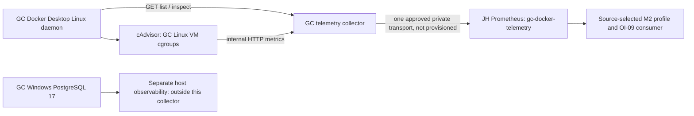

# OI-02/03/04 — GC Docker 자원·재시작 관측 경로

작성일: 2026-11-11 KST. **구현·합성 검증 완료 / 후보 설정 미적용 / GC·JH 실환경 UNVERIFIED**.
GC → JH 로그 전달은 사용자가 확인한 사실이다. 이를 CPU·memory·network·restart 입력 인수로 확대하지 않았다.

## 1. 작업 환경과 보존

- 원본: `/Users/kwonjunhui/Desktop/graduation/graduation-project`, branch `main`, HEAD `92e70dbf8b9af14b9376df3fde3a7fb4db7e3e50`.
- 시작 상태: tracked 변경 없음, `docs/rulepack/`, `tools/rulepack/`가 untracked. M1~M5 보고서·매핑·생성기·테스트·결과가 미커밋 상태임을 파일 목록으로 확인했다.
- 기존 Worktree: 원본 main, `/private/tmp/leafy-aiops-collaboration-20261111/native-worktree-a`와 `native-worktree-b`(detached), `../oi09-source-identity`(`feat/oi09-source-identity`). 이들은 변경하지 않았다.
- 본 작업: 별도 `../oi02-04-telemetry`, branch **`feat/oi02-04-telemetry`**, 같은 HEAD.
- 기존 untracked 전체를 복제하지 않았다. M1, M2-2, M2-3, M5-A, M5-B, OI milestone 보고서 6개와 M2 infra/resource 매핑·생성 결과 4개만 allowlist로 복사했다. `source-copy-manifest.json`의 10개 SHA256을 원본·복사본과 대조했다. 기존 목적지 존재 시 덮어쓰기를 거부하는 방식이었다. 비밀 설정, raw inspect, 런타임 증거·주소, 시나리오, Heldout은 복사하지 않았다.
- A의 `aiops/pipeline/`, `tools/rulepack/`, 운영 Compose/Prometheus/rules, 시나리오/Heldout에 수정 없음. Git stash/reset/clean/강제 checkout/commit/push/PR, 컨테이너 조작, 운영 배포·reload·포트 개방을 실행하지 않았다.

종료 시 Worktree 목록은 원본 main, 본 telemetry, A의 identity, C의 `../m5b-runtime-acceptance`(`test/m5b-runtime-acceptance`)였다. 시작 때의 임시 detached Worktree 두 개는 종료 목록에 없었으며 본 세션은 해당 Worktree를 조작하지 않았다.

이번 신규 파일 범위는 `deploy/leafy-pc/telemetry/`, `monitoring/prometheus/drafts/oi02-04/`, 이 보고서다. 복사된 선행 자료는 참고본이며 신규 구현의 변경 대상이 아니다.

## 2. 기존 관측 경로와 확인한 공백

검토한 근거: [M2-2](M2_2_INFRA_GENERALIZATION.md), [M2-3](M2_3_RESOURCE_GENERALIZATION.md), [M5-A](M5_A_RULEPACK_INTEGRATION.md), [M5-B](M5_B_RUNTIME_ACCEPTANCE.md), [OI milestone](OBSERVABILITY_INFRA_MILESTONE.md), [GC 배포 안내](../../deploy/leafy-pc/README.md), 원격/통합 Prometheus, 운영 룰, `docker-compose.aiops.yml`, Pipeline `main.py`와 metadata/metrics producer.

| 경로 | 저장소에서 확인한 내용 | 실환경 한계 |
|---|---|---|
| GC 로그 | frontend/backend/minio Docker fluentd driver, Zeek/enricher/Fluent Bit → JH Fluentd/Loki | 자원 counter/gauge를 전달하는 경로가 아니다. |
| GC 실제 앱 배포 | Windows 11 Docker Desktop, 별도 `back/deploy/`; 실제 Compose는 이 저장소에 없음 | project, 이름, image, cgroup, 실제 limit·interface를 추측하지 않는다. |
| GC DB | Windows host PostgreSQL 17 + Windows Fluent Bit | 통합 `leafy-db` Docker PG16과 다른 대상이다. 이번 collector는 Windows PostgreSQL CPU/memory/restart를 생산하지 않는다. |
| 원격 Prometheus | 5s scrape/evaluation, JH `pipeline-metadata`, GC 앱/exporter file_sd 자리. node/cAdvisor job 없음 | GC 컨테이너 자원 scrape가 설정돼 있다고 볼 수 없다. |
| Pipeline metadata | 로컬 socket의 실행 중 컨테이너 → `container_name_info{id="/docker/<full-id>",name,service}=1`; service는 이름 가공 | 실제 GC exporter가 이 지표/라벨을 이미 제공한다고 가정하지 않는다. |
| Pipeline restart | 로컬 socket list all + inspect, 고정 project `graduation-project`, services frontend/backend/db/minio | JH socket의 결과는 GC restart 정보가 아니다. |
| 통합 cAdvisor | 통합 Compose의 local daemon/VM 관측 | JH 또는 개발 Mac의 값을 GC 값으로 사용하지 않는다. |

실제 GC 접근 경로·주소를 이번 세션에서 확보하지 못했다. 원격 접속을 시도하거나 C의 실환경 검증을 중복 실행하지 않았다. 실측 표본·실제 target·배포 버전·포트 상태에 관한 VERIFIED 항목은 없다.

## 3. TO-BE 수집 아키텍처와 파일



[collector](../../deploy/leafy-pc/telemetry/exporter.py)는 Python 3.11+ 표준 라이브러리만 사용한다. Docker에는 `GET /containers/json?all=true`, `GET /containers/<64hex>/json`만 요청한다. cAdvisor는 내부 HTTP `/metrics`만 GET하며 redirect를 따르지 않는다. 응답 크기·socket timeout을 제한했다. GET `/metrics` 수집은 단일 worker로 직렬화하고 3초 응답 deadline을 두었다. 지연된 worker를 중복 생성하지 않으며 503으로 알린다. 운영 실행·이미지 빌드는 하지 않았다.

| 파일 | 역할 |
|---|---|
| `deploy/leafy-pc/telemetry/exporter.py` | cAdvisor 수집·품질 검사·Docker metadata 결합·restart producer·HTTP endpoint |
| `config.example.json` | site/source/실제 project/서비스별 정확한 Docker name. placeholder가 있으면 시작 거부 |
| `compose.candidate.yml`, `Dockerfile` | 독립 collector project. 기존 앱 Compose와 분리. 이미지 digest 필수 입력. **host ports 없음** |
| `verify.py` | 저장된 exposition과 timestamped captures의 오프라인 identity/quality 검사 |
| `tests/test_telemetry.py` | 합성 producer/transport/기존 M2 식 native 평가 |
| `monitoring/prometheus/drafts/oi02-04/` | 미로딩 scrape/file_sd 후보 |

cAdvisor의 VM rootfs/sys/Docker 경로와 privileged 권한은 **Linux VM 후보**이며 Windows Desktop에서 실제 mount/cgroup 지원을 인수해야 한다. socket `:ro`는 Docker API 쓰기를 차단하는 보안 경계가 아니다. 본 코드가 GET만 쓰는 것과 socket을 가진 프로세스의 권한은 구분한다. 운영에서는 읽기 전용 API proxy/권한 격리 검토가 필요하다. 이번에는 proxy 설치나 권한 변경도 하지 않았다.

## 4. CPU·Memory·Network producer 및 입력 검사

### CPU

- cAdvisor `container_cpu_usage_seconds_total`을 변환 없이 전달한다. 단위는 누적 CPU seconds, `irate[30s]` 결과는 **seconds/second = CPU core 상당량**이다. 0.5는 멀티코어 호스트 전체의 50%가 아니다.
- raw `id`가 정확히 `/docker/<64자리 Docker Id>`여야 한다. Docker metadata id와 완전 일치 확인 후 사용한다. systemd/cgroup v2의 다른 ID 경로를 임의로 `/docker/`로 다시 쓰지 않는다. 알려진 Docker ID가 다른 경로에 있거나 CPU coverage가 없으면 resources 실패다.
- `cpu="total"`이 실제로 필요하다. total + per-core가 함께 있으면 둘 다 보존하되 기존 식은 total만 고른다. per-core만 있으면 실패하며 합산을 대신 만들지 않는다.
- cAdvisor name이 비어 있으면 검증된 Docker name을 명시적으로 보충한다. 비어 있지 않은 raw name이 Docker와 다르면 실패다. 기존 룰/임계값은 바꾸지 않는다.

### Memory

- `container_memory_working_set_bytes`, `container_spec_memory_limit_bytes`는 **bytes**이며 working set을 usage로 대체하지 않는다.
- 분자/분모의 raw 전체 labelset이 정확히 같아야 한다. 이 검사 후에만 민감할 수 있는 `container_label_*` payload를 제거한다. 그 외 라벨(image 등)은 보존하며 새 identity를 동일하게 붙인다. 정규화 후 중복 시계열도 거부한다.
- 기존 `/(limit > 0)`를 보존한다. limit 0/누락은 정상 비율 0이 아니다. 누락·라벨 mismatch는 resources 실패다. 0은 그대로 노출하며 기존 양수 분모 필터가 제외한다.
- Docker `HostConfig.Memory=0`은 설정된 container limit 없음이다. cAdvisor가 이때 **양수 VM/host limit을 내보낼 수도 있으므로**, 양수라는 이유로 container quota라고 승인하지 않는다. `leafy_docker_container_memory_limit_bytes`와 `leafy_container_memory_limit_configured`로 실제 설정 상태를 별도 노출한다. cAdvisor 값을 임의로 0으로 고치지 않는다.
- 무제한 컨테이너의 기존 메모리 경보는 container quota 소진 판정으로 인수할 수 없다. quota 추가나 룰 분모 변경은 별도 정책/배포 작업이며 이번에는 하지 않았다.

### Network

- `container_network_receive_bytes_total`: 누적 수신 bytes, `rate[1m]`은 bytes/sec이다. interface를 그대로 보존하며 `interface!="lo"`는 기존 식의 책임이다.
- raw `/docker/` 네트워크 시계열은 감시 앱 외의 Docker 컨테이너도 모두 유지한다. 메모리도 원래 source 전체 범위를 유지한다. 보조 collector·Zeek 등의 컨테이너가 포함될 수 있음을 인수해야 한다. restart allowlist로 자원 지표까지 잘라내지 않았다.
- **어떤 `/docker/` 네트워크 시계열이라도 있으면** 기존 root fallback을 막는다. lo만 있음/감시 목록 밖 name도 guard를 막으며, 이는 유효한 target rate 존재와 다르다. 이를 고쳐서 GC 관측이 성공한 것처럼 보이게 하지 않았다.
- root `id="/"`는 `runtime="host",service="docker-vm",target="docker-vm"`이며 name을 제거한다. Docker Desktop **Linux VM 관측점**이지 Windows 물리 호스트·PostgreSQL·backend의 수신량이 아니다. root에 앱 name이 원래 있더라도 귀속하지 않는 명시적인 identity 정규화다.
- net family 자체가 없으면 resources 실패. root만 있으면 정상 수집 가능하지만 per-container network 인수는 미충족이다.

### 품질 실패 처리

raw id/name 중복, 미확인 source/job 라벨 유입, NaN/Inf/음수, label 문법/중복 오류, explicit sample timestamp, name 불일치, full-label memory mismatch, Docker 재생성 중 list/cAdvisor 불일치는 검사에서 거부한다. raw cAdvisor가 site/source/service 등을 이미 제공한다고 가정하지 않으며 해당 예약 라벨 충돌도 거부한다.

실행 중 Docker 컨테이너마다 CPU total·working_set·limit·`container_last_seen` coverage가 필요하다. `container_last_seen`이 collector 시각보다 15초 이상 오래되거나 5초 이상 미래이면 resources 실패다. 이 값은 **producer freshness 허용 폭**이며 탐지 임계값 변경이 아니다. NTP/VM 시계와 실제 5초 housekeeping을 확인해야 한다. last_seen이 최근이라는 사실만으로 모든 통계 항목의 내부 갱신 시점까지 보증하지 않는다.

resource 검사 실패 시 해당 scrape의 자원·root·`container_name_info`를 **전부 생략**한다. 일부 container network를 버린 뒤 root만 남겨 fallback을 잘못 활성화하지 않는다. 이 보수적인 설계는 한 컨테이너의 cgroup race가 그 scrape의 전체 resource 공백을 만들 수 있다. 부분 결과 보존보다 잘못된 귀속 방지를 우선한 후보이며 가용성 영향은 실환경에서 인수해야 한다. restart 수집은 별도 성공/실패로 처리한다.

## 5. Restart producer

기존 Pipeline의 고정 로컬 socket producer를 수정하지 않고 GC 독립 producer를 추가했다.

- site/source/project와 `frontend`, `backend`, `minio`의 실제 Docker name을 config로 받는다. project/service는 Docker Compose labels에서 읽는다. 이름 prefix로 service를 추측하지 않는다.
- list는 중지 컨테이너도 포함한다. 정확한 project/service/name 대상만 inspect하며 list/inspect의 Id/Name/Compose labels를 다시 대조한다. 예상 대상 부재와 API 실패는 target 상태 지표로 구분한다.
- `RestartCount`의 음수가 아닌 정수를 counter로, RFC3339Nano `State.StartedAt`을 Unix seconds gauge로 노출한다. 미시작 zero-time은 StartedAt을 생략한다. running인데 zero-time/invalid timestamp이면 해당 target 실패다.
- restart와 StartedAt 시계열은 안정적인 `{site,source,runtime,service,target,name}`만 갖고 **id를 넣지 않는다**. 같은 이름의 recreate에서 counter reset과 시작 시각 변경을 기존 식이 볼 수 있게 한다. 현재 id는 `leafy_container_identity_info`로 분리한다. 서비스·이름·site/source를 바꾸면 새 시계열이다.
- target inspect 실패 시 그 target 값은 생략한다. 다른 target의 성공 표본은 유지하고 aggregate success는 0이다. 목록 전체 실패 시 모든 restart/자원 값이 없다. 이전 값 재노출·가짜 0·이벤트 누적 저장소는 없다.

기존 M2의 counter 증분/reset 분기, StartedAt changes 분기, OR 결합, 10분 창, 5초 offset/subquery step, `>=2`, `for:0m`, `keep_firing_for:2m`는 그대로다. **Docker inspect에서 관측한 상태 변화**이며 실제 재시작 이벤트 스트림이 아니다. 자동 재시작은 RestartCount에 반영되지만 수동 시작 전체를 세지 않는다. StartedAt은 가장 최근 시작 시각 한 개다. 두 분기를 더해서 한 재시작을 두 번 세지 않는다.

같은 이름의 recreate는 새 ID를 metadata에 보이고 stable restart 시계열에서 reset이 보인다. restart count 감소 시 새 current 값만 반영하는 기존 조건을 유지했다. 최초 표본의 count 전체를 새 이벤트로 세지 않는다. 수집 간 다중 시작, 재생성 직후 첫 scrape 전 이전 값 이상 증가, 긴 단절은 과소 관측 가능하다. 이전 `last_over_time`/Prometheus lookback/keep_firing_for가 남아도 현재 producer 성공을 의미하지 않는다. 재시작을 유발하는 실환경 테스트는 실행하지 않았다.

## 6. 실제 출력 계약과 A 세션 전달 사항

아래는 **이번 코드의 출력 계약**이다. GC 실표본에서 이미 확인한 라벨이 아니다. 주소·site 이름·Docker 이름·image digest는 확정하지 않았다.

공통 정의:

- `S={site,source}`: config 값. site는 PC/배포 환경, source는 **GC Docker daemon 관측자**의 고유하고 안정적인 ID. JH source와 달라야 한다. job/instance는 전송 경로로 Prometheus가 부여한다.
- `I=S+{runtime="container",service,target,name}`: Docker Compose service, 정확한 Docker name을 target/name으로 사용한다. Compose service가 없으면 자원 metadata service는 `unknown`이다. 예상 GC target의 service는 config와 일치해야 한다.
- `D=I+{id="/docker/<64hex>"}`. id는 container 인스턴스, target/name은 그 이름의 논리 대상이다.
- `H=S+{runtime="host",service="docker-vm",target="docker-vm",id="/"}`: root 관측점. **Windows PG17에 매핑 금지**.

| 메트릭 | type / labelset | 의미 |
|---|---|---|
| `container_cpu_usage_seconds_total` | counter / D + cpu + raw 비민감 dimensions | CPU seconds; 기존 식은 cpu=total |
| `container_memory_working_set_bytes` | gauge / D + raw dimensions | bytes |
| `container_spec_memory_limit_bytes` | gauge / 위 분자와 동일 labels | raw cAdvisor bytes, Docker 설정 quota와 별도 |
| `container_network_receive_bytes_total` | counter / D 또는 H + interface + raw dimensions | receive bytes |
| `container_last_seen` | gauge / D 또는 H + raw dimensions | cAdvisor last seen Unix seconds, root는 net freshness용 |
| `container_name_info` | gauge 1 / D | 실행 중 컨테이너, id당 1개. resource 계약 전체 성공 때만 노출 |
| `aiops_docker_container_restarts_total` | counter / I | Docker RestartCount, id 없음 |
| `aiops_docker_container_started_at_seconds` | gauge / I | 최근 StartedAt Unix seconds, id 없음 |
| `leafy_container_identity_info` | gauge 1 / D | inspect 성공한 예상 target, 중지 포함 |
| `leafy_docker_container_memory_limit_bytes` | gauge / I | Docker HostConfig.Memory bytes, 0=설정 limit 없음 |
| `leafy_container_memory_limit_configured` | gauge 0/1 / I | Docker limit 설정 여부 |
| `leafy_telemetry_target_present` | gauge 0/1 / I | 예상 project/service/name의 list 존재 여부. Docker list 실패 때도 0이므로 aggregate 상태와 함께 해석 |
| `leafy_telemetry_target_scrape_success` | gauge 0/1 / I | 해당 inspect/필드 검사 성공 여부 |
| `leafy_telemetry_collection_success` | gauge 0/1 / S + component=docker/resources | docker는 예상 모든 target 성공, resources는 cAdvisor/metadata 계약 성공 |
| `leafy_telemetry_last_success_timestamp_seconds` | gauge / S + component | 해당 producer component의 최근 성공 시각. 프로세스 시작 후 미성공이면 0 |
| `aiops_docker_status_scrape_success` | gauge / S | 기존 이름 호환용 docker aggregate success |

Prometheus의 scrape 성공인 `up{job,instance}`는 별개다. candidate가 file_sd에 site/source를 넣지 않으므로 **up에는 site/source가 자동으로 붙지 않는다**. up=1이라도 component=0이면 내부 수집 실패다. target 미등록은 up=0 시계열의 존재조차 보장하지 않는다. 같은 exporter를 두 경로로 scrape하거나 raw cAdvisor/metadata를 또 scrape하는 구성은 인수 거부한다.

A가 사용할 source mapping 초안(실제 값으로 치환 전 적용 금지):

```yaml
sources:
  REPLACE_GC_DOCKER_OBSERVER:
    cadvisor: {job: gc-docker-telemetry, instance: 'REPLACE_APPROVED_GC_TRANSPORT_HOST:9108'}
    pipeline: {job: gc-docker-telemetry, instance: 'REPLACE_APPROVED_GC_TRANSPORT_HOST:9108'}
```

M2 schema의 `pipeline` 키는 **metadata/restart selector 역할의 기존 키**이며 실제 JH Pipeline 프로세스를 뜻하지 않는다. 두 selector가 같은 GC collector endpoint를 선택하도록 한다. 기존 integrated 매핑/생성기를 수정하지 않았다. 이름별 CPU/restart 및 network_names는 관측된 이름으로 별도 프로파일을 만들어야 한다. GC에 Docker DB target을 넣지 않는다.

A/OI-09는 `site/service/runtime/target/source`를 소비 identity로 유지하고 job/instance를 해당 입력 경로로 검증해야 한다. `source`를 단지 job 문자열로 가정하지 않는다. `rulepack_source`를 쓸 경우 이 observer source와의 명시적 매핑이 필요하다. 기존 CPU/memory/restart의 `sum/max by(name)`은 입력의 site/source/service/runtime/target을 결과에서 버린다. 따라서 source별 생성 룰의 static labels/검증된 consumer profile에서 이를 복원해야 한다. 원본 룰이 새 identity labels를 자동 보존한다고 주장하지 않는다. 여러 source의 동일 name은 반드시 별도 범위로 평가한다.

root fallback의 기존 `sum without(interface)`는 H labels를 남긴다. root 신호는 host scope로 라우팅하고 Docker inspect/고정 backend에 귀속하지 않는다. GC Windows PostgreSQL은 별도의 `service=db,runtime=host,target=<실측 Windows DB 대상>,source=<별도 host observer>` 계약이 필요하며 이 collector의 source·target과 혼용하지 않는다. A 코드/스키마는 본 세션에서 수정하지 않았다.

## 7. JH Prometheus 연결 방법 — 후보만 작성

[스크레이프 후보](../../monitoring/prometheus/drafts/oi02-04/scrape.candidate.yml)는 운영 `prometheus.aiops.yml`이나 `targets/*.yml` 밖에 있다. Docker daemon당 endpoint 하나·job 하나를 등록하는 방식이다. scrape 5초/timeout 4초, collector deadline 3초, cAdvisor housekeeping 5초 및 dynamic housekeeping 비활성 후보를 명시했다. 실제 cadence/timeout은 API와 표본으로 확인해야 한다.

1. GC 실제 config와 reviewed immutable cAdvisor/Python image digest를 확정한다. example placeholder는 collector 시작을 거부한다.
2. GC Docker Desktop에서 후보 mount·id·cpu=total·label 계약의 지원 여부를 먼저 확인한다. 지원되지 않으면 실패 근거를 기록하고 mapping/별도 exporter 설계를 검토한다. 기존 룰을 몰래 바꾸지 않는다.
3. 현재 Compose는 내부 network만 있으며 JH가 직접 연결할 host listener는 없다. 운영 전에는 기존 승인 private tunnel/proxy 또는 별도 검토된 Tailscale listener를 설계해야 한다. **로그용 공유 방향·ACL이 metric pull을 보장하지 않으며 9108/8080 개방은 이번에 하지 않았다.** 별도 후보 override/transport 설계가 없으면 remote collection은 BLOCKED다.
4. transport 승인 후 실제 접근 주소를 file_sd 후보에 한 번만 넣고, scrape 후보의 site/source keep regex도 config와 같게 치환한다. site/source에 점 등 정규식 문자가 있으면 반드시 `re.escape(value)`로 literal escaping하여 정확히 일치시킨다. 예시 주소를 실값으로 가정하지 않는다.
5. `honor_labels:true`로 collector가 확정한 site/source/runtime/service/target을 보존한다. job/instance는 collector가 내보내지 않으며 Prometheus 책임이다. `honor_timestamps:false`이며 exporter도 raw explicit timestamp를 거부한다. keep relabel은 잘못된 site/source를 버리는 **방어선**이지 producer metadata를 생성하는 기능이 아니다. 잘못된 keep regex로 전체를 버려도 up=1일 수 있다.
6. global targets에서 같은 GC daemon의 duplicate source/job/instance가 없는지 확인한다. JH Pipeline을 GC source로 relabel하지 않는다.
7. 기존 운영 룰은 다중 source를 안전하게 집계하는 프로파일로 인수되지 않았다. source-scoped M2 프로파일/OI-09 소비 인수 없이 수집 후보만 운영에 추가하면 unscoped 기존 룰이 GC·JH를 섞을 수 있다. 따라서 **현 운영 설정에 자동 병합·reload하지 않는다**.

후보 Compose의 image/config 환경변수를 채워 `docker compose ... config --quiet`와 전체 합친 Prometheus 설정의 `promtool check config`로 문법만 검사한다. 성공은 연결 성공 증거가 아니다. 이번 검사는 합성 image 문자열·존재하지 않는 config/target 경로로 수행했으며 실제 이미지 pull/build나 실행은 없었다.

## 8. 테스트 결과와 재현

Python 3.14 환경, PyYAML 6.0.3(테스트 전용), 기존 임시 `promtool 3.7.3`을 사용했다. 운영 서비스·Docker daemon에 접근하지 않았다. 기본 sandbox는 임시 Unix socket bind를 차단했으나 승인된 격리 테스트 실행으로 통과했다. 실제 Docker socket 대신 `/private/tmp`의 mock Unix socket만 썼으며 TCP 포트는 열지 않았다.

```sh
OI_PROMTOOL=/path/to/promtool PYTHONDONTWRITEBYTECODE=1 \
  python3 -m unittest discover -s deploy/leafy-pc/telemetry/tests -v
```

- **28개 PASS, SKIP 0개**: producer/quality/transport 19개 + native M2 PromQL 9개.
- CPU 0.8 core/metadata join, memory 0.9 및 limit 0의 빈 결과, 20,000,000 bytes/sec, lo가 root fallback을 막는 조건, root의 VM identity, RestartCount 증가/reset/recreate, StartedAt changes, 전체 입력 결측을 실제 promtool 평가로 확인했다.
- Native 검사는 복사된 기존 M2 식을 읽고 **임시 테스트 안에서 job/instance selector만 GC fixture로 치환**했다. 원본 룰 파일·생성기·threshold·시간창·분기·for를 고치지 않았다. 조건식 평가 검사이며 새 운영 룰을 만든 것이 아니다. 기존 for/keep_firing_for의 전체 시간 회귀는 기존 M2 테스트 근거를 사용하며 이번 신규 검사 범위로 과장하지 않는다.
- producer 검사는 잘못된 cpu/id/name/interface, metadata id/name 중복, full-label memory mismatch, 예약 source/job 충돌, 중복 시계열, NaN, cAdvisor freshness 누락/오래됨/시계 오차, target 부재/inspect 실패, 전체 producer 실패, 이전 값 미재노출, 0/결측 구분, stopped/never-started, 무제한 설정, source/endpoint 중복, capture gap을 포함한다.
- `docker compose -f deploy/leafy-pc/telemetry/compose.candidate.yml config --quiet`: 문법 PASS. 실제 이미지·mount·Windows 실행은 미검증.
- verifier CLI smoke: UTF-8 BOM config/captures 읽기, snapshot/cadence PASS, 잘못된 source exit 1, `runtime_accepted=false` 확인.
- 종료 보존 검사: 복사 참고본 10/10이 원본/Worktree와 해시 일치, 운영·Pipeline 주요 파일 8/8이 두 Worktree에서 HEAD와 바이트 일치, 원본 tracked diff 없음.
- scrape 후보를 임시 전체 config에 넣은 `promtool check config`: PASS, 아직 없는 file_sd 파일 경고는 예상한 결과다.

`OI_PROMTOOL`이 없으면 native 클래스는 명시적으로 SKIP한다. exporter/verify는 표준 라이브러리만 사용하고 native 테스트만 `requirements-test.txt`의 PyYAML을 추가로 사용한다. 실환경 metric 원본을 테스트 fixture로 가장하지 않았다.

## 9. GC/JH 실환경 읽기 전용 검증 절차

다음은 **실행하지 않은 runbook**이다. 이미 존재하고 접근이 승인된 대상에서 조회만 한다. 구성 요소가 없으면 MISSING/BLOCKED를 기록하며 테스트를 위해 컨테이너·Windows 서비스를 시작/재시작/삭제하거나 포트를 열지 않는다. full inspect/Compose config/.env 전체에는 비밀이 있을 수 있으므로 콘솔·증거로 덤프하지 않는다.

### GC PowerShell: 인벤토리·상태·limit

```powershell
[DateTime]::UtcNow.ToString('o')
w32tm /query /status
Get-Service postgresql-x64-17 | Select-Object Name, Status
# 실제 Windows 서비스 이름이 다르면 먼저 Get-Service '*postgres*'로 확인한다.
docker context show
docker info --format '{{.OSType}} {{.CgroupVersion}} {{.Driver}}'
docker ps -a --no-trunc --format '{{.ID}} {{.Names}} {{.Label "com.docker.compose.project"}} {{.Label "com.docker.compose.service"}} {{.State}}'

# 앞에서 확인한 frontend/backend/minio 이름에만 실행한다.
$ObservedContainer = '<실측 Docker name>'
docker inspect $ObservedContainer --format '{{.Id}} {{.Name}} {{index .Config.Labels "com.docker.compose.project"}} {{index .Config.Labels "com.docker.compose.service"}} {{.RestartCount}} {{.State.StartedAt}} {{.State.Running}} {{.HostConfig.Memory}} {{.HostConfig.NanoCpus}} {{.HostConfig.CpuQuota}} {{.HostConfig.CpuPeriod}}'
```

기대: Linux daemon/cgroup 버전·정확한 64자리 ID/project/service/name, bytes 단위 Memory, RestartCount 정수와 StartedAt을 확인한다. 호스트 PostgreSQL17이 Docker 목록에 없어도 정상이며 이 결과로 DB 관측 부재를 오류로 판정하지 않는다. service 이름/배포 방식이 맞지 않으면 config를 추측해서 채우지 않고 차이를 기록한다.

이미 승인된 collector endpoint가 존재할 때만 아래 GET을 수행한다. 저장 위치는 repo 밖의 비공개 디렉터리를 사용한다. 샘플에는 실제 이름/ID가 있으므로 검토 없는 raw 커밋을 하지 않는다.

```powershell
$CollectorUrl = '<기존 승인 transport의 http(s) origin>/metrics'
$CaptureDir = '<repo 밖의 기존 비공개 증거 디렉터리>'
$CaptureRows = @()
1..13 | ForEach-Object {
  $ObservedAt = [DateTimeOffset]::UtcNow.ToUnixTimeMilliseconds() / 1000.0
  $CaptureName = ('scrape-{0:D2}.prom' -f $_)
  curl.exe --fail --silent --show-error --max-time 4 $CollectorUrl -o (Join-Path $CaptureDir $CaptureName)
  if ($LASTEXITCODE -ne 0) { throw 'Capture failed; record scrape failure, do not substitute zero' }
  $CaptureRows += @{timestamp=$ObservedAt; path=$CaptureName}
  if ($_ -lt 13) { Start-Sleep -Seconds 5 }
}
ConvertTo-Json -InputObject @($CaptureRows) -Depth 3 | Set-Content -Encoding utf8 (Join-Path $CaptureDir 'captures.json')
python -B deploy/leafy-pc/telemetry/verify.py --config '<실측 비공개 config.json>' --captures (Join-Path $CaptureDir 'captures.json')
```

Windows PowerShell 5의 UTF-8 BOM이 있는 JSON은 `utf-8-sig`로 읽도록 지원한다. GET 소요 시간 때문에 시작 간격이 5초보다 길 수 있다. 7.5초 초과 gap이면 verifier가 실패하며 실제 scrape cadence는 Prometheus range API에서 따로 인수한다. verifier의 PASS는 snapshot 품질 검사이며 runtime_accepted는 항상 false다. 최소 1분 관측은 rate 입력 확인용이고, 재시작 룰의 정상 10분 창·장기 공백은 더 긴 읽기 전용 관찰이 필요하다. restart를 유발하지 않는다.

### JH Prometheus: GET/API와 질의

`GET /api/v1/targets`, `/api/v1/status/config`, `/api/v1/query`, `/api/v1/query_range`를 승인 endpoint에서 사용한다. config API 전체는 비공개로 검토하며 인증/주소를 저장소에 덤프하지 않는다. 아래 `<...>`는 **실측 값으로 치환**한다.

```promql
up{job="gc-docker-telemetry",instance="<approved endpoint>"}
leafy_telemetry_collection_success{site="<gc site>",source="<gc observer>"}
leafy_telemetry_target_present{site="<gc site>",source="<gc observer>"}
leafy_telemetry_target_scrape_success{site="<gc site>",source="<gc observer>"}
time() - leafy_telemetry_last_success_timestamp_seconds{site="<gc site>",source="<gc observer>"}
time() - container_last_seen{site="<gc site>",source="<gc observer>"}

# expected: id당 유일 / 값 1. 빈 결과는 정상 0과 다르다.
count by (site,source,id) (container_name_info{site="<gc site>",source="<gc observer>"}) != 1
container_name_info{site="<gc site>",source="<gc observer>"} != 1
# 다른 source/job/instance에서 같은 Docker id를 중복 수집했는지 별도 검사
count by (site,id,cpu) (container_cpu_usage_seconds_total{site="<gc site>",cpu="total"}) > 1
count by (site,id) (container_name_info{site="<gc site>"}) > 1

# metadata 매칭. raw 분자/분모 라벨도 각각 직접 비교한다.
container_cpu_usage_seconds_total{job="gc-docker-telemetry",cpu="total",id=~"/docker/.+"}
unless on(id) container_name_info{job="gc-docker-telemetry"}
container_memory_working_set_bytes{job="gc-docker-telemetry"}
unless container_spec_memory_limit_bytes{job="gc-docker-telemetry"}
leafy_docker_container_memory_limit_bytes{site="<gc site>"}
leafy_container_memory_limit_configured{site="<gc site>"}

irate(container_cpu_usage_seconds_total{job="gc-docker-telemetry",cpu="total",id=~"/docker/.+"}[30s])
container_network_receive_bytes_total{job="gc-docker-telemetry"}
rate(container_network_receive_bytes_total{job="gc-docker-telemetry",interface!="lo"}[1m])
count(container_network_receive_bytes_total{job="gc-docker-telemetry",id=~"/docker/.+"})

aiops_docker_container_restarts_total{job="gc-docker-telemetry"}
aiops_docker_container_started_at_seconds{job="gc-docker-telemetry"}
leafy_container_identity_info{job="gc-docker-telemetry"}
count_over_time(container_cpu_usage_seconds_total{job="gc-docker-telemetry",cpu="total"}[1m])
```

기대 판정: target 하나, up=1, components/expected targets=1, id/name/source 중복 없음, CPU total과 memory 쌍 존재, root/container scope 분리다. API 경고·empty·0·실패는 각각 기록한다.

위 job-only query는 해당 job이 **단일 GC endpoint만** 포함하는 후보 계약의 진단용이다. 여러 site를 같은 job에 등록할 때는 모든 selector와 join을 실측 site/source/instance로 제한한 별도 프로파일로 검증한다. 기존 M2의 `on(id)`는 source를 자동 격리하지 않는다.

실패 시: up=0이면 승인 transport/target/timeout, up=1이며 전체 metric 결측이면 keep regex, component=0이면 socket 권한·raw cAdvisor id/cpu/name/full-label/freshness, target_present=0이면 project/service/name을 확인한다. root만 있으면 per-container network 미지원, positive limit과 configured=0이 함께 있으면 VM/host 분모 가능성을 기록한다. 포트 개방·재시작으로 자동 보완하지 않는다.

## 10. 미검증 항목과 M5-B 인수 조건

| 게이트 | 필요한 실환경 증거 | 이번 상태 |
|---|---|---|
| OI-01 inventory | GC Compose project/name/service, daemon/VM/cgroup, 시각, 실제 image digest | UNVERIFIED |
| OI-02 path | 승인 transport를 통한 JH target 등록, 5초 연속 표본, CPU total/memory/network 실값 | 구현 후보 / transport 미구축 |
| OI-03 restart | 동시각의 GC inspect와 Prometheus RestartCount/StartedAt/id 대응, 모든 예상 target 상태 | 합성 PASS / 실환경 UNVERIFIED |
| OI-04 identity | raw cAdvisor ID 일치, metadata=1/유일, source 중복 없음, full-label memory 일치, limit 의미 | 합성 PASS / 실환경 UNVERIFIED |
| OI-04 network | 관측 interface/namespace, 이름 보충의 타당성, root fallback 억제/결측과 VM scope | 합성 PASS / 실환경 UNVERIFIED |
| OI-04 cadence | 실제 targets의 interval/timeout, loaded group 평가 5s, range의 인접 표본/결측/last_seen | 후보 설정만 확인 |
| host PostgreSQL17 | Docker DB와 혼동하지 않는 host producer/DB 입력 프로파일 | 본 collector 대상 외, 통합 PG16 CPU 룰로 대체 불가 |
| OI-09 consumer | A의 site/service/runtime/target/source 유지, 동명 source 분리, root host 라우팅 | A 소유, 미수정 |
| M5-B | source별 실입력 식 평가, 기존/후보 중복 없음, 승인 범위의 AM→Pipeline/RCA 증거 | C의 실환경 검증 대기, 이번 E2E 증거 0 |

실환경에서 재시작이 관측되지 않았다면 현재 count/StartedAt의 일치까지만 인수하고 실제 재시작 탐지는 미검증으로 남긴다. 합성 reset 검사를 실제 GC 재시작의 증거로 사용하지 않는다. 필수 게이트를 충족하기 전 OI-02/03/04나 M5-B 전체를 DONE으로 승격하지 않는다. 구현 후보는 검토 가능하지만 운영 적용을 승인한 상태가 아니다.

## 11. 기술 근거

- [Docker Engine API v1.45](https://docs.docker.com/reference/api/engine/version/v1.45/): containers list/inspectのread endpoint。実GC daemonのAPI互換性は別途確認する。
- [cAdvisor Prometheus metrics](https://github.com/google/cadvisor/blob/master/docs/storage/prometheus.md): CPU seconds、working set/limit bytes、receive bytes、last_seenのmetric定義。実環境のラベル/値はこの一覧だけでは確定しない。
- [Prometheus functions](https://prometheus.io/docs/prometheus/latest/querying/functions/): irate/rate/changesの計算。
- [Prometheus vector matching](https://prometheus.io/docs/prometheus/latest/querying/operators/#vector-matching): full-label matchingとon(id) join。
