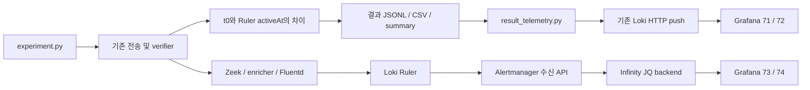

# MTTD 및 실제 Alertmanager 경보 대시보드 검증

검증일: 2026-10-26 (Asia/Seoul). 시작 커밋 `6e70f05`, 브랜치
`feature/s2_scenario`, 시작 워킹트리는 깨끗했다. 이전 두 커밋을 유지했다.

## A. 구현 결과

| 기능 | 상태 | 구현 |
|---|---|---|
| MTTD 데이터 전달 | PASS | 저장된 평가 JSONL을 기존 Loki HTTP push API로 자동 전송 |
| MTTD 패널 | PASS | 71: 실제 TP 표본 평균(초)과 표본 수, 72: 모든 회차 결과 표 |
| Alertmanager API | PASS | Infinity 4.1.3 JQ backend로 Docker 내부 REST API 직접 GET |
| 실제 활성 경보 | PASS | 73: 현재 수신한 활성 네트워크 인스턴스 수 |
| 경보 상세 | PASS | 74: 이름, 상태, 목적지, UTC 시작/만료 시각, fingerprint, labels/annotations |

## B. 데이터 흐름과 측정 기준



- t0: 기존 `run_experiment`가 `run_transfer` 호출 직전에 기록한 UTC 시각.
  실제 첫 패킷 시각으로 새로 정의하지 않았다.
- t2: verifier가 선택한 t0 이후 최초 대상 경보의 Ruler `activeAt`.
  polling 관측 시각이나 Alertmanager 수신 시각이 아니다.
- MTTD: 기존 `verify.mttd_seconds`를 그대로 저장/전송한다. `compute_mttd`,
  `evaluate_stages`, `ConfusionMatrix`는 수정하지 않았다.
- 기존 summary의 표본 기준인 유효한 TP(`valid && should_alert && detected`)를 유지한다.
  여러 실행의 평균은 모든 표본의 합/표본 수이며, 실행별 평균을 다시 평균내지 않는다.
- `experiment_id`는 UUID, `result_id`는 UUID:회차. 고유 식별자는 Loki label이 아니라 JSON body에 둔다.
- `started_at`, `detected_at`, `recorded_at`은 UTC ISO, 지연 단위는 초다.
  Grafana 기간 선택은 결과 기록 시각(`recorded_at_ns`)에 적용된다.
- 미탐지는 `mttd_seconds=null`, `detected_at=null`, `detection_status=not_detected`이다.
  무효 실행도 표에서 `invalid`로 남고 평균에서 제외한다. 표에는 최대 5000행을 표시한다.
- 측정값이 없을 때 평균은 N/A, 표본 수는 0이다. API 오류를 경보 0건으로 바꾸지 않는다.

기존 Fluentd는 컨테이너 로그와 canonical network event를 수집한다. 호스트의 평가 JSONL을
수집하려면 Fluentd 마운트/필터/재시작을 추가해야 한다. 이미 pipeline에서도 사용하는
`POST /loki/api/v1/push` 인터페이스를 stdlib로 재사용하여 해당 변경과 새 서비스를 피했다.
pipeline 실행 자체는 필요하지 않다. 평가 로그의 label은 `job=network-experiment`,
`event_type=network_experiment_result`뿐이라 탐지 규칙의 `log_type=network`와 분리된다.

## C. 변경 파일과 재배포

| 파일 | 변경 이유 |
|---|---|
| `docker-compose.yml`, `docker-compose.aiops.yml` | `GF_PLUGINS_PREINSTALL_SYNC=yesoreyeram-infinity-datasource@4.1.3`로 버전 고정 및 재생성 시 설치 |
| `monitoring/grafana/provisioning/datasources/datasources.yml` | Infinity 전용 `leafy-alertmanager-api` 추가, allowedHosts는 내부 Alertmanager만 허용 |
| `monitoring/grafana/provisioning/dashboards/aiops_dashboard.json` | 하단 row 70 및 패널 71~74, MTTD용 실행 ID 필터 추가 |
| `scenarios/network/experiment.py` | 측정 메타데이터 저장, CLI 실행 후 자동 전송, 재전송 명령 연결 |
| `scenarios/network/result_telemetry.py` | 파일 기반 전송, 실패 후 재시도, 중복 방지 |
| `scenarios/network/tests/test_result_telemetry.py` | 실제 값 보존, 미탐/무효 제외, 전송 실패/중복 방지 검증 |
| 이 보고서 및 동봉 JSON/PNG | 측정 원본·API 비교·화면 검증 근거 보존 |

기존 Prometheus/Loki/Alertmanager 정의는 그대로다. 추가한 Infinity 데이터소스는
API 패널 쿼리용이며 기존 Alertmanager 제어용 데이터소스를 중복 등록하지 않는다.
Grafana-managed 경보 전달은 기존처럼 `handleGrafanaManagedAlerts=false`이다.

Infinity를 선택한 근거:

- [공식 플러그인 메타데이터](https://grafana.com/api/plugins/yesoreyeram-infinity-datasource)의
  4.1.3 지원 범위에 Grafana 12.4.2가 포함된다. 실제 설치/쿼리도 검증했다.
- [공식 JQ backend 안내](https://grafana.com/docs/plugins/yesoreyeram-infinity-datasource/latest/query/jq-backend/)처럼
  서버 측 파서를 사용하므로 브라우저에서 내부 Docker 호스트 이름을 해석할 필요가 없다.
- 별도 exporter는 서비스 운영과 polling 지연을 추가한다. Prometheus `ALERTS`는 Ruler 평가 상태이므로
  수신 경보 데이터로 사용하지 않았다. 기본 Alertmanager 데이터소스의 패널 쿼리 제약도 유지된다.

실제 재생성 명령(두 번 실행, 각각 Grafana만 대상으로 실행):

```powershell
docker compose -f docker-compose.yml up -d --no-deps --force-recreate grafana
```

재생성 후 Grafana 12.4.2, Infinity 4.1.3, 기존 3개 데이터소스와 추가 API 소스,
모든 신규 패널 및 Loki의 측정 이력이 유지됐다. Prometheus/Loki 조회도 success였다.

## D. 실제 검증 결과

### S2 및 MTTD

각 실행 전 Alertmanager 목록이 비어 있고 pipeline/remediation이 exited인지 확인했다.
기존 격리된 Sink B `10.210.0.31:8080`로 V1을 세 번 실행했다. 추가 두 실행은
반복 집계 및 경보 만료 전에 브라우저를 확인하기 위한 검증이었다. 기존 실험 로직은 바꾸지 않았다.

| 실행 ID | t0 (UTC) | Ruler t2 (UTC) | 원본 MTTD (초) | summary 평균(초) |
|---|---|---|---|---|
| 8c678d77ea0d4dca95da51d0ea862e1b | 12:30:15.508423 | 12:30:29.387511 | 13.879088 | 13.879 |
| 1beb24b25d0145359d74d3295f4bab50 | 13:04:18.937481 | 13:04:29.387511 | 10.450030 | 10.450 |
| de9d68c2c8e64511ab6fbfca412d6d68 | 13:14:36.880300 | 13:15:29.387511 | 52.507211 | 52.507 |

날짜는 모두 2026-10-26이다. KST는 UTC+9시간이며 마지막 t0는 22:14:36.880300 KST다.
각 실행은 8개 연결, payload 10,485,760바이트였고 송수신 바이트·SHA-256 교차검증을 통과했다.
세 실행 모두 valid/detected=true였으며, Ruler firing 및 Alertmanager 수신 단계가 true였다.
delivery=false는 비활성 pipeline의 정상적인 결과이며 Slack/자동 조치 성공으로 보고하지 않는다.

검증 시각 `2026-10-26T13:15:50.592929Z` (22:15:50.592929 KST), 선택 기간 최근 1시간:

- 파일 원본 평균: `(13.879088 + 10.450030 + 52.507211) / 3 = 25.61210966666667초`.
- Grafana 실제 쿼리: 동일한 평균, 표본 수 3.
- 브라우저 Stat: **25.612 s**, **표본 수 3**.
- 회차 표의 JSON 원본이 결과 JSONL 세 행과 동일함을 프로그램으로 비교했다.
- 실행 ID별 필터 쿼리에서 각 표본 수 1과 해당 원본 결과를 확인했다.
- 이미 전송한 각 파일을 재전송해 반환 건수 0을 확인했고, 표본 수는 증가하지 않았다.

### 실제 수신 경보

다음 두 인스턴스는 마지막 실행 이후 시작했다. 단순히 이전 firing을 재사용하지 않았다.

| alertname | status.state | destination | startsAt (UTC) | fingerprint |
|---|---|---|---|---|
| UnauthorizedDataTransfer | active | 10.210.0.31:8080 | 2026-10-26T13:15:29.387Z | 8aa2943458e4c4a7 |
| UnauthorizedTransferEarly | active | 10.210.0.31:8080 | 2026-10-26T13:15:29.387Z | c129d63aa2be952e |

73/74는 API의 `active=true`, `silenced=false`, `inhibited=false`, `unprocessed=false`,
네트워크 규칙 이름 및 `category=security` 필터와 JQ의 `status.state=active`,
목적지 레이블 존재 조건을 사용한다. API가 현재 유효한 경보만 반환하므로 resolved를 더하지 않는다.
레이블 이름은 기존 생성된 `network-allowlist.yml`의 두 규칙과 대조했다.
API가 비었을 때 0, 수신 후 2, 자연 만료 후 0으로 변하는 것을 확인했으며 대시보드는 10초마다 갱신한다.
현재 수신 상태이므로 이 두 패널은 대시보드의 과거 시간 범위와 독립적이다.
경보 레이블에 실험 ID가 없으므로 실험 ID 필터는 MTTD 패널에만 적용한다.

검증 결과:

| 항목 | 결과 | 근거 |
|---|---|---|
| S2 전송/Zeek/Loki/Ruler/수신 | PASS | 교차검증 및 이번 t0 이후 두 경보 수신 |
| MTTD 파일/Loki/패널 일치 | PASS | 세 JSONL 행 deep-equal 및 평균/표본 수 대조 |
| 실행 ID 필터/중복 방지 | PASS | 실행별 표본 수 일치, 재전송 후 증가 없음 |
| 실제 경보 API/패널 일치 | PASS | 이름·상태·목적지·startsAt·fingerprint·labels·annotations 대조 |
| 브라우저 렌더링 | PASS | headless Edge에서 평균/표본/실제 경보 행 확인, page error 없음 |
| 기존 전체 패널 보호 | PASS | 시작 스냅샷의 29개 JSON 객체(행 포함) 모두 deep-equal, 위치/쿼리/옵션 포함 |
| 데이터소스 및 재생성 | PASS | 기존 정의 불변, Grafana만 두 번 재생성 후 설치/패널/이력 유지 |
| 기존 Prometheus/Loki 조회 | PASS | API query/labels success |
| 테스트 | PASS | `python -m unittest discover -s scenarios/network/tests -v`, 65개 통과 |
| 안전성 | PASS | pipeline/remediation exited 유지, Slack/자동 조치/외부 목적지 실험 없음 |
| C-a 실제 재실행 | SKIP | 이번 런타임 검증은 S2에 한정, 미탐·무효·FP 표본 처리는 단위 테스트로 검증 |

측정·경보 원본은 [검증 JSON](GRAFANA_MTTD_LIVE_ALERTS_EVIDENCE.json),
실제 화면은 [검증 스크린샷](GRAFANA_MTTD_LIVE_ALERTS.png)에 보존했다.
검증 시점의 스냅샷이며 이후 경보/최근 1시간 표본 수가 자연히 바뀔 수 있다.

## 운영 및 한계

정상 CLI 실행은 자동 전송한다 (`DB_PASSWORD`는 기존처럼 환경변수로만 전달).

```powershell
python scenarios/network/experiment.py run V1 --s2-reps 1 --ca-reps 0
```

결과 JSONL 저장 후 Loki 전송에 실패해도 실험 판정과 파일은 유지되며 경고를 출력한다.
재전송은 다음 명령을 사용한다. 오프라인 실행은 `run ... --no-publish-results`를 사용한다.

```powershell
python scenarios/network/experiment.py export-results <runs.jsonl> --loki-url http://localhost:3100
```

동일 파일/endpoint의 receipt는 HTTP 204 이후에만 기록한다. 응답 유실 후에도 파일의 동일한
timestamp/line을 재사용하므로 Loki의 동일 항목 중복 제거와 함께 중복 표본을 방지한다.
새로운 타임스탬프를 생성해 재전송하지 않는다. 실험이 중간에 강제 종료되어 기존 최종 저장
단계에 도달하지 못한 경우의 회차 복구는 기존 러너와 마찬가지로 지원하지 않는다.

저장소에는 작업 시작 시 과거 결과가 `.gitkeep` 외에 없었다. 구형 JSONL에 t0/t2/고유 ID가
없으면 이를 만들어내지 않고 재전송을 거부한다. 구형 결과의 역사적 backfill은 별도 작업이다.
실험 파일은 이번 검증에서 `%TEMP%/leafy-mttd-verification`에 저장했고,
메모리에서만 사용한 DB/Grafana 자격증명은 보고서나 증거 파일에 포함하지 않았다.
